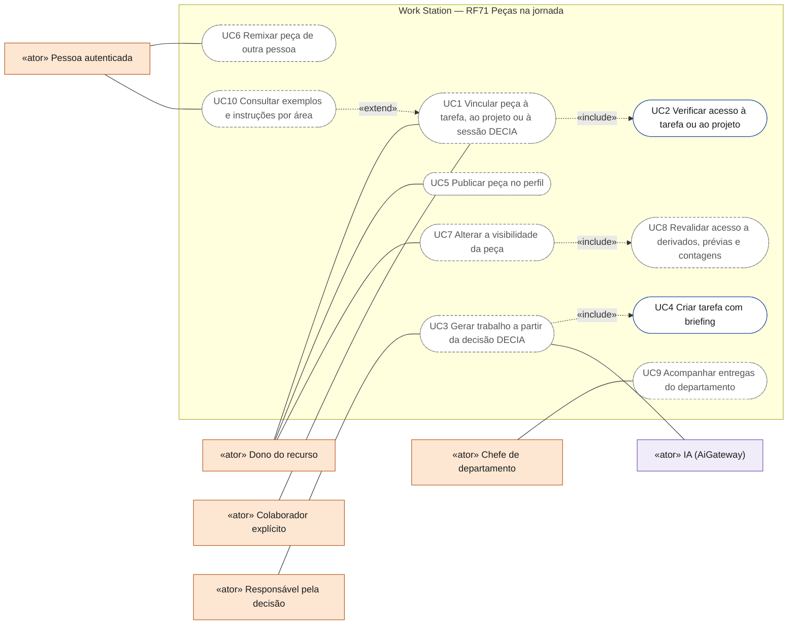
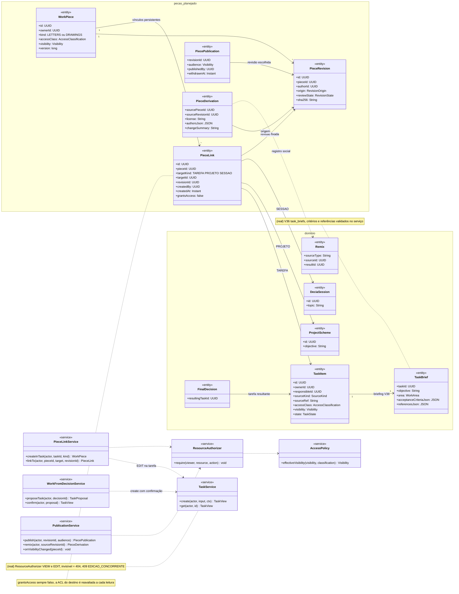
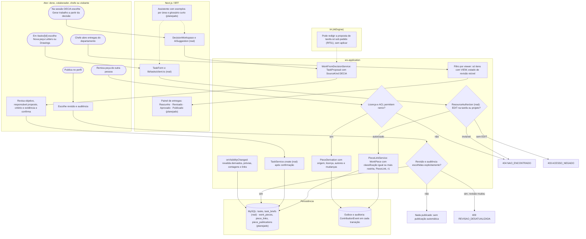
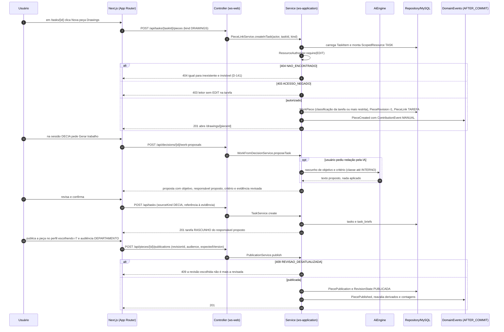
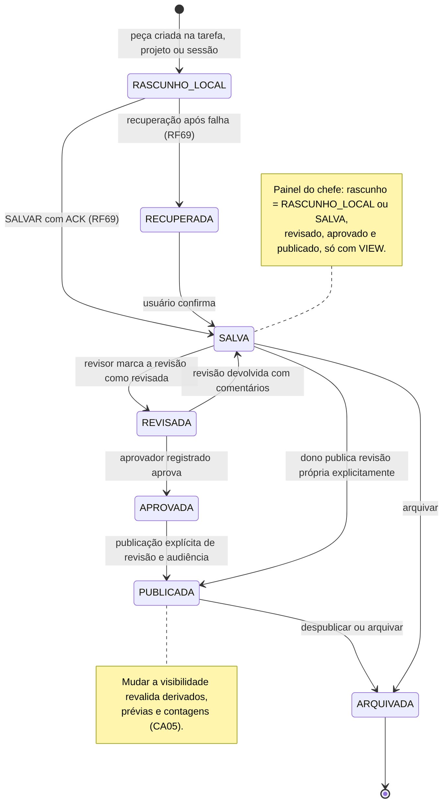
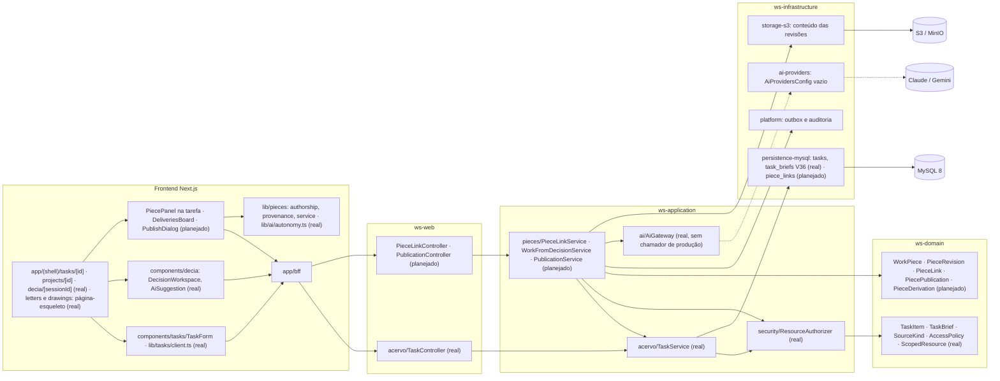

# RF71 — Integrar peças Letters e Drawings à jornada de tarefas, projetos e DECIA
**HU:** — (sem HU no board; RF especificado em 15/10/2026) · **Sprint (board Work Station):** lista *Requisitos Funcionais* sem sprint atribuída · **Equivalente FAI:** — · **Aba/rota:** Letters (`/letters`, `/letters/[pieceId]`) e Drawings (`/drawings`, `/drawings/[pieceId]`); peça aberta a partir de `/tasks/[id]`, `/projects/[id]` e da sessão DECIA `/decia/[sessionId]` · **Página-esqueleto:** registrada em 17/10/2026; editores ainda não implementados (Ondas 3–5 do PLANO_ONDAS)
**Critérios de aceite cobertos:** RF71.CA01 … RF71.CA07 — corpo do card = especificação de docs/produto/requisitos-studio/RF71.md (CAs copiados como estão escritos); classes reais: `TaskItem`, `TaskBrief` (V36 `task_briefs`), `TaskService`, `TaskController`, `ResourceAuthorizer`, `AccessPolicy`, `ScopedResource`, `SourceKind.DECIA`, `lib/tasks/client.ts`, `components/tasks/TaskForm.tsx`, `components/decia/*`, `lib/pieces/service.ts`, `lib/pieces/authorship.ts`, `lib/pieces/provenance.ts`, `lib/ai/autonomy.ts`; o restante (planejado)

Transforma produção e decisões em trabalho rastreável e compartilhável. Uma peça Letters ou Drawings nasce de uma tarefa ou projeto, ou é levada a eles, e pode chegar à sessão DECIA, sempre com o mesmo histórico. O vínculo persistente peça → tarefa → projeto → sessão (`PieceLink`) guarda origem, revisão e acesso em cada transição. Vincular nunca concede acesso: a classificação só restringe, e cada leitura reavalia a ACL do recurso de destino. Uma decisão DECIA vira tarefa proposta, que só é criada com confirmação humana. Publicar no perfil exige escolher a revisão e a audiência. Remix gera derivação com origem, licença, autores e mudanças.

**Estado em 17/10/2026:** a MATRIZ_RF classifica o RF71 como AUSENTE (0,00); a nota de referência do PLANO_ONDAS é 3,45 porque estúdios, tarefa, projeto e decisão não compartilham uma peça nem um histórico. A Onda 3 cria o vínculo persistente e mantém origem, revisão e acesso em cada transição. Já são reais: tarefas com briefing profissional (D-135: objetivo, área, entregáveis, critérios de conclusão e referências; `TaskService` como primeiro chamador do `ResourceAuthorizer`; invisível responde 404, D-141), SIGILOSO = PRIVADA no front (D-137) e sem ADMIN implícito (D-139), o enum `SourceKind` com `DECIA` e `REMIX`, o workspace DECIA com sugestão de IA só após pedido (`components/decia/*`, D-136) e a autoria por cadeia de eventos em `lib/pieces/authorship.ts`. Não há rota de peça, publicação nem remix. A conclusão segue a prova do RF72: CA → teste → evidência.

## Critérios de aceite

| CA | Enunciado (Dado / Quando / Então) |
|---|---|
| **RF71.CA01** | Dada tarefa/projeto, quando cria peça Letters/Drawings, então mantém vínculo, proprietário, visibilidade e revisão persistida. |
| **RF71.CA02** | Dada decisão DECIA, quando gera trabalho, então cria tarefa com objetivo, responsável proposto, critério de aceite e referência à evidência revisada. |
| **RF71.CA03** | Dado perfil profissional, quando publica peça, então exige escolha explícita da revisão e audiência; salvar, seguir, curtir ou compartilhar não concede acesso. |
| **RF71.CA04** | Dado remix, quando autorizado, então cria derivação com origem, licença, autores e mudanças; não infere porcentagens de autoria como prova. |
| **RF71.CA05** | Dado comentário, curtida ou compartilhamento, quando a visibilidade muda, então revalida acesso aos derivados e evita vazamento por prévias e contagens. |
| **RF71.CA06** | Dado chefe/departamento, quando acompanha entregas, então vê apenas dados autorizados e distingue rascunho, revisado, aprovado e publicado. |
| **RF71.CA07** | Dado usuário de qualquer área profissional, quando percorre o fluxo, então recebe exemplos e instruções claros sem exigir terminologia técnica não explicada. |

## Regras do vínculo

| Transição | Origem registrada | Revisão registrada | Acesso |
|---|---|---|---|
| tarefa → peça (criar na tarefa) | `PieceLink` TAREFA, `createdBy`, `ContributionEvent` MANUAL | `PieceRevision` r1 persistida | peça herda classificação da tarefa ou mais restrita; EDIT na tarefa exigido |
| peça → projeto (levar ao projeto) | `PieceLink` PROJETO | revisão escolhida, fixada | membros do projeto não ganham leitura da peça; veem só o que a ACL da peça permite |
| peça → sessão DECIA (anexar como evidência) | `PieceLink` SESSAO | revisão revisada fixada | participante sem VIEW vê "item sem acesso", sem título nem prévia |
| decisão → tarefa | `SourceKind.DECIA` + referência à decisão e à evidência | revisão da evidência citada | tarefa nasce RASCUNHO do responsável proposto só após confirmação |
| peça → perfil (publicar) | `PiecePublication` com autor e data | revisão escolhida explicitamente | audiência escolhida; nunca automática |
| peça → remix | `PieceDerivation` (origem, licença, autores, mudanças) | revisão de origem fixada | só se a licença e a ACL permitirem; derivado não amplia acesso à fonte |

## 0. Diagrama de casos de uso

Casos de uso derivados dos CAs. A tarefa com briefing e a verificação de acesso já são reais; a peça, o vínculo, a publicação e o remix são planejados.

| Caso de uso | Ator(es) | CAs | Situação |
|---|---|---|---|
| UC1 Vincular peça à tarefa, ao projeto ou à sessão DECIA | `dono`, `colaborador` | RF71.CA01 | planejado |
| UC2 Verificar acesso à tarefa ou ao projeto | — (incluído por UC1) | RF71.CA01, RF71.CA06 | real (`ResourceAuthorizer` no `TaskService`; invisível responde 404, D-141) |
| UC3 Gerar trabalho a partir da decisão DECIA | `decisor`, `ia` | RF71.CA02 | planejado (IA só redige sob pedido, RF51) |
| UC4 Criar tarefa com briefing | — (incluído por UC3) | RF71.CA02 | real (`TaskController`, `components/tasks/TaskForm.tsx`, D-135) |
| UC5 Publicar peça no perfil | `dono` | RF71.CA03 | planejado |
| UC6 Remixar peça de outra pessoa | `autenticado` | RF71.CA04 | planejado |
| UC7 Alterar a visibilidade da peça | `dono` | RF71.CA05 | planejado |
| UC8 Revalidar acesso a derivados, prévias e contagens | — (incluído por UC7) | RF71.CA05 | planejado |
| UC9 Acompanhar entregas do departamento | `chefe` | RF71.CA06 | planejado |
| UC10 Consultar exemplos e instruções por área | `autenticado` | RF71.CA07 | planejado |

## 1. Diagrama de classes

Legenda: **(real)** = código no repositório em 17/10/2026; demais classes **(planejado)**. `WorkPiece`, `PieceRevision` e `PieceLink` seguem `LETTERS_DRAWINGS_ENGENHARIA.md` §3; `TaskItem`, `ProjectScheme`, `DeciaSession`, `FinalDecision` e `Remix` usam os nomes e atributos da TAXONOMIA.

## 2. Diagrama de atividades

## 3. Diagrama de sequência

## 4. Máquina de estados

Entidade central: `PieceRevision.reviewState` (planejado), lida pelo painel de entregas do CA06. Estende os estados do RF69 com revisão e aprovação humanas. Cada transição grava autor, data, `ContributionEvent` e `PieceLink` afetado; nenhuma é automática a partir de IA, curtida, seguir ou compartilhar.

## 5. Diagrama de componentes

## 6. Rastreabilidade

| CA | Classe | Passo | Mensagem | Transição | Componente | Prova exigida (RF72) |
|---|---|---|---|---|---|---|
| **RF71.CA01** | `PieceLinkService.createInTask`, `WorkPiece`, `PieceLink` TAREFA, `PieceRevision` r1, `TaskService` (real) | A0 → F1 → P1 → P2 | `POST /api/tasks/{taskId}/pieces` com 404, 403 e 201 | `[*] → RASCUNHO_LOCAL → SALVA` | `PLC`, `PLS`, `TS`, `MY` | teste de serviço e E2E: criar na tarefa, sair, entrar e reabrir com vínculo, dono, visibilidade e revisão iguais |
| **RF71.CA02** | `WorkFromDecisionService`, `TaskBrief` (objetivo, critérios, referências, real), `TaskItem.responsibleId`, `SourceKind.DECIA` | A1 → F2 → P3 → A2 → P4 | `work-proposals`, `POST /api/tasks` | — (tarefa nasce RASCUNHO) | `R3`, `PLS`, `TS` | teste: sem confirmação nada é criado; tarefa traz objetivo, responsável proposto, critério e referência à revisão da evidência |
| **RF71.CA03** | `PublicationService.publish`, `PiecePublication` (revisão e audiência) | A3 → A4 → P5 → E3 | `POST /api/pieces/{id}/publications` com 409 e 201 | `APROVADA → PUBLICADA`, `SALVA → PUBLICADA` | `PLC`, `R4` | teste: salvar, seguir, curtir e compartilhar não mudam ACL; publicar sem escolher revisão é recusado |
| **RF71.CA04** | `PieceDerivation` (origem, licença, autores, mudanças), `Remix`, `lib/pieces/authorship.ts` (`aiShare` é medida do log, mostrada em faixa, nunca prova) | A5 → P6 → P7 | — (`POST /api/pieces/{id}/remixes`) | — | `PLS`, `R5` | teste: remix sem licença é recusado; derivado lista autores e mudanças sem percentual de autoria inferido |
| **RF71.CA05** | `PublicationService.onVisibilityChanged`, `AccessPolicy.effectiveVisibility` (real) | P8 | `PiecePublished` e reavaliação | nota de PUBLICADA | `PLS`, `RA` | teste com duas contas: após restringir, prévia, contagem e link do derivado não revelam a fonte |
| **RF71.CA06** | filtro por viewer, `ResourceAuthorizer` (real), `reviewState` | A6 → P9 → F4 | — (`GET /api/departments/{id}/deliveries`) | `SALVA → REVISADA → APROVADA → PUBLICADA` | `R4`, `RA` | teste: chefe sem colaboração explícita não vê SIGILOSO (D-137, D-139); rótulos dos quatro estados visíveis |
| **RF71.CA07** | assistente com exemplos por área (`WorkArea` real) | F3 | — | — | `R4`, `R2` | teste com tarefas de software, administração, design, pesquisa, marketing e planejamento (roteiro da jornada de 17/10) e revisão de linguagem sem jargão |
