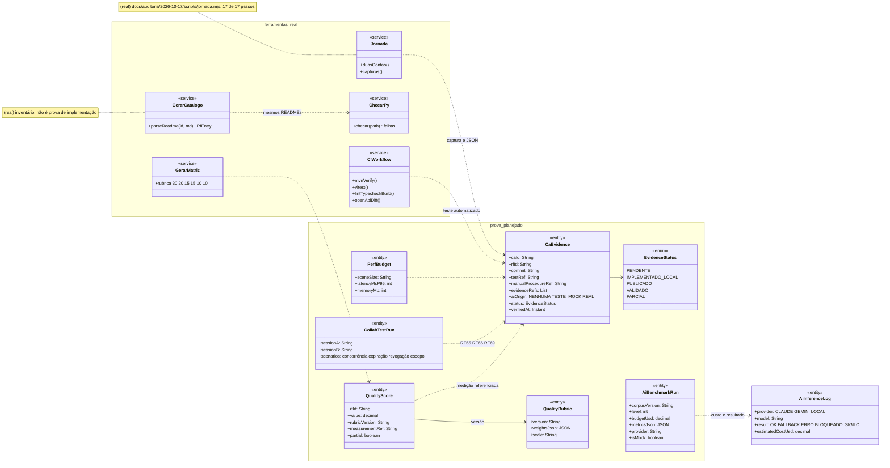
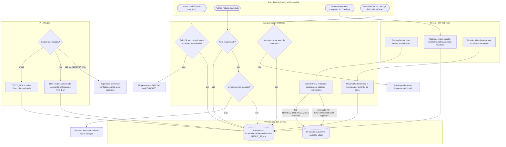
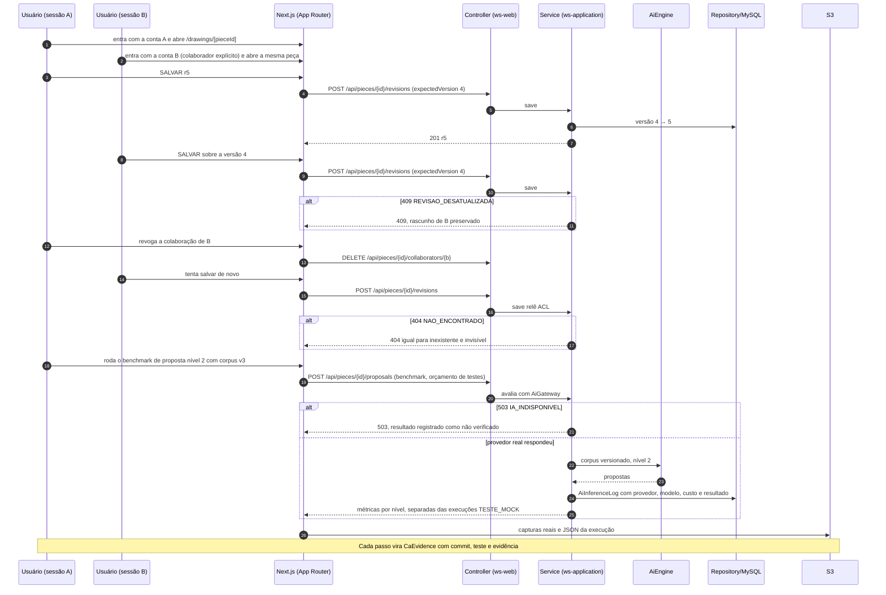
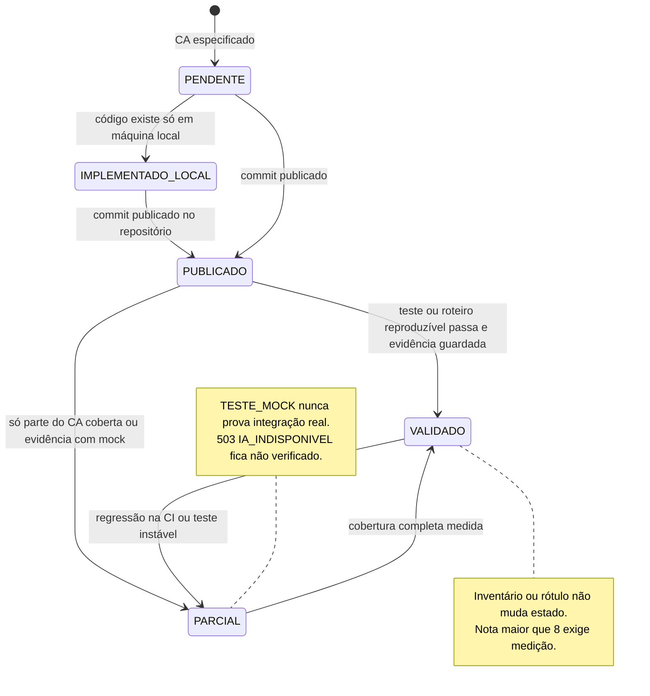
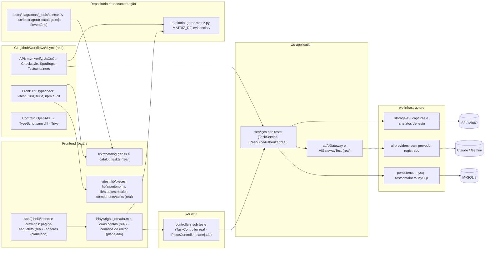

# RF72 — Validar qualidade, desempenho e evidências dos editores
**HU:** — (sem HU no board; RF especificado em 15/10/2026) · **Sprint (board Work Station):** lista *Requisitos Funcionais* sem sprint atribuída · **Equivalente FAI:** — · **Aba/rota:** Letters (`/letters`, `/letters/[pieceId]`) e Drawings (`/drawings`, `/drawings/[pieceId]`); peça aberta a partir de `/tasks/[id]`, `/projects/[id]` e da sessão DECIA `/decia/[sessionId]` · **Página-esqueleto:** registrada em 17/10/2026; editores ainda não implementados (Ondas 3–5 do PLANO_ONDAS)
**Critérios de aceite cobertos:** RF72.CA01 … RF72.CA07 — corpo do card = especificação de docs/produto/requisitos-studio/RF72.md (CAs copiados como estão escritos); classes reais: `.github/workflows/ci.yml` (mvn verify, vitest, lint, typecheck, build, contrato OpenAPI, Trivy), `docs/diagramas/_tools/checar.py`, `scripts/rf/gerar-catalogo.mjs` (`parseReadme`) e `lib/rf/catalog.test.ts`, `docs/auditoria/2026-10-17/scripts/gerar-matriz.py` (rubrica explícita) e `jornada.mjs` (Playwright, duas contas, `evidencias/JORNADA.json`), `AiGatewayTest`, `lib/ai/autonomy.test.ts`, `lib/pieces/*.test.ts`, `lib/studio/selection.test.ts`, `components/tasks/tasks.test.tsx`; o restante (planejado)

Define a prova de conclusão de todo RF dos editores: cada CA aponta para um teste automatizado ou uma validação manual reproduzível, com versão/commit e evidência guardada. Uma funcionalidade só é "concluída" quando todos os CAs do RF têm essa tripla CA → teste → evidência. Notas de qualidade usam rubrica explícita; nota acima de 8 exige medição. Demonstrações do Drawings usam capturas reais do editor. Colaboração se prova com duas sessões autenticadas. IA se avalia com corpus versionado, sem confundir mock com integração real. Acessibilidade e desempenho têm orçamento declarado por tamanho de documento ou cena. O relatório de funcionalidades distingue implementado local, publicado, validado, parcial e pendente; script de inventário não prova implementação.

**Estado em 17/10/2026:** a MATRIZ_RF classifica o RF72 como LÓGICA SEM INTERFACE (0,30 → 0,60). A CI de `main` estava vermelha (npm ci, vitest de `.tsx`) e foi restaurada em `4c6d05e`; `lib/auth/lease.test.ts` ainda é instável (cerca de 1 em 5). A auditoria de 16/10 não era reproduzível: 20 dos 51 componentes citados não existem no repositório, e 50 dos 74 RF se apoiavam neles. Por isso as notas de 17/10 foram refeitas pelo código publicado, com a rubrica de `gerar-matriz.py` (funcionalidade 30 %, eficiência 20 %, visual 15 %, recuperação 15 %, acessibilidade 10 %, feedback 10 %; "n/v" fica fora da média). A jornada real UI → BFF → API → MySQL passou em 17 de 17 passos com duas contas sintéticas e sem IA. Nenhum teste com usuários foi feito, e a qualidade real da IA continua não verificada. Pelo PLANO_ONDAS o RF72 é transversal (nota de referência 5,35): manter a matriz CA → teste → evidência, benchmarks e amostra com usuários reais por domínio e acessibilidade.

## Critérios de aceite

| CA | Enunciado (Dado / Quando / Então) |
|---|---|
| **RF72.CA01** | Dada entrega de RF, quando é marcada como concluída, então cada CA tem evidência, versão/commit e teste ou validação manual reproduzível. |
| **RF72.CA02** | Dadas notas de qualidade, quando publica auditoria, então usa rubrica explícita; nota superior a 8 exige medição e não apenas novo rótulo. |
| **RF72.CA03** | Dados cenários complexos, quando demonstra Drawings, então mostra etapas de criação, wireframe, refino, câmera e resultado final com capturas reais do editor. |
| **RF72.CA04** | Dada colaboração, quando valida, então usa duas sessões autenticadas e testa concorrência, expiração, revogação e escopos sobrepostos. |
| **RF72.CA05** | Dados modelos de IA, quando avalia, então usa corpus/benchmark versionado, orçamento de testes e métricas por nível, sem confundir mocks com integração real. |
| **RF72.CA06** | Dados acessibilidade e desempenho, quando valida, então registra teclado/leitor de tela e orçamento de latência/memória em tamanhos de documento/cena definidos. |
| **RF72.CA07** | Dado catálogo de funcionalidades desejadas, quando gera relatório, então distingue implementado local, publicado, validado, parcial e pendente; script de inventário não conta como prova de implementação. |

## Formato da prova (vale para RF69–RF74)

Cada README de RF dos editores traz, na §6, a coluna "Prova exigida (RF72)". O registro de conclusão de um CA tem estes campos:

| Campo | Conteúdo | Exemplo real de 17/10/2026 |
|---|---|---|
| CA | id copiado da especificação | RF4 (criar tarefa), passo da jornada |
| Versão | commit publicado (não "local") | `97611a0`, `013657a`, `474b6cb` |
| Teste | arquivo e nome do teste, ou roteiro manual numerado | `docs/auditoria/2026-10-17/scripts/jornada.mjs` |
| Evidência | saída versionada ou captura do editor real | `evidencias/JORNADA.json`, `evidencias/04-conflito-edicao-desktop.png` |
| Origem da IA | `NENHUMA`, `TESTE_MOCK` ou provedor real com modelo e data | jornada sem IA |
| Estado | PENDENTE · IMPLEMENTADO_LOCAL · PUBLICADO · VALIDADO · PARCIAL | ver §4 |

## 1. Diagrama de classes

Legenda: **(real)** = scripts, testes e CI no repositório em 17/10/2026; demais classes **(planejado)**. Os registros de prova não são entidades da TAXONOMIA (vivem no repositório de documentação); `AiInferenceLog` é da TAXONOMIA e alimenta o benchmark.

## 2. Diagrama de atividades

## 3. Diagrama de sequência

## 4. Máquina de estados

Entidade central: `CaEvidence.status` (`EvidenceStatus`, planejado), um por CA. O estado do RF é o menor estado entre os seus CAs. Cada transição registra quem verificou, o commit e a evidência; mudar uma rubrica ou um corpus exige nova medição.

## 5. Diagrama de componentes

## 6. Rastreabilidade

| CA | Classe | Passo | Mensagem | Transição | Componente | Prova exigida (RF72) |
|---|---|---|---|---|---|---|
| **RF72.CA01** | `CaEvidence` (commit, teste, evidência), coluna "Prova exigida" das §6 de RF69–RF74 | A0 → P1 → E1 | Note final da sequência | `PUBLICADO → VALIDADO` | `CI`, `MX` | toda conclusão de RF lista CA, commit, teste e evidência; RF sem a tripla completa fica PARCIAL |
| **RF72.CA02** | `QualityRubric`, `QualityScore.measurementRef`, `GerarMatriz` (rubrica real) | A1 → P2 → P3 → E2 | — | nota de VALIDADO | `MX` | auditoria publicada traz rubrica versionada; nota > 8 aponta medição reproduzível |
| **RF72.CA03** | `CaEvidence.evidenceRefs` com capturas | A2 → F2 | `FE->>S3` capturas reais | `PUBLICADO → VALIDADO` | `PW`, `S3A` | sequência de capturas do editor publicado: criação, wireframe, refino, câmera e resultado |
| **RF72.CA04** | `CollabTestRun` (sessões A e B) | F1 → P4 | `UB` recebe 409 `REVISAO_DESATUALIZADA` e 404 após revogação | — | `PW`, `CT` | E2E com duas contas autenticadas cobrindo concorrência, expiração, revogação e escopos sobrepostos |
| **RF72.CA05** | `AiBenchmarkRun` (corpus, nível, orçamento, `isMock`), `AiInferenceLog` | I1 → I2 ou I3 → E3 | `alt 503 IA_INDISPONIVEL` e ramo do provedor real | nota de PARCIAL | `AG`, `AIP` | corpus versionado, orçamento declarado, métricas por nível e separação explícita de `TESTE_MOCK` |
| **RF72.CA06** | `PerfBudget`, verificação de teclado e leitor de tela | F3 → P5 | — | `PUBLICADO → VALIDADO` | `PW`, `R1` | relatório com tamanhos de cena definidos, p95 de latência, memória e roteiro de leitor de tela |
| **RF72.CA07** | `EvidenceStatus` (cinco estados), `GerarCatalogo` como inventário | A3 → P6 → E4 | — | toda a máquina | `CK`, `RF`, `MX` | relatório do catálogo com os cinco estados; teste garante que inventário sozinho não marca VALIDADO |
