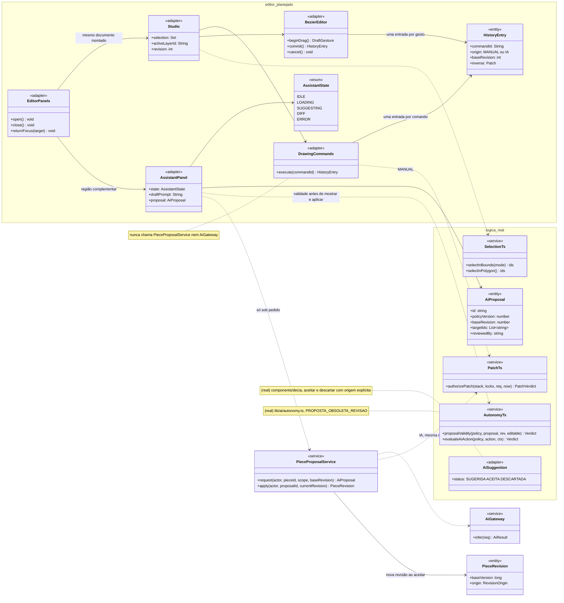
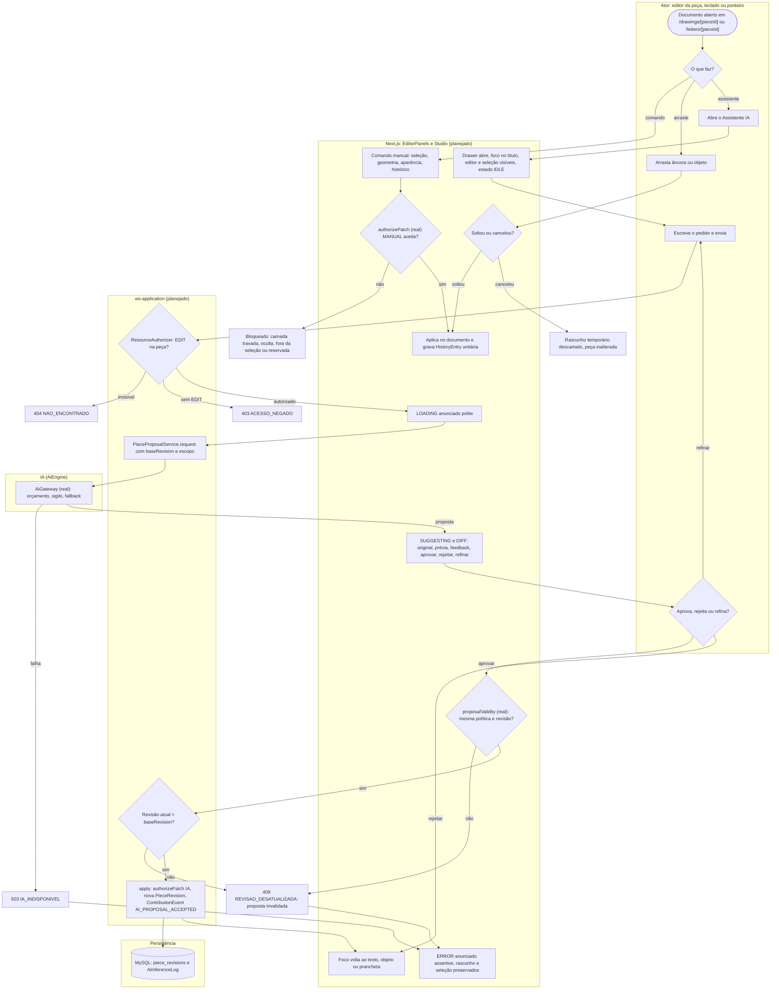
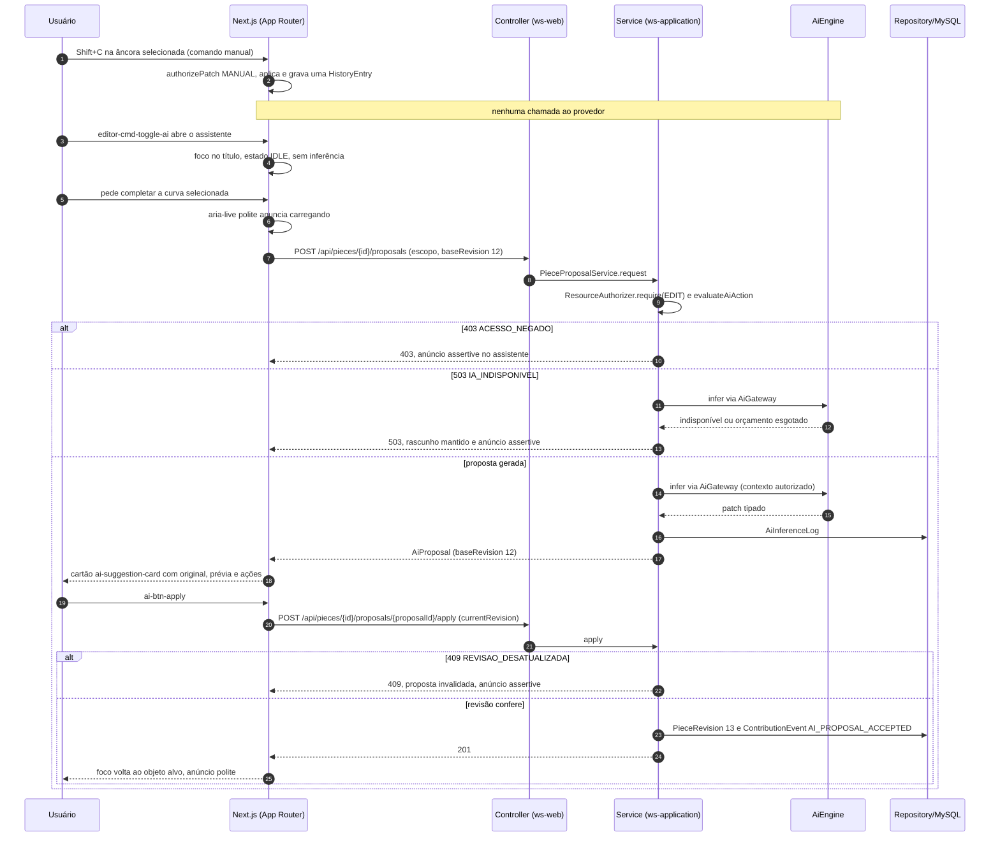
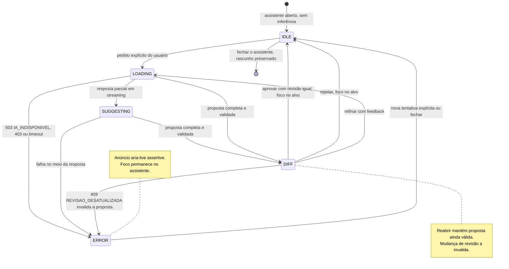
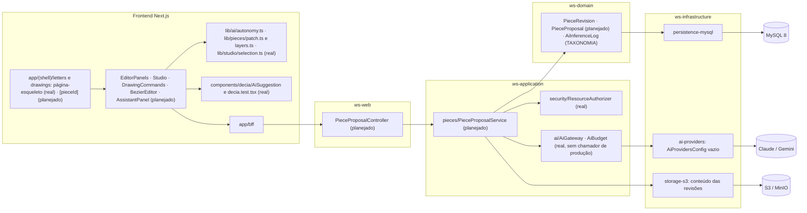

# RF73 — Separar editor determinístico e Assistente IA com navegação acessível
**HU:** — (sem HU no board; RF especificado em 16/10/2026) · **Sprint (board Work Station):** lista *Requisitos Funcionais* sem sprint atribuída · **Equivalente FAI:** — · **Aba/rota:** Letters (`/letters`, `/letters/[pieceId]`) e Drawings (`/drawings`, `/drawings/[pieceId]`); peça aberta a partir de `/tasks/[id]`, `/projects/[id]` e da sessão DECIA `/decia/[sessionId]` · **Página-esqueleto:** registrada em 17/10/2026; editores ainda não implementados (Ondas 3–5 do PLANO_ONDAS)
**Critérios de aceite cobertos:** RF73.CA01 … RF73.CA10 — corpo do card = especificação de docs/produto/requisitos-studio/RF73.md (CAs copiados como estão escritos); classes reais: `lib/ai/autonomy.ts` (`AiProposal`, `proposalValidity`, `evaluateAiAction`, `MODE_CAPABILITIES`), `lib/pieces/patch.ts` (`authorizePatch` único para MANUAL e IA), `lib/pieces/layers.ts`, `lib/studio/selection.ts`, `components/decia/AiSuggestion.tsx` e `decia.test.tsx`, `AiGateway`; o restante (planejado)

Separa a edição determinística das propostas de IA sem trocar de documento. O editor e a seleção continuam visíveis enquanto o Assistente IA ocupa uma região complementar lateral, retrátil e nomeada. Abrir o assistente não inicia inferência. Comandos manuais de seleção, geometria, aparência e histórico aplicam direto no documento e nunca chamam o provedor. Cada proposta mostra original, prévia, feedback, aprovar, rejeitar e refinar, com estado assíncrono explícito (`idle`, `loading`, `suggesting`, `diff`, `error`). O foco é previsível, carregamento e erro são anunciados por `aria-live`, um arraste vira uma única ação reversível e a mudança de revisão invalida propostas antigas.

**Estado em 17/10/2026:** a MATRIZ_RF classifica o RF73 como AUSENTE (0,00), porque não há rota de editor no app. A nota de referência 6,95 do PLANO_ONDAS vem da prévia local de 16/10 (`docs/produto/ARQUITETURA_PAINEIS_EDITOR_IA.md`, capturas em `docs/auditoria/2026-10-16/paineis-bezier/`), cujos módulos `EditorPanels`, `Studio`, `DrawingCommands`, `BezierEditor`, `DrawingJourney`, `LettersAgent`, `AssetWorkbench` e `png-preview` não estão no repositório (a auditoria de 17/10 não encontrou `components/studio/*`). São reais a regra única de autorização de patch para edição manual e IA, a validade de proposta por política e revisão (`PROPOSTA_OBSOLETA_REVISAO`), a seleção por janela, cruzamento e laço e o cartão de sugestão do DECIA com aceitar e descartar. Pelo PLANO_ONDAS o RF73 entra na Onda 5 (Drawings): consolidar contratos de comandos e estados e testar foco, responsividade e preservação de rascunho. A conclusão segue a prova do RF72: CA → teste → evidência.

## Critérios de aceite

| CA | Enunciado (Dado / Quando / Então) |
|---|---|
| **RF73.CA01** | Dado um documento aberto, quando abre o Assistente IA, então mantém editor e seleção visíveis, com região complementar retrátil identificada e sem iniciar inferência. |
| **RF73.CA02** | Dados os comandos manuais, quando executa seleção, geometria, aparência ou histórico, então aplica deterministicamente no documento e não aciona o provedor de IA. |
| **RF73.CA03** | Dada proposta de IA, quando apresenta, então distingue original, prévia, feedback, aprovar, rejeitar e refinar; estado assíncrono explicita idle/loading/suggesting/diff/error. |
| **RF73.CA04** | Dado uso por teclado, quando abre/fecha o drawer ou conclui proposta, então gerencia foco de forma previsível e preserva navegação Tab sem armadilha. |
| **RF73.CA05** | Dada sugestão aceita ou rejeitada, quando a operação termina, então devolve foco ao texto, objeto ou prancheta correspondente; falhas permanecem anunciadas no assistente. |
| **RF73.CA06** | Dados carregamento e erro, quando surgem, então os anuncia respectivamente por aria-live polite e assertive; controles possuem nomes acessíveis. |
| **RF73.CA07** | Dada troca de painel ou fechamento do assistente, quando reabre, então mantém rascunho, seleção, histórico e proposta ainda válida; alterações de revisão invalidam propostas antigas. |
| **RF73.CA08** | Dado um arraste contínuo, quando solta ou cancela, então registra uma única ação reversível ou descarta o rascunho temporário; comandos devem usar histórico unitário. |
| **RF73.CA09** | Dados componentes, quando altera matemática geométrica, transporte de IA ou acessibilidade, então testes isolados cobrem o módulo e os fluxos integrados cobrem foco, concorrência e rejeição de resposta obsoleta. |
| **RF73.CA10** | Dados comandos e cards, quando testa a UI, então usa identificadores editor-cmd-{comando}, ai-suggestion-card-{id}, ai-btn-apply/reject e seletores por papel/nome; critérios WCAG são verificados no escopo declarado sem alegar certificação global. |

## Contrato de foco e anúncios

| Evento | Foco vai para | Anúncio | Identificador de teste |
|---|---|---|---|
| abrir o assistente | título da região do assistente | — (nenhuma inferência) | `editor-cmd-toggle-ai` |
| fechar o assistente (botão ou Escape) | botão que o abriu | — | `editor-cmd-toggle-ai` |
| pedir proposta | permanece no formulário do assistente | `aria-live="polite"`: carregando | `editor-cmd-execute-2d` |
| proposta pronta | cartão da proposta | `polite`: proposta disponível | `ai-suggestion-card-{id}` |
| aceitar | texto, objeto ou prancheta alvo | `polite`: aplicada na revisão rN | `ai-btn-apply` / `ai-btn-accept` |
| rejeitar | texto, objeto ou prancheta alvo | `polite`: descartada | `ai-btn-reject` |
| erro ou proposta obsoleta | permanece no assistente | `aria-live="assertive"` | `ai-suggestion-card-{id}` |

O assistente não é modal: não prende o foco nem torna o editor inerte, e a página não ganha um segundo landmark `main`. Campos de texto não disparam atalhos de comando.

## 1. Diagrama de classes

Legenda: **(real)** = código no repositório em 17/10/2026; demais classes **(planejado)**. As classes de interface seguem a tabela de responsabilidades de `ARQUITETURA_PAINEIS_EDITOR_IA.md`; `PieceRevision` segue `LETTERS_DRAWINGS_ENGENHARIA.md` §3.

## 2. Diagrama de atividades

## 3. Diagrama de sequência

## 4. Máquina de estados

Entidade central: `AssistantPanel.state` (`AssistantState`, planejado). A prévia de 16/10 só tinha `idle`, `loading`, `diff` e `error`; `suggesting` com fila e cancelamento remoto é parte desta especificação e do RF74. Aceitar grava revisão e `ContributionEvent`; rejeitar registra a decisão sem alterar a peça.

## 5. Diagrama de componentes

## 6. Rastreabilidade

| CA | Classe | Passo | Mensagem | Transição | Componente | Prova exigida (RF72) |
|---|---|---|---|---|---|---|
| **RF73.CA01** | `EditorPanels.open`, `AssistantPanel` (região nomeada, não modal) | A3 → F5 | `editor-cmd-toggle-ai` sem requisição de rede | `[*] → IDLE` | `R2` | E2E: abrir o drawer não gera requisição; editor e seleção continuam visíveis em desktop e celular |
| **RF73.CA02** | `DrawingCommands.execute`, `authorizePatch` MANUAL (real), `SelectionTs` (real) | A1 → F1 → F2 → F3 | Note: nenhuma chamada ao provedor | — | `R2`, `R3` | teste: comandos de seleção, geometria, aparência e histórico com o provedor espionado e zero chamadas |
| **RF73.CA03** | `AssistantState`, `AiProposal`, `AiSuggestion` (real) | F6 → F7 → A5 | cartão com original, prévia e ações | `IDLE → LOADING → SUGGESTING → DIFF` | `R2`, `R4` | teste de componente com os cinco estados e as seis ações rotuladas |
| **RF73.CA04** | `EditorPanels.returnFocus`, contrato de foco | F5 → F9 | `editor-cmd-toggle-ai` | `IDLE → [*]` | `R2` | E2E só com teclado: abrir, fechar com Escape, Tab sai do drawer sem armadilha |
| **RF73.CA05** | `EditorPanels.returnFocus(target)` | A5 → F9; F10 | `ai-btn-apply` e resposta 201 | `DIFF → IDLE` | `R2` | teste: após aceitar ou rejeitar, `document.activeElement` é o alvo; erro continua visível no assistente |
| **RF73.CA06** | regiões `aria-live` polite e assertive | F6; F10 | anúncios polite e assertive | `IDLE → LOADING`, `LOADING → ERROR` | `R2` | teste de anúncios e verificação axe de nomes acessíveis no escopo declarado |
| **RF73.CA07** | `AssistantPanel.draftPrompt`, `proposalValidity` (real, `PROPOSTA_OBSOLETA_REVISAO`) | F8 → E6 | 409 `REVISAO_DESATUALIZADA` | `DIFF → ERROR` e nota de DIFF | `R2`, `R3` | teste: fechar e reabrir mantém rascunho, seleção, histórico e proposta; nova revisão invalida a proposta |
| **RF73.CA08** | `BezierEditor.beginDrag/commit/cancel`, `HistoryEntry` | A2 → F4 → F3 ou E2 | — (local) | — | `R2` | teste: um gesto gera uma entrada de histórico; cancelar deixa a peça com hash igual |
| **RF73.CA09** | testes isolados de `bezier-edit`, `autonomy`, `patch`, `selection` e fluxos integrados | todo o fluxo | 409 e 503 da sequência | `DIFF → ERROR` | `R3`, `R4`, `PPS` | vitest por módulo (já existem `autonomy.test.ts`, `patch.test.ts`, `selection.test.ts`) e E2E de foco, concorrência e resposta obsoleta |
| **RF73.CA10** | identificadores `editor-cmd-*`, `ai-suggestion-card-*`, `ai-btn-apply/reject` | contrato de foco | todas as mensagens com testId | — | `R2` | testes usam testId e `getByRole` com nome; relatório WCAG declara escopo e não alega certificação global |
