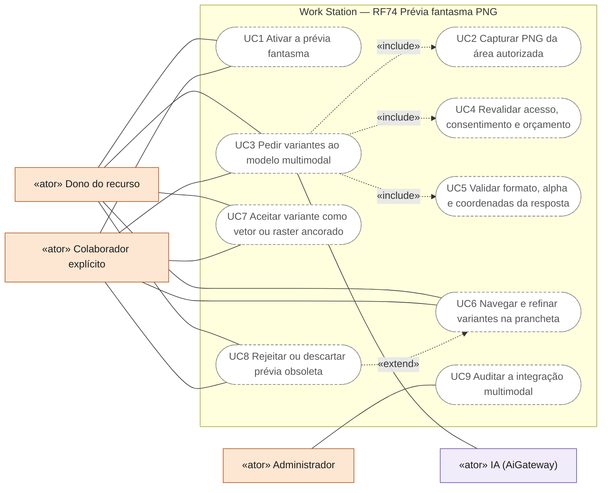
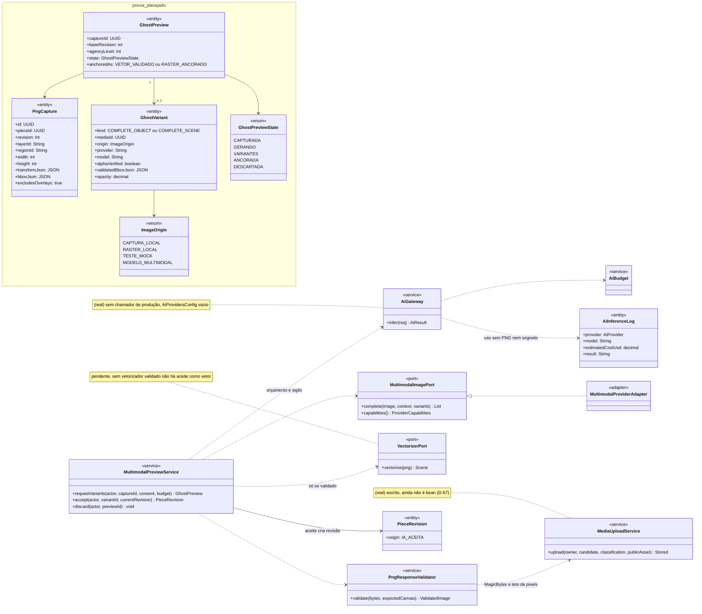
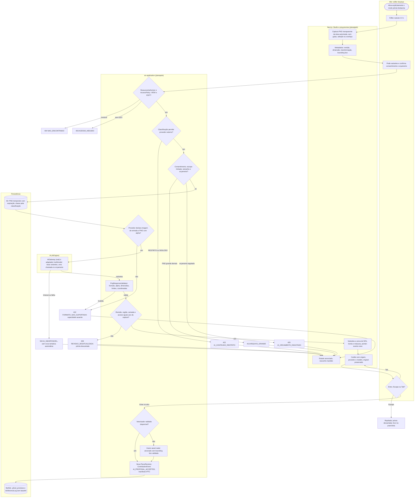
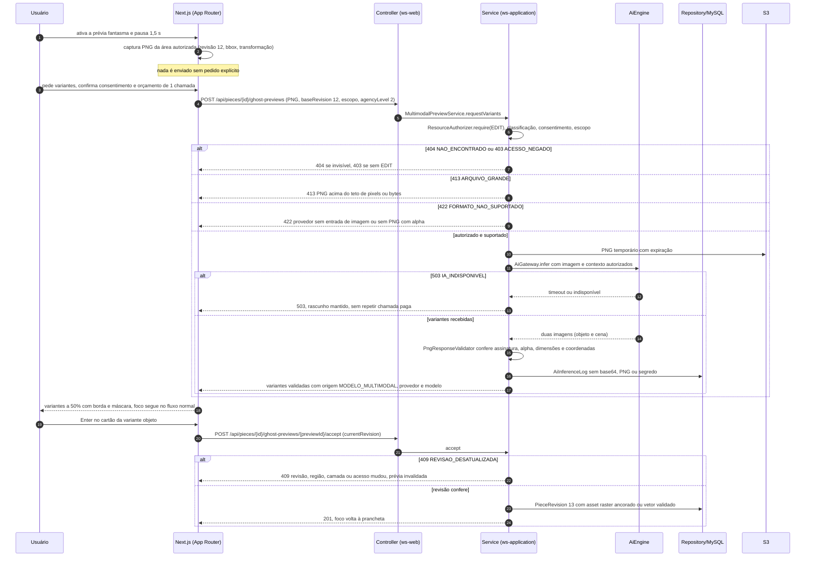
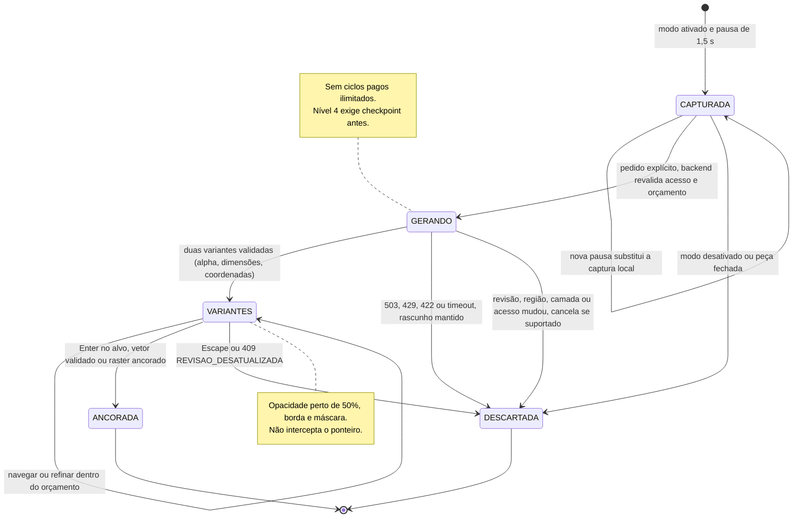
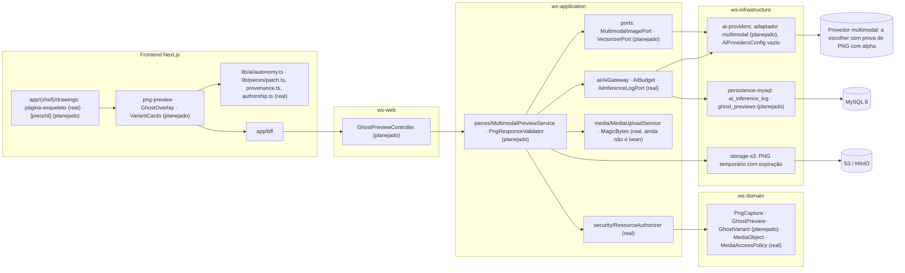

# RF74 — Capturar PNG e oferecer prévia fantasma multimodal no Drawings
**HU:** — (sem HU no board; RF especificado em 16/10/2026) · **Sprint (board Work Station):** lista *Requisitos Funcionais* sem sprint atribuída · **Equivalente FAI:** — · **Aba/rota:** Drawings (`/drawings`, `/drawings/[pieceId]`); peça aberta a partir de `/tasks/[id]`, `/projects/[id]` e da sessão DECIA `/decia/[sessionId]` · **Página-esqueleto:** registrada em 17/10/2026; editores ainda não implementados (Ondas 3–5 do PLANO_ONDAS)
**Critérios de aceite cobertos:** RF74.CA01 … RF74.CA12 — corpo do card = especificação de docs/produto/requisitos-studio/RF74.md (CAs copiados como estão escritos); classes reais: `AiGateway` (`503 IA_INDISPONIVEL`, `422 IA_CONTEUDO_RESTRITO`), `AiBudget` (`429 IA_ORCAMENTO_ESGOTADO`), `AiInferenceLogPort`, `MediaUploadService` e `MagicBytes` (PNG pelo conteúdo, teto de 40 MP; ainda não é bean — D-67), `MediaAccessPolicy`, `MediaObject`, `ResourceAuthorizer`, `AccessPolicy`, `lib/ai/autonomy.ts`, `lib/pieces/patch.ts` (`authorizePatch`, `aiScopeIsBounded`), `lib/pieces/provenance.ts` (`IPTC_DIGITAL_SOURCE`), `lib/pieces/authorship.ts`; o restante (planejado)

Com o modo ativado explicitamente, uma pausa de 1,5 s na edição captura um PNG transparente só da área autorizada, junto com revisão, dimensão, transformação e bounding box, sem overlays nem interface. Capturar não é enviar. A inferência remota só acontece depois que o backend revalida autenticação, ACL, classificação, consentimento, escopo, tamanho, limites e orçamento. Um provedor com suporte efetivo a imagem de entrada e PNG transparente de saída devolve duas variantes ("completar objeto" e "completar cena"). As variantes são verificadas em formato, alpha, dimensões e coordenadas, e aparecem sobre a prancheta a cerca de 50% de opacidade, com borda e máscara, sem interceptar o desenho. O aceite converte por vetorizador validado ou insere asset raster ancorado. Nunca promete vetor editável que não existe.

**Estado em 17/10/2026:** a MATRIZ_RF classifica o RF74 como AUSENTE (0,00) no app. A nota de referência 4,3 do PLANO_ONDAS vem da prévia local de 16/10 (`docs/produto/PREVIEW_PNG_MULTIMODAL_DRAWINGS.md`): ali o PNG fantasma é rasterização local de uma proposta vetorial e o teste usa provedor `TESTE_MOCK`, ou seja, não é geração multimodal. O contrato JSON daquele documento (`contextual_drawing_completion`, `baseRevision`, `scope`, `inputImageRef`, `variants`, `agencyLevel`, `budget`) é proposta, não endpoint. Nenhum provedor está registrado no backend (`AiProvidersConfig` vazio; o enum da TAXONOMIA tem CLAUDE, GEMINI e LOCAL). A escolha anterior de OpenAI e a possibilidade Gemini dependem de prova de saída PNG com alpha. Pelo PLANO_ONDAS o RF74 entra na Onda 5: captura → backend multimodal → duas variantes alpha → ancoragem → aceite, com custo, versão e ACL testados. A conclusão segue a prova do RF72: CA → teste → evidência.

## Critérios de aceite

| CA | Enunciado (Dado / Quando / Então) |
|---|---|
| **RF74.CA01** | Dado modo explicitamente ativado, quando há pausa de 1,5 segundo na edição, então captura PNG transparente da área autorizada e metadados de revisão, dimensão, transformação e bounding box, sem capturar overlays ou interfaces. |
| **RF74.CA02** | Dada imagem pronta, quando solicita inferência remota, então backend revalida autenticação, ACL, classificação, consentimento, escopo, tamanho, limites e orçamento; captura local não equivale a autorização de envio. |
| **RF74.CA03** | Dado provedor com suporte efetivo a entrada de imagem e saída PNG transparente, quando executa, então envia imagem e contexto autorizados e retorna variantes para completar objeto e completar cena; capacidades não suportadas produzem erro explícito. |
| **RF74.CA04** | Dada resposta, quando valida, então verifica formato, alpha, dimensões, limites e coordenadas; não confia em coordenadas do modelo sem validação e não executa conteúdo ativo ou URLs arbitrárias. |
| **RF74.CA05** | Dada proposta válida, quando exibe, então coloca PNG sobre a prancheta com opacidade configurável próxima a 50%, borda e máscara da área; imagem não intercepta ações de desenho. |
| **RF74.CA06** | Dadas variantes, quando navega ou refina, então preserva original e contexto, mostra origem/provedor e distingue rasterização local de vetores de PNG efetivamente gerado por modelo multimodal. |
| **RF74.CA07** | Dado aceite, quando aprova, então converte em vetor por pipeline validado ou insere asset raster suportado com ancoragem explícita; sem suporte não promete vetor editável nem insere imagem como vetor fictício. |
| **RF74.CA08** | Dado Enter, Escape e Tab, quando usa ações, então Enter aceita no alvo correto, Escape rejeita e Tab mantém navegação por padrão; aceitar via Tab exige ativação e foco na prancheta. |
| **RF74.CA09** | Dada revisão, região, camada ou acesso alterado enquanto processa, quando a resposta chega, então descarta ou invalida a prévia, cancela trabalho pendente quando suportado e impede sobrescrita de conteúdo novo. |
| **RF74.CA10** | Dados níveis 1–4, quando utiliza a prévia, então respeita RF51: leitura/sugestão/transformação local/plano agêntico autorizados, checkpoints e limites; publicar ou ampliar escopo não ocorre automaticamente. |
| **RF74.CA11** | Dados indisponibilidade, custo limite, timeout ou falha de vetorização, quando ocorrer, então mantém rascunho, anuncia estado e não inicia ciclos pagos ilimitados; registra uso sem vazar PNG ou segredos em logs. |
| **RF74.CA12** | Dada auditoria, quando valida integração, então separa mock, captura local, PNG gerado por modelo e integração real; testa alpha, alinhamento, revisão obsoleta, aceitação/rejeição, acessibilidade e orçamento com evidências reproduzíveis. |

## Origem da imagem e níveis de autonomia

| Origem exibida no cartão | O que é | Pode ser chamada de "gerada por modelo"? |
|---|---|---|
| `CAPTURA_LOCAL` | PNG da área autorizada, feito no navegador | não |
| `RASTER_LOCAL` | rasterização local de proposta vetorial (prévia de 16/10) | não |
| `TESTE_MOCK` | resposta interceptada em teste | não |
| `MODELO_MULTIMODAL` | PNG devolvido pelo provedor, com provedor, modelo e `inferenceId` | sim, depois da validação de alpha, dimensões e coordenadas |

Os níveis 1–4 da especificação (`LETTERS_DRAWINGS_ENGENHARIA.md` §2) convivem com os cinco modos de `lib/ai/autonomy.ts` (D-136). Este é o mapeamento proposto, a confirmar no RF51: MANUAL = prévia desligada; nível 1 leitura = SOB_SOLICITACAO; nível 2 sugestão = SUGESTOES; nível 3 transformação local = ASSISTIDO (aplica só a proposta revisada na mesma revisão); nível 4 plano agêntico = AGENTE (mandato, checkpoint antes de cada passo, `AGENT_LIMITS`). Em nenhum nível há publicação nem ampliação de escopo.

## 0. Diagrama de casos de uso

Casos de uso derivados dos CAs. Todos são planejados: nenhum provedor multimodal está registrado e a prévia local de 16/10 não está no repositório.

| Caso de uso | Ator(es) | CAs | Situação |
|---|---|---|---|
| UC1 Ativar a prévia fantasma | `dono`, `colaborador` | RF74.CA01, RF74.CA10 | planejado |
| UC2 Capturar PNG da área autorizada | — (incluído por UC3) | RF74.CA01 | planejado (captura local não autoriza envio) |
| UC3 Pedir variantes ao modelo multimodal | `dono`, `colaborador`, `ia` | RF74.CA03, RF74.CA11 | planejado (nenhum provedor registrado) |
| UC4 Revalidar acesso, consentimento e orçamento | — (incluído por UC3) | RF74.CA02, RF74.CA11 | planejado (regras reais em `AiGateway` e `AiBudget`) |
| UC5 Validar formato, alpha e coordenadas da resposta | — (incluído por UC3) | RF74.CA04, RF74.CA09 | planejado |
| UC6 Navegar e refinar variantes na prancheta | `dono`, `colaborador` | RF74.CA05, RF74.CA06, RF74.CA08 | planejado |
| UC7 Aceitar variante como vetor ou raster ancorado | `dono`, `colaborador` | RF74.CA07, RF74.CA08 | planejado |
| UC8 Rejeitar ou descartar prévia obsoleta | `dono`, `colaborador` | RF74.CA08, RF74.CA09 | planejado |
| UC9 Auditar a integração multimodal | `admin` | RF74.CA12 | planejado (separa mock, captura local e modelo real) |

## 1. Diagrama de classes

Legenda: **(real)** = código no repositório em 17/10/2026; demais classes **(planejado)**. `MediaObject` e `AiInferenceLog` seguem a TAXONOMIA; `PieceRevision` segue `LETTERS_DRAWINGS_ENGENHARIA.md` §3.

## 2. Diagrama de atividades

## 3. Diagrama de sequência

## 4. Máquina de estados

Entidade central: `GhostPreview.state` (`GhostPreviewState`, planejado). Cada transição grava origem da imagem, provedor e modelo quando houver, `inferenceId`, custo e autor. Só o aceite gera `PieceRevision` e `ContributionEvent`; o manifesto de proveniência usa o tipo de fonte IPTC de `lib/pieces/provenance.ts` (real).

## 5. Diagrama de componentes

## 6. Rastreabilidade

| CA | Classe | Passo | Mensagem | Transição | Componente | Prova exigida (RF72) |
|---|---|---|---|---|---|---|
| **RF74.CA01** | `PngCapture` (revisão, dimensão, transformação, bbox, `excludesOverlays`) | A0 → A1 → F1 → F2 | captura local e Note sem envio | `[*] → CAPTURADA` | `R2` | teste com relógio controlado: só dispara com o modo ativo; PNG com alpha, sem guias nem seleção |
| **RF74.CA02** | `MultimodalPreviewService.requestVariants`, `ResourceAuthorizer`, `AiGateway`, `AiBudget` (real) | A2 → P1 → P2 → P3 | `POST .../ghost-previews` com 404, 403 e 413 | `CAPTURADA → GERANDO` | `MPS`, `RA`, `AG` | teste de serviço: cada verificação recusa sozinha; captura local sem pedido não gera requisição |
| **RF74.CA03** | `MultimodalImagePort.capabilities`, `MultimodalProviderAdapter`, `GhostVariant.kind` | P4 → I1 | 422 `FORMATO_NAO_SUPORTADO` e "duas imagens" | `GERANDO → VARIANTES` | `PORTS`, `AIP` | teste de contrato do adaptador e execução real registrada com provedor, modelo e data |
| **RF74.CA04** | `PngResponseValidator`, `MediaUploadService` e `MagicBytes` (real) | I1 → P5 | `PngResponseValidator confere assinatura, alpha...` | `GERANDO → DESCARTADA` | `MPS`, `MUS` | corpus adverso: JPEG renomeado, PNG sem alpha, dimensão errada, coordenadas fora da área, SVG com script |
| **RF74.CA05** | `GhostVariant.opacity`, `GhostOverlay` | F3 | variantes a 50% com borda e máscara | nota de VARIANTES | `R2` | E2E: clique e arraste atravessam a prévia; opacidade configurável; captura do editor |
| **RF74.CA06** | `ImageOrigin`, `GhostVariant.provider/model`, tabela de origem desta página | F4 | origem `MODELO_MULTIMODAL`, provedor e modelo | `VARIANTES → VARIANTES` | `R2`, `R3` | teste: rótulo de origem correto para captura local, raster local, mock e modelo |
| **RF74.CA07** | `VectorizerPort` (pendente), `GhostPreview.anchoredAs` | P7 → P8 → P9 | `accept` com 201 | `VARIANTES → ANCORADA` | `PORTS`, `MPS` | teste: sem vetorizador o aceite cria asset raster ancorado e nunca objeto vetorial |
| **RF74.CA08** | atalhos do cartão e da prancheta | A3 | Enter no cartão da variante | `VARIANTES → ANCORADA` ou `→ DESCARTADA` | `R2` | E2E de teclado: Enter no alvo, Escape rejeita, Tab navega; aceitar via Tab só com opção ativa e foco na prancheta |
| **RF74.CA09** | `GhostPreview.baseRevision`, `proposalValidity` (real) | P6 → E8 | 409 `REVISAO_DESATUALIZADA` | `GERANDO → DESCARTADA`, `VARIANTES → DESCARTADA` | `MPS`, `R3` | teste: editar, trocar camada ou perder acesso durante a geração descarta a resposta sem sobrescrever |
| **RF74.CA10** | `GhostPreview.agencyLevel`, `MODE_CAPABILITIES` e `AGENT_LIMITS` (real), mapeamento desta página | A2 → P3 | `agencyLevel 2` no pedido | nota de GERANDO | `R3`, `MPS` | teste por nível: nível 1 não aplica, nível 4 grava checkpoint; nenhum nível publica ou amplia escopo |
| **RF74.CA11** | `AiBudget` (429), `AiGateway` (503), `AiInferenceLog` sem base64 | I1 → E7 → F5 | `alt 503 IA_INDISPONIVEL` | `GERANDO → DESCARTADA` | `AG`, `MY` | teste: timeout não repete chamada; inspeção de logs sem PNG, base64 ou chave |
| **RF74.CA12** | `ImageOrigin`, `CaEvidence` do RF72 | todo o fluxo | toda a sequência | toda a máquina | `R2`, `MPS`, `AIP` | relatório separando mock, captura local, PNG de modelo e integração real, com alpha, alinhamento, revisão obsoleta, aceite, rejeição, acessibilidade e orçamento |
