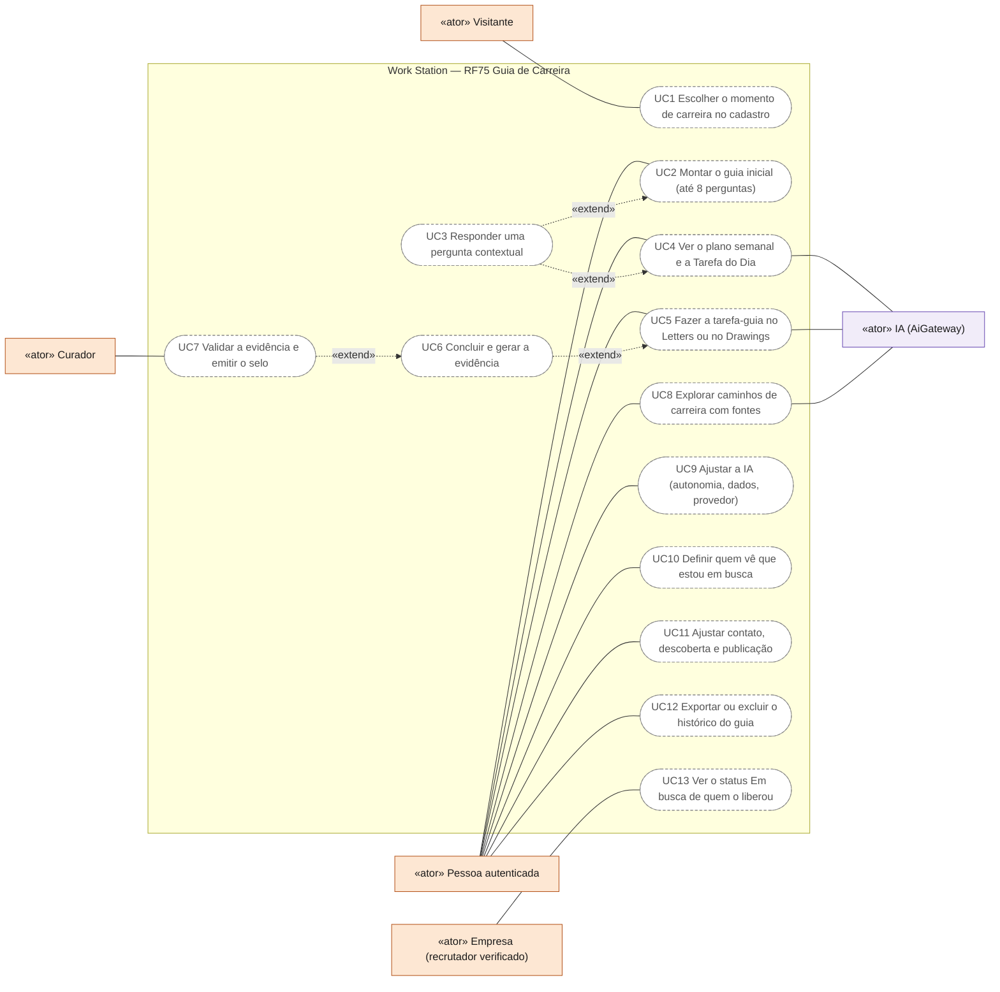
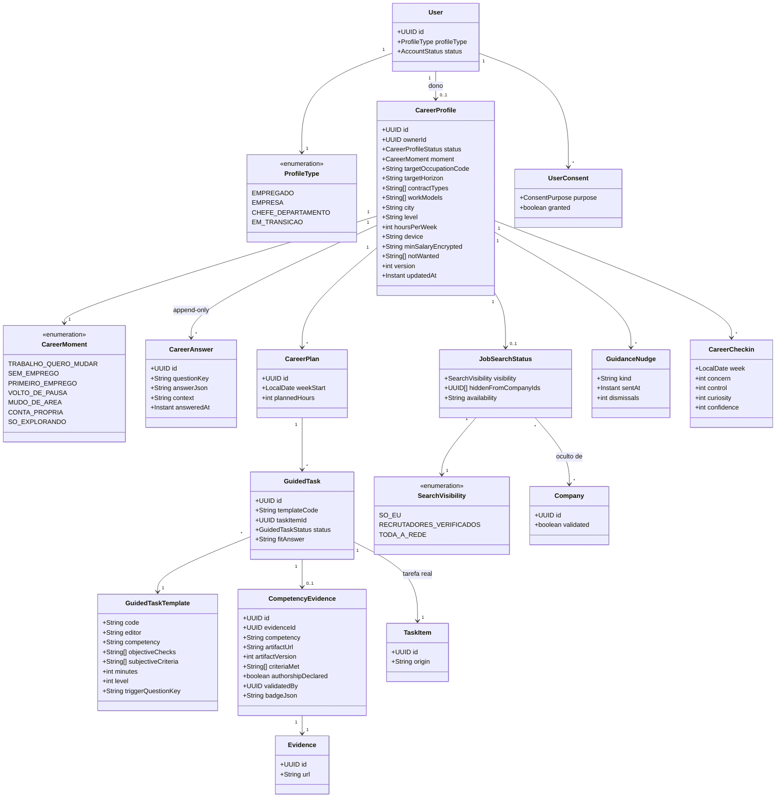
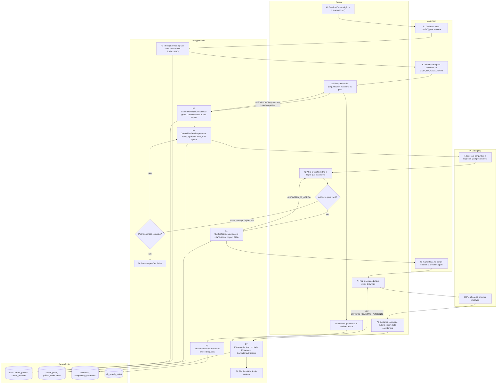
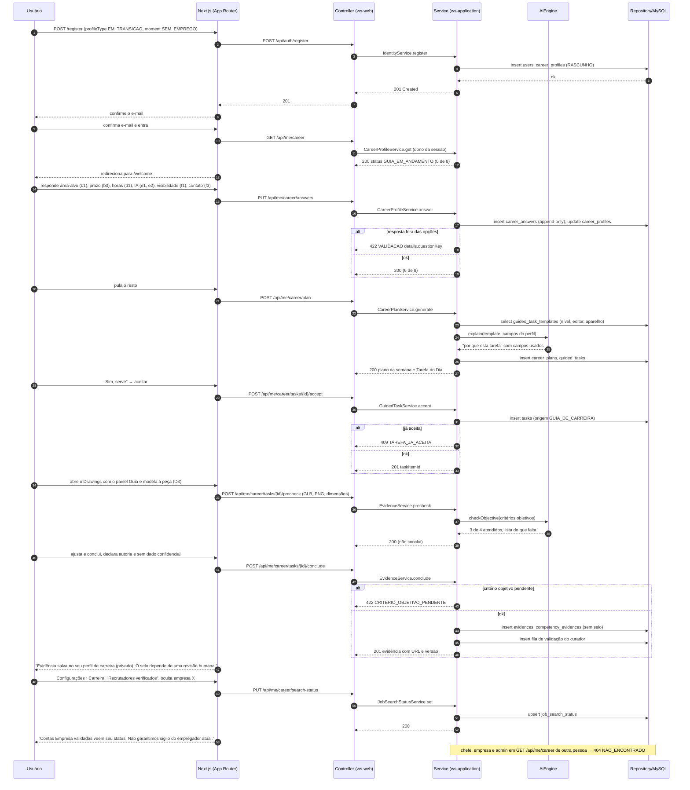
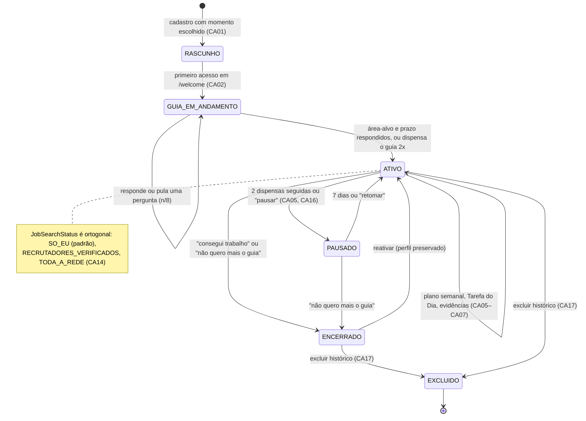
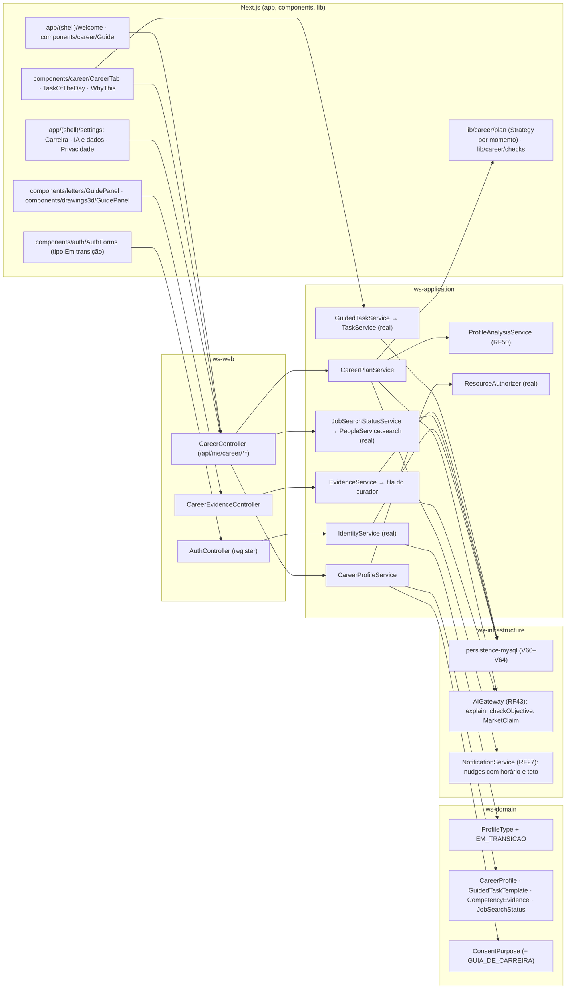

# RF75 — Work Station Career Guidance: guiar a pessoa em transição de carreira com perguntas, tarefas-guia e evidências
**HU:** — · **Aba/rota:** Guia de Carreira (`/profile?tab=carreira`; guia inicial em `/welcome`; Tarefa do Dia em `/profile?tab=tarefa-do-dia`; caminhos em `/insights?tab=perfil`; controles em `/settings?tab=carreira`, `ia` e `privacidade`; painel Guia dentro de `/letters` e `/drawings`) · **Página-esqueleto:** a registrar; jornada ainda não implementada.
**Critérios de aceite cobertos:** RF75.CA01 … RF75.CA18 — requisito novo pedido pelo usuário em 31/10/2026 ("Work Station Career Guidance — Guia de Carreira do Work Station"), derivado da auditoria [`GUIA_DE_CARREIRA.md`](../../auditoria/2026-10-31/GUIA_DE_CARREIRA.md); todos planejados. No código existem só as bases: tipos de conta e perfil (RF1, RF3), especialidades e visibilidade (`lib/account/publication.ts`), modos de autonomia (RF51, `lib/ai/autonomy.ts`), consentimentos (`ConsentPurpose.RESUMO_PROFISSIONAL_IA`), tarefas reais (RF4), seguir (RF16), editores Letters (esqueleto) e Drawings (3D real).

**Trello:** [RF75 Work Station Career Guidance (Guia de Carreira do Work Station)](https://trello.com/c/IbMkAppV/241-rf75-work-station-career-guidance-guia-de-carreira-do-work-station-guiar-a-pessoa-em-transi%C3%A7%C3%A3o-de-carreira-com-perguntas-tarefas) (card 241, criado em 31/10/2026).

**Estado:** novo requisito especificado; implementação pendente. **Nome de produto:** Guia de Carreira (Work Station Career Guidance). **Origem:** solicitação do usuário em 31/10/2026, a partir da auditoria da persona em recolocação. **Relação com o RF50:** o RF50 (Análise de Perfil) é o motor de análise e sugestão; o RF75 é a **jornada completa** que o envolve — a porta de entrada (tipo de conta e perguntas), o plano de tarefas-guia nos editores, as evidências, os controles de IA e de rede e as mensagens. O RF75 fornece ao RF50 o perfil de carreira que o CA01 dele pede e consome as quatro saídas (tarefas, projetos, caminhos, pessoas).

**História de usuário:** Como pessoa que busca recolocação ou mudança de carreira, quero que o Work Station me pergunte, aos poucos e no momento certo, o que descreve meu momento, o que quero e quanto tempo tenho, e a partir disso me proponha tarefas concretas no Letters e no Drawings que provem minhas competências, com a IA explicando cada sugestão e eu decidindo o que fica visível na rede, para construir um perfil com evidências sem ser avaliada, ranqueada ou exposta.

**Experiência central:** "O que descreve seu momento?" no cadastro; "Vamos montar seu guia" em cinco minutos no primeiro acesso; uma Tarefa do Dia com "por que esta tarefa", critério de aceite e a peça aberta no editor; ao concluir, uma evidência com URL e versão no perfil de carreira, privado por padrão; a pessoa escolhe quem vê que está em busca.

**Decisão de dados (D-147, proposta neste RF):** `DADOS_DE_PERFIL_POR_TIPO.md` §4 e §10.7 classificam o sinal "procurando emprego" e a pretensão salarial como "proibido sem base". O RF75 dá a base: **finalidade** declarada (orientação da própria pessoa), **consentimento** específico ao ativar o guia, armazenamento em área privada (`career_profiles`) fora do perfil público, visibilidade do status só nos níveis que a pessoa escolher (padrão "só eu") e salário nunca exibido a terceiros nem usado para ordenar. Quem não ativa o guia não tem esses campos.

## Critérios de aceite

| CA | Dado / quando / então |
|---|---|
| RF75.CA01 | Dado o cadastro, quando a pessoa escolhe o tipo de conta, então além de Empregado, Empresa e Chefe existe **Em transição** (`ProfileType.EM_TRANSICAO`, sem validação, ativa ao confirmar o e-mail) e a pergunta "O que descreve seu momento?" (trabalho e quero mudar · estou sem emprego · primeiro emprego · volto depois de uma pausa · mudo de área · por conta própria · só explorando). Uma conta Em transição vira Empregado (vínculo a empresa) sem perder dados; a dica de Empregado deixa de ser a única opção para pessoa física. |
| RF75.CA02 | Dado o primeiro acesso de uma conta com o guia ativado, quando a confirmação de e-mail ou o login termina, então a pessoa vai para `/welcome` com até oito perguntas (cargo ou área alvo, prazo, sigilo do empregador atual se couber, horas por semana, quanto a IA faz sozinha, que dados a IA lê, quem vê que está em busca, quem pode enviar mensagem), cada uma com "por que pergunto" e "pular"; o guia é retomável e um aviso "Seu guia está n/8" aparece até concluir ou ser dispensado duas vezes; nada bloqueia o uso do sistema. |
| RF75.CA03 | Dado o guia iniciado, quando uma resposta só faz diferença num momento (teste de interesses ao responder "não sei", salário mínimo e lista "não quero" ao ver oportunidades, "tem prova disso?" por competência, público padrão na primeira publicação, check-in semanal de prontidão), então a pergunta aparece nesse momento, uma vez, e nunca repete o que já foi respondido. |
| RF75.CA04 | Dado o perfil de carreira (momento, objetivo, competências, evidências, pausa, salário, lista "não quero", check-ins), quando armazenado ou consultado, então é privado por padrão: chefe, empresa, administrador e curador não têm acesso automático; aparece a terceiros só o que a pessoa marcar campo a campo; `404 NAO_ENCONTRADO` para quem não pode ver. |
| RF75.CA05 | Dado o perfil de carreira confirmado, quando o plano é gerado, então a pessoa recebe um plano semanal e uma Tarefa do Dia do catálogo de tarefas-guia, cada uma com competência comprovada, critério de aceite verificável, evidência esperada, tempo estimado e "por que esta tarefa"; o plano respeita horas por semana e aparelho (tarefas 3D só com computador); "serve para você?" (sim · agora não · nunca este tipo) alimenta o plano e duas dispensas seguidas pausam sugestões por sete dias. |
| RF75.CA06 | Dado uma tarefa-guia aceita, quando a pessoa a abre, então o Letters ou o Drawings abre com um painel lateral Guia (enunciado, critérios, rubrica, "concluir e gerar evidência"); a IA pré-checa só os critérios objetivos (tamanho, campos presentes, cotas que fecham, vistas renderizadas) e nunca os subjetivos; a peça fica na pasta da tarefa e vinculada a ela (RF71). |
| RF75.CA07 | Dado uma tarefa concluída, quando a pessoa confirma, então nasce uma `Evidence` com URL da peça, versão, critérios atendidos, declaração de autoria e de ausência de dado confidencial; o selo de competência só é emitido com validação humana (par, mentor ou curador) e pode ser exportado como Open Badge 3.0; todo rótulo que a IA inferiu mostra "como foi calculado" e "contestar". |
| RF75.CA08 | Dado o progresso da pessoa, quando exibido, então é por evidências e critérios ("3 de 5"), sem score, percentual de empregabilidade, ranking entre pessoas, contagem regressiva ou perda de progresso; sequência, se existir, é semanal e tem pausa sem custo; Hype Score, pontos e popularidade não entram em nenhuma sugestão. |
| RF75.CA09 | Dado qualquer pergunta ou sugestão da IA, quando apresentada, então a IA pergunta em vez de inferir área, senioridade ou situação; explica por que pergunta; cada sugestão traz "por que recebi isto" com os campos usados e "discordo", que corrige o perfil ou descarta a sugestão; inferências ficam marcadas e corrigíveis. |
| RF75.CA10 | Dado o controle "quanto o guia pode fazer sozinho" (só sugerir · rascunhar para eu aprovar · executar rotinas avisando), quando escolhido, então mapeia para SUGESTOES, ASSISTIDO ou AGENTE do RF51 (Manual e Sob solicitação ficam em "mais opções"); em nenhum modo a IA publica, segue, envia mensagem, compartilha ou se candidata sem confirmação explícita; o agente para antes dessas ações. |
| RF75.CA11 | Dado o controle "que dados o guia pode ler" (perfil · currículo · minhas Letters · meus Drawings · mensagens) e "onde a IA roda" (padrão do WS · provedor externo · desligada), quando a IA é chamada, então lê só o escopo marcado; o provedor externo exige consentimento contextual que lista as categorias enviadas e o custo; mensagens e itens RESTRITO/SIGILOSO nunca vão ao provedor externo; "Economia/Avançado" passa a dizer o que sai e o que custa. |
| RF75.CA12 | Dado o perfil de carreira e o material da pessoa, quando coletados ou analisados, então o sistema não pergunta nem infere idade, gênero, estado civil, filhos, gravidez, religião, opinião política, sindicato, raça ou cor, saúde ou deficiência, endereço completo, motivo da demissão ou foto obrigatória; acessibilidade entra como "o que deixa o WS mais fácil para você", gravada como preferência de interface, fora do perfil e da descoberta. |
| RF75.CA13 | Dado uma afirmação sobre vagas, demanda, remuneração ou requisito de mercado, quando exibida, então cita fonte, data e região; sem fonte, diz "estimativa sem fonte atual"; caminhos de carreira são alternativas para explorar e nunca prometem emprego, salário ou prazo. |
| RF75.CA14 | Dado o status "Em busca", quando a pessoa o ativa, então escolhe quem o vê (só eu · recrutadores verificados = contas Empresa validadas pelo RF28 · toda a rede), pode ocultar o perfil de empresas específicas e informar disponibilidade; o padrão é "só eu"; a tela avisa que o sigilo em relação ao empregador atual não é garantido; o status nunca entra em ranking, ordenação ou recomendação a empregadores. |
| RF75.CA15 | Dado os controles de rede (quem pode enviar mensagem, aparecer em buscas e em pessoas semelhantes, mostrar atividade, público padrão das produções, comentários e remix por item), quando exibidos, então cada opção responde "quem verá?", "o que muda?" e "vale para itens antigos?"; mudar o padrão não republica o acervo; a pessoa só é sugerida a outras se marcou participar (RF50.CA16). |
| RF75.CA16 | Dado as mensagens do guia, quando enviadas, então a primeira interação diz "Sou uma IA; minhas sugestões não garantem entrevista, emprego nem salário"; há no máximo um lembrete proativo por dia, dentro do horário escolhido, com pausa de sete dias após duas dispensas; nenhuma mensagem culpa a pessoa, usa contagem regressiva falsa ou "confirmshaming"; os modos Manual e Sob solicitação não geram lembretes. |
| RF75.CA17 | Dado o histórico do guia (respostas, análises, sugestões, evidências), quando a pessoa pede, então exporta tudo e exclui análises e respostas dentro das regras de retenção; revogar um consentimento invalida sugestões pendentes no servidor; conta trocada no mesmo aparelho não vê nada da anterior; eventos guardam autoria e referência de inferência sem copiar currículo ou texto sensível. |
| RF75.CA18 | Dado qualquer tela da jornada, quando renderizada, então não mostra identificadores internos (selos "RFnn", "Q-30", "Bloco 3", "Esqueleto da etapa"), nem jargão técnico ("tokens", "ponto de restauração", "ferramentas determinísticas") fora de "mais opções"; funciona por teclado, com estrutura semântica, e distingue informação confirmada, inferência e proposta (RF50.CA15). |

## Perguntas, abas e tarefas

O banco de 40 perguntas (perfil, tarefas, IA, rede), a ordem (cadastro → primeiro acesso → contextuais → Configurações), as abas e sub-abas, as mensagens e o catálogo de 20 tarefas-guia (L1–L10 no Letters, D1–D10 no Drawings) estão em [`GUIA_DE_CARREIRA.md`](../../auditoria/2026-10-31/GUIA_DE_CARREIRA.md) §4, §6, §7 e §8 e valem como anexo deste RF.

## 0. Diagrama de casos de uso

Quem usa o Guia de Carreira e para quê. Atores do catálogo de [`ATORES_E_ATRIBUTOS.md`](../../arquitetura/ATORES_E_ATRIBUTOS.md) §2. O guia é da própria pessoa: chefe, empresa e administrador não aparecem como atores; a Empresa validada só recebe o status "Em busca" quando a pessoa escolhe "recrutadores verificados". Todos os casos são planejados.

| Caso de uso | Ator(es) | CAs | Situação |
|---|---|---|---|
| UC1 Escolher o momento de carreira no cadastro (tipo Em transição) | Visitante | RF75.CA01 | planejado |
| UC2 Montar o guia inicial (até 8 perguntas, pulável, retomável) | Pessoa autenticada | RF75.CA02, RF75.CA04, RF75.CA12, RF75.CA18 | planejado |
| UC3 Responder uma pergunta contextual (uma vez, no momento certo) | — (estende UC2 e UC4) | RF75.CA03 | planejado |
| UC4 Ver o plano semanal e a Tarefa do Dia ("por que esta tarefa", "serve para você?") | Pessoa autenticada, IA (AiGateway) | RF75.CA05, RF75.CA08, RF75.CA09, RF75.CA16 | planejado |
| UC5 Fazer a tarefa-guia no Letters ou no Drawings (painel Guia, pré-checagem objetiva) | Pessoa autenticada, IA (AiGateway) | RF75.CA06 | planejado |
| UC6 Concluir e gerar a evidência (URL, versão, critérios, autoria) | — (estende UC5) | RF75.CA07 | planejado |
| UC7 Validar a evidência e emitir o selo (par, mentor ou curador; Open Badge 3.0) | Curador | RF75.CA07 | planejado |
| UC8 Explorar caminhos de carreira com fontes identificadas | Pessoa autenticada, IA (AiGateway) | RF75.CA13 | planejado |
| UC9 Ajustar a IA (quanto faz sozinha, que dados lê, onde roda) | Pessoa autenticada | RF75.CA10, RF75.CA11 | planejado |
| UC10 Definir quem vê que estou em busca (três níveis, bloqueio de empresas) | Pessoa autenticada | RF75.CA14 | planejado |
| UC11 Ajustar contato, descoberta e publicação ("quem verá? o que muda?") | Pessoa autenticada | RF75.CA15 | planejado |
| UC12 Exportar ou excluir o histórico do guia | Pessoa autenticada | RF75.CA17 | planejado |
| UC13 Ver o status Em busca de quem o liberou para recrutadores verificados | Empresa (validada, RF28) | RF75.CA14 | planejado |

## Integração com o Work Station

- **RF1/RF3:** tipo de conta Em transição e preferências; `/welcome` entra como destino pós-cadastro e pós-login quando `careerProfile.status = GUIA_EM_ANDAMENTO`.
- **RF50:** recebe o `CareerProfile` como a ficha do CA01; devolve tarefas, projetos, caminhos e pessoas; as quatro saídas passam pelo plano (CA05) antes de virar rascunho (RF50.CA08).
- **RF4/RF41:** cada tarefa-guia aceita é uma `TaskItem` real (origem GUIA_DE_CARREIRA) com `Evidence` (RF41.CA06).
- **RF52–RF56 e RF57–RF74:** o painel Guia dentro dos editores; a peça vinculada à tarefa (RF71); a captura PNG do Drawings (RF74) serve de evidência visual.
- **RF51:** os três controles simples mapeiam para os cinco modos; a regra "IA nunca publica sozinha" vale aqui.
- **RF16, RF46, RF28:** status Em busca com níveis; recrutador verificado = Empresa validada; mensagens só com permissão de contato.
- **RF24/RF25/RF40:** selos de competência por validação humana; nunca por pontos.
- **RF3 bloco C (LGPD):** consentimentos (`ConsentPurpose.GUIA_DE_CARREIRA`, `RESUMO_PROFISSIONAL_IA`), exportação e exclusão.

## Modelo e plano propostos

`CareerProfile` (dono, status, momento, objetivo CBO/ESCO, prazo, regime, modelo, cidade, nível, horas por semana, aparelho, salário mínimo cifrado, lista "não quero", versão) · `CareerAnswer` (pergunta, resposta, quando, contexto) — append-only · `GuidedTaskTemplate` (catálogo L1–L10, D1–D10: competência, editor, critérios objetivos e subjetivos, rubrica, tempo, nível, pergunta-gatilho) · `CareerPlan` (semana, itens, horas previstas) · `GuidedTask` (template, `TaskItem` real, estado, resposta a "serve para você?") · `CompetencyEvidence` (liga `Evidence` à competência: URL, versão, critérios atendidos, autoria declarada, validação, badge) · `JobSearchStatus` (nível de visibilidade, empresas bloqueadas, disponibilidade) · `GuidanceNudge` (tipo, quando, dispensas) · `CareerCheckin` (quatro dimensões, semana).

### Plano de implementação (etapas, cada uma entregável e testável)

| Etapa | Entrega | CAs | Onde no código | Verificação |
|---|---|---|---|---|
| **E1 Porta de entrada** | `ProfileType.EM_TRANSICAO` + pergunta "O que descreve seu momento?" no cadastro; migração `V60__em_transicao.sql`; textos pt-BR/en/es; mudança de tipo sem perda | CA01, CA12, CA18 | `ws-domain/.../identity/ProfileType.java`, `ws-application/.../IdentityService`, `components/auth/AuthForms.tsx`, `lib/i18n/messages/*` | teste de integração do cadastro; e2e `register.spec` com o tipo novo |
| **E2 Perfil de carreira e guia inicial** | `career_profiles` + `career_answers` (`V61`); `GET/PUT /api/me/career`; rota `/welcome` (registry + página); redirecionamento pós-cadastro e pós-login; aviso "n/8"; aba Carreira no perfil (n.16, privada) | CA02, CA03, CA04 | `ws-application/career/`, `ws-infrastructure/persistence-mysql`, `app/(shell)/welcome`, `lib/pages/registry.ts`, `lib/nav/matrix.ts`, `components/career/` | contrato OpenAPI regenerado; teste de autorização (chefe/empresa/admin → 404); e2e do guia pulável e retomável |
| **E3 Controles de IA e rede** | Configurações › IA e dados (e1–e6) sobre as preferências já persistidas no servidor; Configurações › Privacidade real (f1–f7) com "quem verá?"; `JobSearchStatus` (`V62`) com três níveis e bloqueio de empresas; consentimento `GUIA_DE_CARREIRA` | CA10, CA11, CA14, CA15, CA17 | `app/(shell)/settings`, `lib/preferences`, `ws-application/.../PublicationService`, `PeopleService.search` (filtro de descoberta), `ConsentPurpose` | teste com duas contas (status invisível por padrão; recrutador verificado vê; empresa bloqueada não vê); e2e das abas |
| **E4 Catálogo e plano** | `guided_task_templates` semeados com L1–L10 e D1–D10 (`V63`); gerador de plano semanal (puro, testado) a partir do perfil; Tarefa do Dia real no perfil; "serve para você?" e pausa após duas dispensas; nudges com horário e teto diário | CA05, CA08, CA16 | `lib/career/plan.ts` (Strategy por momento), `ws-application/career/CareerPlanService`, `components/career/TaskOfTheDay`, notificações (RF27) | testes do gerador (horas, aparelho, dispensas); e2e da Tarefa do Dia |
| **E5 Painel Guia nos editores e evidência** | Painel lateral no Letters e no Drawings; pré-checagem objetiva (contagem de palavras, campos, cotas, vistas); `CompetencyEvidence` (`V64`) ao concluir; fila de validação do curador; exportação Open Badge 3.0 | CA06, CA07 | `components/letters/GuidePanel`, `components/drawings3d/GuidePanel`, `lib/career/checks/*` (uma Strategy por critério), `ws-application/career/EvidenceService` | testes das checagens; e2e: concluir D3 gera evidência com GLB e PNG; selo só após validação |
| **E6 IA explicável** | "Por que esta sugestão" e "discordo/contestar" em toda saída; perguntas em vez de inferência; `MarketClaim` com fonte, data e região ou "estimativa"; aviso fixo da primeira interação; sub-aba Caminhos em `/insights` sobre o RF50 | CA09, CA13 | `AiGateway` (RF43), `ProfileAnalysisService` (RF50), `components/career/WhyThis`, `components/insights/CareerPaths` | teste de que toda saída carrega campos usados; e2e com motor simulado |
| **E7 Fechamento** | Jargão interno removido das telas; acessibilidade (Axe, teclado, leitor de tela); jornada real UI→BFF→API→MySQL com capturas; matriz, catálogo e Trello atualizados | CA18 e todos | `RfPage` (selos só no laboratório), `docs/auditoria`, `MATRIZ_RF` | nota acima de 8,5 na rubrica; e2e completo em duas contas |

Ordem: E1 → E2 → E3 → E4 → E5 → E6 → E7. E3 e E4 podem andar em paralelo depois de E2. Cada etapa fecha com contrato regenerado (`OpenApiContractIT` + `npm run api:types`), catálogo (`node scripts/rf/gerar-catalogo.mjs`), `verify` do backend, bateria do front e e2e. Nenhuma chamada paga de IA é necessária até E6, e lá o motor simulado basta para os testes.

Validar com perfis: sem emprego há 4 meses, primeiro emprego, mudando de área, empregado com sigilo, pessoa que pula o guia inteiro. Medir: conclusão do guia, tarefas aceitas e concluídas, evidências validadas, dispensas e correções de inferência — nunca como medida de empregabilidade.

## 1. Diagrama de classes

Entidades novas do Guia de Carreira e as reais que elas reutilizam (`User`, `UserPreferences`, `UserConsent`, `TaskItem`, `Evidence`, `Company`).

## 2. Diagrama de atividades

Da escolha do momento no cadastro até a evidência validada, com as raias do projeto.

## 3. Diagrama de sequência

Primeiro acesso, Tarefa do Dia e conclusão com evidência. Erros nomeados como nos CAs.

## 4. Máquina de estados

`CareerProfileStatus`: o ciclo do guia de uma pessoa. "Encerrado" é escolha da pessoa (conseguiu trabalho ou não quer mais o guia); os dados continuam dela até exportar ou excluir.

## 5. Diagrama de componentes

## 6. Rastreabilidade

Mensagens = números do `autonumber` da §3. Passos = nós da §2. Componentes = nós da §5.

| CA | Classe | Passo | Mensagem | Transição | Componente |
|---|---|---|---|---|---|
| RF75.CA01 | `ProfileType.EM_TRANSICAO`, `CareerProfile.moment` (`CareerMoment`), `IdentityService.register` (real, campo novo) | A0 → F1 → P1 → D1 | 1–7 | `[*] → RASCUNHO` | `REG`, `AC`, `IDS`, `PT` |
| RF75.CA02 | `CareerProfile.status`, `CareerProfileService.get/answer`, `CareerAnswer` | P1 → F2 → A1 → P2 | 9–20 | `RASCUNHO → GUIA_EM_ANDAMENTO → ATIVO` | `WEL`, `CC`, `CPS` |
| RF75.CA03 | `CareerAnswer.context`, `questionKey` único por pessoa | A1 → P2 (nunca repete) | 15–20 | `GUIA_EM_ANDAMENTO → GUIA_EM_ANDAMENTO` | `CPS` |
| RF75.CA04 | `CareerProfile.ownerId`, `ResourceAuthorizer` (real, 404 uniforme), `minSalaryEncrypted` | P2 → D1 | 11–12, nota final | — | `CPS`, `RA`, `MYSQL` |
| RF75.CA05 | `CareerPlanService.generate`, `GuidedTaskTemplate` (level, minutes, editor), `GuidedTask.fitAnswer`, `GuidanceNudge.dismissals` | P3 → I1 → A2 → A3 → P5 → P6 | 22–27 | `ATIVO → PAUSADO → ATIVO` | `CAR`, `CPL`, `PLN` |
| RF75.CA06 | `GuidedTaskService.accept` → `TaskItem.origin = GUIA_DE_CARREIRA`, `EvidenceService.precheck`, `objectiveChecks` | P4 → F3 → A4 → I2 | 28–39 | `ATIVO → ATIVO` | `GUI`, `GTS`, `EVS`, `AIG` |
| RF75.CA07 | `EvidenceService.conclude`, `CompetencyEvidence` (artifactUrl, artifactVersion, criteriaMet, authorshipDeclared, validatedBy, badgeJson), fila do curador | A5 → P7 → D3 → P8 | 40–47 | — | `EC`, `EVS` |
| RF75.CA08 | `CompetencyEvidence.criteriaMet` (progresso por contagem), ausência de score e ranking, `GuidanceNudge` semanal com pausa | A2 | 24–27 | `ATIVO ↔ PAUSADO` | `CAR`, `CPL` |
| RF75.CA09 | `AiGateway.explain` (campos usados), "discordo" → `CareerAnswer` corrigida ou `GuidedTask.fitAnswer` | I1 → A2 → A3 | 23–24 | — | `CAR` (WhyThis), `AIG` |
| RF75.CA10 | `UserPreferences.aiAutonomyDefault` (real) mapeado de 3 controles; regra "IA nunca publica" (RF51 `authorizePatch`) | A1 → P2 | 15–18 | — | `SET`, `CPS` |
| RF75.CA11 | escopo de leitura em `UserPreferences`, `UserConsent`/`ConsentPurpose.GUIA_DE_CARREIRA`, `AiGateway` classificação e `PersonalDataMasker` (real) | A1 → P2 → I1 | 15–18, 23 | — | `SET`, `CONS`, `AIG` |
| RF75.CA12 | `CareerProfile` sem campos sensíveis, `SensitiveTraitFilter` (RF50.CA11), acessibilidade em `UserPreferences` | A1 → P2 | 15–18 | — | `WEL`, `CPS` |
| RF75.CA13 | `MarketClaim` (RF50.CA07: citation, sourceDate, geography, estimate) | I1 | 23 | — | `AIG`, `PAS` |
| RF75.CA14 | `JobSearchStatus` (visibility, hiddenFromCompanyIds, availability), `Company.validated` (RF28), `PeopleService.search` filtra | A6 → P9 → D4 | 48–52 | nota de `ATIVO` | `SET`, `JSS` |
| RF75.CA15 | `PublicationService` (real) estendido: contato, descoberta, público padrão, por item; textos "quem verá / o que muda / vale para antigos" | A6 → P9 | 48–52 | — | `SET`, `JSS` |
| RF75.CA16 | `GuidanceNudge` (kind, sentAt, dismissals), `NotificationService` com horário e teto diário, aviso fixo da 1ª interação | P3 → A2, P5 → P6 | 22–27 | `ATIVO → PAUSADO` | `NOTIF`, `CPL` |
| RF75.CA17 | `DataExportRequest` (real), exclusão de `career_*`, revogação de `UserConsent` invalida `GuidedTask` pendentes, `CurrentUserProvider` (real) | — | — | `ATIVO/ENCERRADO → EXCLUIDO` | `CPS`, `CONS`, `MYSQL` |
| RF75.CA18 | `RfPage` sem selos fora do laboratório, textos simples em `lib/i18n`, "mais opções" para o técnico; Axe e teclado | A1, A2, A6 | — | — | `WEL`, `CAR`, `SET` |
