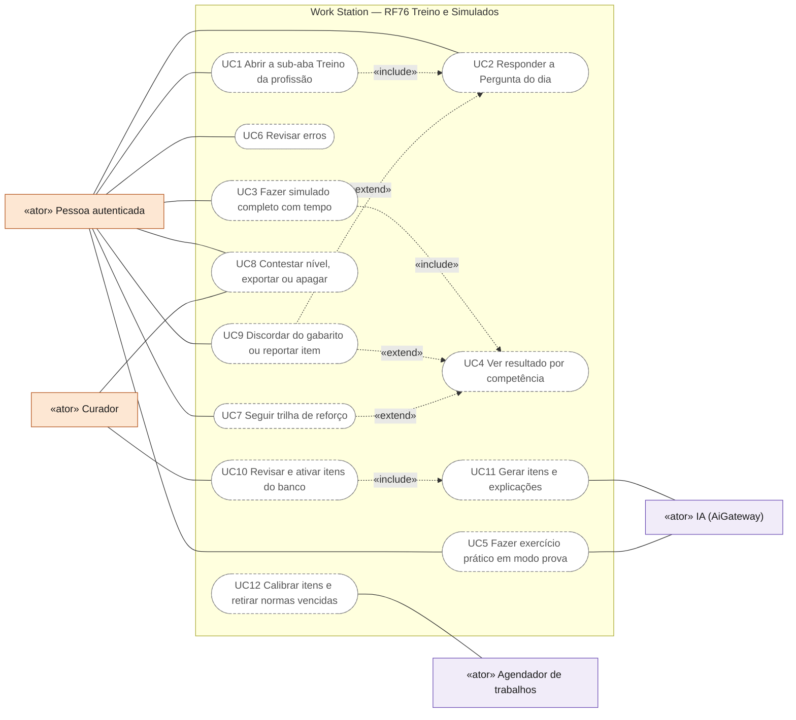
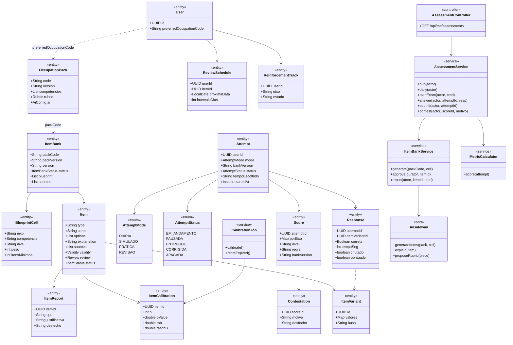
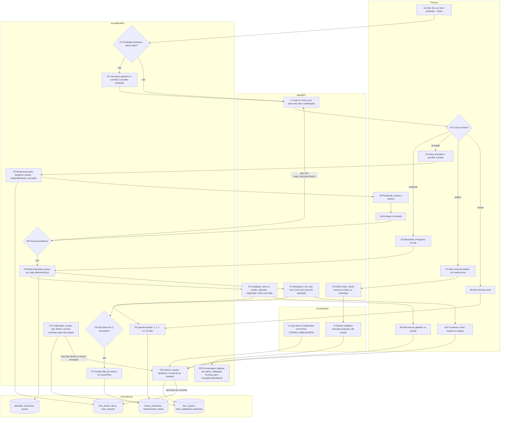
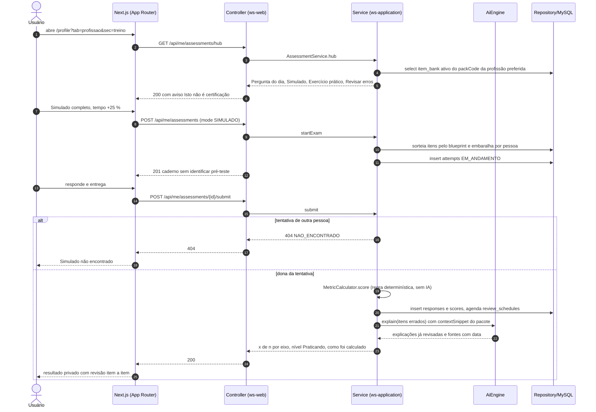
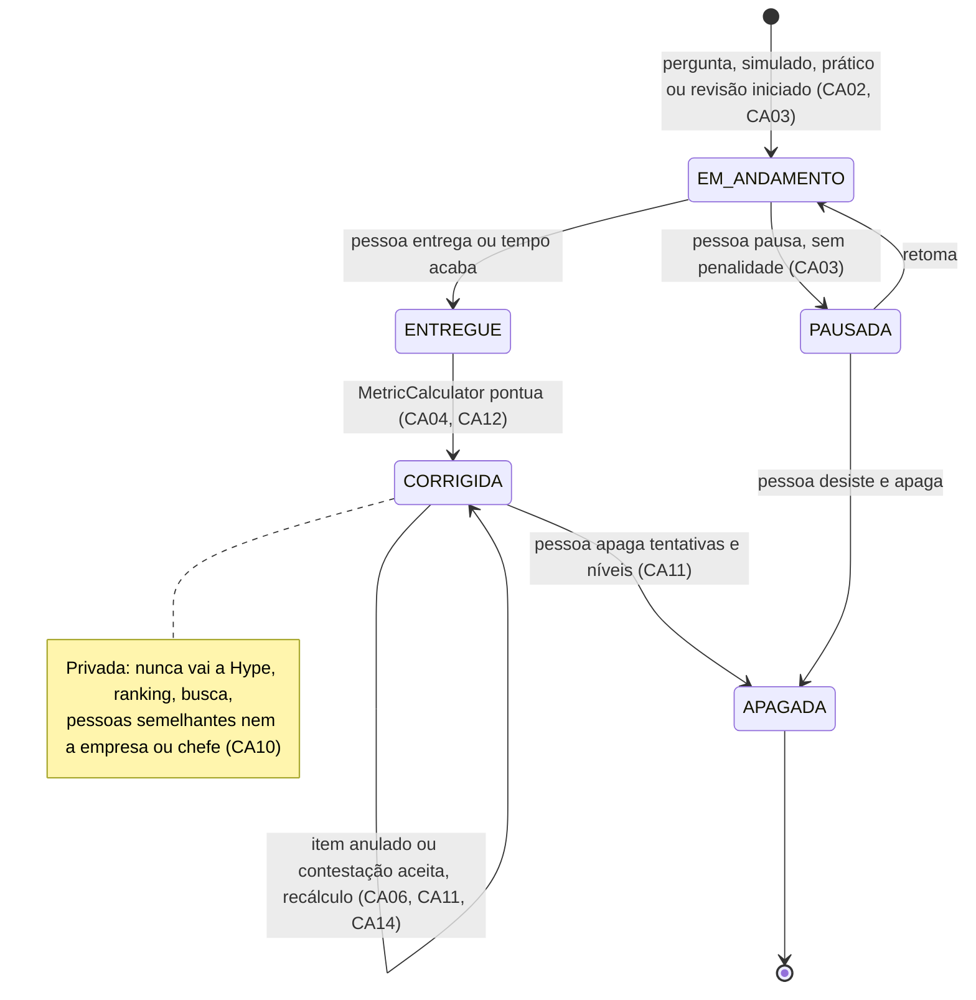
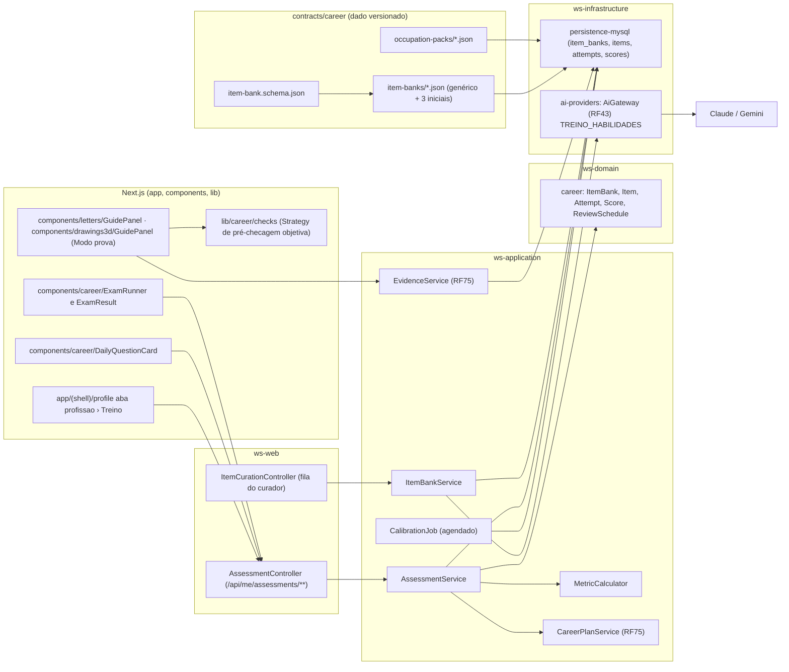

# RF76 — Treino e Simulados por Profissão
**HU:** HU76 · **Aba/rota:** sub-aba **Treino** da aba "Sou um bom <profissão>" (`/profile?tab=profissao&sec=treino`); card "Pergunta do dia" ao lado da Tarefa do Dia (`/profile?tab=tarefa-do-dia`); painel Guia › "Modo prova" no `/letters` e no `/drawings` · **Página-esqueleto:** a registrar; jornada ainda não implementada.
**Critérios de aceite cobertos:** RF76.CA01 … RF76.CA14 — requisito novo pedido pelo dono do produto em 02/11/2026 ("Sou um bom engenheiro de software"), numerado pela decisão D-149 (09/11/2026); derivado da pesquisa [`avaliacao-e-provas.md`](../../auditoria/2026-11-02/fontes/avaliacao-e-provas.md) §5 e do resumo [`ABAS_POR_PROFISSAO.md`](../../auditoria/2026-11-02/ABAS_POR_PROFISSAO.md) §3–§4; todos planejados. Já existem no repositório as bases: profissão preferida (RF75.CA19, RF81), catálogo de ramos e pacotes de domínio (`contracts/career/`), validador (`npm run career:validate`), helpers `lib/career/`, `AiGateway` (RF43), tarefas reais (RF4) e o Drawings 3D.

**Trello:** card a criar no board **Work Station**.

**História de usuário:** COMO pessoa que escolheu uma profissão preferida (ex.: engenharia de software) QUERO responder perguntas atualizadas e de nível acadêmico sobre a minha área, fazer simulados completos com tempo no formato da prova de referência e exercícios práticos corrigidos por rubrica, recebendo na hora a explicação e a fonte de cada resposta e um mapa do que domino e do que preciso rever, PARA saber se sou bom na minha profissão **para mim**, sem que isso vire nota pública, ranking ou sinal para empregadores.

**Experiência central:** na sub-aba Treino, quatro entradas — **Pergunta do dia** (1–3 itens, 2–5 min, feedback imediato com explicação e fonte), **Simulado completo** (formato, quantidade e tempo da prova de referência do pacote: ENADE, 1ª fase OAB, exame do CFC; pausável, tempo estendido como preferência), **Exercício prático** (tarefa-guia L1–L10/D1–D10 em "modo prova" no Letters ou no Drawings, com pré-checagem objetiva da rubrica) e **Revisar erros** (repetição espaçada 1 → 3 → 7 → 14 → 30 dias). O resultado é "x de n" por eixo e competência e um nível nomeado (Iniciando · Praticando · Consistente) com "como foi calculado" e "contestar". Texto fixo em toda tela de resultado: "Isto não é certificação nem nota oficial; é seu treino, só seu".

**Regras herdadas:** `Attempt` e `Score` são privados e não alimentam Hype, ranking (inclusive o RF77), busca, pessoas semelhantes nem telas de empresa, chefe, administrador ou curador; fazer simulados **não é sinal de busca de emprego** (D-147); o escopo é o `OccupationPack` da profissão preferida (D-148); sem proctoring, webcam, rastreio de abas ou IP; a IA gera itens e explicações só com revisão humana e nunca pontua (RF43 D-12); simulados e perguntas não geram evidência — só o exercício prático validado por humano gera `CompetencyEvidence` (RF75.CA07).

## Critérios de aceite

| CA | Dado / quando / então |
|---|---|
| RF76.CA01 | Dado `User.preferredOccupation` preenchido e um `ItemBank` ativo para o pacote (`packCode`, mesma linha de `version`), quando a pessoa abre a sub-aba Treino, então vê a Pergunta do dia, "Simulado completo", "Exercício prático" e "Revisar erros", com o aviso fixo "Isto não é certificação nem nota oficial; é seu treino, só seu"; sem profissão ou sem banco, vê o banco genérico (competências transversais) e o convite para escolher a profissão. |
| RF76.CA02 | Dado a Pergunta do dia, quando a pessoa responde, então recebe na hora certo/errado, a justificativa da alternativa escolhida, a explicação da correta, ao menos uma fonte com título, URL e data (e versão da norma quando houver), os botões "acertei chutando", "discordo do gabarito" e "reportar problema", e o item errado ou chutado entra na fila de revisão espaçada; há no máximo um lembrete por dia e nenhuma sequência punitiva (RF75.CA16, CA08). |
| RF76.CA03 | Dado "Simulado completo", quando iniciado, então o sistema monta a prova pelo `blueprint` do banco no formato da referência do pacote (quantidade de itens, tipos, tempo), sorteia e embaralha itens e alternativas por pessoa, inclui itens de pré-teste não pontuados sem identificá-los, permite pausar e retomar, e aplica o tempo escolhido pela pessoa (padrão, +25 %, +50 %, sem tempo) sem pedir justificativa. |
| RF76.CA04 | Dado o simulado entregue, quando o resultado é exibido, então mostra acertos por eixo e por competência no formato "x de n", o nível nomeado (Iniciando · Praticando · Consistente) com "como foi calculado", a revisão item a item com explicação e fonte, e a comparação apenas com simulados anteriores da própria pessoa; não exibe percentual global destacado, percentil, ranking, "chance de aprovação" ou "empregabilidade". |
| RF76.CA05 | Dado "Exercício prático", quando aceito, então abre uma tarefa-guia L1–L10/D1–D10 parametrizada pelo pacote em modo prova (enunciado, tempo, rubrica visível), a IA pré-checa só os critérios objetivos da rubrica ao concluir, o parecer da IA sobre critérios subjetivos aparece como "proposta da IA — não pontua", a peça fica na pasta da tarefa (RF71) e a pessoa pode pedir validação humana que, se concedida, gera `CompetencyEvidence` (RF75.CA06, CA07). |
| RF76.CA06 | Dado qualquer item exibido, quando foi gerado com apoio de IA, então só chegou à pessoa após `review.reviewedBy` humano, com `sources` não vazias, `rationale` em todas as alternativas e `validity.normRefs` vigentes; item com `reviewBy` vencido ou norma marcada como revogada sai da rotação e, se já estava numa prova em curso, é anulado sem prejuízo para a pessoa. |
| RF76.CA07 | Dado respostas acumuladas, quando um item atinge 30 respostas, então o sistema calcula p-valor, correlação item-total e, com ≥ 50, dificuldade Rasch e ajuste; item fora das faixas (p < 0,15 ou > 0,95, rpb < 0,15, infit/outfit fora de 0,7–1,3) vai à fila do curador e deixa de pontuar; as estatísticas são anonimizadas (sem `userId`) e a dificuldade exibida à pessoa diz "estimada" até a calibração. |
| RF76.CA08 | Dado "Revisar erros", quando aberto, então lista os itens errados ou chutados cujo intervalo venceu (1 → 3 → 7 → 14 → 30 dias, voltando a 1 ao errar), mostra a explicação já lida e um item paramétrico irmão quando existir, e nunca exibe previsões de esquecimento com falsa precisão. |
| RF76.CA09 | Dado um eixo com desempenho baixo em dois simulados ou na Pergunta do dia da semana, quando o plano semanal é gerado, então o guia propõe uma trilha de reforço (itens guiados, leitura do `learning` do pacote, uma tarefa L/D que prove a competência) com "por que recebi isto" e "não me serve" (RF75.CA05, CA09). |
| RF76.CA10 | Dado `Attempt`, `Score` e níveis, quando armazenados ou consultados, então são privados por padrão, não alimentam Hype Score, ranking, busca, pessoas semelhantes, Insight de Equipe, Análise de Perfil visível a terceiros nem qualquer tela de Empresa, chefe, administrador ou curador; `GET` de outra pessoa retorna `404 NAO_ENCONTRADO`; fazer simulados não grava sinal de busca de emprego nem é enviado à empresa a que a conta se vincular depois (RF75.CA04, CA08, CA14; RF50.CA06, CA12; D-147). |
| RF76.CA11 | Dado um nível por competência, quando exibido, então há "como foi calculado" (itens contados, pesos, regra, data, versão do banco) e "contestar", que abre revisão humana com resposta registrada em `AiInferenceLog` e prazo informado; a pessoa pode apagar níveis e tentativas, e exportar tudo em JSON/PDF (LGPD art. 20; RF75.CA17). |
| RF76.CA12 | Dado a geração de itens e explicações pela IA, quando chamada, então passa pelo `AiGateway` com `capability = TREINO_HABILIDADES`, recebe só o `contextSnippet` do pacote e os trechos das fontes (nunca currículo, Letters, Drawings ou mensagens da pessoa), respeita "onde a IA roda" e consentimento `GUIA_DE_CARREIRA`, e a pontuação objetiva é calculada por regra determinística, não pela IA (RF43 D-12; RF75.CA11). |
| RF76.CA13 | Dado itens e telas de prova, quando renderizados, então funcionam por teclado e leitor de tela (grupos de alternativas rotulados, imagens e desenhos com descrição textual equivalente, sem dependência de cor, sem "todas as anteriores"), o validador do banco rejeita item sem texto alternativo ou com termo de dado sensível, e nenhuma tela mostra identificadores internos ou jargão (RF75.CA12, CA18). |
| RF76.CA14 | Dado "discordo do gabarito" ou "reportar problema", quando enviado, então o item é marcado para o curador com a justificativa, a pessoa recebe o desfecho (mantido, corrigido, anulado) e, se anulado, suas tentativas são recalculadas; itens com ≥ 3 reportes abertos saem da rotação até a revisão. |

## 0. Diagrama de casos de uso

| Caso de uso | Ator(es) | CAs | Situação |
|---|---|---|---|
| UC1 Abrir a sub-aba Treino da profissão | Pessoa autenticada | RF76.CA01, RF76.CA13 | planejado |
| UC2 Responder a Pergunta do dia | Pessoa autenticada | RF76.CA02 | planejado |
| UC3 Fazer simulado completo com tempo | Pessoa autenticada | RF76.CA03, RF76.CA13 | planejado |
| UC4 Ver resultado por competência | Pessoa autenticada | RF76.CA04, RF76.CA10 | planejado |
| UC5 Fazer exercício prático em modo prova | Pessoa autenticada, IA | RF76.CA05 | planejado |
| UC6 Revisar erros | Pessoa autenticada | RF76.CA08 | planejado |
| UC7 Seguir trilha de reforço | Pessoa autenticada | RF76.CA09 | planejado |
| UC8 Contestar nível, exportar ou apagar | Pessoa autenticada, Curador | RF76.CA11 | planejado |
| UC9 Discordar do gabarito ou reportar item | Pessoa autenticada | RF76.CA14 | planejado |
| UC10 Revisar e ativar itens do banco | Curador | RF76.CA06, RF76.CA13, RF76.CA14 | planejado |
| UC11 Gerar itens e explicações | IA | RF76.CA06, RF76.CA12 | planejado |
| UC12 Calibrar itens e retirar normas vencidas | Agendador de trabalhos | RF76.CA06, RF76.CA07 | planejado |

## 1. Diagrama de classes

Nota: `Item.options` carrega `rationale` por alternativa; `Item.validity` tem `normRefs` e `reviewBy`; `ItemCalibration` é agregada e anônima (sem `userId`). Reutiliza `TaskItem` (RF4), `Evidence`/`CompetencyEvidence` (RF75.CA07), `CareerPlan`, `UserConsent`, `UserPreferences` (tempo estendido) e `AiInferenceLog`.

## 2. Diagrama de atividades

Do acesso à sub-aba Treino até o resultado privado, a revisão espaçada e a trilha de reforço; à direita, o ciclo do banco de itens.

## 3. Diagrama de sequência

## 4. Máquina de estados

`AttemptStatus` da tentativa (`Attempt`), entidade central do RF.

## 5. Diagrama de componentes

## 6. Rastreabilidade

Mensagens = números do `autonumber` da §3. Passos = nós da §2. Componentes = nós da §5.

| CA | Classe | Passo | Mensagem | Transição | Componente |
|---|---|---|---|---|---|
| RF76.CA01 | `User`, `OccupationPack`, `ItemBank` | A1 → P1 → P2 · F1 | 1–6 | — | `TAB`, `AC`, `AS`, `IBK` |
| RF76.CA02 | `Response`, `ReviewSchedule`, `Item.options` | A3 → P4 → F2 → P5 | — | `[*] → EM_ANDAMENTO → ENTREGUE → CORRIGIDA` | `DAY`, `AS`, `MC` |
| RF76.CA03 | `BlueprintCell`, `ItemVariant`, `Attempt.tempoEscolhido` | A4 → P3 → A5 | 7–12 | `EM_ANDAMENTO ⇄ PAUSADA` | `EXAM`, `AS` |
| RF76.CA04 | `Score`, `MetricCalculator` | A6 → P8 → P4 → F3 | 13–15, 19–25 | `ENTREGUE → CORRIGIDA` | `EXAM`, `MC` |
| RF76.CA05 | `TaskItem`, `CompetencyEvidence`, `AiGateway.proposeRubric` | A7 → F4 → I2 → P9 | — | — | `GUI`, `CHK`, `EVS`, `AIG` |
| RF76.CA06 | `Item.review`, `Item.validity`, `ItemBankService.approve` | I1 → P10 → D1 · P11 | 21–22 | `CORRIGIDA → CORRIGIDA` (item anulado) | `CC`, `IBSV`, `IBS` |
| RF76.CA07 | `ItemCalibration`, `CalibrationJob` | P11 → D4 | — | — | `CJ`, `MYSQL` |
| RF76.CA08 | `ReviewSchedule`, `ItemVariant` | A8 → P5 | — | — | `TAB`, `AS` |
| RF76.CA09 | `ReinforcementTrack` | F3 → P6 → P7 | — | — | `AS`, `CPS` |
| RF76.CA10 | `Attempt`, `Score` (privados) | P8 | 16–18 | nota em `CORRIGIDA` | `AC`, `AS` |
| RF76.CA11 | `Contestation`, `AiInferenceLog` | A10 → P10 | — | `CORRIGIDA → APAGADA` · `CORRIGIDA → CORRIGIDA` | `AC`, `AS` |
| RF76.CA12 | `AiGateway`, `MetricCalculator` | I1 · P4 | 19, 21–22 | `ENTREGUE → CORRIGIDA` | `IBSV`, `AIG`, `EXT`, `MC` |
| RF76.CA13 | `Item` (descrição textual), validador | F1 · F2 · F3 | — | — | `IBS`, `EXAM`, `DAY` |
| RF76.CA14 | `ItemReport` | A9 → P10 → D4 | — | `CORRIGIDA → CORRIGIDA` (recálculo) | `CC`, `IBSV` |
