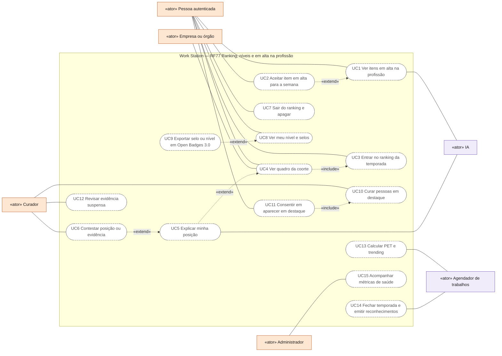
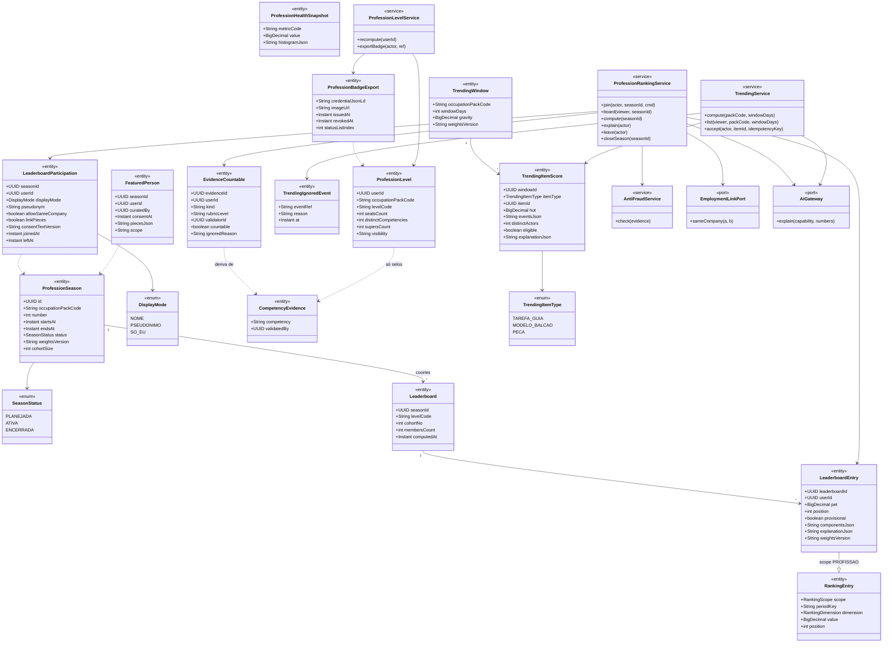
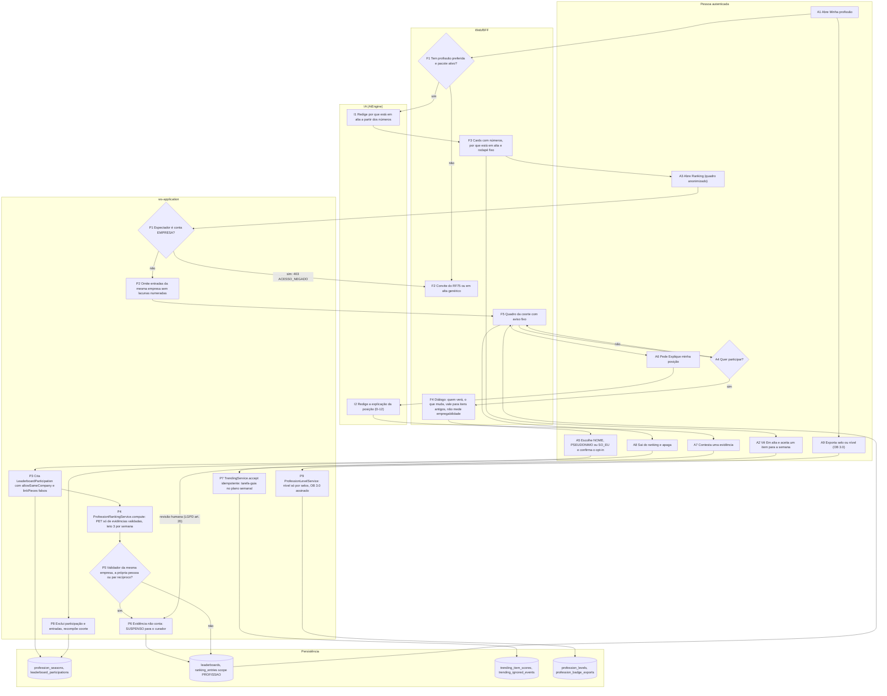
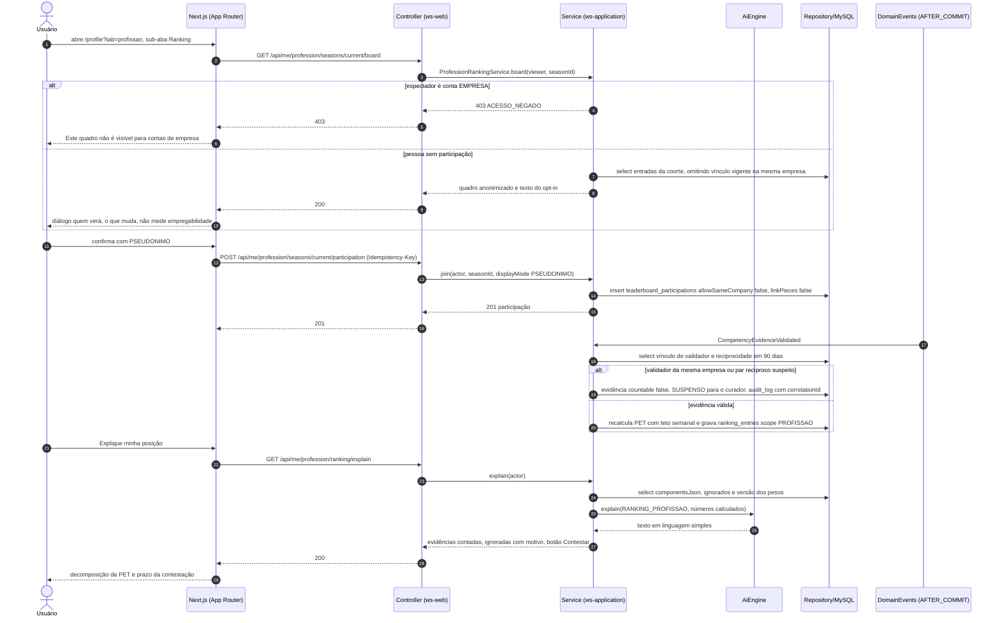
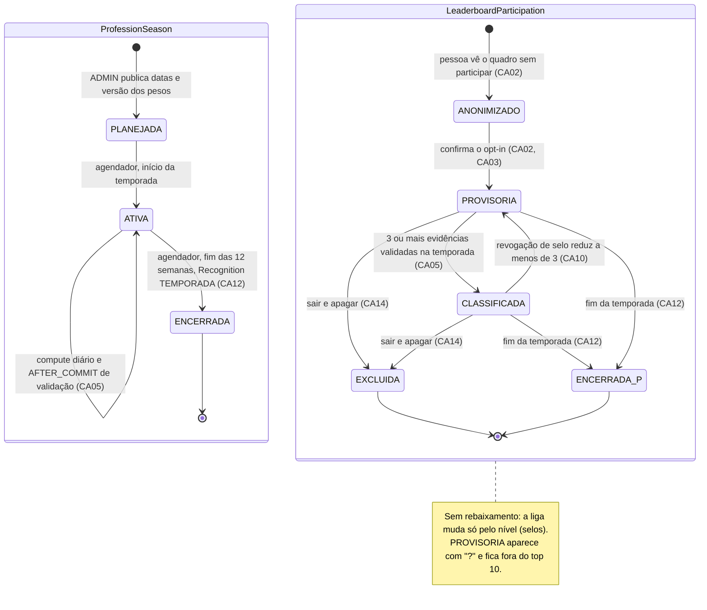
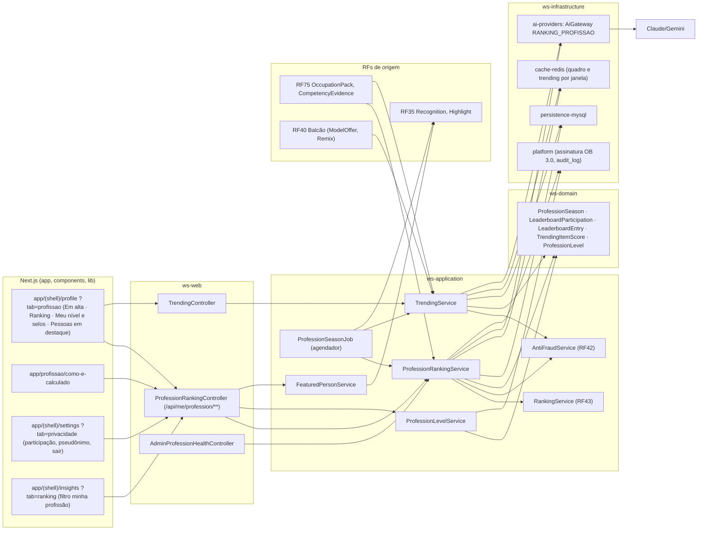

# RF77 — Ranking da temporada, níveis e "Em alta na profissão"
**HU:** HU77 · **Aba/rota:** Minha profissão (`/profile?tab=profissao`, sub-abas **Em alta** · **Ranking** · **Meu nível e selos** · **Pessoas em destaque**); atalho em `/insights?tab=ranking` (filtro "minha profissão"); página pública "Como o ranking da profissão é calculado" (`/profissao/como-e-calculado`); controles em `/settings?tab=privacidade` (participação, pseudônimo, colegas podem ver, sair e apagar) · **Página-esqueleto:** a registrar; jornada ainda não implementada.
**Critérios de aceite cobertos:** RF77.CA01 … RF77.CA15 — requisito novo (numeração D-149), derivado da pesquisa [`ranking-hype-trending.md`](../../auditoria/2026-11-02/fontes/ranking-hype-trending.md) §2.3, §3, §4 e §5 (lá os CAs aparecem como RF76.CA01–15, numeração anterior à D-149) e do resumo em [`ABAS_POR_PROFISSAO.md`](../../auditoria/2026-11-02/ABAS_POR_PROFISSAO.md) §5; todos planejados.

**Trello:** card a criar no board **Work Station**.

**História de usuário:** COMO pessoa que escolheu uma profissão preferida (RF75.CA19, RF81) POSSO abrir a aba "Minha profissão" e, se eu quiser, entrar no ranking da temporada com nome ou pseudônimo, ver quem são as pessoas mais bem avaliadas **por evidências validadas** na minha profissão, acompanhar meu nível e meus selos e descobrir que tarefas, modelos e peças estão em alta na minha área PARA me orientar pelo que a comunidade da profissão está produzindo e validando, sem que minha empresa, meu chefe ou recrutadores vejam, e sem que isso vire nota de empregabilidade.

**Experiência central:** a aba abre em **Em alta** — tarefas-guia, modelos do Balcão e peças públicas do pacote da profissão com mais aceites, conclusões, remixes com crédito e validações nos últimos 7 ou 30 dias, cada card com os números e "por que está em alta ✦", e o botão "aceitar para minha semana". Em **Ranking**, o quadro da coorte aparece anonimizado até a pessoa entrar (opt-in por temporada, com nome, pseudônimo ou "só eu"); a pontuação é a **PET — Pontuação de Evidências da Temporada**, sempre decomposta em "Explique minha posição". Em **Meu nível e selos**, o nível derivado só de selos validados, a raridade de cada selo e a exportação Open Badges 3.0. Em toda tela, o aviso fixo: "Este quadro conta evidências validadas nesta temporada. Não é nota, não prevê contratação e nenhuma empresa o vê."

**Decisões vigentes:** D-147 (sem sinal de busca de emprego; profissão preferida privada), D-148 (profissão preferida no cadastro; escopo = `OccupationPack`), D-149 (numeração RF76–RF81), D-150 ("hype" = item em alta, nunca o Hype do autor), **D-152 (temporada de 12 semanas — confirmada)**. **Em aberto (Q-247), escritos aqui como propostos:** nomes dos níveis (Iniciante · Praticante · Consolidado · Referência · Mentor), pseudônimo como padrão no primeiro opt-in, existência de `allowSameCompany` (proposto: existe, padrão desligado), peso da chancela de peça pública (proposto: 1) e curtidas no trending (proposto: zero).

**Regras herdadas:** popularidade ≠ qualidade (`REDE_PROFISSIONAL_VISIBILIDADE.md`); progresso por evidência, nunca score de empregabilidade (`GUIA_DE_CARREIRA.md` §3.7); RF50.CA06/CA12 (sem Hype, pontos ou popularidade como medida de potencial); RF43.CA05 (dimensões separadas, pesos públicos, "Explique minha posição", nunca volume bruto); RF45.CA06/CA08/CA10 (SO_EU nunca exposto, dashboards só com histograma anonimizado); D-12 (a IA só interpreta números calculados pelo sistema); LGPD art. 20 (contestação de decisão automatizada).

## Critérios de aceite

| CA | Dado / quando / então |
|---|---|
| RF77.CA01 | Dado uma pessoa sem profissão preferida, quando abre a aba, então vê só o convite do RF75 ("escolha sua profissão ou faça o teste de interesses") e nenhum ranking, trending ou nível; com profissão preferida, a aba carrega o pacote correspondente (`OccupationPack` `ativo`); sem pacote ativo, mostra "em alta" genérico e explica que o ranking abre quando o pacote estiver ativo. |
| RF77.CA02 | Dado a sub-aba Ranking, quando a pessoa ainda não participa, então o quadro aparece **anonimizado** (posições e PET sem nomes) com o diálogo de opt-in que responde "quem verá?", "o que muda?" e "vale para itens antigos?", afirma que **empresa, chefe e recrutadores não veem** e que **não mede empregabilidade**; só após confirmar nasce `LeaderboardParticipation(seasonId, userId, displayMode, allowSameCompany=false, linkPieces=false)`; `rankingOptOut=false` **não** é interpretado como opt-in. |
| RF77.CA03 | Dado uma participação, quando a pessoa escolhe `displayMode` PSEUDONIMO, então o quadro mostra o pseudônimo (único na temporada, sem avatar real), nenhum link para o perfil e, se `linkPieces=false`, só os nomes dos critérios validados; trocar para NOME exige nova confirmação; SO_EU mostra a posição só para a própria pessoa ("você estaria em 12º de 48"). Padrão do primeiro opt-in (NOME ou PSEUDONIMO) proposto, em aberto na Q-247. |
| RF77.CA04 | Dado um espectador, quando a API monta o quadro, então **omite** as entradas de pessoas com vínculo vigente na mesma empresa do espectador (salvo `allowSameCompany=true` da entrada — opção proposta, Q-247), responde `403 ACESSO_NEGADO`/omissão a contas EMPRESA e não existe endpoint nominal para dashboards (só histograma anonimizado por profissão, RF45.CA10); a omissão não deixa lacunas numeradas ("você vê 46 de 48 participantes"). |
| RF77.CA05 | Dado a temporada vigente (`ProfessionSeason` de **12 semanas**, D-152, datas públicas), quando o `ProfessionRankingService.compute` roda (job diário + AFTER_COMMIT de validação), então a PET de cada participante é a soma ponderada (`RankingWeights` escopo PROFISSAO, vigência, `criteriaPublicText`) **apenas** de: selos de competência validados (rubrica aproxima 1 · atende 2 · supera 3), revisões L10 recebidas e aceitas (1), remixes com crédito validados pelo autor original (1), chancela de peça pública (1, proposto — Q-247); **nunca** DP, Hype, HSE, curtidas, seguidores, mensagens ou visualizações; teto de 3 evidências/semana; < 3 evidências na temporada ⇒ `provisional=true` ("?") e fora do top 10; grava `RankingEntry(scope=PROFISSAO, dimension=EVIDENCIAS_VALIDADAS, explanationJson)`. |
| RF77.CA06 | Dado uma evidência, quando o validador tem vínculo vigente na mesma empresa da pessoa, é a própria pessoa, ou está em par recíproco suspeito (reciprocidade ≥ 60 % em 90 d e ≥ 5 validações), então a evidência **não conta** para PET nem para trending e nasce `SUSPENSO` para o CURADOR (`AntiFraudService`, escada ignorar → suspenso → estorno de PET → perda do direito de validar), auditada com `correlationId`; o selo em si segue a regra do RF75.CA07 (validador sem vínculo). |
| RF77.CA07 | Dado "Explique minha posição", quando acionado, então a tela lista cada evidência contada (critério, data, validador anonimizado, peso), as ignoradas com motivo, a versão dos pesos e o botão **Contestar** que abre revisão humana (LGPD art. 20) com prazo exibido; a IA (`AiCapability RANKING_PROFISSAO`) só redige a explicação a partir desses números (D-12). |
| RF77.CA08 | Dado a sub-aba Em alta, quando carregada, então mostra tarefas-guia, modelos do Balcão e peças públicas do pacote ordenados por `hot` (janela 7/30 d, gravidade 1,5/1,2, amortecimento `log2(1+n)`, `f_autor`, limite inferior de Wilson para conclusão), com ≥ 3 eventos de ≥ 3 pessoas, no máximo 2 itens por autor no top 10, bônus de novato e uma vaga por competência; cada card traz "N aceites · M conclusões · K validações · R remixes com crédito" e "por que está em alta ✦"; curtidas (zero, proposto — Q-247), salvos, visualizações e DP **não** entram; rodapé fixo "Isto não mede empregabilidade" + "Como calculamos". |
| RF77.CA09 | Dado um item em alta, quando a pessoa clica "aceitar para minha semana", então a tarefa-guia entra no plano do RF75/Tarefa do Dia (RF44) com os parâmetros do pacote; para modelo do Balcão, segue RF40.CA03/CA04 (preço em DP, licença, crédito); a aceitação gera evento de trending (peso 1) uma única vez por pessoa e item (idempotente). |
| RF77.CA10 | Dado as evidências validadas da pessoa, quando recalculadas, então `ProfessionLevel` (Iniciante · Praticante · Consolidado · Referência · Mentor — nomes propostos, Q-247) é derivado só de selos (quantidade, competências distintas, "supera", revisões dadas, validações feitas), nunca de DP/Hype/posição; não cai por inatividade, só por revogação (com notificação e "contestar"); cada selo exibe raridade ("X % das pessoas desta profissão"); visibilidade do nível SO_EU por padrão. |
| RF77.CA11 | Dado um selo ou nível, quando a pessoa pede exportar, então recebe um `AchievementCredential` Open Badges 3.0 (JSON-LD assinado + imagem com metadados) com `criteria` da rubrica, `alignment` ESCO/CBO da competência, `evidence` com URL só se autorizar e `credentialStatus` para revogação; nada é publicado em rede externa automaticamente. |
| RF77.CA12 | Dado o fim da temporada, quando o job fecha a coorte (≤ 30 pessoas da mesma profissão e nível), então emite `Recognition` fonte TEMPORADA (TOP_COORTE 1º–3º; PARTICIPOU para ≥ 3 evidências), privados por padrão, sem DP; a PET zera para a nova temporada; o histórico de posições fica visível só para a própria pessoa; **não há rebaixamento**. |
| RF77.CA13 | Dado "Pessoas em destaque", quando o algoritmo propõe candidatos (PET, diversidade, sem suspensões), então um CURADOR com escopo PROFISSAO seleciona e **cada pessoa consente** antes da publicação (nome/pseudônimo, nível, até 3 peças escolhidas por ela); sem consentimento não publica; exibido só a participantes, salvo opt-in "também no Mural › Descobrir"; nunca para contas EMPRESA da mesma empresa. |
| RF77.CA14 | Dado a pessoa, quando aciona "Sair do ranking" ou "Apagar", então as `LeaderboardEntry`/`LeaderboardParticipation` dela (temporada atual e histórico) são excluídas em ≤ 24 h, a coorte é recomposta sem buracos numerados, os selos permanecem no perfil privado (exclusão separada), e `DataSubjectRequest` target `RANKING_PROFISSAO` cobre exportação/exclusão (RF3); a aba continua utilizável em modo anonimizado. |
| RF77.CA15 | Dado a Análise de Perfil (RF50), o guia (RF75), pessoas semelhantes, chancelas (RF39), DP (RF42) e dashboards de empresa, quando executados, então **nenhum** lê posição, PET, coorte ou nível da profissão como entrada (teste automatizado de contrato); métricas de saúde ficam em `MetricDefinition` domínio PROFISSAO com histograma anonimizado para ADMIN (`minSamples` 20 participantes por profissão). |

### Métricas de saúde (`ProfessionHealthSnapshot`, só agregados; alvos propostos)

| Métrica | Fórmula | Alarme |
|---|---|---|
| Abandono pós-temporada | % de participantes da temporada N sem nenhuma evidência nas 4 semanas seguintes | > 40 % |
| Saída do ranking | % que aciona "Sair" na temporada, por quartil de posição | quartil inferior sai > 2× o superior |
| Ansiedade autorrelatada | `SurveyService` anônimo (≥ 5 respostas): "o ranking te motivou / te pressionou?" (1–5) | média "pressionou" ≥ 3,5 ⇒ ADMIN revisa pesos/coorte |
| Denúncias e suspensões | denúncias por 100 participantes; % SUSPENSO; % fraude confirmada | fraude > 2 % ⇒ dois validadores |
| Concentração | Gini da PET na coorte; repetição do top 10 entre temporadas | Gini > 0,6 ou repetição > 70 % |
| Provisórios | % com "?" no fim da temporada | > 50 % |
| Viés de volume no trending | correlação nº de itens do autor × posições no top 10 | > 0,5 ⇒ ajustar `f_autor` |
| Diversidade | competências distintas no top 10 / competências do pacote | < 50 % ⇒ reforçar round-robin |

### Etapas de implementação (propostas)

| Etapa | Entrega | CAs | Pré-requisitos |
|---|---|---|---|
| E1 Fundamentos (ranking por evidência) | `ProfessionSeason`, `LeaderboardParticipation` com opt-in, pseudônimo e zona de privacidade; PET determinística sobre `CompetencyEvidence`; `RankingEntry` scope PROFISSAO; "Explique minha posição" + Contestar; "Sair e apagar"; textos fixos; página "Como é calculado"; testes de contrato | RF77.CA01–CA07, RF77.CA14, RF77.CA15 | RF75 E4–E5 (pacotes `ativo`, selo com validação humana); ao menos 1 pacote além do genérico |
| E2 Em alta, Balcão e destaques curados | `TrendingWindow`/`TrendingItemScore` com `hot`, Wilson, `f_autor`, teto por autor, bônus de novato, round-robin; cards com ✦; "aceitar para minha semana"; prateleiras do Balcão por pacote; destaques com curador e consentimento; `TrendingIgnoredEvent` | RF77.CA08, RF77.CA09, RF77.CA13 | contrato social real do RF19/RF27 (remix com crédito, reação qualitativa verificada, publicação opt-in); RF40 fora de esqueleto |
| E3 Níveis, ligas, badges e saúde | `ProfessionLevel` com raridade; coortes ≤ 30 e `Recognition` TEMPORADA; `ProfessionBadgeExport` (OB 3.0); `ProfessionHealthSnapshot` + pesquisa de fim de temporada; painel ADMIN com histogramas | RF77.CA10–CA12, RF77.CA15 (métricas) | RF35 `Recognition`; `SurveyService` (RF43.CA14); Q-247 (nomes dos níveis) |

### Exemplos por profissão

- **Desenvolvimento de software:** Ana (pseudônimo "compilador-azul", `allowSameCompany=false`) soma L4 relatório técnico "supera" (3), D4 diagrama de arquitetura "atende" (2), D9 wireframe "atende" (2), revisão L10 recebida e aceita (1) e remix do seu "checklist de code review" validado por ela (1) ⇒ PET 9, 4º de 27 na coorte Praticante. Em alta: "D9 wireframe com 3 estados" (41 aceites, 18 conclusões, 7 validações). Sua chefe, também participante, **não vê** a entrada da Ana.
- **Direito:** Bruno (nome real) chega a PET 9 com L4 parecer "supera", L3 estudo de caso sem dados do cliente, L7 POP de protocolo eletrônico e 2 revisões L10; um remix do seu POP feito por colega do mesmo escritório é **ignorado** (`MESMA_EMPRESA`) e aparece em "ignorados" com motivo.
- **Enfermagem** (pacote a criar, com regra reforçada de dados de saúde — LGPD art. 11): Dalva, conta Em transição (aparece como pessoa comum, D-147), entra em SO_EU e vê "você estaria em 6º de 22" sem aparecer a ninguém; a pré-checagem barrou um número de prontuário no estudo de caso antes da submissão.

## 0. Diagrama de casos de uso

| Caso de uso | Ator(es) | CAs | Situação |
|---|---|---|---|
| UC1 Ver itens em alta na profissão | Pessoa autenticada, IA | RF77.CA01, RF77.CA08 | planejado |
| UC2 Aceitar item em alta para a semana | Pessoa autenticada | RF77.CA09 | planejado |
| UC3 Entrar no ranking da temporada | Pessoa autenticada | RF77.CA02, RF77.CA03 | planejado |
| UC4 Ver quadro da coorte | Pessoa autenticada, Empresa ou órgão (recebe 403) | RF77.CA02, RF77.CA04 | planejado |
| UC5 Explicar minha posição | Pessoa autenticada, IA | RF77.CA07 | planejado |
| UC6 Contestar posição ou evidência | Pessoa autenticada, Curador | RF77.CA07, RF77.CA10 | planejado |
| UC7 Sair do ranking e apagar | Pessoa autenticada | RF77.CA14 | planejado |
| UC8 Ver meu nível e selos | Pessoa autenticada | RF77.CA10 | planejado |
| UC9 Exportar selo ou nível em Open Badges 3.0 | Pessoa autenticada | RF77.CA11 | planejado |
| UC10 Curar pessoas em destaque | Curador | RF77.CA13 | planejado |
| UC11 Consentir em aparecer em destaque | Pessoa autenticada | RF77.CA13 | planejado |
| UC12 Revisar evidência suspensa | Curador | RF77.CA06 | planejado |
| UC13 Calcular PET e trending | Agendador de trabalhos | RF77.CA05, RF77.CA06, RF77.CA08 | planejado |
| UC14 Fechar temporada e emitir reconhecimentos | Agendador de trabalhos | RF77.CA12 | planejado |
| UC15 Acompanhar métricas de saúde | Administrador | RF77.CA15 | planejado |

## 1. Diagrama de classes

Entidades novas propostas na pesquisa (§5.2), a registrar em `docs/arquitetura/TAXONOMIA.md` quando o RF entrar em sprint; `RankingEntry`, `RankingWeights`, `CompetencyEvidence`, `Recognition` e `OccupationPack` já estão descritas no RF43, RF75 e RF35.

## 2. Diagrama de atividades

Da abertura da aba até a posição explicada na coorte, com o caminho do "Em alta" e a saída do ranking.

## 3. Diagrama de sequência

Opt-in, quadro com zona de privacidade e explicação da posição; o `alt` cobre a conta EMPRESA e o validador da mesma empresa.

## 4. Máquina de estados

Duas entidades: `ProfessionSeason` (ciclo de 12 semanas, D-152) e `LeaderboardParticipation` da pessoa na temporada.

## 5. Diagrama de componentes

## 6. Rastreabilidade

Mensagens = números do `autonumber` da §3. Passos = nós da §2. Componentes = nós da §5.

| CA | Classe | Passo | Mensagem | Transição | Componente |
|---|---|---|---|---|---|
| RF77.CA01 | `OccupationPack` (RF75) | A1 → F1 → F2 | — | — | `TAB`, `RF75` |
| RF77.CA02 | `LeaderboardParticipation` | A3 → P2 → F5 → A4 → F4 → A5 → P3 | 1–3, 7–16 | `ANONIMIZADO → PROVISORIA` | `TAB`, `PC`, `PRS` |
| RF77.CA03 | `DisplayMode`, `LeaderboardParticipation.pseudonym` | A5 → P3 | 11–16 | `ANONIMIZADO → PROVISORIA` | `PRIV`, `PC` |
| RF77.CA04 | `EmploymentLinkPort` | P1 → P2 | 4–7 | — | `PC`, `PRS` |
| RF77.CA05 | `LeaderboardEntry`, `RankingEntry`, `EvidenceCountable`, `ProfessionSeason` | P4 → D2 | 17–18, 20 | `PROVISORIA → CLASSIFICADA`; `ATIVA → ATIVA` | `PRS`, `RKS`, `JOB` |
| RF77.CA06 | `EvidenceCountable.ignoredReason`, `AntiFraudService` | P5 → P6 | 17–19 | — | `AFS`, `PLAT` |
| RF77.CA07 | `LeaderboardEntry.explanationJson`, `AiGateway` | A6 → I2 → A7 | 21–29 | — | `PC`, `AIG` |
| RF77.CA08 | `TrendingWindow`, `TrendingItemScore`, `TrendingIgnoredEvent` | F1 → I1 → F3 | — | — | `TAB`, `TC`, `TRS`, `REDIS` |
| RF77.CA09 | `TrendingService.accept` | A2 → P7 → D3 | — | — | `TC`, `TRS`, `RF75`, `RF40` |
| RF77.CA10 | `ProfessionLevel` | A9 → P9 | — | `CLASSIFICADA → PROVISORIA` (revogação) | `PLS` |
| RF77.CA11 | `ProfessionBadgeExport` | A9 → P9 → D4 | — | — | `PLS`, `PLAT` |
| RF77.CA12 | `Leaderboard`, `ProfessionSeason`, `Recognition` (RF35) | — | — | `ATIVA → ENCERRADA`; `CLASSIFICADA → ENCERRADA_P` | `JOB`, `RF35` |
| RF77.CA13 | `FeaturedPerson` | — | — | — | `FPS`, `RF35` |
| RF77.CA14 | `LeaderboardParticipation`, `LeaderboardEntry` | A8 → P8 → D1 | — | `PROVISORIA/CLASSIFICADA → EXCLUIDA` | `PRIV`, `PC`, `PRS` |
| RF77.CA15 | `ProfessionHealthSnapshot` | — | — | — | `AC`, `PRS` |
