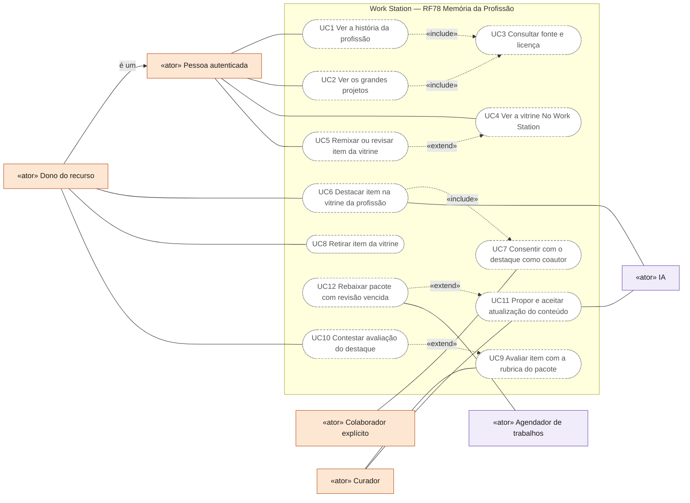
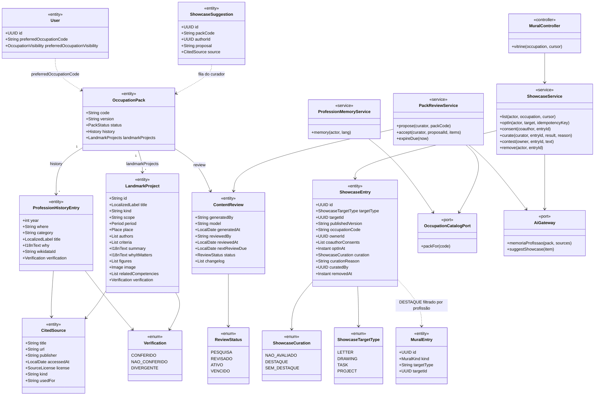
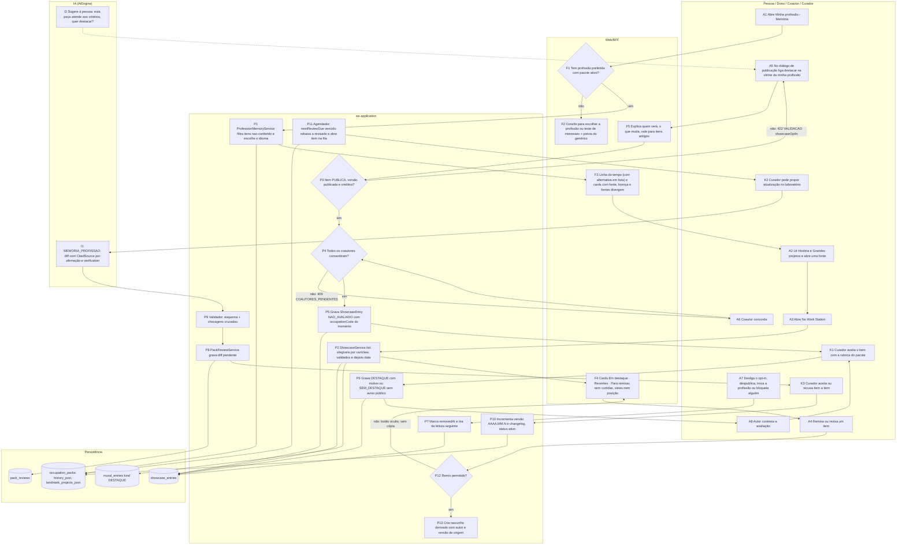
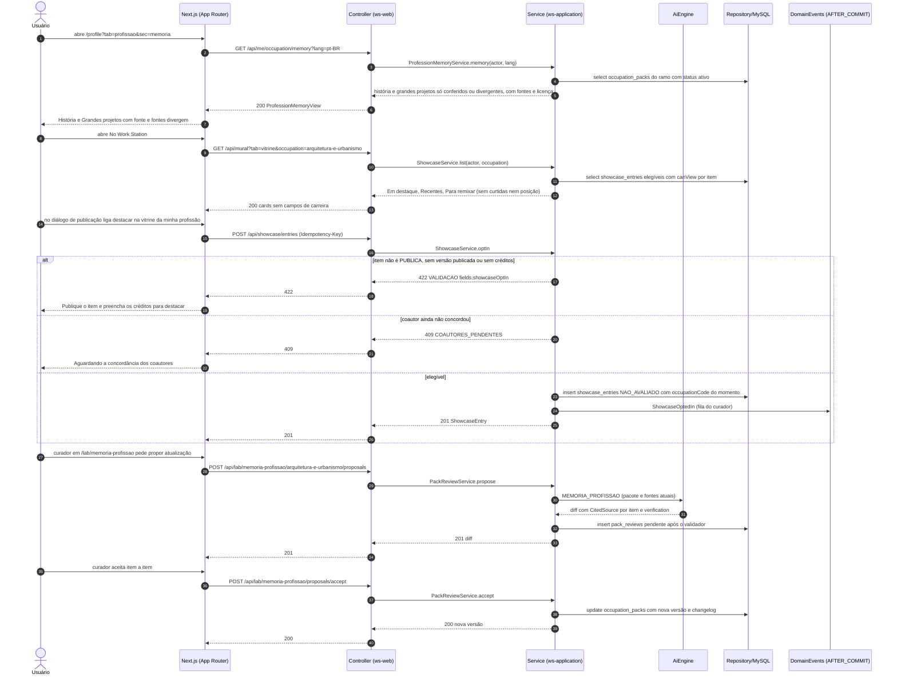
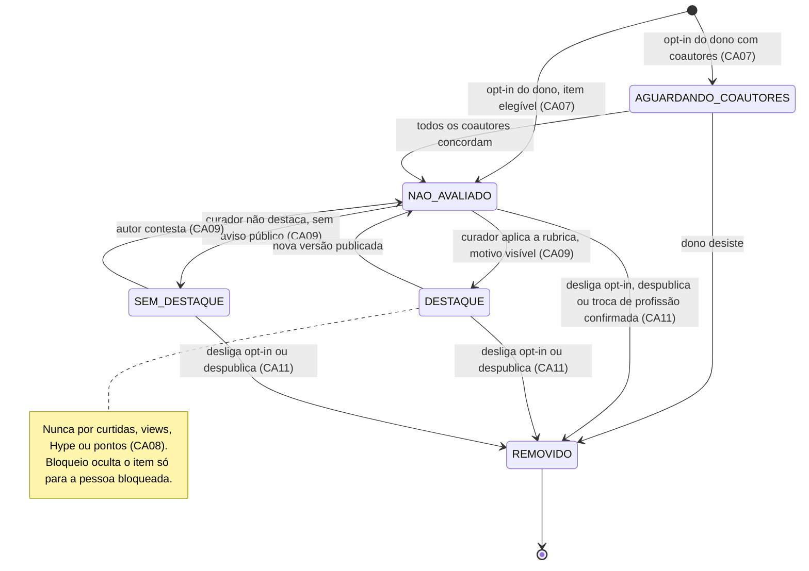
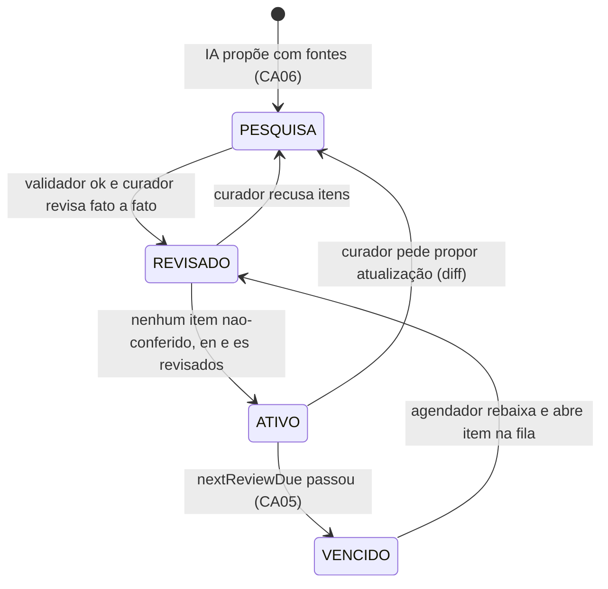
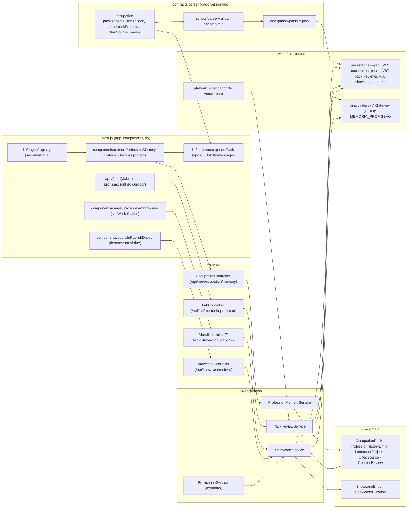

# RF78 — Memória da Profissão: história, grandes projetos e vitrine da profissão preferida
**HU:** HU78 · **Aba/rota:** Minha profissão › Memória (`/profile?tab=profissao&sec=memoria`, sub-abas História · Grandes projetos · No Work Station); atalhos no Guia de Carreira (RF75) e em Conta ao lado da profissão preferida (RF81); laboratório do curador em `/lab/memoria-profissao` · **Página-esqueleto:** a registrar; jornada ainda não implementada.
**Critérios de aceite cobertos:** RF78.CA01 … RF78.CA12 — requisito proposto na pesquisa [`historia-e-grandes-projetos.md`](../../auditoria/2026-11-02/fontes/historia-e-grandes-projetos.md) §5 (lá numerado RF76) e resumido em [`ABAS_POR_PROFISSAO.md`](../../auditoria/2026-11-02/ABAS_POR_PROFISSAO.md) §6; numerado RF78 pela D-149 (09/11/2026); todos planejados. Depende do `OccupationPack` do RF75.CA19 e da profissão preferida do RF81 (D-148). Já existem no repositório: o esquema e os pacotes (`contracts/career/occupation-pack.schema.json`, `contracts/career/occupation-packs/`), o validador (`npm run career:validate`) e a Vitrine do Mural (RF27, `MuralEntry.kind = DESTAQUE`).

**Trello:** card a criar no board **Work Station**.

**História de usuário:** COMO pessoa que escolheu uma profissão preferida (ou está decidindo qual) QUERO uma aba que conte, com fontes, a história dessa profissão no mundo e no Brasil, mostre os projetos de referência e as peças públicas que pessoas da mesma profissão fizeram no Work Station PARA entender onde estou entrando, me inspirar em trabalhos reais e remixá-los com crédito — sem que isso me compare, ranqueie ou exponha a mim ou a outras pessoas.

**Experiência central:** "Sou um bom engenheiro de software" → a aba Minha profissão abre a seção **Memória** com três sub-abas: **História** (marcos no mundo e no Brasil, regulamentação, figuras de referência com diversidade, evolução das ferramentas, "o que isso significa para quem entra hoje"), **Grandes projetos** (cards com ficha: período, lugar, autores, critérios atendidos, por que importa, números com fonte e data — ex.: Pix, Pampulha, Brasília, Itaipu) e **No Work Station** (peças, tarefas e projetos públicos que pessoas da profissão escolheram destacar, validados por curador, prontos para abrir, salvar, remixar com crédito ou revisar). Todo fato tem fonte; o que diverge aparece como "fontes divergem".

**Conteúdo como dado versionado:** `history` e `landmarkProjects` são seções **opcionais** novas do `OccupationPack` (obrigatórias em pacote `ativo` com `fields.length > 0`; `generico.json` fica isento), com `$defs` novos `i18nText`, `citedSource` (licença por fonte), `verification` (`conferido` · `nao-conferido` · `divergente`), `milestone`, `referencePerson`, `toolsEra`, `landmarkProject` e `review`. Pipeline: IA (serviço `MEMORIA_PROFISSAO` no `AiGateway`, RF43) propõe com uma fonte por afirmação → validador → curador aceita item a item → seed só `ativo` → revisão anual com rebaixamento automático do pacote vencido.

**Regras herdadas:** a vitrine não é ranking de pessoas nem sinal de busca de emprego (D-147); popularidade ≠ qualidade e publicar é opt-in (`REDE_PROFISSIONAL_VISIBILIDADE.md`); validação é humana, a IA só pré-checa e sugere (RF75.CA07, CA10); sem identificadores internos na tela (RF75.CA18).

**Em aberto (Q-251):** a sub-aba No Work Station é a Vitrine do RF27 filtrada por profissão (**recomendado**, modelado aqui: `GET /api/mural?tab=vitrine&occupation=`) ou um feed próprio? A tag de profissão do item pode diferir da profissão preferida (para quem não quer revelá-la)? Os diagramas tratam `ShowcaseEntry.occupationCode` como gravado no opt-in, vindo da profissão preferida ou de uma tag escolhida no diálogo de publicação.

## Critérios de aceite

| CA | Dado / quando / então |
|---|---|
| RF78.CA01 | Dado `User.preferredOccupation` preenchido com um ramo servido por pacote `ativo`, quando a pessoa abre `/profile?tab=profissao&sec=memoria`, então vê as sub-abas História, Grandes projetos e No Work Station com o conteúdo de `history` e `landmarkProjects` desse pacote, no idioma da interface (pt-BR sempre; en/es quando existirem no pacote, senão pt-BR com aviso discreto). |
| RF78.CA02 | Dado que a pessoa não tem profissão preferida ou o pacote não está `ativo`, quando abre a aba, então vê um convite para escolher a profissão (ou o teste de interesses do RF75) e uma prévia do pacote genérico; nenhum erro técnico nem identificador interno aparece (RF75.CA18). |
| RF78.CA03 | Dado qualquer marco, pessoa de referência, projeto ou número exibido, quando renderizado, então mostra "fonte" com título, publicador, data de acesso e licença, abre em nova aba, e itens `verification = divergente` exibem "fontes divergem" com a nota; nenhum item `nao-conferido` chega à tela de produção. |
| RF78.CA04 | Dado o texto da aba, quando lido, então é autoral do Work Station (gerado por IA e revisado), não reproduz trechos de fontes sob CC BY-SA ou "todos os direitos reservados", e imagens só aparecem com `license` permitida e `credit` visível. |
| RF78.CA05 | Dado o pacote da profissão, quando `review.nextReviewDue` passa, então o pacote deixa de ser semeado como `ativo`, a aba mostra "conteúdo em revisão (última revisão em DD/MM/AAAA)" e um item entra na fila do curador; nada é editado automaticamente em produção. |
| RF78.CA06 | Dado o curador no laboratório, quando pede "propor atualização", então a IA (RF43, serviço `MEMORIA_PROFISSAO`) devolve um diff com fontes por item e marcação `conferido`/`nao-conferido`; o curador aceita item a item; a versão do pacote incrementa e o `changelog` registra; sem aceite humano nada muda. |
| RF78.CA07 | Dado uma peça, tarefa ou projeto da pessoa, quando ela publica ou edita a publicação, então existe a opção "destacar na vitrine da minha profissão" (padrão desligado), com "quem verá?", "o que muda?" e "vale para itens antigos?"; a opção só fica ativa se o item é `PUBLICA`, tem versão publicada e créditos preenchidos; coautores precisam concordar. |
| RF78.CA08 | Dado a sub-aba No Work Station, quando carregada, então lista só itens elegíveis por `canView` no servidor, ordenados por "validados" e depois por data, sem curtidas, visualizações, posição, Hype Score ou pontos; contadores só contam itens elegíveis; nenhum card mostra momento de carreira, tipo de conta, cidade ou campo do `CareerProfile` (D-147). |
| RF78.CA09 | Dado um item na vitrine, quando o curador o avalia com a rubrica do pacote, então ele recebe `DESTAQUE` com motivo curto visível ou permanece sem destaque sem notificação pública; o destaque nunca é calculado por popularidade e pode ser contestado pelo autor. |
| RF78.CA10 | Dado um item em destaque que permite remix, quando a pessoa clica "remixar", então nasce um rascunho derivado com autor e versão de origem (D10) e crédito automático; "revisar" abre L10 com a rubrica; itens que não permitem remix não mostram o botão nem são copiados pela IA ou pela exportação. |
| RF78.CA11 | Dado que a pessoa desliga o opt-in, despublica, troca de profissão ou bloqueia alguém, quando a vitrine é lida de novo, então o item sai (ou deixa de aparecer para a pessoa bloqueada); a troca de profissão não move itens antigos sem confirmação; não se promete remoção de cópias já exportadas. |
| RF78.CA12 | Dado qualquer tela do RF78, quando renderizada, então funciona por teclado e leitor de tela, a linha do tempo tem alternativa em lista, imagens têm `alt`, e a interface distingue fato conferido, divergência e conteúdo do próprio Work Station; nenhuma sugestão da IA publica, destaca, segue ou envia mensagem sem confirmação (RF75.CA10). |

## 0. Diagrama de casos de uso

| Caso de uso | Ator(es) | CAs | Situação |
|---|---|---|---|
| UC1 Ver a história da profissão | Pessoa autenticada | RF78.CA01, RF78.CA02, RF78.CA04, RF78.CA12 | planejado |
| UC2 Ver os grandes projetos | Pessoa autenticada | RF78.CA01, RF78.CA04, RF78.CA12 | planejado |
| UC3 Consultar fonte e licença | Pessoa autenticada | RF78.CA03, RF78.CA04 | planejado |
| UC4 Ver a vitrine No Work Station | Pessoa autenticada | RF78.CA08, RF78.CA11 | planejado (Vitrine do RF27 filtrada, Q-251) |
| UC5 Remixar ou revisar item da vitrine | Pessoa autenticada | RF78.CA10 | planejado |
| UC6 Destacar item na vitrine da profissão | Dono do recurso, IA (só sugere) | RF78.CA07, RF78.CA12 | planejado |
| UC7 Consentir com o destaque como coautor | Colaborador explícito | RF78.CA07 | planejado |
| UC8 Retirar item da vitrine | Dono do recurso | RF78.CA11 | planejado |
| UC9 Avaliar item com a rubrica do pacote | Curador | RF78.CA09 | planejado |
| UC10 Contestar avaliação do destaque | Dono do recurso | RF78.CA09 | planejado |
| UC11 Propor e aceitar atualização do conteúdo | Curador, IA | RF78.CA06 | planejado |
| UC12 Rebaixar pacote com revisão vencida | Agendador de trabalhos | RF78.CA05 | planejado |

## 1. Diagrama de classes

## 2. Diagrama de atividades

Da leitura da memória da profissão ao destaque de uma peça na vitrine, com a curadoria do conteúdo e a revisão anual.

## 3. Diagrama de sequência

## 4. Máquina de estados

`ShowcaseEntry` (curadoria do item na vitrine da profissão), entidade central da sub-aba No Work Station.

`ContentReview.status` do conteúdo `history`/`landmarkProjects` de um pacote (ciclo de curadoria e revisão anual).

## 5. Diagrama de componentes

## 6. Rastreabilidade

Mensagens = números do `autonumber` da §3 (contando as do `alt`: 17–19 = 422, 20–22 = 409, 23–26 = elegível). Passos = nós da §2. Transições = §4 (`ShowcaseEntry` e `ContentReview`). Componentes = nós da §5.

| CA | Classe | Passo | Mensagem | Transição | Componente |
|---|---|---|---|---|---|
| RF78.CA01 | `OccupationPack.history`, `LandmarkProject`, `ProfessionMemoryService` | A1 → F1 → P1 → F3 → A2 | 1–7 | — | `MEM`, `OC`, `PMS`, `MYSQL` |
| RF78.CA02 | `User.preferredOccupationCode`, `OccupationPack` (genérico) | F1 → F2 | 1–3 | — | `MEM`, `LIB` |
| RF78.CA03 | `CitedSource`, `Verification` | P1 → F3 → A2 | 4–7 | `REVISADO → ATIVO` | `MEM`, `VAL` |
| RF78.CA04 | `CitedSource.license`, `LandmarkProject.image` | P9 → F3 | 5, 31 | `PESQUISA → REVISADO` | `SCH`, `VAL`, `MEM` |
| RF78.CA05 | `ContentReview.nextReviewDue`, `PackReviewService.expireDue` | P11 → K2 | — | `ATIVO → VENCIDO → REVISADO` | `JOB`, `PRS` |
| RF78.CA06 | `ContentReview`, `AiGateway.memoriaProfissao`, `PackReviewService` | K2 → I1 → P9 → P8 → K3 → P10 | 27–40 | `[*] → PESQUISA`, `ATIVO → PESQUISA` | `LAB`, `LC`, `PRS`, `AIG` |
| RF78.CA07 | `ShowcaseEntry.coauthorConsents`, `ShowcaseService.optIn` | A5 → F5 → P3 → P4 → A6 → P5 | 14–26 | `[*] → AGUARDANDO_COAUTORES → NAO_AVALIADO` | `PUB`, `SC`, `SS`, `PS` |
| RF78.CA08 | `ShowcaseService.list`, `MuralEntry` | A3 → P2 → F4 | 8–13 | — | `SHW`, `MC`, `SS` |
| RF78.CA09 | `ShowcaseCuration`, `ShowcaseService.curate`, `contest` | K1 → P6 → A8 | 24 | `NAO_AVALIADO → DESTAQUE`, `NAO_AVALIADO → SEM_DESTAQUE`, `SEM_DESTAQUE → NAO_AVALIADO` | `SS` |
| RF78.CA10 | `ShowcaseEntry`, remix (D10), revisão (L10) | A4 → P12 → P13 | — | — | `SHW`, `SS` |
| RF78.CA11 | `ShowcaseEntry.removedAt`, `ShowcaseService.remove` | A7 → P7 | — | `* → REMOVIDO` | `SHW`, `SS` |
| RF78.CA12 | todas as telas, `AiGateway.suggestShowcase` | F3 · I2 → A5 | 7, 14 | — | `MEM`, `SHW`, `PUB`, `LIB` |
