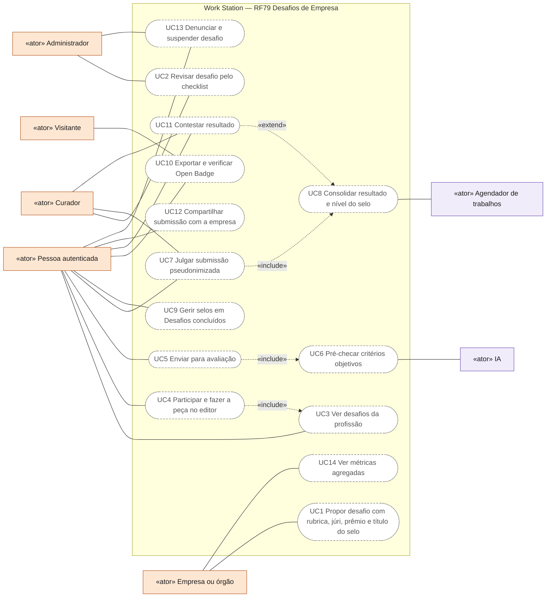
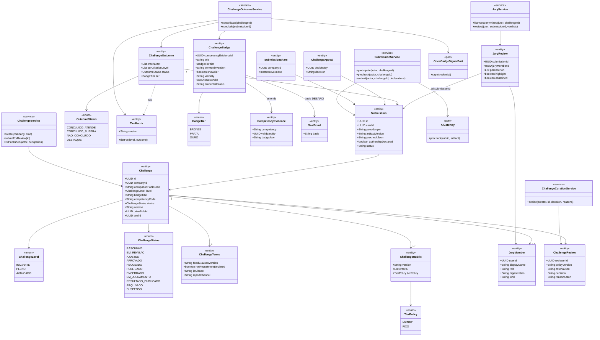
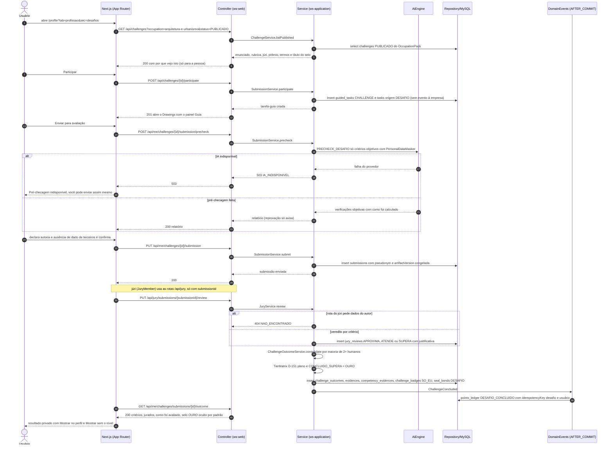
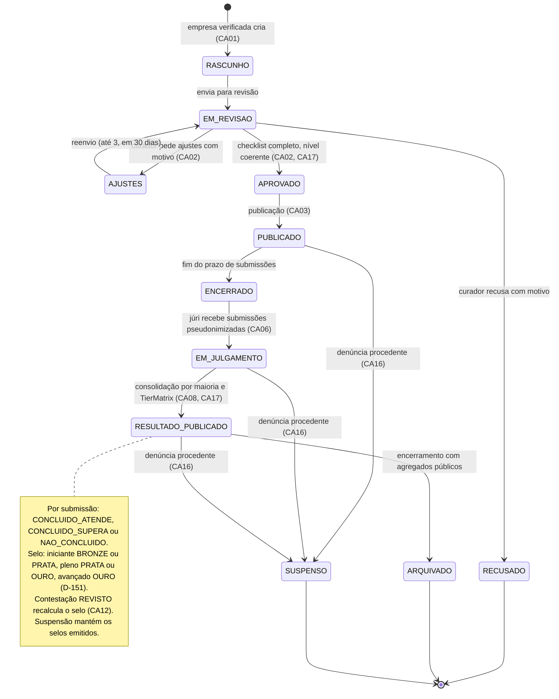
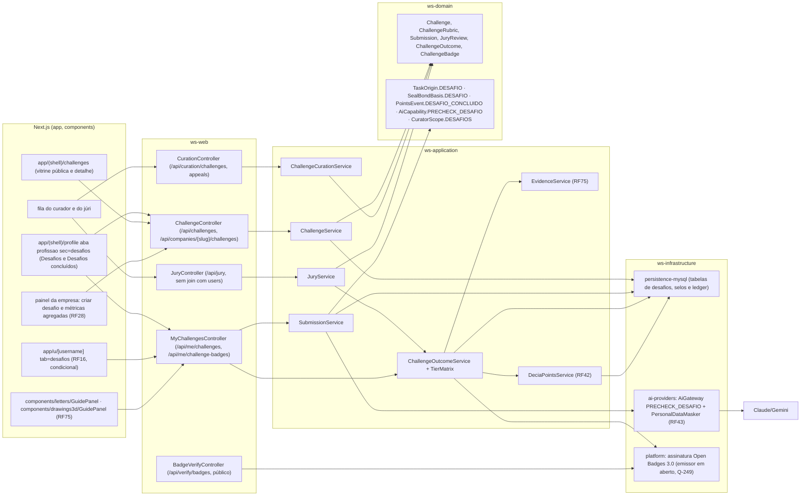

# RF79 — Desafios de Empresa com selo específico em níveis bronze, prata e ouro
**HU:** HU79 · **Aba/rota:** Desafios na aba da profissão (`/profile?tab=profissao&sec=desafios`, inclui a sub-aba "Desafios concluídos" do dono), vitrine pública de desafios (`/challenges`), sub-aba pública condicional do perfil de terceiros (`/u/[username]?tab=desafios`, RF16) · **Página-esqueleto:** a registrar; jornada ainda não implementada.
**Critérios de aceite cobertos:** RF79.CA01 … RF79.CA17 — requisito novo; todos planejados. Fonte aprovada pelo dono do produto: [`desafios-de-empresas.md`](../../auditoria/2026-11-02/fontes/desafios-de-empresas.md) (§2.3 regras R1–R12, §3 mecânica e ciclo, §4 selo e nível, §5 HUs, CAs, entidades, API, integrações, etapas e exemplos; lá numerado como RF76) e o resumo em [`ABAS_POR_PROFISSAO.md`](../../auditoria/2026-11-02/ABAS_POR_PROFISSAO.md) §7. Numeração RF79 pela D-149; profissão preferida e escopo por `OccupationPack` pela D-148; sem sinal de busca de emprego pela D-147; **matriz do nível do selo confirmada pela D-151**. Em aberto (escrito aqui como proposta): destaques do júri (Q-248, parte restante), emissor do Open Badge (Q-249), teto de pontos e curadores (Q-250), revisão jurídica dos termos fixos (Q-252).

**Trello:** card a criar no board **Work Station**.

**História de usuário (pessoa):** COMO pessoa que quer testar o que sei fazer na minha profissão QUERO participar de desafios públicos propostos por empresas validadas, fazendo a peça no Letters ou no Drawings com critérios e rubrica conhecidos de antemão, e ao concluir receber um selo que diga **exatamente o que entreguei**, com nível bronze, prata ou ouro, chancelado por pessoas identificadas, que eu decido se mostro no perfil PARA comprovar uma entrega concreta — sem que a empresa saiba quem participou, sem ranking e sem que isso vire processo seletivo.

**História de usuário (empresa):** COMO EMPRESA validada QUERO propor um desafio com enunciado, rubrica e júri públicos, nomear meu júri e patrocinar o prêmio em DECIA Points PARA divulgar minha área e contribuir com a formação da comunidade, recebendo só métricas agregadas.

**Por que o desenho é assim.** Uma empresa que mede o nível de pessoas e vê quem foi bem está recrutando (AI Act Anexo III 4(a), Lei 9.029/1995 art. 1º, LGPD art. 20). A proteção não pode ser só "a IA não decide": **a empresa não pode receber os dados que a tornariam decisora**. Regras invariantes R1–R12 (fonte §2.3): desafio público e aberto (R1); enunciado, rubrica, júri e prêmio públicos antes de abrir (R2); pré-checagem objetiva pela IA e júri humano identificado para o subjetivo (R3); júri vê só submissões pseudonimizadas (R4); nenhum ranking de pessoas (R5); destaque no perfil controlado pela pessoa, padrão oculto (R6); direito de apagar (R7); PI permanece com a pessoa, licença de exibição apenas (R8); proibido usar como etapa de seleção não declarada (R9); termos aprovados por curador ou ADMIN (R10); sem dados sensíveis nem proxies (R11); participar não é sinal de busca de emprego (R12, D-147).

**Nível do selo (D-151).** Matriz pública versionada dificuldade do desafio × resultado na rubrica: iniciante → bronze (atende) ou prata (supera); pleno → prata ou ouro; avançado → ouro para todo concluinte ("supera" fica só no `result[]`). "Supera" = ≥ 2/3 dos critérios subjetivos obrigatórios julgados "supera" pela maioria do júri. O metal descreve **a entrega**, não a pessoa.

## Critérios de aceite

| CA | Dado / quando / então |
|---|---|
| RF79.CA01 | Dado uma conta EMPRESA com `verified = true` (RF28) e `canPromoteChallenges` ativo, quando cria um desafio, então informa profissão (`OccupationPack`), nível (iniciante/pleno/avançado), enunciado, entregáveis (Letter e/ou Drawing), `ChallengeRubric` com critérios marcados como objetivos (pré-checáveis) ou subjetivos e obrigatórios/opcionais, ao menos 2 `JuryMember`s identificados por nome e papel, prazo de submissão (14–90 dias), prêmio em DECIA Points dentro do teto da regra global (valores do teto em aberto, Q-250) e o **título do selo** a ser emitido; os termos fixos do produto ("não é processo seletivo", "a PI permanece com a pessoa; licença de exibição apenas", "a empresa não recebe dados individuais"; texto sujeito à revisão jurídica, Q-252) são exibidos e não editáveis; conta EMPREGADO/CHEFE recebe `403 ACESSO_NEGADO`; empresa com 3 desafios publicados ou 12 no ano recebe `409 LIMITE_DESAFIOS`. |
| RF79.CA02 | Dado um desafio em `EM_REVISAO`, quando o curador (`CuratorAppointment` escopo `DESAFIOS`; quem são os curadores está em aberto, Q-250) ou o ADMIN revisa, então vê o checklist versionado (`ChallengeReviewPolicy`: enunciado sem dado sensível nem linguagem de vaga, rubrica com critérios verificáveis, júri nomeado, prazo, prêmio no teto, nível coerente, selo específico — sem adjetivo de pessoa, nível ou percentual) e decide APROVAR, AJUSTES ou RECUSAR; AJUSTES/RECUSAR exigem ao menos um motivo padronizado (ex. `SELO_GENERICO`, `LINGUAGEM_DE_VAGA`, `PEDE_DADO_PESSOAL`, `CESSAO_PI`, `NIVEL_INCOERENTE`), senão `422 VALIDACAO`; APROVAR com item obrigatório pendente → `409 CRITERIOS_PENDENTES`; a empresa tem até 3 reenvios e 30 dias para ajustar. |
| RF79.CA03 | Dado um desafio `PUBLICADO`, quando qualquer pessoa autenticada abre `/profile?tab=profissao&sec=desafios` ou `/challenges`, então vê enunciado, rubrica completa, nomes e papéis do júri, prazo, prêmio, termos e o título do selo, **antes** de participar; a lista é filtrada pela profissão preferida (D-148) com explicação "por que vejo isto" visível só à própria pessoa, e pode ser ampliada para outras profissões; não há convite, elegibilidade por vínculo nem lista de convidados. |
| RF79.CA04 | Dado "Participar", quando confirmado, então nasce um `GuidedTask` (`templateCode = CHALLENGE:<id>`) com `TaskItem.origin = DESAFIO` em pasta própria e a peça abre no Letters/Drawings com o painel Guia (RF75.CA06) mostrando enunciado, critérios, rubrica e prazo; a participação é privada: não aparece no mural, na página da empresa, em sugestões de pessoas (RF50.CA16) nem em qualquer notificação à empresa promotora ou à empresa empregadora (D-147); desistir apaga a tarefa e a peça se a pessoa quiser. |
| RF79.CA05 | Dado "Enviar para avaliação", quando acionado, então a versão da peça é congelada (`artifactVersion`), a IA executa **só** as checagens objetivas da rubrica (tamanho, campos, cotas, vistas, testes/formatos declarados) via `AiGateway` (`AiCapability.PRECHECK_DESAFIO`, com `PersonalDataMasker`) e exibe cada verificação com "como foi calculado"; a pessoa declara autoria e ausência de dado confidencial ou pessoal de terceiros; a pré-checagem reprovada não bloqueia o envio; IA indisponível (`503 IA_INDISPONIVEL`) permite enviar sem pré-checagem; reenviar dentro do prazo substitui a submissão (uma por pessoa por desafio). |
| RF79.CA06 | Dado uma `Submission`, quando persistida, então recebe um `pseudonym` único no desafio e a cópia para o júri remove nome, username, avatar, empresa, metadados de arquivo e assinaturas; qualquer rota do júri que tente acessar dados do autor responde `404 NAO_ENCONTRADO`; os `JuryReview`s referenciam só `submissionId`; a empresa promotora não tem rota para listar participantes nem submissões fora do júri. |
| RF79.CA07 | Dado o período `EM_JULGAMENTO`, quando um jurado avalia, então marca cada critério subjetivo como APROXIMA/ATENDE/SUPERA conforme os descritores publicados na rubrica (objetivos: atendido/não atendido), com justificativa obrigatória (≥ 140 caracteres quando "aproxima" e quando "supera"), vê o relatório de pré-checagem como informação, pode marcar "destaque" sem ordem (proposta: até 5 por desafio, opt-in do autor — em aberto, Q-248) e declara "reconheci a peça/autor" para se abster; a decisão por critério é por maioria de ao menos 2 jurados; empate → curador; não existe campo de nota, pontuação total, posição ou ranking em nenhuma entidade ou tela. |
| RF79.CA08 | Dado o resultado consolidado, quando publicado, então a pessoa recebe privadamente os critérios atendidos/não atendidos, justificativas, nomes dos jurados, versão da rubrica e "como foi avaliado"; o desafio é concluído quando todos os critérios obrigatórios estão atendidos; a empresa recebe apenas agregados com `minSamples ≥ 10` (submissões, conclusões, taxa por critério, destaques em número se mantidos, Q-248); abaixo do mínimo recebe "amostra insuficiente". |
| RF79.CA09 | Dado um desafio concluído por uma pessoa, quando confirmado, então nascem `Evidence` + `CompetencyEvidence` (RF75.CA07: URL, versão, critérios atendidos, autoria, `validatedBy` = jurados/curador) e um `ChallengeBadge` com título específico de entrega (verbo + objeto + condição), competência ESCO/CBO, entregável, critérios atendidos e não atendidos, `rubricVersion`, `challengeVersion`, nível do desafio, **nível do selo (bronze/prata/ouro, RF79.CA17)**, `endorsedBy` (nomes, papéis, organização), data e `precheckSummary`; o selo **nunca** é emitido só pela IA nem sem ao menos dois humanos identificados (ou um jurado + curador) registrados em `JuryReview`; um `SealBond` com `basis = DESAFIO` liga a peça ao `Seal` da empresa (RF39), exibido só com consentimento do dono (RF39 UC5). |
| RF79.CA10 | Dado um `ChallengeBadge`, quando criado, então `visibility = SO_EU`; a pessoa altera por item para EMPRESA ou PUBLICA, independentemente do público da peça (controles separados: mostrar selo ≠ publicar peça); a sub-aba "Desafios concluídos" em `/u/[username]?tab=desafios` só existe se há ao menos um selo visível ao viewer e `GET /api/people/{id}/tabs/desafios` responde `404` caso contrário; contadores do cabeçalho contam só o visível. |
| RF79.CA11 | Dado um selo, quando a pessoa pede exportação, então recebe um `AchievementCredential` Open Badges 3.0 assinado (emissor proposto: Work Station com endosso da empresa — em aberto, Q-249) com `achievement` (id = URL do desafio arquivado, `name` = título específico, `criteria` = rubrica, `alignment` = ESCO/CBO e norma citada), `evidence[]` (URL da peça se pública, senão URL opaca de verificação), `result[]` por critério com `resultDescription` (aproxima/atende/supera ou atendido/não atendido) e o "Nível do selo" como `achievedLevel`, `endorsement` da empresa e do curador e `credentialStatus` para revogação; o mesmo JSON fica em `CompetencyEvidence.badgeJson`. |
| RF79.CA12 | Dado um resultado, quando a pessoa contesta em até 10 dias, então indica critérios e razão; um curador que não integrou o júri decide MANTIDO/REVISTO/ANULADO em 10 dias úteis com motivo; REVISTO atualiza critérios, selo (inclusive o nível) e credential; ANULADO invalida o critério para todos; a trilha fica em `ChallengeAppeal` e em "como foi avaliado". |
| RF79.CA13 | Dado uma submissão ou selo, quando a pessoa apaga, então a submissão, a `Evidence`, o `CompetencyEvidence`, o `ChallengeBadge`, o `SealBond` e qualquer `SubmissionShare` são removidos nas regras de retenção, o credential é revogado via `credentialStatus`, o júri perde acesso e só o agregado numérico permanece; a exportação do histórico do guia (RF75.CA17) inclui submissões, resultados e selos. |
| RF79.CA14 | Dado o prêmio, quando o desafio é concluído pela pessoa, então o ledger recebe **um** `DeciaPointsLedgerEntry` (`PointsEvent DESAFIO_CONCLUIDO`, `idempotencyKey` = desafio + usuário, `ruleVersionId` da `DeciaPointsRule` do desafio) com valor igual para todos os concluintes (teto por nível proposto 30/60/120, em aberto, Q-250); bônus de destaque, se mantido (Q-248), é igual para todos os destacados; itens patrocinados (`StoreItem.companyId`) são entregues como `BENEFICIO_BONUS`; a conta EMPRESA não ganha pontos; nenhum campo de moeda real, vaga, entrevista ou contratação existe no desafio (RF40.CA08, RF42.CA10, R9). |
| RF79.CA15 | Dado "Compartilhar com a empresa promotora", quando a pessoa aciona após o resultado, então vê o aviso "a empresa passará a saber que você participou e verá sua peça e seu resultado" e confirma; cria `SubmissionShare` revogável, que dá à empresa leitura dessa submissão e identidade — e nada mais (não amplia acesso ao perfil, à análise de carreira ou a outras peças, RF50.CA09); revogar remove a leitura; a empresa não pode solicitar o compartilhamento nem contatar a pessoa pelo desafio. |
| RF79.CA16 | Dado uma denúncia de uso do desafio como etapa de seleção, pedido de dado pessoal ou cessão de PI, quando o ADMIN a julga procedente, então o desafio passa a `SUSPENSO`, os selos já emitidos permanecem com a pessoa (o mérito é dela), a empresa perde `canPromoteChallenges` por 180 dias e o fato entra no `AuditLog`; os termos do desafio incluem o canal de denúncia. |
| RF79.CA17 | Dado um desafio com `level` validado pelo curador (item `NIVEL_COERENTE`; motivo `NIVEL_INCOERENTE` em AJUSTES) e uma rubrica cujos critérios subjetivos têm descritores publicados de "aproxima", "atende" e "supera", quando o júri consolida o resultado, então cada critério subjetivo recebe o grau da maioria, a submissão é `CONCLUIDO_ATENDE` (todos os obrigatórios ≥ atende), `CONCLUIDO_SUPERA` (idem e ≥ 2/3 dos subjetivos obrigatórios = supera) ou `NAO_CONCLUIDO`, e o `tier` do selo sai da matriz pública versionada (`TierMatrix`, D-151: iniciante→bronze/prata, pleno→prata/ouro, avançado→ouro/ouro; `tierPolicy = FIXO` dá a todos o metal da dificuldade); o nível descreve a entrega e **não** a pessoa: não existe campo, contagem, soma, filtro, ordenação, busca ou sugestão de pessoas por metal (`/api/people`, RF50.CA16), a aba lista itens sem totais por metal, a pessoa pode exibir o selo sem o nível (`showTier = false`) ou ocultar o item, a empresa só recebe contagem por metal com `minSamples ≥ 10` e sem identidade, e o texto "como foi avaliado" explica a matriz e diz que o metal não compara pessoas; o metal nunca decai nem expira por inatividade. |

## 0. Diagrama de casos de uso

| Caso de uso | Ator(es) | CAs | Situação |
|---|---|---|---|
| UC1 Propor desafio com rubrica, júri, prêmio e título do selo | Empresa ou órgão | RF79.CA01 | planejado |
| UC2 Revisar desafio pelo checklist | Curador, Administrador | RF79.CA02, RF79.CA17 | planejado (curadores em aberto, Q-250) |
| UC3 Ver desafios da profissão | Pessoa autenticada | RF79.CA03 | planejado |
| UC4 Participar e fazer a peça no editor | Pessoa autenticada | RF79.CA04 | planejado |
| UC5 Enviar para avaliação | Pessoa autenticada | RF79.CA05, RF79.CA06 | planejado |
| UC6 Pré-checar critérios objetivos | IA | RF79.CA05 | planejado |
| UC7 Julgar submissão pseudonimizada | Pessoa autenticada nomeada `JuryMember` (júri da empresa), Curador | RF79.CA06, RF79.CA07 | planejado (destaques em aberto, Q-248) |
| UC8 Consolidar resultado e nível do selo | Agendador de trabalhos (fim do prazo de julgamento) | RF79.CA08, RF79.CA09, RF79.CA14, RF79.CA17 | planejado |
| UC9 Gerir selos em Desafios concluídos | Pessoa autenticada (dono) | RF79.CA10, RF79.CA13, RF79.CA17 | planejado |
| UC10 Exportar e verificar Open Badge | Pessoa autenticada, Visitante (verificação pública) | RF79.CA11 | planejado (emissor em aberto, Q-249) |
| UC11 Contestar resultado | Pessoa autenticada, Curador fora do júri | RF79.CA12 | planejado |
| UC12 Compartilhar submissão com a empresa | Pessoa autenticada | RF79.CA15 | planejado |
| UC13 Denunciar e suspender desafio | Pessoa autenticada, Administrador | RF79.CA16 | planejado |
| UC14 Ver métricas agregadas | Empresa ou órgão | RF79.CA08, RF79.CA17 | planejado |

## 1. Diagrama de classes

## 2. Diagrama de atividades

Da proposta da empresa ao selo com nível na aba "Desafios concluídos" da pessoa.

```mermaid
flowchart TD
  subgraph E["Empresa · Curador · Júri"]
    E1["E1 Empresa preenche desafio, rubrica, júri, prêmio e título do selo"]
    E2["E2 Envia para revisão"]
    C1{"C1 Curador: checklist ok?"}
    C2["C2 Pede AJUSTES ou RECUSA com motivo padronizado"]
    J1["J1 Jurado julga cada critério APROXIMA, ATENDE ou SUPERA com justificativa"]
  end
  subgraph H["Pessoa autenticada"]
    H1["H1 Abre Desafios da profissão ou /challenges"]
    H2["H2 Lê enunciado, rubrica, júri, prêmio e selo"]
    H3["H3 Participar"]
    H4["H4 Faz a peça no Letters ou Drawings com painel Guia"]
    H5["H5 Enviar para avaliação e declara autoria"]
    H6["H6 Recebe resultado privado por critério"]
    H7{"H7 Contestar?"}
    H8["H8 Escolhe mostrar selo, nível, exportar OB 3.0 ou compartilhar"]
  end
  subgraph W["Web/BFF"]
    F1["F1 Lista filtrada pela profissão preferida com por que vejo isto"]
    F2["F2 Mostra pré-checagem com como foi calculado"]
  end
  subgraph S["ws-application"]
    P1{"P1 Empresa verificada e dentro do limite?"}
    P2["P2 Publica desafio (PUBLICADO)"]
    P3["P3 Cria GuidedTask CHALLENGE e TaskItem origem DESAFIO"]
    P4["P4 Congela artifactVersion e cria Submission com pseudonym"]
    P5["P5 Fim do prazo: ENCERRADO e EM_JULGAMENTO"]
    P6{"P6 Maioria de 2+ humanos e obrigatórios >= atende?"}
    P7{"P7 >= 2/3 dos subjetivos obrigatórios = supera?"}
    P8["P8 TierMatrix: nível do desafio x resultado = BRONZE, PRATA ou OURO"]
    P9["P9 Cria Evidence, CompetencyEvidence, ChallengeBadge SO_EU e SealBond DESAFIO"]
    P10["P10 Credita DESAFIO_CONCLUIDO idempotente"]
    P11["P11 NAO_CONCLUIDO: mostra o que faltou"]
    P12["P12 Curador fora do júri decide MANTIDO, REVISTO ou ANULADO"]
  end
  subgraph I["IA (AiEngine)"]
    I1{"I1 Pré-checagem objetiva disponível?"}
    I2["I2 Verifica só critérios objetivos com PersonalDataMasker"]
  end
  subgraph D["Persistência"]
    D1[("challenges, challenge_terms, challenge_rubrics, jury_members, challenge_reviews")]
    D2[("submissions, jury_reviews, challenge_outcomes")]
    D3[("evidences, competency_evidences, challenge_badges, seal_bonds")]
    D4[("points_ledger")]
  end
  E1 --> P1
  P1 -- "não: 403 ACESSO_NEGADO ou 409 LIMITE_DESAFIOS" --> E1
  P1 -- sim --> E2 --> C1
  C1 -- "não: 422 VALIDACAO sem motivo · 409 CRITERIOS_PENDENTES" --> C2 --> E1
  C1 -- sim --> P2 --> D1
  P2 --> H1 --> F1 --> H2 --> H3 --> P3 --> H4 --> H5 --> I1
  I1 -- "não: 503 IA_INDISPONIVEL, envia sem pré-checagem" --> P4
  I1 -- sim --> I2 --> F2 --> P4
  P4 --> D2
  P4 --> P5 --> J1 --> P6
  P6 -- não --> P11 --> H6
  P6 -- sim --> P7
  P7 -- "sim: CONCLUIDO_SUPERA" --> P8
  P7 -- "não: CONCLUIDO_ATENDE" --> P8
  P8 --> P9 --> D3
  P9 --> P10 --> D4
  P9 --> H6 --> H7
  H7 -- sim --> P12 --> P6
  H7 -- não --> H8
```

## 3. Diagrama de sequência

## 4. Máquina de estados

`ChallengeStatus` do `Challenge` (entidade central do RF). O resultado de cada submissão (`OutcomeStatus`) e o nível do selo (`BadgeTier`) são da entrega, não do desafio, e aparecem na nota.

## 5. Diagrama de componentes

## 6. Rastreabilidade

Mensagens = números do `autonumber` da §3. Passos = nós da §2. Componentes = nós da §5.

| CA | Classe | Passo | Mensagem | Transição | Componente |
|---|---|---|---|---|---|
| RF79.CA01 | `Challenge`, `ChallengeTerms`, `ChallengeRubric`, `JuryMember`, `ChallengeService` | E1 → P1 → E2 | — | `[*] → RASCUNHO → EM_REVISAO` | `CMP`, `CC`, `CS` |
| RF79.CA02 | `ChallengeReview`, `ChallengeCurationService` | C1 → C2 · C1 → P2 | — | `EM_REVISAO → AJUSTES · RECUSADO · APROVADO` | `CUR`, `QC`, `CRS` |
| RF79.CA03 | `Challenge`, `ChallengeService.listPublished` | P2 → H1 → F1 → H2 | 1–6 | `APROVADO → PUBLICADO` | `TAB`, `CHL`, `CC` |
| RF79.CA04 | `SubmissionService.participate`, `TaskOrigin.DESAFIO` | H3 → P3 → H4 | 7–12 | — | `MC`, `SS`, `GUI`, `DEN` |
| RF79.CA05 | `Submission`, `AiGateway` | H5 → I1 → I2 → F2 → P4 | 13–29 | — | `SS`, `AIG` |
| RF79.CA06 | `Submission.pseudonym`, `JuryReview`, `JuryService` | P4 → P5 → J1 | 30–33 | `PUBLICADO → ENCERRADO → EM_JULGAMENTO` | `JC`, `JS` |
| RF79.CA07 | `JuryReview`, `JuryMember` | J1 → P6 | 30–34 | — | `CUR`, `JC`, `JS` |
| RF79.CA08 | `ChallengeOutcome` | P6 → P11 → H6 | 34, 39–41 | `EM_JULGAMENTO → RESULTADO_PUBLICADO` | `OS`, `CMP` |
| RF79.CA09 | `ChallengeBadge`, `CompetencyEvidence`, `SealBond`, `ChallengeOutcomeService` | P8 → P9 | 36 | — | `OS`, `EVS` |
| RF79.CA10 | `ChallengeBadge.visibility` | H8 | 40–41 | — | `TAB`, `UPR`, `MC` |
| RF79.CA11 | `ChallengeBadge.credentialStatus`, `OpenBadgeSignerPort` | H8 | — | — | `OBS`, `VC` |
| RF79.CA12 | `ChallengeAppeal` | H7 → P12 → P6 | — | nota de `RESULTADO_PUBLICADO` | `CUR`, `QC` |
| RF79.CA13 | `Submission`, `ChallengeBadge`, `SubmissionShare` | H8 | — | — | `MC`, `MYSQL` |
| RF79.CA14 | `PointsEvent.DESAFIO_CONCLUIDO` | P9 → P10 | 37–38 | — | `PTS`, `MYSQL` |
| RF79.CA15 | `SubmissionShare` | H8 | — | — | `MC` |
| RF79.CA16 | `ChallengeStatus.SUSPENSO`, `ChallengeTerms.reportChannel` | — | — | `PUBLICADO · EM_JULGAMENTO · RESULTADO_PUBLICADO → SUSPENSO` | `QC`, `CS` |
| RF79.CA17 | `TierMatrix`, `BadgeTier`, `OutcomeStatus`, `ChallengeRubric.tierPolicy`, `ChallengeBadge.showTier` | P6 → P7 → P8 | 34–35 | `EM_REVISAO → APROVADO`, `EM_JULGAMENTO → RESULTADO_PUBLICADO` | `OS` |
