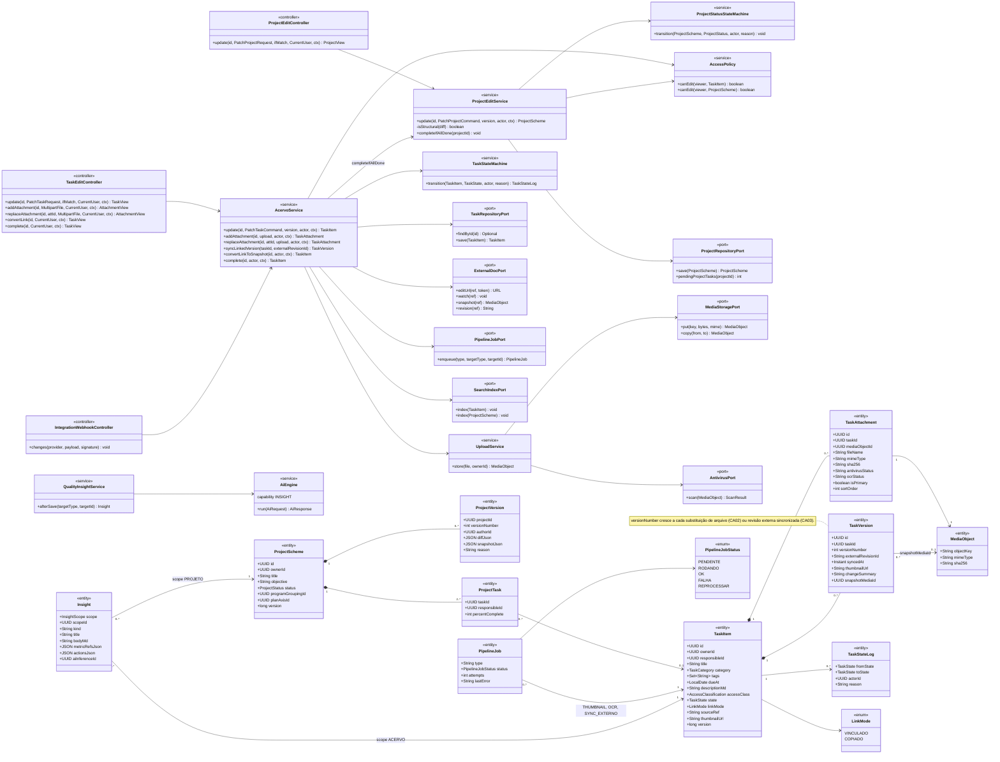
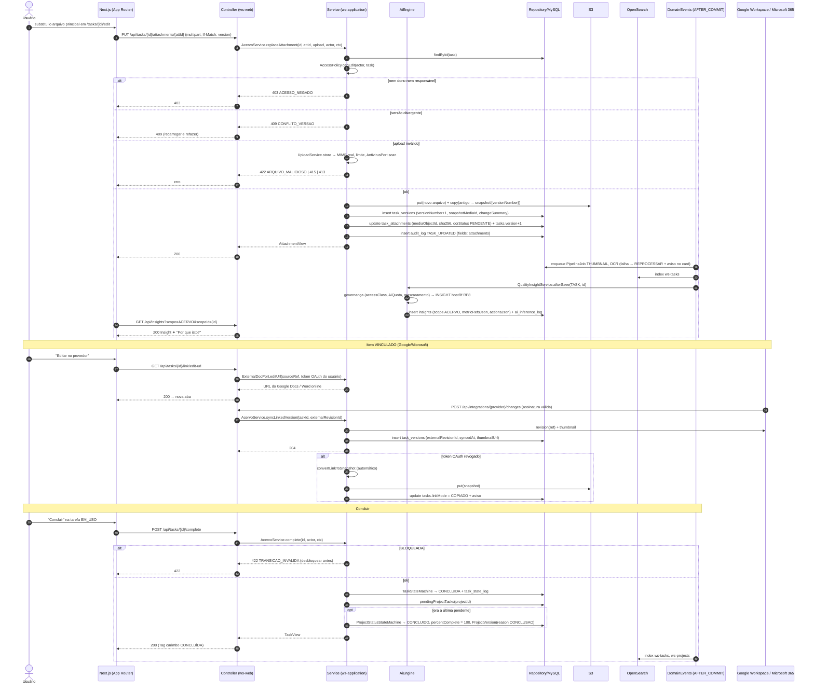
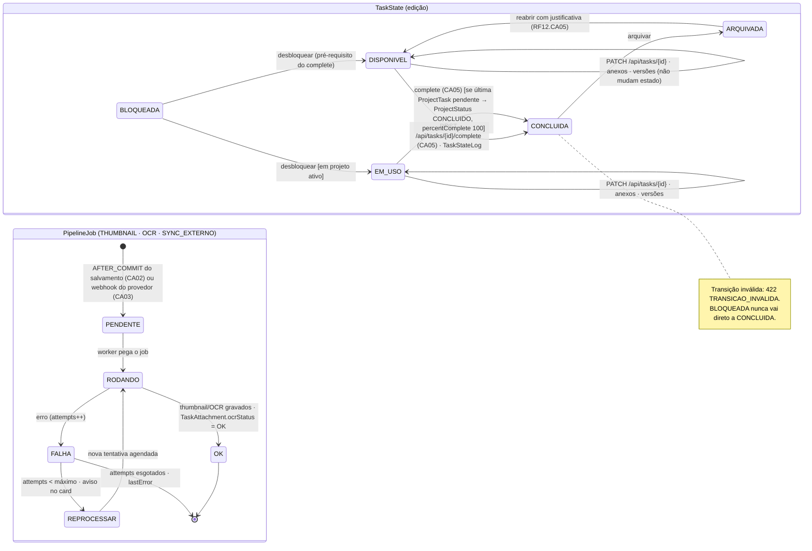
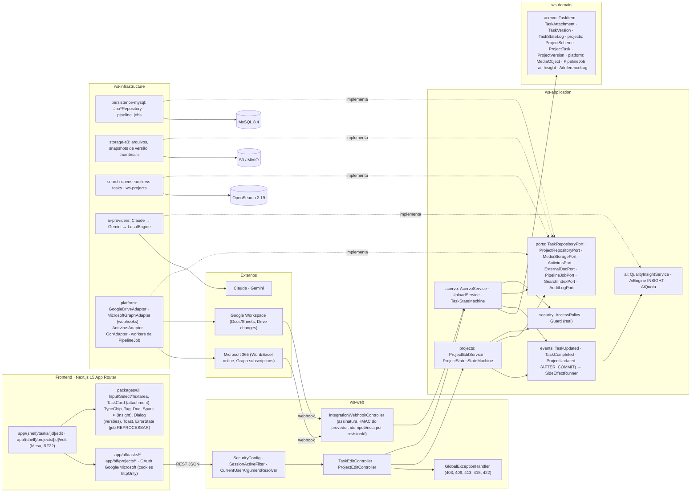

# RF8 — Editar arquivos de tarefas ou projetos dentro de meu perfil do Work Station
**HU:** HU8 · **Sprint (board Work Station):** lista *Requisitos Funcionais* sem sprint atribuída (o card "SPRINT 2" cita "RF8 Notificar divergências", escopo antigo — `RENUMERACAO.md`; fase (e) da ARQUITETURA §6) · **Equivalente FAI:** RF8 Editar peça (formulário da peça, trocar foto, versão da foto) + RF9 Editar esquema · **Aba/rota:** `/tasks/[id]/edit` (ficha + **anexos + versões**, a partir do Acervo Digital, RF6) e `/projects/[id]/edit` (ficha do projeto e arquivos das tarefas pela Mesa, RF22); "Editar no provedor" abre Google Docs/Sheets ou Word/Excel online; API `PATCH /api/tasks/{id}`, `POST /api/tasks/{id}/attachments`, `PUT /api/tasks/{id}/attachments/{attId}` (substituir), `POST /api/tasks/{id}/link/convert`, `POST /api/tasks/{id}/complete`, `PATCH /api/projects/{id}`, webhook `POST /api/integrations/{provider}/changes`
**Critérios de aceite cobertos:** RF8.CA01 … RF8.CA06 — **todos "(CA a confirmar)"**: o corpo do card está vazio; os CAs foram derivados do título + HU8 e reaproveitam RF20.CA07/CA12 (itens vinculados, `PipelineJob`), RF41.CA02/CA03 (estados, versões) e RF22.CA02/CA06 (versões de projeto, bloqueio). O foco deste RF são os **arquivos** (anexos, versões, provedor externo); a edição dos **dados** do esquema é o RF12. Todas as classes do RF são **(planejado)**; reais só os transversais (`SecurityConfig`, `SessionActiveFilter`, `Guard`, `AuditLogPort`, `S3StorageConfig`, `AiProvidersConfig`).

> **HU8** — COMO usuário do sistema Work Station POSSO editar uma tarefa ou projeto de meu perfil PARA concluir projetos e receber insights de feedback da IA a respeito da qualidade do item.

## Critérios de aceite derivados da HU8 (todos "CA a confirmar")

| CA | Enunciado (Dado / Quando / Então) | Origem |
|---|---|---|
| **RF8.CA01** (CA a confirmar) | Dado uma tarefa do meu perfil (sou `ownerId` ou `responsibleId`), quando edito título, categoria, tags, prazo, descrição ou classificação e salvo com `If-Match: version`, então o sistema valida como no criador (RF4: `422 VALIDACAO` por campo), grava com bloqueio otimista (`409 CONFLITO_VERSAO` se outra edição venceu), registra `AuditLog TASK_UPDATED` e reindexa no OpenSearch após o commit; quem não é dono nem responsável → `403 ACESSO_NEGADO`. | RF41.CA03, RF12 |
| **RF8.CA02** (CA a confirmar) | Dado os anexos da tarefa, quando substituo o arquivo principal ou adiciono um novo, então o upload passa por `MediaStoragePort` + `AntivirusPort` (`422 ARQUIVO_MALICIOSO` bloqueia; `415`/`413` como no RF4), a versão anterior é preservada como `TaskVersion` (`versionNumber + 1`, `snapshotMediaId` do arquivo antigo, `changeSummary`), e thumbnail/OCR são reprocessados por `PipelineJob` após o commit (falha → `REPROCESSAR`, aviso no card). | RF20.CA01/CA12, RF41.CA06 |
| **RF8.CA03** (CA a confirmar) | Dado um item `linkMode VINCULADO` (Google/Microsoft), quando aciono "Editar no provedor", então o documento abre no Google Docs/Sheets ou Word/Excel online com o OAuth do usuário; ao receber o webhook de mudança (`ExternalDocPort.watch`), `AcervoService.syncLinkedVersion` cria `TaskVersion` (`externalRevisionId`, `syncedAt`) e atualiza o thumbnail; "Converter em cópia" chama `convertLinkToSnapshot` (`linkMode COPIADO`, snapshot no S3); token revogado → conversão automática em snapshot com aviso. | RF20.CA07 |
| **RF8.CA04** (CA a confirmar) | Dado um projeto do meu perfil, quando edito a ficha (título, objetivo, prazo, programa, eixo) ou os arquivos das suas tarefas pela Mesa (RF22), então mudanças estruturais geram `ProjectVersion` com `diffJson` legível e as não-estruturais só atualizam; projeto `CONCLUIDO`/`ARQUIVADO` → `409 PROJETO_BLOQUEADO` (reabrir exige justificativa); a visibilidade dos arquivos segue a da tarefa dona (`AccessPolicy`). | RF22.CA02/CA06 |
| **RF8.CA05** (CA a confirmar) | Dado uma tarefa `EM_USO` ou `DISPONIVEL`, quando marco "Concluir" (`POST /api/tasks/{id}/complete`), então `TaskStateMachine` leva a `CONCLUIDA` com `TaskStateLog`; se era a última `ProjectTask` pendente de um projeto, `ProjectScheme.status` passa a `CONCLUIDO` e `percentComplete = 100`; transição inválida → `422 TRANSICAO_INVALIDA`; `BLOQUEADA` precisa ser desbloqueada antes. | RF41.CA02, RF5 §4 |
| **RF8.CA06** (CA a confirmar) | Dado um salvamento bem-sucedido, então após o commit a IA gera um **`Insight` de qualidade** (`scope` ACERVO para tarefa, PROJETO para projeto; `metricRefsJson` com completude, clareza, prazo, conformidade RF32; `actionsJson` com correções em 1 clique), exibido com faísca ✦ e "Por que isto?", registrado em `ai_inference_log` (capability `INSIGHT`, `hostRf RF8`); `accessClass` RESTRITO/SIGILOSO → `LocalEngine`; sem cota → sem insight (nunca bloqueia o salvamento). | RF43 §2–4, RF43.CA02 |

## 1. Diagrama de classes

## 2. Diagrama de atividades

```mermaid
flowchart TD
  subgraph ATOR["Dono ou responsável"]
    A1["Abre /tasks/{id}/edit a partir do Acervo Digital (RF6) ou /projects/{id}/edit (RF22)"]
    A2["Edita a ficha (título, categoria, tags, prazo, descrição, classificação)"]
    A3["Substitui o arquivo principal ou adiciona anexo"]
    A4["Item VINCULADO: Editar no provedor · Converter em cópia"]
    A5["Marca Concluir"]
    A6["Lê o Insight de qualidade ✦ e aplica correções em 1 clique"]
  end
  subgraph FE["Next.js (App Router) · BFF"]
    F1["Formulário com If-Match: version · erro por campo"]
    F2["PATCH /api/tasks/{id} · PATCH /api/projects/{id}"]
    F3["POST|PUT /api/tasks/{id}/attachments (multipart) · lista de TaskVersion"]
    F4["Abre editUrl do provedor em nova aba (OAuth do usuário) · POST /api/tasks/{id}/link/convert"]
    F5["POST /api/tasks/{id}/complete"]
    F6["Painel Insight com Spark ✦ e 'Por que isto?' (polling após salvar)"]
  end
  subgraph WEB["ws-web"]
    W1["JWT + SessionActiveFilter + CurrentUserArgumentResolver"]
    W2["TaskEditController · ProjectEditController · IntegrationWebhookController (assinatura do provedor)"]
    E403["403 ACESSO_NEGADO (nem dono nem responsável)"]
    E422["422 VALIDACAO por campo"]
    E409V["409 CONFLITO_VERSAO (If-Match)"]
    E409P["409 PROJETO_BLOQUEADO (CONCLUIDO/ARQUIVADO)"]
    E422M["422 ARQUIVO_MALICIOSO · 415 · 413"]
    E422T["422 TRANSICAO_INVALIDA (BLOQUEADA → desbloquear antes)"]
  end
  subgraph APP["ws-application"]
    S1["AccessPolicy.canEdit(viewer, task | project)?"]
    S2{"permitido?"}
    S3["AcervoService.update: valida como RF4 · compara version"]
    S4{"válido e versão igual?"}
    S5["save · AuditLog TASK_UPDATED"]
    T1["UploadService.store: MIME real · limite · AntivirusPort"]
    T2{"limpo?"}
    T3["TaskVersion(versionNumber+1, snapshotMediaId = arquivo antigo, changeSummary) · TaskAttachment aponta o novo MediaObject"]
    L1["ExternalDocPort.editUrl(sourceRef, token OAuth)"]
    L2["Webhook → syncLinkedVersion: TaskVersion(externalRevisionId, syncedAt) · thumbnail"]
    L3["convertLinkToSnapshot: ExternalDocPort.snapshot → S3 · linkMode COPIADO (automático se token revogado)"]
    P1["ProjectEditService.update: CONCLUIDO/ARQUIVADO?"]
    P2{"estrutural?"}
    P3["ProjectVersion(diffJson legível, snapshotJson, authorId)"]
    P4["só atualiza ficha"]
    C1["TaskStateMachine: EM_USO | DISPONIVEL → CONCLUIDA · TaskStateLog"]
    C2{"última ProjectTask pendente do projeto?"}
    C3["ProjectStatusStateMachine → CONCLUIDO · percentComplete = 100"]
    EV["AFTER_COMMIT: PipelineJob THUMBNAIL/OCR (REPROCESSAR em falha) · SearchIndexPort.index · QualityInsightService.afterSave"]
  end
  subgraph IA["AiEngine"]
    I1["Governança: accessClass RESTRITO/SIGILOSO → LocalEngine · AiQuota (sem cota → sem insight) · mascaramento"]
    I2["INSIGHT hostRf RF8: completude, clareza, prazo, conformidade (RF32) → Insight(metricRefsJson, actionsJson) · AiInferenceLog"]
  end
  subgraph PERS["Persistência"]
    D1[("MySQL: tasks, task_attachments, task_versions, task_state_log, project_schemes, project_versions, project_tasks, pipeline_jobs, insights, ai_inference_log, audit_log")]
    D2[("S3: novo arquivo · snapshot do antigo · thumbnails")]
    D3[("OpenSearch ws-tasks · ws-projects")]
    D4["Google Drive / Microsoft Graph (OAuth do usuário, webhooks)"]
  end

  A1 --> F1 --> A2 --> F2 --> W1 --> W2 --> S1 --> S2
  S2 -->|"não"| E403
  S2 -->|"sim"| S3 --> S4
  S4 -->|"campo inválido"| E422
  S4 -->|"versão antiga"| E409V
  S4 -->|"sim"| S5 --> D1
  S5 --> EV
  A3 --> F3 --> W2 --> T1 --> T2
  T2 -->|"não"| E422M
  T2 -->|"sim"| T3 --> D2
  T3 --> D1
  T3 --> EV
  A4 --> F4 --> L1 --> D4
  D4 -->|"webhook de mudança"| W2 --> L2 --> D1
  F4 -->|"converter"| L3 --> D2
  F2 -->|"projeto"| P1
  P1 -->|"bloqueado"| E409P
  P1 --> P2
  P2 -->|"sim"| P3 --> D1
  P2 -->|"não"| P4 --> D1
  P3 --> EV
  A5 --> F5 --> W2 --> C1
  C1 -->|"inválida"| E422T
  C1 --> C2
  C2 -->|"sim"| C3 --> D1
  C2 -->|"não"| D1
  C1 --> EV
  EV --> D3
  EV --> I1 --> I2 --> D1
  I2 --> F6 --> A6
```

## 3. Diagrama de sequência

## 4. Máquina de estados

Entidade central: **`TaskItem.state`** (`TaskState`) na porção acionada pela edição (concluir, bloqueios) e, em paralelo, o **`PipelineJob.status`** dos reprocessamentos de arquivo (CA02/CA03). `ProjectStatus` (CA04/CA05) está completo no RF5 §4; aqui só a chegada a `CONCLUIDO`.

## 5. Diagrama de componentes

## 6. Rastreabilidade

| CA | Classe (§1) | Passo da atividade (§2) | Mensagem da sequência (§3) | Transição de estado (§4) | Componente (§5) | Situação |
|---|---|---|---|---|---|---|
| RF8.CA01 | `TaskEditController.update`, `AcervoService.update`, `AccessPolicy.canEdit`, `TaskItem.version`, `SearchIndexPort` | `A2`→`F2`→`S1`→`S5`, `E403`, `E422`, `E409V` | 4–9 (mesmo guard e versão), 22 | `DIS`→`DIS`, `USO`→`USO` | `TC`, `ACV`, `SECU`, `OSE` | planejado |
| RF8.CA02 | `AcervoService.addAttachment/replaceAttachment`, `UploadService`, `AntivirusPort`, `TaskVersion`, `PipelineJob` | `A3`→`F3`→`T1`→`T3`→`EV`, `E422M` | 1–3, 10–21 | `PJ` inteiro | `S3`, `PLT` (antivírus, OCR), `UI` (`ErrorState`) | planejado |
| RF8.CA03 | `ExternalDocPort.editUrl/watch/snapshot/revision`, `AcervoService.syncLinkedVersion/convertLinkToSnapshot`, `IntegrationWebhookController`, `LinkMode` | `A4`→`F4`→`L1`→`L2`/`L3` | 27–40 | `PEN` por webhook (SYNC_EXTERNO) | `WH`, `PLT`, `GW`, `M365`, `BFF` (OAuth) | planejado (RF20.CA07) |
| RF8.CA04 | `ProjectEditService.update/isStructural`, `ProjectVersion`, `ProjectStatusStateMachine` | `F2`→`P1`→`P2`→`P3`/`P4`, `E409P` | — (mesmo padrão de 4–9) | `ProjectStatus` em RF5 §4, nota de `CON` | `PRJ`, `UI` (RF22) | planejado (RF22.CA02/CA06) |
| RF8.CA05 | `AcervoService.complete`, `TaskStateMachine`, `ProjectEditService.completeIfAllDone`, `ProjectRepositoryPort.pendingProjectTasks` | `A5`→`F5`→`C1`→`C2`→`C3`, `E422T` | 41–52 | `DIS`→`CON`, `USO`→`CON`, `BLO`→`DIS` | `ACV`, `PRJ` | planejado |
| RF8.CA06 | `QualityInsightService.afterSave`, `AiEngine` (INSIGHT), `Insight`, `AiInferenceLog` | `EV`→`I1`→`I2`→`F6`→`A6` | 23–26 | — | `AIE`, `AIP`, `UI` (`Spark`) | planejado (RF43) |
