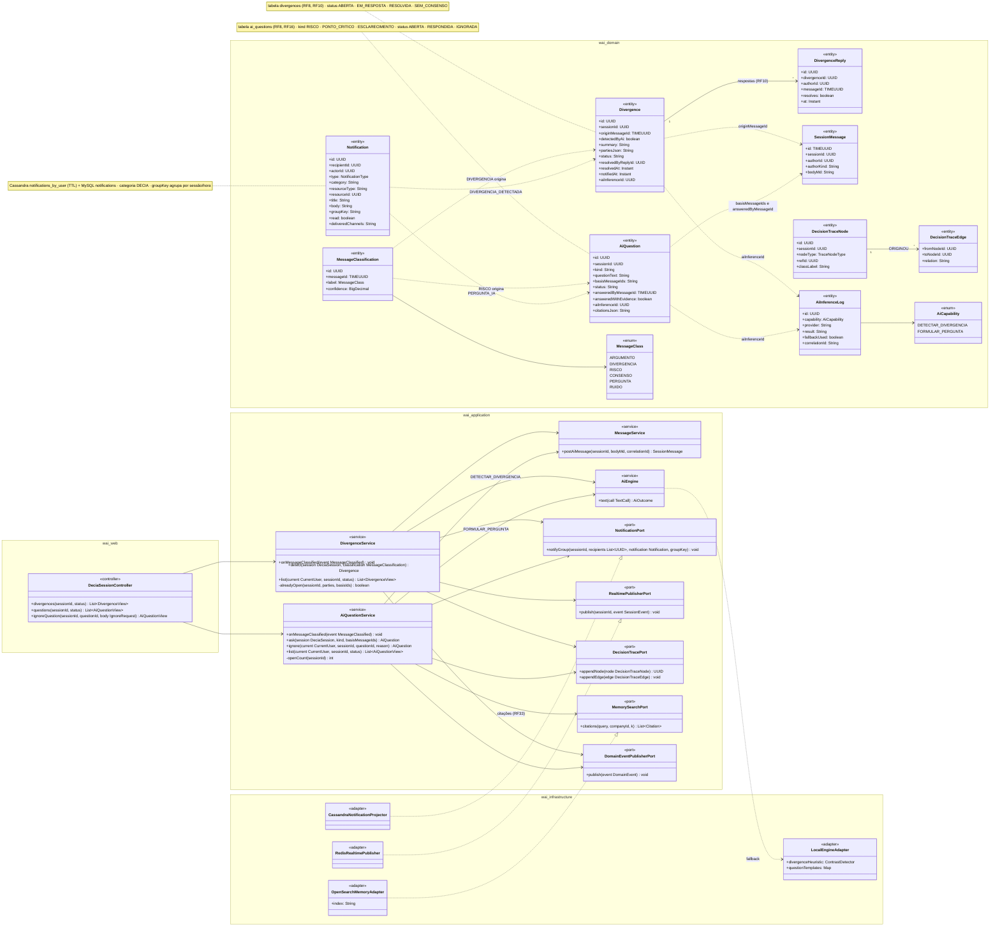
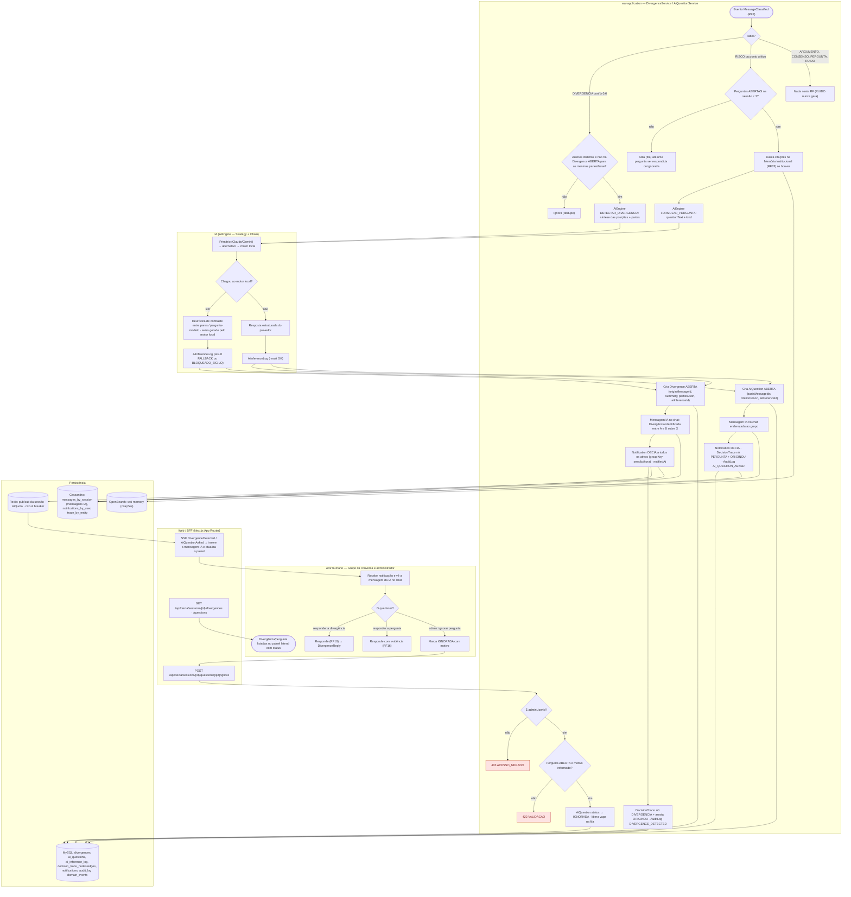
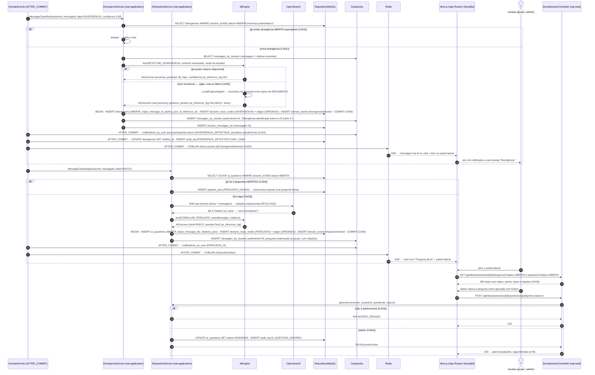
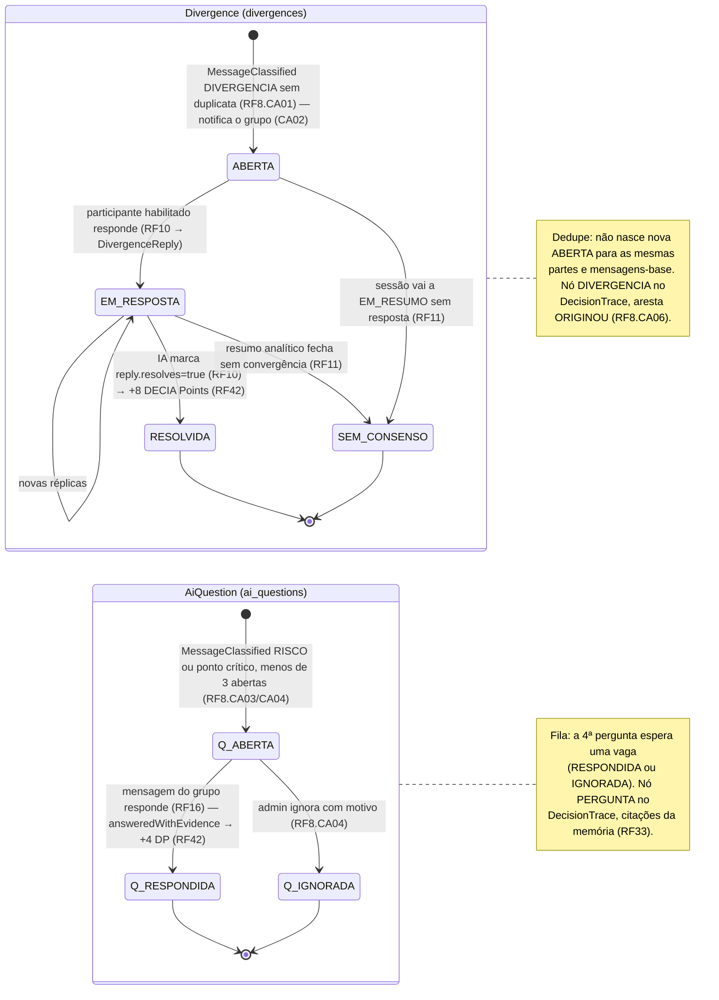
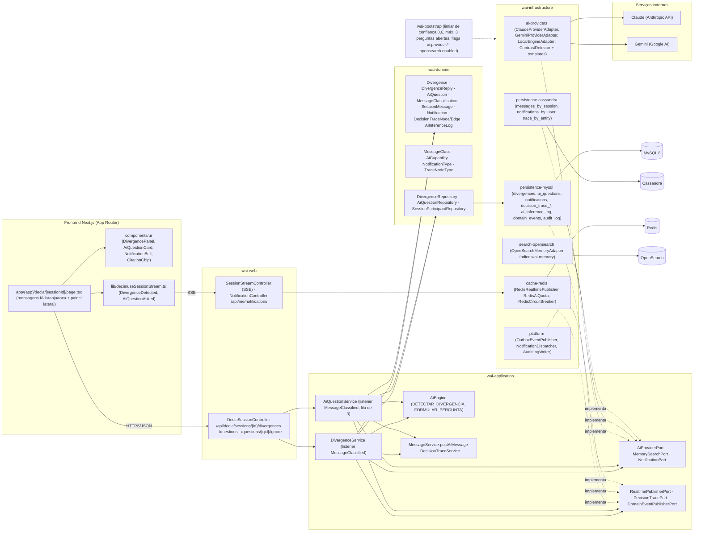

# RF8 — Notificar o grupo a respeito de divergências, assim como formalizar perguntas a partir destes pontos de risco.
**HU:** HU8 · **Sprint (board Work Station):** 2 · **Equivalente FAI:** RF10 Copilot (sugestões proativas do Copilot) + RF24 Usar a IA do sistema (`AiEngine`, capabilities DETECTAR_DIVERGENCIA e FORMULAR_PERGUNTA) + notificações RNF10 (`NotificationService`) · **Aba/rota:** DECIA (`/decia/[sessionId]` — mensagens da IA no chat + painel lateral "Divergências e perguntas"), sino de notificações — rota sugerida
**Critérios de aceite cobertos:** RF8.CA01 … RF8.CA06 (RF1–RF18 não têm CAs no board: derivados da HU8 + RF16/RF29/RF42 e marcados "CA a confirmar")

> **HU8** — COMO IA do sistema POSSO notificar o grupo a respeito de divergências identificadas e formular perguntas a partir dos pontos de risco PARA estimular o esclarecimento e reduzir ambiguidades antes da decisão.

## Critérios de aceite derivados da HU8 (todos "CA a confirmar")

| CA | Enunciado (Dado / Quando / Então) |
|---|---|
| **RF8.CA01** (CA a confirmar) | Dado `MessageClassified` com `label DIVERGENCIA` (confidence ≥ 0,6) envolvendo autores distintos, então o `DivergenceService` pede ao `AiEngine` (DETECTAR_DIVERGENCIA) a síntese das posições e cria `Divergence` (`originMessageId`, `detectedByAi` true, `summary`, `partiesJson`, `status ABERTA`, `aiInferenceId`), publicando na sessão uma mensagem `authorKind IA` "Divergência identificada entre A e B sobre X". |
| **RF8.CA02** (CA a confirmar) | Dado a divergência criada, então todos os participantes ativos recebem `Notification` (categoria DECIA, type DIVERGENCIA_DETECTADA, `groupKey` por sessão/hora para não inundar), em tempo real (SSE) e em `notifications_by_user`; `Divergence.notifiedAt` é preenchido. |
| **RF8.CA03** (CA a confirmar) | Dado `MessageClassified` com `label RISCO` (ou um ponto crítico detectado no contexto, RF16), então a IA formula `AiQuestion` (`kind` RISCO · PONTO_CRITICO · ESCLARECIMENTO, `questionText`, `basisMessageIds`, `status ABERTA`, `citationsJson` com fontes da Memória Institucional quando houver — RF33.CA03) e a posta na sessão como mensagem IA, endereçada ao grupo. |
| **RF8.CA04** (CA a confirmar) | Dado o controle de ruído, então há no máximo **3 perguntas ABERTAS** por sessão e não se cria `Divergence` já ABERTA para as mesmas partes/mensagens-base (dedupe por `basisMessageIds`/`partiesJson`); mensagens RUIDO ou repetidas nunca geram divergência nem pergunta; o administrador pode marcar uma pergunta como IGNORADA com motivo. |
| **RF8.CA05** (CA a confirmar) | Dado o `AiEngine`, então a detecção e a formulação seguem a cadeia primário → alternativo → motor local com `AiInferenceLog`; **sem IA externa** (sigilo, cota ou falha) o motor local detecta divergência por heurística (contraste/negação entre pares de ARGUMENTO) e usa uma pergunta-modelo, com aviso "gerado pelo motor local" no card. |
| **RF8.CA06** (CA a confirmar) | Dado divergência e pergunta criadas, então entram no `DecisionTrace` (nós DIVERGENCIA e PERGUNTA, arestas ORIGINOU a partir da mensagem), aparecem no painel lateral (abertas/resolvidas) e podem ser resolvidas pelo grupo (RF10 → `DivergenceReply`, RF16 → `answeredByMessageId`), gerando DECIA Points quando a IA marca como resolvida/respondida com evidência (RF42); `AuditLog DIVERGENCE_DETECTED` / `AI_QUESTION_ASKED`. |

## 1. Diagrama de classes

## 2. Diagrama de atividades

Raias: Grupo/Administrador · Web/BFF · `wai-application` · IA (AiEngine) · Persistência. Gatilho: `MessageClassified` (RF7).

## 3. Diagrama de sequência

Caminho feliz da divergência (CA01, CA02) e da pergunta (CA03), `alt` de dedupe/limite (CA04), `alt` de fallback local (CA05) e o erro 403 ao ignorar. Sem ponto e vírgula nas mensagens.

## 4. Máquina de estados

Entidades centrais: `Divergence.status` (ABERTA · EM_RESPOSTA · RESOLVIDA · SEM_CONSENSO) e `AiQuestion.status` (ABERTA · RESPONDIDA · IGNORADA). O RF8 cria ambas em `ABERTA`; as transições de resposta pertencem aos RF10 e RF16 e aparecem para contexto.

## 5. Diagrama de componentes

## 6. Rastreabilidade

| CA | Classe (§1) | Passo da atividade (§2) | Mensagem da sequência (§3) | Transição de estado (§4) | Componente (§5) |
|---|---|---|---|---|---|
| RF8.CA01 | `DivergenceService.onMessageClassified/detect`, `Divergence.originMessageId/summary/partiesJson/detectedByAi`, `AiEngine` (DETECTAR_DIVERGENCIA), `MessageService.postAiMessage` | `C0`, `C1`, `C2`, `C4`, `C5`, `C6` | 1, 5–7, 11–13 | `[*] → ABERTA` (Divergence) | `S1`, `S3`, `S4`, `I3 divergences`, `I4 messages_by_session` |
| RF8.CA02 | `NotificationPort.notifyGroup`, `Notification.groupKey/category DECIA`, `Divergence.notifiedAt`, `RealtimePublisherPort` | `C7`, `B1`, `A1` | 14–18 | nota em `ABERTA` | `I4 notifications_by_user`, `I6 NotificationDispatcher`, `I5`, `W2`, `FE2 NotificationBell` |
| RF8.CA03 | `AiQuestionService.ask`, `AiQuestion.kind/questionText/basisMessageIds/citationsJson`, `MemorySearchPort`/`OpenSearchMemoryAdapter`, `AiEngine` (FORMULAR_PERGUNTA) | `C9`, `C11`–`C14` | 19, 24–32 | `[*] → Q_ABERTA` | `S2`, `I2 search-opensearch`, `FE2 AiQuestionCard/CitationChip` |
| RF8.CA04 | `DivergenceService.alreadyOpen`, `AiQuestionService.openCount/ignore`, `AiQuestion.status IGNORADA` | `C2` → `C3`, `C9` → `C10`, `C17` → `E403`, `C18` → `E422`, `C19` | 2–4 (dedupe), 20–23 (fila), 36–44 (ignorar, 403) | `Q_ABERTA → Q_IGNORADA`, nota da fila | `W1 /ignore`, `BOOT` (limiares) |
| RF8.CA05 | `AiEngine` cadeia, `LocalEngineAdapter.divergenceHeuristic/questionTemplates`, `AiInferenceLog.fallbackUsed/result` | `I1`–`I6` | 8–10 (`else sem IA externa` → heurística local) | — | `I1 ai-providers`, `I5 RedisCircuitBreaker/AiQuota`, `X1`, `X2` |
| RF8.CA06 | `DecisionTracePort`, `DecisionTraceNode DIVERGENCIA/PERGUNTA`, `DecisionTraceEdge ORIGINOU`, `DivergenceReply`, `AiQuestion.answeredByMessageId`, `AuditLog` | `C8`, `C15`, `A3`, `A4`, `B2`, `A20` | 11, 15, 29, 33–35 | `ABERTA → EM_RESPOSTA → RESOLVIDA` (RF10), `Q_ABERTA → Q_RESPONDIDA` (RF16) | `S4 DecisionTraceService`, `I3 decision_trace_*`, `I4 trace_by_entity`, `FE2 DivergencePanel` |
