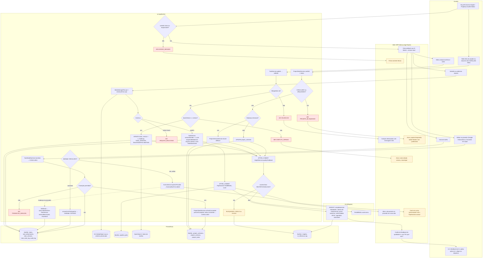
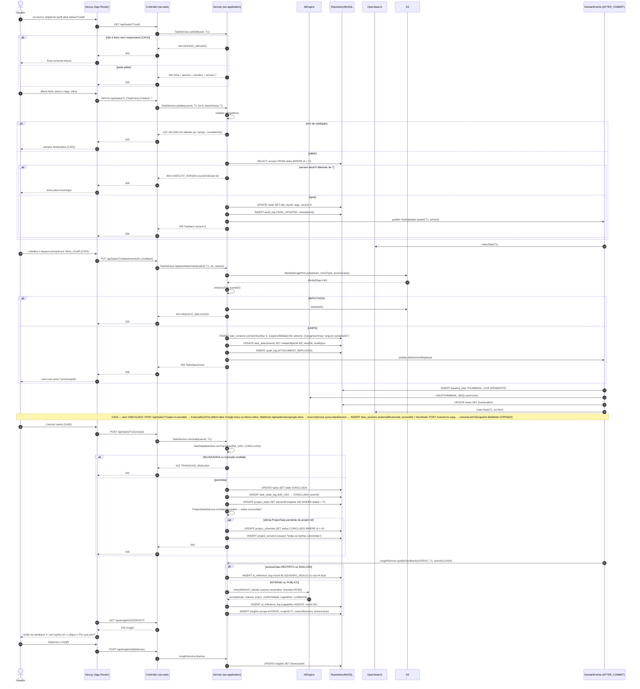
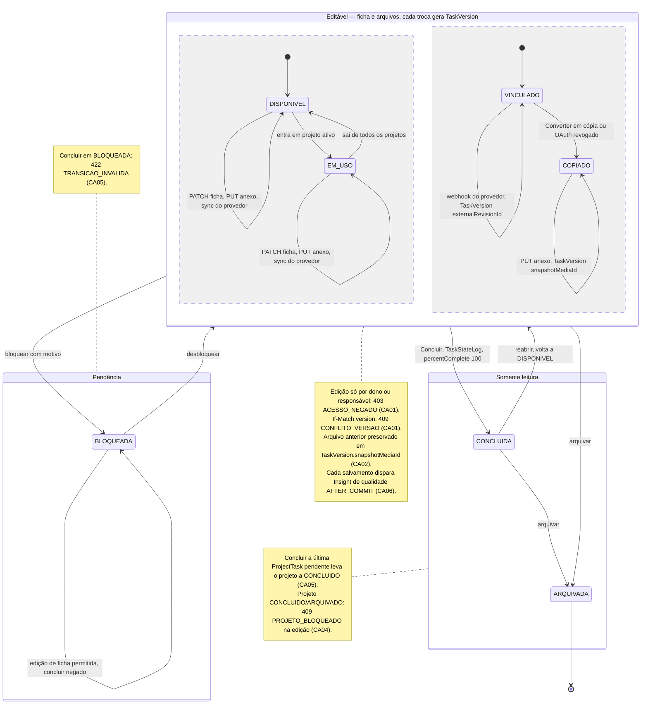
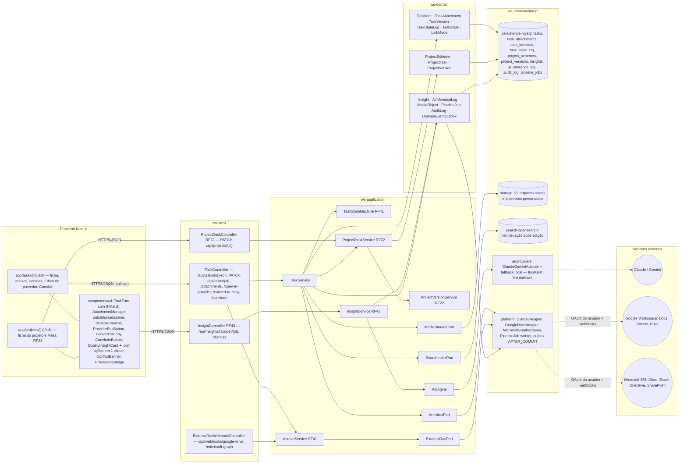

# RF8 — Editar arquivos de tarefas ou projetos dentro de meu perfil do Work Station
**HU:** HU8 · **Sprint (board Work Station):** lista *Requisitos Funcionais* (sem sprint atribuída) · **Equivalente FAI:** RF8 Editar peça (formulário da peça, trocar foto, versão da foto) + RF9 Editar esquema · **Aba/rota:** `/tasks/[id]/edit` (ficha + anexos + versões, a partir do Acervo Digital do perfil RF6) e `/projects/[id]/edit` (ficha do projeto e arquivos das tarefas pela Mesa, RF22); "Editar no provedor" abre Google Docs/Sheets ou Word/Excel online
**Critérios de aceite cobertos:** RF8.CA01 … RF8.CA06 — **todos "(CA a confirmar)"**: o corpo do card RF8 está vazio; os CAs foram derivados do título + HU8 e reaproveitam RF20.CA07/CA12 (itens vinculados, PipelineJob), RF41.CA02/CA03 (estados, versões) e RF22.CA02/CA06 (versões de projeto, bloqueio)

> **HU8** — COMO usuário do sistema Work Station POSSO editar uma tarefa ou projeto de meu perfil PARA concluir projetos e receber insights de feedback da IA a respeito da qualidade do item.

"Editar arquivos" cobre três coisas sobre itens **do meu perfil** (dono ou responsável): **(1) os metadados** da tarefa (`TaskItem`, otimista por `version`) ou do projeto (`ProjectScheme`, com `ProjectVersion` quando a mudança é estrutural, RF22); **(2) os arquivos em si** — substituir/adicionar anexo (`TaskAttachment` → novo `MediaObject` no S3, antivírus, OCR e thumbnail por `PipelineJob`) preservando a versão anterior em `TaskVersion` (`snapshotMediaId`, `changeSummary`), ou **editar no provedor** quando o item é VINCULADO (Google Workspace / Microsoft 365: o webhook de mudança cria `TaskVersion` com `externalRevisionId`); **(3) concluir** — a transição `EM_USO/DISPONIVEL → CONCLUIDA` via `TaskStateMachine` e, quando todas as `ProjectTask`s estão concluídas, `ProjectScheme` → `CONCLUIDO`. Cada salvamento dispara, após o commit, o **feedback de qualidade da IA** (`Insight` com `scope` ACERVO ou PROJETO via AiEngine `INSIGHT`): completude dos metadados, clareza do título/resumo, prazo coerente, conformidade (RF32) e sugestões acionáveis; `accessClass` RESTRITO/SIGILOSO nunca vai à IA externa.

## Critérios de aceite derivados do título + HU8 (todos "CA a confirmar")

| CA | Enunciado (Dado / Quando / Então) | Fonte reaproveitada |
|---|---|---|
| **RF8.CA01** (CA a confirmar) | Dado uma tarefa do meu perfil (sou `ownerId` ou `responsibleId`), quando edito título, categoria, tags, prazo, descrição ou classificação e salvo com `If-Match: version`, então o sistema valida como no criador (RF4: `422 VALIDACAO` por campo), grava com bloqueio otimista (`409 CONFLITO_VERSAO` se outra edição venceu), registra `AuditLog TASK_UPDATED` e reindexa no OpenSearch; quem não é dono nem responsável recebe `403 ACESSO_NEGADO` e vê a ficha somente leitura. | RF20.CA14, RF22.CA01, RF22.CA04 |
| **RF8.CA02** (CA a confirmar) | Dado os anexos da tarefa, quando substituo o arquivo principal ou adiciono um novo, então o upload passa por `MediaStoragePort` + `AntivirusPort` (`422 ARQUIVO_MALICIOSO` bloqueia), a versão anterior é preservada como `TaskVersion` (`versionNumber + 1`, `snapshotMediaId` do arquivo antigo, `changeSummary`), e thumbnail/OCR são reprocessados por `PipelineJob` após o commit (falha → `REPROCESSAR` e aviso no card). | RF20.CA01, RF20.CA12, RF41.CA03 |
| **RF8.CA03** (CA a confirmar) | Dado um item `linkMode VINCULADO` (Google/Microsoft), quando aciono "Editar no provedor", então o documento abre no Google Docs/Sheets ou Word/Excel online com o OAuth do usuário; ao receber o webhook de mudança, `AcervoService.syncLinkedVersion` cria `TaskVersion` (`externalRevisionId`, `syncedAt`) e atualiza o thumbnail; "Converter em cópia" chama `convertLinkToSnapshot` (`linkMode COPIADO`); OAuth revogado converte automaticamente. | RF20.CA07, RF41.CA03 |
| **RF8.CA04** (CA a confirmar) | Dado um projeto do meu perfil, quando edito a ficha (título, objetivo, prazo, programa, eixo) ou os arquivos das suas tarefas pela Mesa (RF22), então mudanças estruturais geram `ProjectVersion` com `diffJson` legível e as não-estruturais só atualizam; projeto `CONCLUIDO/ARQUIVADO` → `409 PROJETO_BLOQUEADO` (reabrir exige justificativa); a visibilidade dos arquivos segue a do projeto. | RF22.CA02, RF22.CA06 |
| **RF8.CA05** (CA a confirmar) | Dado uma tarefa `EM_USO` ou `DISPONIVEL`, quando marco "Concluir", então `TaskStateMachine` leva a `CONCLUIDA` com `TaskStateLog`; se era a última `ProjectTask` pendente de um projeto, `ProjectScheme.status` passa a `CONCLUIDO` e `percentComplete = 100`; transição inválida → `422 TRANSICAO_INVALIDA`; `BLOQUEADA` precisa ser desbloqueada antes. | RF41.CA02, RF21 máquina de estados |
| **RF8.CA06** (CA a confirmar) | Dado um salvamento bem-sucedido, então após o commit a IA gera um **`Insight` de qualidade** (`scope` ACERVO para tarefa, PROJETO para projeto; `metricRefsJson` com completude, clareza, prazo, conformidade RF32; `actionsJson` com correções em 1 clique), exibido com faísca ✦ e "Por que isto?", registrado em `ai_inference_log` (capability `INSIGHT`); `accessClass` RESTRITO/SIGILOSO → `BLOQUEADO_SIGILO` ou IA local; o usuário pode dispensar (`dismissedAt`); IA indisponível não bloqueia o salvamento. | RF43 §2–4, RF20.CA02/CA03, RF32.CA02 |

## 1. Diagrama de classes

```mermaid
classDiagram
direction LR

namespace ws_domain_acervo {
  class TaskItem {
    <<entity>>
    +id: UUID
    +ownerId: UUID
    +responsibleId: UUID
    +departmentId: UUID
    +title: String
    +summary: String
    +descriptionMd: String
    +type: TaskType
    +category: TaskCategory
    +subcategory: String
    +processTags: Set~ProcessTag~
    +natureTags: Set~NatureTag~
    +accessClass: AccessClassification
    +format: String
    +sourceKind: SourceKind
    +sourceRef: String
    +linkMode: LinkMode
    +dueAt: LocalDate
    +state: TaskState
    +visibility: Visibility
    +thumbnailUrl: String
    +tags: Set~String~
    +aiGenerated: boolean
    +version: long otimista
    .. +35 campos ..
  }
  class TaskAttachment {
    <<entity>>
    +id: UUID
    +taskId: UUID
    +mediaObjectId: UUID
    +fileName: String
    +mimeType: String
    +sizeBytes: long
    +sha256: String
    +antivirusStatus: String PENDENTE LIMPO INFECTADO
    +ocrStatus: String
    +isPrimary: boolean
    +sortOrder: int
  }
  class TaskVersion {
    <<entity>>
    +id: UUID
    +taskId: UUID
    +versionNumber: int
    +externalRevisionId: String
    +syncedAt: Instant
    +thumbnailUrl: String
    +changeSummary: String
    +snapshotMediaId: UUID arquivo anterior
  }
  class TaskStateLog {
    <<entity>>
    +id: UUID
    +taskId: UUID
    +fromState: TaskState
    +toState: TaskState
    +actorId: UUID
    +reason: String
    +projectId: UUID
    +at: Instant
  }
}

namespace ws_domain_projetos {
  class ProjectScheme {
    <<entity>>
    +id: UUID
    +ownerId: UUID
    +title: String
    +objective: String
    +status: ProjectStatus
    +currentPhase: ProjectPhase
    +nextMilestoneAt: LocalDate
    +conformityPercent: BigDecimal
    +version: long
    .. +35 campos ..
  }
  class ProjectTask {
    <<entity>>
    +id: UUID
    +projectId: UUID
    +taskId: UUID
    +phase: ProjectPhase
    +responsibleId: UUID
    +dueAt: LocalDate
    +percentComplete: int
  }
  class ProjectVersion {
    <<entity>>
    +id: UUID
    +projectId: UUID
    +versionNumber: int
    +authorId: UUID
    +diffJson: JSON legível
    +snapshotJson: JSON
    +reason: String
  }
}

namespace ws_domain_ia_plataforma {
  class Insight {
    <<entity>>
    +id: UUID
    +scope: InsightScope ACERVO ou PROJETO
    +scopeId: UUID
    +kind: String QUALIDADE
    +title: String
    +bodyMd: String
    +metricRefsJson: JSON completude clareza prazo conformidade
    +actionsJson: JSON correções em 1 clique
    +severity: String
    +aiInferenceId: UUID
    +dismissedAt: Instant
    +generatedAt: Instant
  }
  class AiInferenceLog {
    <<entity>>
    +id: UUID
    +capability: AiCapability INSIGHT
    +provider: AiProvider
    +result: InferenceResult
    +maskedFields: String
    +correlationId: String
  }
  class MediaObject {
    <<entity>>
    +id: UUID
    +bucket: String
    +key: String
    +mimeType: String
    +sha256: String
    +accessClass: AccessClassification
    +variantsJson: JSON
  }
  class PipelineJob {
    <<entity>>
    +id: UUID
    +type: String THUMBNAIL OCR ANTIVIRUS SYNC_EXTERNO
    +targetType: String
    +targetId: UUID
    +status: PipelineJobStatus
    +lastError: String
  }
  class AuditLog {
    <<entity>>
    +id: UUID
    +actorId: UUID
    +action: String TASK_UPDATED ATTACHMENT_REPLACED
    +resourceType: String
    +resourceId: UUID
    +correlationId: String
  }
}

namespace ws_domain_enums {
  class TaskState {
    <<enum>>
    RASCUNHO
    DISPONIVEL
    EM_USO
    BLOQUEADA
    CONCLUIDA
    ARQUIVADA
    MODELO_PUBLICO
    OFERECIDA
  }
  class LinkMode {
    <<enum>>
    VINCULADO
    COPIADO
  }
  class InsightScope {
    <<enum>>
    ACERVO
    PERFIL
    EQUIPE
    PROJETO
  }
  class InferenceResult {
    <<enum>>
    OK
    FALLBACK
    ERRO
    BLOQUEADO_SIGILO
  }
}

namespace ws_application {
  class TaskService {
    <<service>>
    +canEdit(user, task) boolean dono ou responsável
    +update(userId, taskId, TaskForm, baseVersion) TaskItem
    +replaceAttachment(userId, taskId, attachmentId, stream) TaskAttachment
    +addAttachment(userId, taskId, stream) TaskAttachment
    +conclude(userId, taskId) TaskItem
    -validate(TaskForm) 422 VALIDACAO
  }
  class AcervoService {
    <<service>>
    +openInProvider(userId, taskId) URL
    +syncLinkedVersion(taskId, externalRevision) TaskVersion
    +convertLinkToSnapshot(taskId) TaskVersion
  }
  class TaskStateMachine {
    <<service>>
    +transition(taskId, to, actorId, reason) TaskStateLog
    +canTransition(from, to) boolean
  }
  class ProjectDeskService {
    <<service>>
    +canEdit(userId, project) boolean
    +updateSheet(userId, projectId, form, baseVersion) ProjectScheme
    +onTaskConcluded(taskId) recalcula percentComplete e status
  }
  class ProjectVersionService {
    <<service>>
    +record(projectId, authorId, diff, reason) ProjectVersion
  }
  class InsightService {
    <<service>>
    +qualityFeedback(scope, scopeId, actorId) Insight
    +dismiss(userId, insightId)
  }
  class AiEngine {
    <<service>>
    +infer(capability, input, mode) AiResult
  }
  class MediaStoragePort {
    <<port>>
    +put(stream, mimeType, accessClass) MediaObject
    +presign(mediaId) URL
  }
  class AntivirusPort {
    <<port>>
    +scan(mediaId) PENDENTE LIMPO INFECTADO
  }
  class ExternalDocPort {
    <<port>>
    +editUrl(provider, ref, oauthToken) URL
    +fetch(provider, ref, mode) ExternalDoc
    +revoke(provider, ref)
  }
  class SearchIndexPort {
    <<port>>
    +indexTask(TaskItem, ocrText)
  }
}

namespace ws_web {
  class TaskController {
    <<controller>>
    +GET_api_tasks_id_edit()
    +PATCH_api_tasks_id(TaskForm, If_Match)
    +PUT_api_tasks_id_attachments_attId(multipart)
    +POST_api_tasks_id_attachments(multipart)
    +POST_api_tasks_id_open_in_provider()
    +POST_api_tasks_id_convert_to_copy()
    +POST_api_tasks_id_conclude()
  }
  class ProjectDeskController {
    <<controller>>
    +PATCH_api_projects_id(form, If_Match)
  }
  class InsightController {
    <<controller>>
    +GET_api_insights_scope_id()
    +POST_api_insights_id_dismiss()
  }
  class ExternalDocWebhookController {
    <<controller>>
    +POST_api_webhooks_google_drive()
    +POST_api_webhooks_microsoft_graph()
  }
}

namespace ws_infrastructure {
  class S3StorageAdapter {
    <<adapter>>
  }
  class ClamAvAdapter {
    <<adapter>>
  }
  class GoogleDriveAdapter {
    <<adapter>>
  }
  class MicrosoftGraphAdapter {
    <<adapter>>
  }
  class OpenSearchIndexAdapter {
    <<adapter>>
  }
  class ClaudeGeminiAdapter {
    <<adapter>>
  }
}

TaskItem "1" --> "*" TaskAttachment : anexos
TaskItem "1" --> "*" TaskVersion : versões de arquivo e do provedor
TaskItem "1" --> "*" TaskStateLog
TaskItem "1" --> "*" ProjectTask : usada em projetos
ProjectScheme "1" --> "*" ProjectTask
ProjectScheme "1" --> "*" ProjectVersion
TaskAttachment "*" --> "1" MediaObject : mediaObjectId
TaskVersion "*" --> "0..1" MediaObject : snapshotMediaId
PipelineJob "*" --> "1" TaskItem : targetId
Insight "*" --> "1" AiInferenceLog : aiInferenceId
Insight ..> TaskItem : scope ACERVO
Insight ..> ProjectScheme : scope PROJETO
TaskItem --> TaskState
TaskItem --> LinkMode
Insight --> InsightScope
AiInferenceLog --> InferenceResult

TaskController ..> TaskService
TaskController ..> AcervoService : provedor
ProjectDeskController ..> ProjectDeskService
InsightController ..> InsightService
ExternalDocWebhookController ..> AcervoService : syncLinkedVersion
TaskService ..> TaskStateMachine : conclude
TaskService ..> MediaStoragePort
TaskService ..> AntivirusPort
TaskService ..> SearchIndexPort
TaskService ..> AuditLog
TaskService ..> ProjectDeskService : onTaskConcluded
ProjectDeskService ..> ProjectVersionService : mudança estrutural
AcervoService ..> ExternalDocPort
InsightService ..> AiEngine : INSIGHT
S3StorageAdapter ..|> MediaStoragePort
ClamAvAdapter ..|> AntivirusPort
GoogleDriveAdapter ..|> ExternalDocPort
MicrosoftGraphAdapter ..|> ExternalDocPort
OpenSearchIndexAdapter ..|> SearchIndexPort
ClaudeGeminiAdapter ..> AiEngine : provider

note for TaskItem "edição só por ownerId ou responsibleId (403) · If-Match version → 409 CONFLITO_VERSAO (CA01)"
note for TaskVersion "tabela task_versions · substituir anexo preserva o arquivo anterior em snapshotMediaId (CA02) · webhook do provedor grava externalRevisionId (CA03)"
note for Insight "tabela insights · feedback de qualidade gerado AFTER_COMMIT a cada salvamento · RESTRITO/SIGILOSO = BLOQUEADO_SIGILO ou IA local (CA06)"
note for ProjectScheme "CONCLUIDO/ARQUIVADO bloqueiam edição: 409 PROJETO_BLOQUEADO (CA04) · todas as ProjectTasks concluídas → CONCLUIDO (CA05)"
```

## 2. Diagrama de atividades

## 3. Diagrama de sequência

## 4. Máquina de estados

Entidade central: **`TaskItem.state`** (enum `TaskState`), sob a ótica da **edição e conclusão**: os estados do grupo *Editável* aceitam alteração de ficha e de arquivos (cada troca de arquivo gera `TaskVersion`); `CONCLUIDA` e `ARQUIVADA` ficam somente leitura (reabrir = voltar a `DISPONIVEL`); `BLOQUEADA` precisa ser desbloqueada antes de concluir. `ProjectScheme.status` segue a máquina do RF22 (CONCLUIDO/ARQUIVADO = `409 PROJETO_BLOQUEADO`), indicada na nota.

## 5. Diagrama de componentes

## 6. Rastreabilidade

| CA | Elemento do diagrama (classe / passo / mensagem / transição / componente) |
|---|---|
| RF8.CA01 (a confirmar) | Classes `TaskItem.version` (nota), `TaskService.canEdit/update/validate`, `AuditLog TASK_UPDATED`, `SearchIndexPort` · Atividades `U1 → A1 → A2 403 → W2`, `U2 → A3 → A4 → A5 422 → W3`, `A6 → A7 409 CONFLITO_VERSAO → W4`, `A8 → P1/P4` · Sequência `GET /api/tasks/T1/edit` com `alt não é dono nem responsável`, `PATCH /api/tasks/T1 If-Match: 7` com `alt erro de validação` e `alt version atual 8 diferente de 7` · Nota do grupo *Editável* · Componentes `TaskForm com If-Match`, `ConflictBanner`, `search-opensearch` |
| RF8.CA02 (a confirmar) | Classes `TaskAttachment`, `TaskVersion.snapshotMediaId/changeSummary`, `MediaObject`, `PipelineJob`, `TaskService.replaceAttachment/addAttachment`, `MediaStoragePort`, `AntivirusPort` · Atividades `U3 → A9 → A10 → A11 422 ARQUIVO_MALICIOSO` / `A12 → A13 → P3 → I2 → W6` · Sequência `PUT /api/tasks/T1/attachments/A1` com `alt INFECTADO` / `else LIMPO` → INSERT task_versions (snapshotMediaId M1), pipeline_jobs THUMBNAIL/OCR · Transição `COPIADO → COPIADO : PUT anexo, TaskVersion snapshotMediaId` · Componentes `AttachmentManager`, `VersionTimeline`, `ProcessingBadge`, `storage-s3`, `ClamAvAdapter`, `PipelineJob worker` |
| RF8.CA03 (a confirmar) | Classes `TaskItem.linkMode/sourceRef`, enum `LinkMode`, `TaskVersion.externalRevisionId/syncedAt`, `AcervoService.openInProvider/syncLinkedVersion/convertLinkToSnapshot`, `ExternalDocPort.editUrl/revoke`, `ExternalDocWebhookController`, `GoogleDriveAdapter`, `MicrosoftGraphAdapter` · Atividades `U4 → A14 → A15 → W5`, `A16`, `A17` · Sequência nota «CA03» (open-in-provider, webhook, convert-to-copy) · Transições `VINCULADO → VINCULADO : webhook` e `VINCULADO → COPIADO` · Componentes `ProviderEditButton`, `ConvertToCopy`, `C4`, `I5 → E2/E3` |
| RF8.CA04 (a confirmar) | Classes `ProjectScheme.status/version`, `ProjectVersion.diffJson`, `ProjectDeskService.canEdit/updateSheet`, `ProjectVersionService.record` · Atividades `U5 → A18 → A19 → A20 409 PROJETO_BLOQUEADO → W8`, `A21 → A22/A23 → P5` · Nota do grupo *Somente leitura* · Componentes `app/projects/[id]/edit`, `ProjectDeskController RF22`, `ProjectVersionService RF22` |
| RF8.CA05 (a confirmar) | Classes `TaskStateMachine.transition/canTransition`, `TaskStateLog`, `ProjectTask.percentComplete`, `ProjectDeskService.onTaskConcluded`, `TaskService.conclude` · Atividades `U6 → A24 → A25 → A26 422 TRANSICAO_INVALIDA` / `A25 → P1 + A27 → P5` · Sequência `POST /api/tasks/T1/conclude` com `alt BLOQUEADA ou transição inválida` / `else permitida` e `opt última ProjectTask pendente → status CONCLUIDO` · Transições `Editavel → CONCLUIDA`, `BLOQUEADA` (nota 422) e nota *Somente leitura* · Componente `ConcludeButton` |
| RF8.CA06 (a confirmar) | Classes `Insight` (scope ACERVO/PROJETO, metricRefsJson, actionsJson, dismissedAt), `AiInferenceLog` (INSIGHT, BLOQUEADO_SIGILO), enums `InsightScope`, `InferenceResult`, `InsightService.qualityFeedback/dismiss`, `AiEngine` · Atividades `A8/A12/A22/A23 → A28 → A29 → A30` / `I1 → P6 → W7 → U7` · Sequência `DE->>S InsightService.qualityFeedback` com `alt accessClass RESTRITO ou SIGILOSO` / `else` → infer(INSIGHT) → insights, `GET /api/insights/ACERVO/T1`, `POST /dismiss` · Nota do grupo *Editável* · Componentes `QualityInsightCard ✦`, `InsightController RF43`, `ai-providers → Claude / Gemini` |

Tela/aba: `/tasks/[id]/edit` (esqueleto em `app/(shell)/tasks/[id]/edit/page.tsx`) · `/projects/[id]/edit` (esqueleto em `app/(shell)/projects/[id]/edit/page.tsx`)
