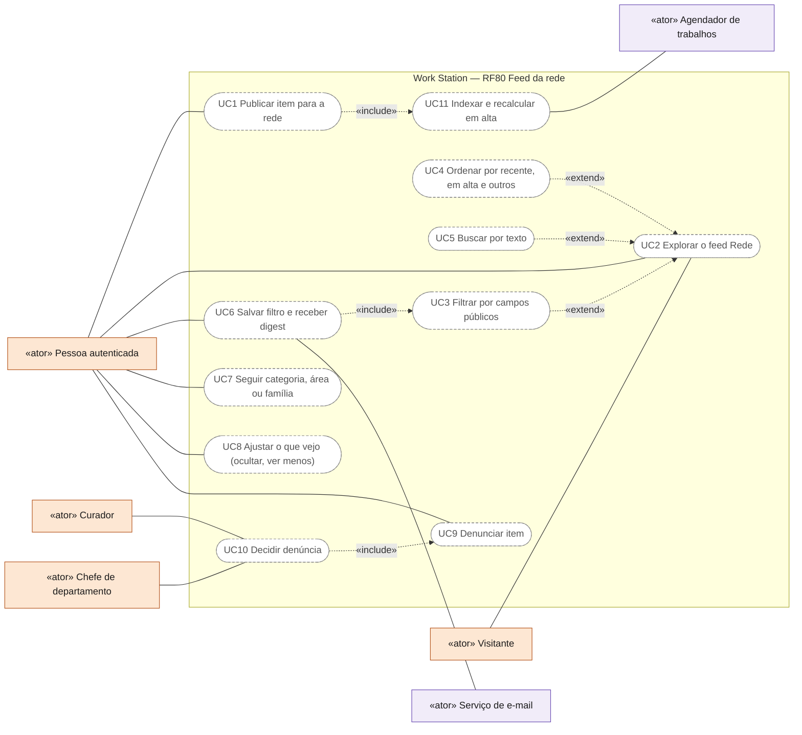
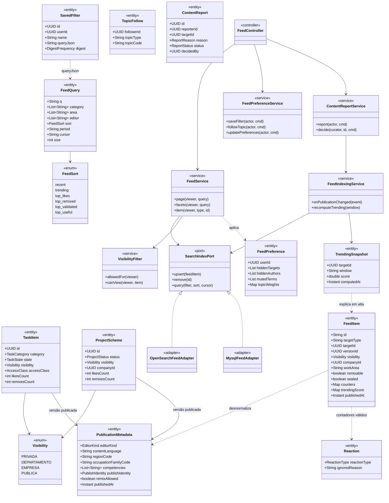
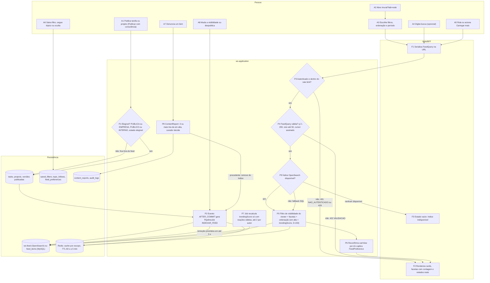
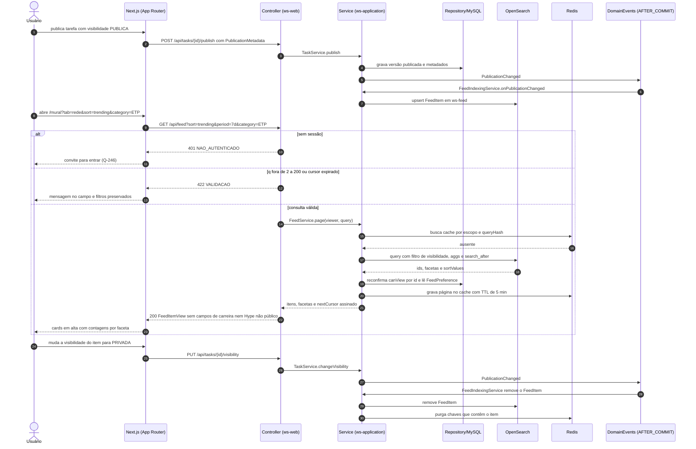
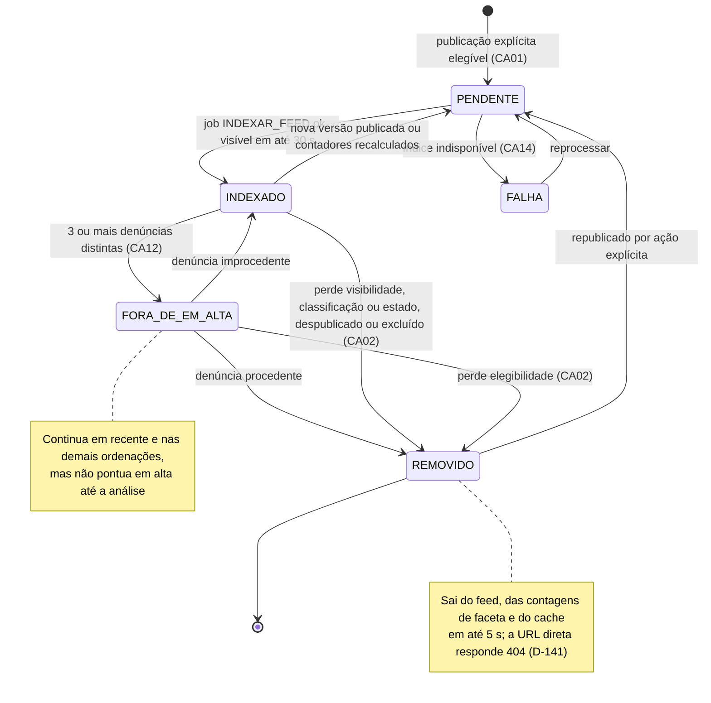
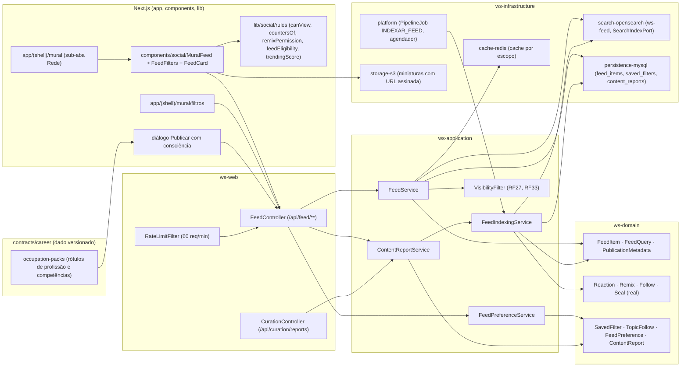

# RF80 — Feed da rede Work Station: projetos e tarefas publicados por todas as pessoas, com filtros por todos os campos públicos
**HU:** HU80 · **Aba/rota:** Mural, sub-aba Rede (`/mural?tab=rede`, ao lado de Mural da empresa · Vitrine · Seguindo; filtros e ordenação na URL, ex.: `/mural?tab=rede&sort=trending&category=ETP&area=ENGENHARIA&cursor=…`), filtros salvos (`/mural/filtros`), preferências do feed (`/settings?tab=privacidade`) · **Página-esqueleto:** a registrar; jornada ainda não implementada.
**Critérios de aceite cobertos:** RF80.CA01 … RF80.CA16 — requisito da auditoria de 02/11/2026 ([`ABAS_POR_PROFISSAO.md`](../../auditoria/2026-11-02/ABAS_POR_PROFISSAO.md) §8 e [`fontes/feed-global.md`](../../auditoria/2026-11-02/fontes/feed-global.md) §2–§5, onde os CAs aparecem com o número provisório RF76); numeração confirmada pela D-149; "hype" no feed = item em alta (D-150); visitante anônimo e itens EMPRESA na mesma lista seguem como propostos, em aberto na Q-246. Todos planejados. Já existem no código: `Visibility`, `TaskCategory`, `TaskType`, `NatureTag`, `ProcessTag`, `WorkArea`, os contadores em `TaskItem`/`ProjectScheme`, `Reaction` com `ignoredReason`, `Remix`, `Follow`, `Seal*`, `CuratorAppointment`, as regras puras de `lib/social/rules.ts` (`canView`, `countersOf`, `remixPermission`, `muralFeed` só DEMO) e a flag `ws.opensearch.enabled` com fallback MySQL.

**Trello:** card a criar no board **Work Station**.

**História de usuário:** COMO pessoa autenticada no Work Station QUERO explorar, na aba "Rede" do Mural, um feed de todos os projetos e tarefas que outras pessoas publicaram como públicos (ou para a minha empresa), filtrando por categoria, área profissional, editor de origem, selo, remixável, idioma, região e os demais campos públicos do item, ordenando por recente, em alta ("hype"), mais curtidos, mais remixados, mais validados ou mais úteis, salvando filtros e seguindo categorias ou áreas PARA descobrir trabalhos úteis, aprender com produções publicadas e reutilizá-las com crédito — sem que nenhum dado privado de perfil, carreira ou Hype de terceiros seja exposto.

**Experiência central:** a aba Rede abre em "recente" com uma lista de cards (título, capa, autor, categoria, área, editor, selos, contadores); o painel de filtros mostra cada faceta com a contagem de itens que a pessoa pode ver; o chip "em alta" (o "hype" do item, D-150) troca a ordenação para o `trendingScore` com decaimento; "Salvar filtro" guarda a combinação em `/mural/filtros`; cada card tem "ver menos disto", "ocultar" e "denunciar".

**Elegibilidade:** entra só a **versão publicada por ação explícita** (publicar ≠ salvar, `REDE_PROFISSIONAL_VISIBILIDADE.md`) com visibilidade PUBLICA e classificação PUBLICO/INTERNO, em estado elegível (tarefa `DISPONIVEL`, `CONCLUIDA`, `MODELO_PUBLICO`; projeto `PUBLICADO`, `EM_DECISAO`, `APROVADO`, `EM_EXECUCAO`, `CONCLUIDO`); itens EMPRESA só para quem é da mesma empresa, rotulados "sua empresa" (Q-246); DEPARTAMENTO, PRIVADA, RESTRITO e SIGILOSO nunca (D-93, D-137, D-139). **Fora, sempre:** perfil de carreira, profissão preferida sem opt-in (RF75.CA19, RF81.CA03), Hype de terceiros salvo PUBLICO (RF45.CA06), HSE, DECIA Points, sinal de busca de emprego (D-147).

## Critérios de aceite

| CA | Dado / quando / então |
|---|---|
| RF80.CA01 | Dado um item (tarefa ou projeto), quando o autor o publica por ação explícita com visibilidade PUBLICA e classificação PUBLICO/INTERNO, em estado elegível (tarefa DISPONIVEL/CONCLUIDA/MODELO_PUBLICO; projeto PUBLICADO/EM_DECISAO/APROVADO/EM_EXECUCAO/CONCLUIDO), então em até 30 s ele aparece no feed "Rede" para qualquer pessoa autenticada, com a **versão publicada** (não o rascunho), e um item EMPRESA aparece só para pessoas da mesma empresa com o rótulo "sua empresa" (lista única proposta; Q-246). |
| RF80.CA02 | Dado um item presente no feed, quando sua visibilidade muda para PRIVADA/DEPARTAMENTO, sua classificação para RESTRITO/SIGILOSO, seu estado para RASCUNHO/ARQUIVADO/BLOQUEADA/DEVOLVIDO, ou ele é despublicado ou excluído, então ele some do feed, das contagens de faceta e do cache em até 5 s para quem perdeu acesso; a leitura reconfirma `canView` por id antes de responder; abrir o item por URL responde `404 NAO_ENCONTRADO` (D-141). Teste automatizado "mudança de visibilidade remove do índice". |
| RF80.CA03 | Dado o feed, quando a pessoa aplica filtros, então estão disponíveis as facetas públicas do item: tipo (tarefa/projeto), categoria documental e subcategoria, tipo da tarefa, natureza, processo, área profissional/família de ocupação do item, editor de origem (Letters/Drawings/outro), autor, empresa/órgão (só em publicação institucional), identidade de publicação, intervalo de datas, exercício, estado/fase, competências declaradas, selo validado (emissor, nível, excelência), validado no DECIA, remixável, é remix, gerado com IA, idioma do conteúdo, região (UF/município), formato, classificação, contadores mínimos e **em alta** ("hype" do item: `trendingScore` na janela escolhida, D-150); filtros combinam por AND entre facetas e OR dentro da faceta; cada faceta mostra a contagem de itens elegíveis **para o viewer**. |
| RF80.CA04 | Dado qualquer filtro ou ordenação, quando calculado, então usa somente atributos **do item** publicado ou campos descobríveis do autor (nome profissional, `verified`, vínculo institucional se a publicação é institucional); nunca usa perfil de carreira, `preferredOccupation` sem opt-in, HSE, DECIA Points, Hype do autor, sinal de emprego ou pretensão salarial (RF75.CA14, D-147, D-150); um teste de contrato falha se o DTO `FeedItemView` contiver qualquer desses campos. |
| RF80.CA05 | Dado o feed, quando a pessoa escolhe a ordenação, então existem: **recente** (padrão, `publishedAt desc`), **em alta** — o filtro/ordenação "hype" do feed (D-150): `trendingScore` do item com decaimento temporal sobre reações válidas, salvos, remixes, comentários e visualizações; janelas 24 h / 7 d / 30 d; recalculado por job; o Hype do autor (RF45) nunca é filtro nem ordenação —, **mais curtidos**, **mais remixados** (atores distintos), **mais validados** (selo/decisão validada, nível, excelência) e **mais úteis** (ÚTIL + BEM_FUNDAMENTADO + CONFORME), todas com período (7 d / 30 d / 1 ano / sempre) e desempate por id. |
| RF80.CA06 | Dado o cálculo de "em alta", curtidas e úteis, quando há reações com `ignoredReason` (AUTO_INTERACAO, NAO_VERIFICADO, ANTIFRAUDE) ou repetidas da mesma pessoa, então elas não pontuam; uma página de "em alta" tem no máximo 2 itens do mesmo autor; o Hype do autor nunca entra no cálculo. |
| RF80.CA07 | Dado o card de um item no feed, quando exibido, então mostra título, resumo, capa/miniatura, tipo e categoria, autor (com `verified`; "autor não disponível" se o perfil não é visível ao viewer), empresa/órgão quando institucional, data de publicação, estado, área, editor de origem, idioma, região, selos, "remix de…" com crédito à origem, badge remixável, gerado com IA, contadores (curtidas, úteis, comentários, salvos, remixes) e o Hype do autor **apenas** se `hypeVisibility = PUBLICO` (D-150); as ações do RF26 (curtir, reagir, salvar, compartilhar, remixar, comentar) respeitam `canInteract`. |
| RF80.CA08 | Dado a busca textual, quando a pessoa digita de 2 a 200 caracteres, então o servidor busca em título, resumo, descrição, tags, subcategoria e competências, com analisador pt-BR e sinônimos; fora da faixa responde `422 VALIDACAO`; o trecho destacado nunca vem de item inelegível. |
| RF80.CA09 | Dado o feed, quando a pessoa salva o conjunto atual de filtros e ordenação, então cria um `SavedFilter` (≤ 20 por pessoa, nome obrigatório, privado) acessível em `/mural/filtros`, com opção de digest por e-mail ou notificação, diário ou semanal; filtros salvos não são visíveis a terceiros. |
| RF80.CA10 | Dado uma categoria, área profissional ou família de ocupação, quando a pessoa escolhe "seguir", então novos itens dessa faceta passam a alimentar a aba "Seguindo" e o filtro rápido "o que eu sigo"; seguir tópico não notifica por item (só digest), não concede acesso e é reversível. |
| RF80.CA11 | Dado um item ou autor no feed, quando a pessoa escolhe "ver menos disto", "ocultar item", "ocultar autor no feed" ou define palavras silenciadas, então o ajuste vale só para ela, é persistido no servidor, não altera ACL, não notifica o autor e é reversível em `/settings?tab=privacidade`. |
| RF80.CA12 | Dado um item no feed, quando a pessoa denuncia (motivos: impróprio, dados pessoais, direito autoral, spam, outro; texto ≤ 500), então um `ContentReport` é criado (uma denúncia por pessoa e item; repetida responde `409 JA_DENUNCIADO`), o curador ou o chefe do departamento do item decide com trilha (`AuditLog`); com ≥ 3 denúncias de pessoas distintas o item sai de "em alta" até a análise; denúncia procedente remove o item do índice e notifica o autor com o motivo; improcedente restaura. |
| RF80.CA13 | Dado o feed, quando a pessoa rola ou aciona "Carregar mais", então a paginação é por **cursor opaco e assinado** (sem offset), páginas de 20 (máx. 50), cursor válido por 5 min, profundidade máxima de 50 páginas; a URL reflete filtros e ordenação e o botão voltar restaura o estado; estados de carregamento, vazio e erro são reais. |
| RF80.CA14 | Dado `ws.opensearch.enabled = true`, quando o feed consulta, então usa o índice `ws-feed` com PIT + `search_after`, `aggs` por faceta e o filtro `(PUBLICA) OR (EMPRESA AND companyId = viewer)`; com a flag desligada usa `feed_items` materializada no MySQL com keyset pagination e FULLTEXT, mantendo as facetas principais; falha do índice mostra o estado vazio "índice indisponível", nunca 500, e nunca bloqueia publicar. |
| RF80.CA15 | Dado o `GET /api/feed`, quando chamado, então exige autenticação (`401 NAO_AUTENTICADO`; o visitante anônimo vê só o convite para entrar — proposta, Q-246), aplica rate limit de 60 req/min por pessoa (`429` com `Retry-After`), `viewsCount` incrementa no máximo 1× por pessoa e dia, as respostas têm `Cache-Control: private` e o feed não é indexável por buscadores. |
| RF80.CA16 | Dado a aba "Rede", quando avaliada por acessibilidade, então tem lista semântica com `aria-label`, filtros em `fieldset/legend`, chips removíveis nomeados, `aria-live` ao carregar, foco preservado após a paginação, operação completa por teclado, contraste ≥ 4,5:1 e respeito a `prefers-reduced-motion`; teste axe sem violações críticas. |

## 0. Diagrama de casos de uso

| Caso de uso | Ator(es) | CAs | Situação |
|---|---|---|---|
| UC1 Publicar item para a rede | Pessoa autenticada | RF80.CA01, RF80.CA02 | planejado (publicar e `Visibility` reais; metadados de publicação e índice a criar) |
| UC2 Explorar o feed Rede | Pessoa autenticada, Visitante (só convite para entrar, Q-246) | RF80.CA01, RF80.CA07, RF80.CA13, RF80.CA15, RF80.CA16 | planejado (`muralFeed` só DEMO para as outras abas) |
| UC3 Filtrar por campos públicos | Pessoa autenticada | RF80.CA03, RF80.CA04, RF80.CA14 | planejado |
| UC4 Ordenar por recente, em alta e outros | Pessoa autenticada | RF80.CA05, RF80.CA06 | planejado |
| UC5 Buscar por texto | Pessoa autenticada | RF80.CA08 | planejado |
| UC6 Salvar filtro e receber digest | Pessoa autenticada, Serviço de e-mail | RF80.CA09 | planejado |
| UC7 Seguir categoria, área ou família | Pessoa autenticada | RF80.CA10 | planejado |
| UC8 Ajustar o que vejo (ocultar, ver menos) | Pessoa autenticada | RF80.CA11 | planejado |
| UC9 Denunciar item | Pessoa autenticada | RF80.CA12 | planejado |
| UC10 Decidir denúncia | Curador, Chefe de departamento | RF80.CA12 | planejado |
| UC11 Indexar e recalcular em alta | Agendador de trabalhos | RF80.CA01, RF80.CA02, RF80.CA05, RF80.CA06, RF80.CA14 | planejado |

## 1. Diagrama de classes

## 2. Diagrama de atividades

Da publicação explícita ao item filtrado no feed, com a remoção quando o item perde a elegibilidade e a denúncia.

## 3. Diagrama de sequência

## 4. Máquina de estados

Ciclo do `FeedItem` no índice `ws-feed` (ou na tabela `feed_items`). O `FeedItem` é derivado e reconstruível: os estados descrevem a presença do item no feed, não o estado da tarefa ou do projeto (`TaskState`, `ProjectStatus`).

## 5. Diagrama de componentes

## 6. Rastreabilidade

Mensagens = números do `autonumber` da §3. Passos = nós da §2. Componentes = nós da §5. Estados = §4.

| CA | Classe | Passo | Mensagem | Transição | Componente |
|---|---|---|---|---|---|
| RF80.CA01 | `PublicationMetadata`, `FeedItem`, `FeedIndexingService` | A1 → P1 → P2 | 1–7 | `[*] → PENDENTE → INDEXADO` | `PUB`, `FIS`, `OS`, `PL` |
| RF80.CA02 | `FeedIndexingService`, `VisibilityFilter.canView` | A8 → P2 · P6 | 19, 24–30 | `INDEXADO → REMOVIDO` | `FIS`, `VF`, `RD` |
| RF80.CA03 | `FeedQuery`, `FeedItem` | A3 → F1 → P5 → F2 | 8–9, 14–23 | — | `FEED`, `FC`, `FS`, `OS` |
| RF80.CA04 | `FeedItem` (sem campos de carreira), `FeedService` | P5 → P6 | 22 | — | `FS`, `RUL` |
| RF80.CA05 | `FeedSort`, `TrendingSnapshot` | A3 → P5 · P7 | 9, 17 | — | `FS`, `FIS` |
| RF80.CA06 | `Reaction.ignoredReason`, `TrendingSnapshot` | P7 | — | — | `FIS`, `SOC`, `PL` |
| RF80.CA07 | `FeedItem` (contadores, selos, remix) | F2 | 22–23 | — | `FEED`, `RUL`, `S3` |
| RF80.CA08 | `FeedQuery.q` | A4 → P4 | 12–13 | — | `FS`, `OS` |
| RF80.CA09 | `SavedFilter`, `FeedPreferenceService` | A6 | — | — | `FIL`, `FPS`, `MY` |
| RF80.CA10 | `TopicFollow` | A6 | — | — | `FPS`, `REP` |
| RF80.CA11 | `FeedPreference` | A6 · P6 | 19 | — | `FPS`, `FS` |
| RF80.CA12 | `ContentReport`, `ContentReportService` | A7 → P8 → P2 | — | `INDEXADO → FORA_DE_EM_ALTA → REMOVIDO` | `CRS`, `CC`, `FIS` |
| RF80.CA13 | `FeedQuery.cursor` | A5 → F1 → P4 | 9, 21 | — | `FEED`, `FC`, `FS` |
| RF80.CA14 | `SearchIndexPort`, `OpenSearchFeedAdapter`, `MysqlFeedAdapter` | P9 → P5 · F3 | 17 | `PENDENTE → FALHA` | `OS`, `MY` |
| RF80.CA15 | `FeedController` | P3 | 10–11 | — | `RL`, `FC` |
| RF80.CA16 | — (interface) | F2 | 23 | — | `MUR`, `FEED` |
