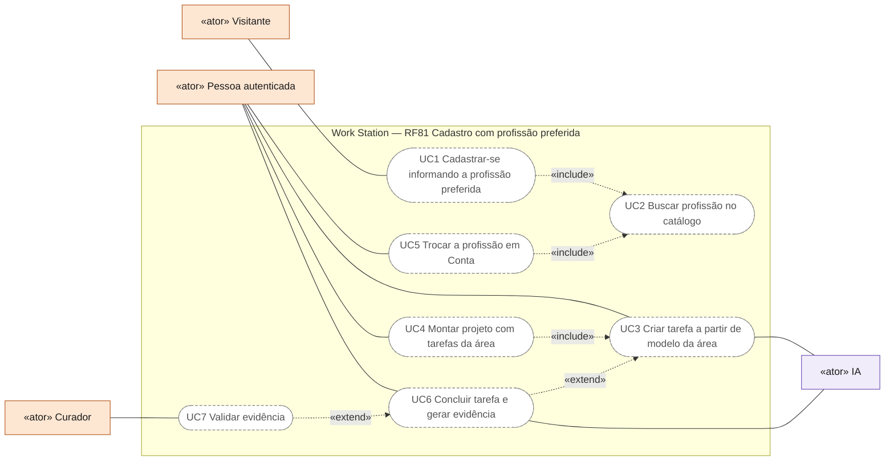
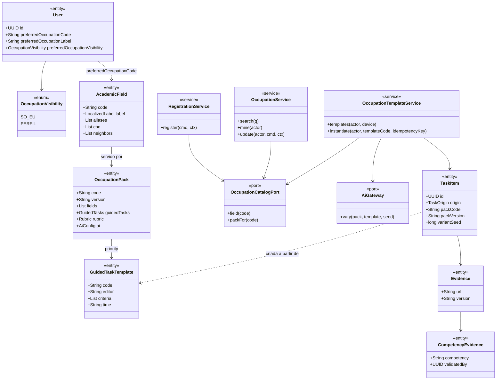
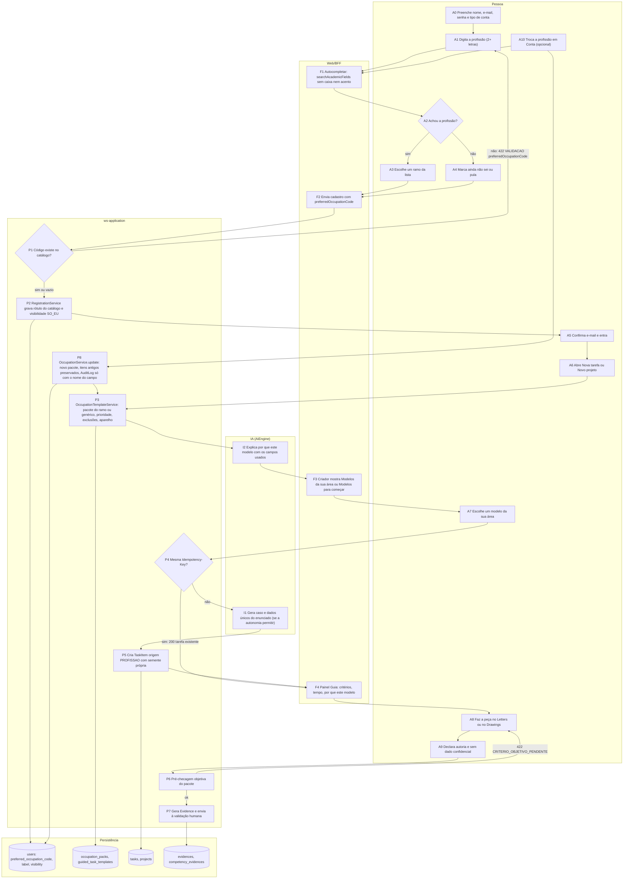
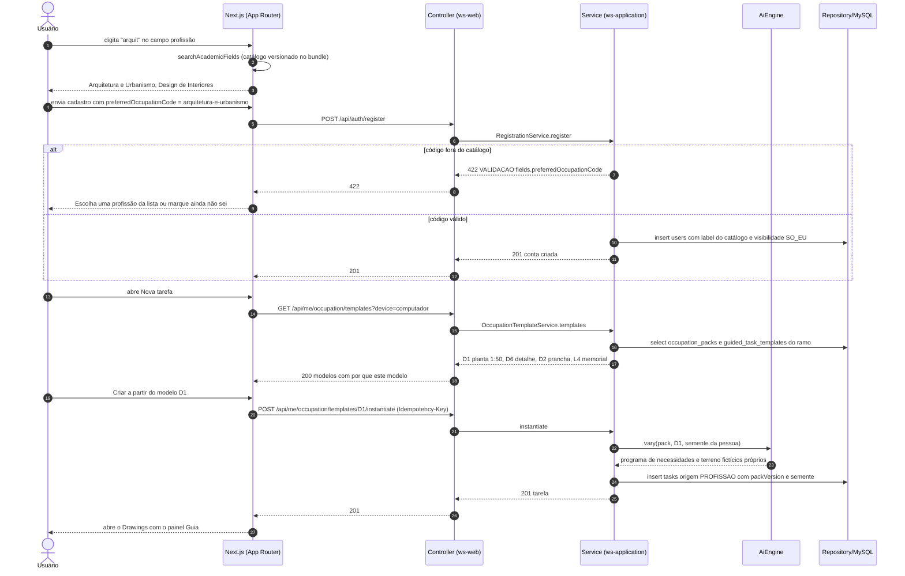
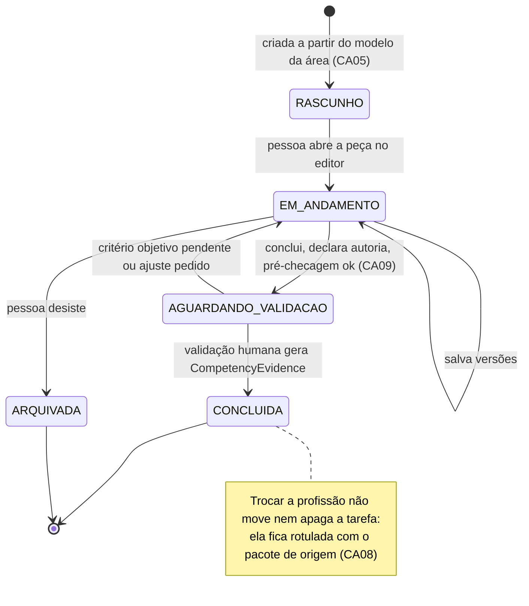
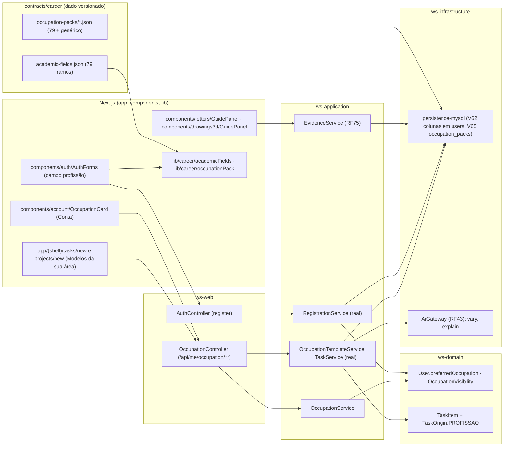

# RF81 — Cadastrar-se com a profissão preferida para criar tarefas e projetos únicos da própria área
**HU:** HU81 · **Aba/rota:** Cadastro (`/register`), Conta (`/settings?tab=conta`), criador de tarefas e projetos com modelos da profissão (`/tasks/new?modelo=`, `/projects/new?modelo=`) · **Página-esqueleto:** a registrar; jornada ainda não implementada.
**Critérios de aceite cobertos:** RF81.CA01 … RF81.CA10 — requisito novo pedido pelo usuário em 09/11/2026; todos planejados. Concretiza a decisão D-148 (profissão preferida já no cadastro) e o campo `User.preferredOccupation` do RF75.CA19. Já existem no repositório: o catálogo de 79 ramos (`contracts/career/academic-fields.json`), um pacote de domínio por ramo mais o genérico (`contracts/career/occupation-packs/`), o validador (`npm run career:validate`) e os helpers de busca e de pacote (`lib/career/`).

**Trello:** card a criar no board **Work Station** (esta sessão não tem acesso ao Trello; o texto do card está em [`TRELLO_CARD.md`](TRELLO_CARD.md)).

**História de usuário:** COMO usuário QUERO me cadastrar no Work Station com a minha profissão preferida PARA criar tarefas e projetos únicos de minha área de estudo ou trabalho, a fim de agregar em minha formação acadêmica e profissional.

**Experiência central:** no cadastro, depois dos dados da conta, a pergunta opcional "Qual profissão você quer desenvolver?" com autocompletar sobre os 79 ramos (sem caixa nem acento; "advogada" encontra Direito) e a opção "ainda não sei". Ao entrar, o criador de tarefas e projetos oferece **modelos da profissão** (as tarefas-guia do pacote, já parametrizadas: planta 1:50 com NBR 6492 para Arquitetura, parecer sobre caso fictício para Direito, relatório técnico e diagrama para Engenharia de Software), cada um gerado com dados próprios para a pessoa — a peça é dela, única, e vira evidência para a formação quando concluída.

**Regras herdadas:** a profissão preferida é privada por padrão e **não é sinal de busca de emprego** (D-147); dados sensíveis não são perguntados nem inferidos (RF75.CA12); a IA só pré-checa critérios objetivos e nunca produz peça assinável (RF75.CA06, pacotes `ai.guardrails`).

## Estado da implementação (frontend · novembro de 2026)

Já existe no criador de tarefas (`/tasks/new`, `components/tasks/TaskAssist.tsx`) a parte do RF81 que não depende do cadastro:
o **campo de estudo como lente da tarefa** (os 79 ramos, cada um com a área de trabalho padrão e o pacote de domínio carregado sob
demanda — `lib/tasks/fieldIndex.gen.ts`, gerado por `npm run career:index`), os **modelos iniciais** da área (51 modelos para as 9
`WorkArea`, `lib/tasks/areaTemplates.ts`) e do campo (tarefas-guia e próprias do pacote, `packTemplates`), abertos também por
`/tasks/new?modelo=<id>`, e o **feedback de qualidade** determinístico (`lib/tasks/quality.ts`): essencial (objetivo tangível,
entregas como substantivos, critérios verificáveis, prazo, privacidade), regras da área (ex.: Jurídico — número CNJ, base legal e
prazo; Pesquisa — pergunta, método, amostra e consentimento; Engenharia — norma e ART) e do campo (rubrica, entregas típicas, fontes
e dados sensíveis do pacote), cada achado com a correção aplicável em um clique. A tarefa grava o campo usado em
`extensions.studyField`. Ainda planejado: a pergunta no cadastro e em Conta (`User.preferredOccupation`), a origem `PROFISSAO`
(CA05) e os modelos no criador de projetos.

## Critérios de aceite

| CA | Dado / quando / então |
|---|---|
| RF81.CA01 | Dado o formulário de cadastro, quando a pessoa chega ao passo de perfil, então vê a pergunta opcional "Qual profissão você quer desenvolver?" com "por que pergunto" ("para sugerir tarefas e projetos da sua área"), autocompletar a partir de 2 caracteres sobre rótulo e aliases do catálogo (sem caixa nem acento, até 8 sugestões, ordem: rótulo igual, rótulo começa, alias igual, alias começa, contém) e a opção "ainda não sei"; pular não bloqueia o cadastro. |
| RF81.CA02 | Dado o envio do cadastro com `preferredOccupationCode`, quando o servidor valida, então o código precisa existir no catálogo versionado; o rótulo gravado vem do catálogo (nunca do cliente); código desconhecido responde `422 VALIDACAO` com `details.fields.preferredOccupationCode` e nada é criado; a conta nasce com `preferredOccupationVisibility = SO_EU`. |
| RF81.CA03 | Dado a profissão preferida gravada, quando terceiros (outra pessoa, chefe, empresa, administrador, curador) consultam perfil, busca, pessoas semelhantes ou painéis, então o campo não aparece enquanto a pessoa não marcar "mostrar no meu perfil" em Conta; mesmo visível, nunca é filtro de busca de pessoas nem sinal de disponibilidade para emprego (D-147). |
| RF81.CA04 | Dado o primeiro acesso com profissão preferida, quando a pessoa abre "Nova tarefa" ou "Novo projeto", então o criador mostra a seção "Modelos da sua área" com as tarefas-guia do `OccupationPack` do ramo na ordem de `guidedTasks.priority`, sem as excluídas e, no celular, sem as que exigem computador (D3, D8); cada modelo diz competência, entregável, tempo, critérios e "por que este modelo". |
| RF81.CA05 | Dado um modelo escolhido, quando a pessoa confirma "Criar a partir do modelo", então nasce uma `TaskItem` real (RF4) com origem `PROFISSAO`, título, categoria, critérios e parâmetros do pacote, e o caso, os dados e o contexto do enunciado são **gerados para essa pessoa** (variação paramétrica com semente própria; a IA via `AiGateway` só quando o modo de autonomia permitir, senão a variação determinística do pacote), de modo que duas pessoas não recebam o mesmo enunciado; a tarefa abre no Letters ou no Drawings com o painel Guia; a mesma confirmação repetida com a mesma `Idempotency-Key` não duplica (`200` com a tarefa existente). |
| RF81.CA06 | Dado um projeto criado a partir de modelos da área, quando a pessoa agrupa duas ou mais tarefas da profissão, então o projeto (RF21) recebe fases sugeridas pelo pacote (ex.: levantamento → projeto → detalhamento → apresentação) que a pessoa pode editar; nada é publicado sem ação explícita (`REDE_PROFISSIONAL_VISIBILIDADE.md`). |
| RF81.CA07 | Dado "ainda não sei" ou cadastro sem profissão, quando a pessoa entra, então vale o pacote genérico (competências transversais), o criador mostra "Modelos para começar" e o guia oferece o teste de interesses (RF75.CA03); a qualquer momento a pessoa escolhe a profissão em Conta. |
| RF81.CA08 | Dado a troca da profissão preferida em Conta, quando salva, então os modelos e sugestões passam a vir do novo pacote, tarefas, projetos e evidências já criados permanecem e ficam rotulados com o pacote de origem, e o `AuditLog PROFILE_UPDATED` registra só o nome do campo (sem valores). |
| RF81.CA09 | Dado uma tarefa da profissão concluída, quando a pessoa declara autoria e ausência de dado confidencial, então a pré-checagem objetiva do pacote roda (`rubric.objective` com `auto = true`), a tarefa gera `Evidence` e, com validação humana, `CompetencyEvidence` exportável (Open Badges 3.0) — o registro que "agrega à formação"; a IA nunca dá a validação. |
| RF81.CA10 | Dado o campo e as telas do RF, quando renderizados ou exportados, então funcionam por teclado e leitor de tela (combobox com `aria-activedescendant`), têm textos pt-BR/en/es sem identificadores internos, entram na exportação de dados da conta (LGPD art. 18) e a anonimização da conta zera código, rótulo e visibilidade. |

## 0. Diagrama de casos de uso

| Caso de uso | Ator(es) | CAs | Situação |
|---|---|---|---|
| UC1 Cadastrar-se informando a profissão preferida | Visitante | RF81.CA01, RF81.CA02, RF81.CA07 | planejado |
| UC2 Buscar profissão no catálogo | Visitante, Pessoa autenticada | RF81.CA01, RF81.CA10 | planejado (busca pura já em `lib/career/academicFields.ts`) |
| UC3 Criar tarefa a partir de modelo da área | Pessoa autenticada, IA | RF81.CA04, RF81.CA05 | planejado |
| UC4 Montar projeto com tarefas da área | Pessoa autenticada | RF81.CA06 | planejado |
| UC5 Trocar a profissão em Conta | Pessoa autenticada | RF81.CA03, RF81.CA08 | planejado |
| UC6 Concluir tarefa e gerar evidência | Pessoa autenticada, IA | RF81.CA09 | planejado |
| UC7 Validar evidência | Curador | RF81.CA09 | planejado |

## 1. Diagrama de classes

## 2. Diagrama de atividades

Do cadastro com a profissão preferida até a tarefa única da área concluída como evidência da formação. Versão em imagem (para o card do Trello): [`atividades.png`](atividades.png).

## 3. Diagrama de sequência

## 4. Máquina de estados

`TaskState` da tarefa criada a partir de modelo da profissão (RF4), com as transições que este RF acrescenta.

## 5. Diagrama de componentes

## 6. Rastreabilidade

Mensagens = números do `autonumber` da §3. Passos = nós da §2. Componentes = nós da §5.

| CA | Classe | Passo | Mensagem | Transição | Componente |
|---|---|---|---|---|---|
| RF81.CA01 | `AcademicField` | A1 → F1 → A2 → A3 · A4 | 1–3 | — | `REG`, `LIB`, `CAT` |
| RF81.CA02 | `User.preferredOccupation*`, `RegistrationService` | F2 → P1 → P2 | 4–10 | — | `AC`, `RS`, `MYSQL` |
| RF81.CA03 | `OccupationVisibility` | P2 | 8 | — | `OS`, `ACC` |
| RF81.CA04 | `OccupationPack`, `GuidedTaskTemplate`, `OccupationTemplateService` | A6 → P3 → I2 → F3 | 11–16 | — | `NEW`, `OC`, `OTS` |
| RF81.CA05 | `TaskItem` (origin, packVersion, variantSeed), `AiGateway.vary` | A7 → P4 → I1 → P5 → F4 | 17–24 | `[*] → RASCUNHO` | `OTS`, `AIG`, `T` |
| RF81.CA06 | `TaskItem`, projeto (RF21) | A6 → P3 | — | — | `NEW` |
| RF81.CA07 | pacote genérico | A4 → F2 → P2 → P3 | 4–10 | — | `LIB`, `PKS` |
| RF81.CA08 | `OccupationService.update` | A10 → P8 → P3 | — | — | `ACC`, `OS` |
| RF81.CA09 | `Evidence`, `CompetencyEvidence` | A8 → A9 → P6 → P7 | — | `EM_ANDAMENTO → AGUARDANDO_VALIDACAO → CONCLUIDA` | `GUI`, `EVS` |
| RF81.CA10 | `User` (exportação, anonimização) | A1 | — | — | `REG`, `ACC` |

## Estado da implementação (12/11/2026)

- **Profissão preferida nas preferências:** `preferredOccupation` em `lib/preferences/types.ts`, validada contra os 79 ramos do índice
  gerado do catálogo (`lib/tasks/fieldIndex.gen.ts`), viaja dentro de `notificationPrefsJson` (sem backend novo, como
  `aiAutonomyDefault`). Privada (D-147): nunca vai para o `ws.prefs` do `localStorage` (sem sessão, fica só no `sessionStorage` da aba) e
  é esquecida ao sair da conta.
- **Conta/Configurações › Trabalho (CA01 e CA10, parcial):** campo "Qual profissão você quer desenvolver?" com combobox acessível
  (`aria-activedescendant`, ↓ ↑ Enter Esc), autocompletar a partir de 2 letras por rótulo e aliases sem caixa nem acento (até 8
  sugestões, também pelo rótulo em en/es), lista agrupada pelas categorias do criador (TI = "Desenvolvimento de software", Engenharia,
  Design, Pesquisa, Administração e depois Marketing, Planejamento, Jurídico — `lib/career/categories.ts`, sem vocabulário novo), "ainda
  não sei" e o aviso "só você vê; não aparece no seu perfil nem para a empresa". A pergunta no cadastro (`/register`) ainda não existe.
- **Criador de tarefas (CA04 e CA07, parcial):** só no criador e só para o dono, o campo de estudo vem pré-selecionado pela profissão,
  marcado "a partir da sua profissão — só você vê" e trocável; com ele a área, os modelos, as extensões e a checagem da profissão se
  adaptam. A lente sugerida só é gravada na tarefa (`extensions.studyField`) se a pessoa confirmar ou usar um modelo do campo. Edição de
  tarefa existente e visitante não recebem a sugestão.
- **Plano de desenvolvimento:** as tarefas-guia da profissão na ordem de `guidedTasks.priority` (sem as excluídas; as próprias do campo no
  fim), cada uma com "criar esta tarefa" e o progresso pelas tarefas da pessoa com `extensions.guidedTask` ("k de n", sem percentual).
  Fica no criador de tarefas porque a aba Carreira do perfil (RF75, n.16) não está no registro (Matriz B tem 15 sub-abas);
  `components/career/DevelopmentPlan.tsx` está pronto para ser montado nela.
- **D-153:** `packFor(code, minStatus)` em `lib/career/packs.ts`; o Acervo usa `pesquisa` como mínimo para lente, modelos e plano e mostra
  "em revisão por especialistas" no lugar de "(pesquisa)", sem status, versão nem códigos L/D/X.
- **Rascunho de outras telas:** `/tasks/new?rascunho=<id>` preenche o formulário, mostra a origem, permite descartar e apaga o rascunho
  depois de salvar.
- **Ainda planejado:** validação no servidor (CA02), visibilidade `PERFIL` por opt-in (CA03), origem `PROFISSAO` com `Idempotency-Key`
  e variação paramétrica (CA05), modelos no criador de projetos (CA06), `AuditLog` da troca (CA08), evidência (CA09), exportação e
  anonimização da conta (CA10).
- **Testes:** `lib/preferences/occupation.test.tsx`, `lib/career/packs.test.ts`, `components/career/career.test.tsx` e
  `components/tasks/assist.test.tsx`.
