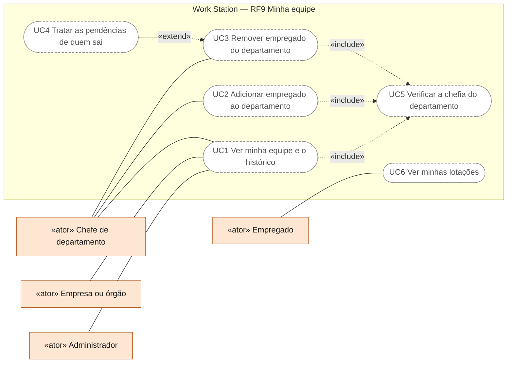
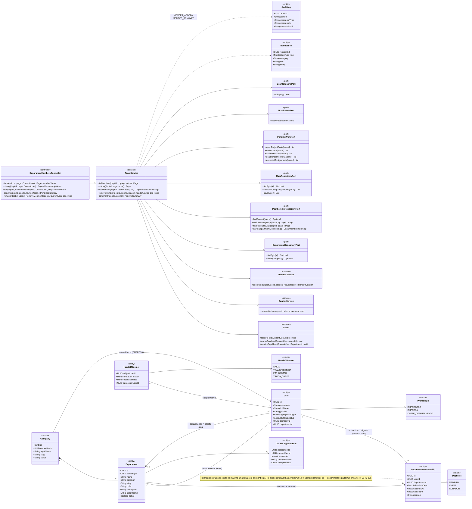
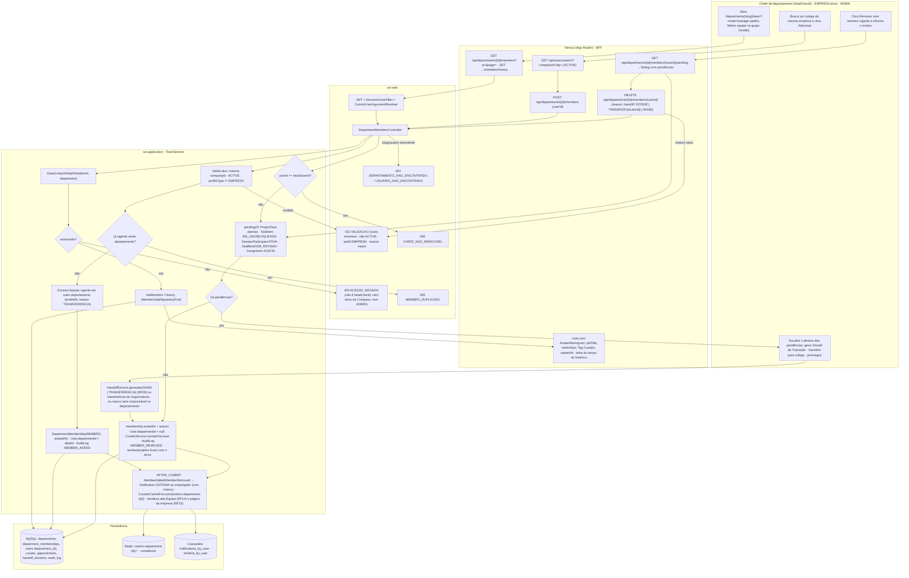
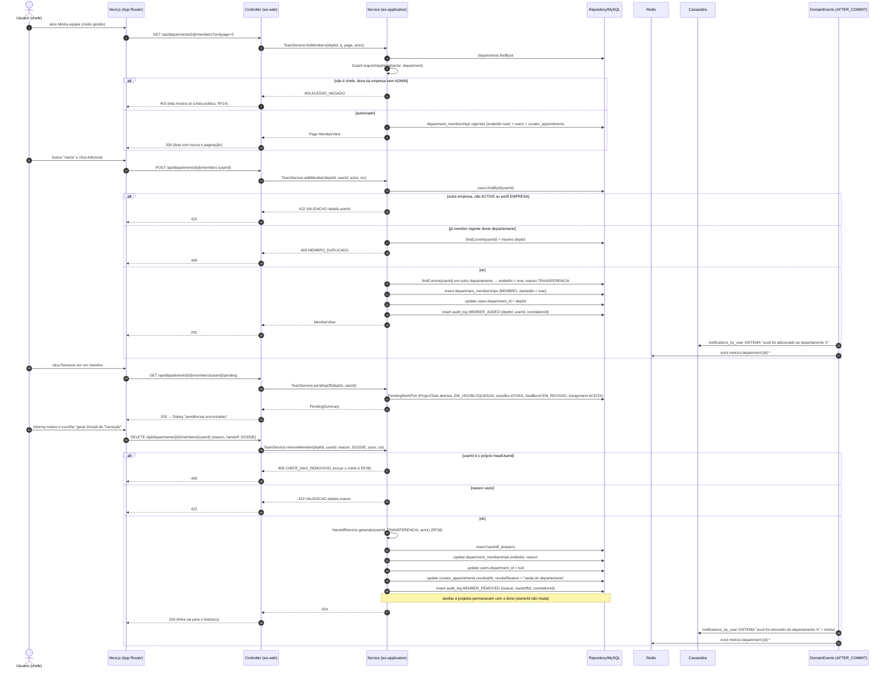
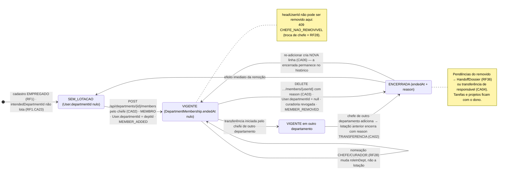
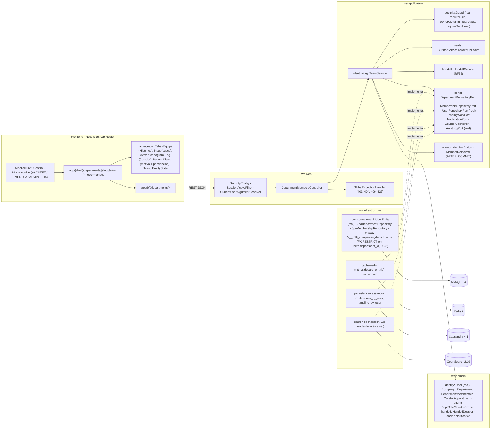

# RF9 — Permitir que um chefe de departamento possa adicionar ou remover um usuário da sua lista de empregados atuais
**HU:** HU9 · **Sprint (board Work Station):** lista *Requisitos Funcionais* sem sprint atribuída (o card "SPRINT 2" cita "RF9 Adicionar/remover usuários" da **sessão DECIA**, escopo antigo preservado em `_anterior/RF9`; fase (g) da ARQUITETURA §6: "RF9/RF10/RF46 (equipe, atribuição, chat)") · **Equivalente FAI:** RF22 Perfil institucional (celebridade) — abas "do administrador" negadas no serviço (`guard.deny`); o FAI não tem lotação de pessoas, a gestão de equipe é nova · **Aba/rota:** página do departamento `/departments/[slug]` → aba **Equipe** → modo **Minha equipe (gestão)** só para o chefe (`/departments/[slug]/team?mode=manage`); atalho **Minha equipe** no grupo Gestão do `SidebarNav` (ABAS_POR_PERFIL §1.2, §7.b); API `GET /api/departments/{id}/members`, `GET /api/departments/{id}/members/history`, `POST /api/departments/{id}/members`, `DELETE /api/departments/{id}/members/{userId}`, `GET /api/departments/{id}/members/{userId}/pending`
**Critérios de aceite cobertos:** RF9.CA01 … RF9.CA06 — **todos "(CA a confirmar)"**: o corpo do card está vazio e o **escopo é novo**; os CAs foram derivados do título + HU9 e reaproveitam RF28.CA02 (lotação 1 por vez com histórico em `DepartmentMembership`), RF28.CA03 (auditoria do chefe), o guard `requireDeptHead` e a aba "Minha equipe" propostos em `docs/produto/ABAS_POR_PERFIL.md`. Todas as classes do RF são **(planejado)**; reais: `Guard.requireRole/ownerOrAdmin`, `User.companyId/departmentId` (colunas sem FK até o RF28, D-23), `AuditLogPort`, `SecurityConfig`.

> **HU9** — COMO chefe de departamento de uma empresa POSSO adicionar ou remover um usuário de minha lista de empregados ativos PARA melhorar a minha gestão empresarial.

## Critérios de aceite derivados da HU9 (todos "CA a confirmar")

| CA | Enunciado (Dado / Quando / Então) | Origem |
|---|---|---|
| **RF9.CA01** (CA a confirmar) | Dado um CHEFE_DEPARTAMENTO com `Department.headUserId == eu` (ou EMPRESA dona da `Company`, ou ADMIN — `Guard.requireDeptHead`), quando abro a aba Equipe no modo **Minha equipe**, então vejo os `DepartmentMembership` vigentes (nome, username, `jobTitle`, `roleInDept`, `startedAt`, etiqueta Curador) com busca e paginação (> 50), mais o histórico de lotações encerradas; quem não é chefe vê só a lista pública (RF14) e a API de gestão responde `403 ACESSO_NEGADO`. | ABAS §7.b, RF28.CA02 |
| **RF9.CA02** (CA a confirmar) | Dado o modo gestão, quando **adiciono** um usuário (busca por nome/username na mesma `Company`, `AccountStatus ACTIVE`), então nasce um `DepartmentMembership` MEMBRO com `startedAt`, a lotação vigente anterior (em outro departamento) é encerrada com `endedAt` e `reason TRANSFERENCIA` e `User.departmentId` passa a ser o meu departamento; já membro vigente → `409 MEMBRO_DUPLICADO`; usuário de outra empresa, não ACTIVE ou perfil EMPRESA → `422 VALIDACAO`. | RF28.CA02 (1 lotação por vez) |
| **RF9.CA03** (CA a confirmar) | Dado um membro vigente, quando **removo** informando `reason` (obrigatório, `422 VALIDACAO`), então o `DepartmentMembership` recebe `endedAt` e `reason` (sem apagar), `User.departmentId` fica nulo, o `CuratorAppointment` vigente dele é revogado (`revokeReason` = saída do departamento) e suas tarefas/projetos **permanecem** com o dono; remover o próprio chefe (`headUserId`) → `409 CHEFE_NAO_REMOVIVEL` (trocar o chefe é RF28). | RF28.CA02/CA03 |
| **RF9.CA04** (CA a confirmar) | Dado que o removido tem pendências (responsável em `ProjectTask` aberta, `TaskItem` EM_USO/BLOQUEADA como responsável, `SessionParticipant` em sessão ATIVA, `SealBond` EM_REVISAO de que é alvo, `Assignment` ACEITA), quando confirmo a remoção, então o sistema lista as pendências (`GET …/pending`) e oferece **gerar Dossiê de Transição** (`HandoffDossier` reason TRANSFERENCIA/SAIDA, RF36) ou **transferir** para outro membro; sem escolha, a remoção prossegue e as pendências ficam marcadas "sem responsável no departamento". | RF36, RF10 |
| **RF9.CA05** (CA a confirmar) | Dado a inclusão ou remoção, então `MemberAdded`/`MemberRemoved` (AFTER_COMMIT) gravam `AuditLog MEMBER_ADDED/MEMBER_REMOVED` com `correlationId`, notificam o empregado (`Notification` tipo SISTEMA, categoria SISTEMA: "você foi adicionado/removido do departamento X", com motivo), invalidam o cache Redis de métricas/contadores do departamento e atualizam a aba pública Equipe e a página da empresa (RF14/RF15). | RF28.CA03 |
| **RF9.CA06** (CA a confirmar) | Dado o histórico, então re-adicionar alguém cria um **novo** `DepartmentMembership` (o anterior permanece encerrado), a linha do tempo de lotações aparece no modo gestão e no perfil do empregado (empresa/departamento atual, RF16), e todas as mensagens são i18n (pt-BR/en/es). | RF28.CA02 (histórico) |

## 0. Diagrama de casos de uso

Quem gere a lista de empregados de um departamento e o que cada um consegue fazer. Borda contínua: existe no código em 17/10/2026; tracejada: planejado (a gestão de equipe é escopo novo e a aba Minha equipe ainda é esqueleto).

| Caso de uso | Ator(es) | CAs | Situação |
|---|---|---|---|
| UC1 Ver minha equipe e o histórico | chefe; empresa e admin só veem (ABAS_POR_PERFIL §2.5) | RF9.CA01, RF9.CA06 | planejado (`GET /api/departments/{id}/members`) |
| UC2 Adicionar empregado ao departamento | chefe | RF9.CA02, RF9.CA05, RF9.CA06 | planejado (`DepartmentMembership`; `409 MEMBRO_DUPLICADO`) |
| UC3 Remover empregado do departamento | chefe | RF9.CA03, RF9.CA05 | planejado (motivo obrigatório; revoga o curador; `409 CHEFE_NAO_REMOVIVEL`) |
| UC4 Tratar as pendências de quem sai | chefe | RF9.CA04 | planejado (Dossiê de Transição RF36 ou transferência) |
| UC5 Verificar a chefia do departamento | — (incluído por UC1, UC2, UC3) | RF9.CA01 | planejado (`Guard.requireDeptHead`; o CA também admite a EMPRESA dona e o ADMIN) |
| UC6 Ver minhas lotações | empregado | RF9.CA05, RF9.CA06 | planejado (linha do tempo no perfil, RF16; aviso por notificação) |

## 1. Diagrama de classes

## 2. Diagrama de atividades

## 3. Diagrama de sequência

## 4. Máquina de estados

Entidade central: **`DepartmentMembership`** (TAXONOMIA §1.6) — estados derivados de `endedAt` (não há enum): **VIGENTE** (`endedAt` nulo) e **ENCERRADA** (`endedAt` + `reason`). A invariante "no máximo uma VIGENTE por `userId`" é garantida pelo `TeamService` (e, no RF28, por índice parcial). `DeptRole` muda por nomeação (CHEFE/CURADOR, RF28), não por este RF.

## 5. Diagrama de componentes

## 6. Rastreabilidade

| CA | Classe (§1) | Passo da atividade (§2) | Mensagem da sequência (§3) | Transição de estado (§4) | Componente (§5) | Situação |
|---|---|---|---|---|---|---|
| RF9.CA01 | `DepartmentMembersController.list/history`, `TeamService.listMembers/history`, `Guard.requireDeptHead`, `MembershipRepositoryPort.findCurrentByDept` | `A1`→`F1`→`S1`→`S2`→`S3`→`F6`, `E403` | 1–11 | — | `PG`, `SN`, `GD`, `UI` | planejado (`Guard` base real) |
| RF9.CA02 | `TeamService.addMember`, `DepartmentMembership`, `User.departmentId`, `UserRepositoryPort.searchInCompany` | `A2`→`F2`→`F3`→`ADD1`→`ADD4`, `E422`, `E409D` | 12–26 | `SEM`→`VIG`, `OUTRO`→`ENC` | `TS`, `MY` | planejado (RF28.CA02) |
| RF9.CA03 | `TeamService.removeMember`, `CuratorService.revokeOnLeave`, `CuratorAppointment.revokeReason` | `A3`→`F5`→`REM1`→`REM5`, `E409C`, `E422` | 36–47 | `VIG`→`ENC`→`SEM` | `TS`, `CUR` | planejado (RF28.CA03) |
| RF9.CA04 | `TeamService.pendingOf`, `PendingWorkPort`, `HandoffService.generate`, `HandoffDossier` | `F4`→`REM2`→`REM3`→`A4`→`REM4` | 29–35, 43–44 | nota de `ENC` | `HO`, `PORTS` | planejado (RF36, RF10) |
| RF9.CA05 | eventos `MemberAdded`/`MemberRemoved`, `AuditLogPort` (`MEMBER_ADDED`/`MEMBER_REMOVED`), `NotificationPort`, `CounterCachePort.evict` | `EV` | 23, 27–28, 47, 51–52 | — | `EVT`, `CAS`, `RDS`, `OSE` | planejado (`AuditLogPort` real) |
| RF9.CA06 | `MembershipRepositoryPort.findHistoryByDept`, invariante de 1 vigente, `lib/i18n` | `F1` (history), `F6` | 10–11 | `ENC`→`VIG` (nova linha) | `UI` (linha do tempo), `PG` | planejado |
