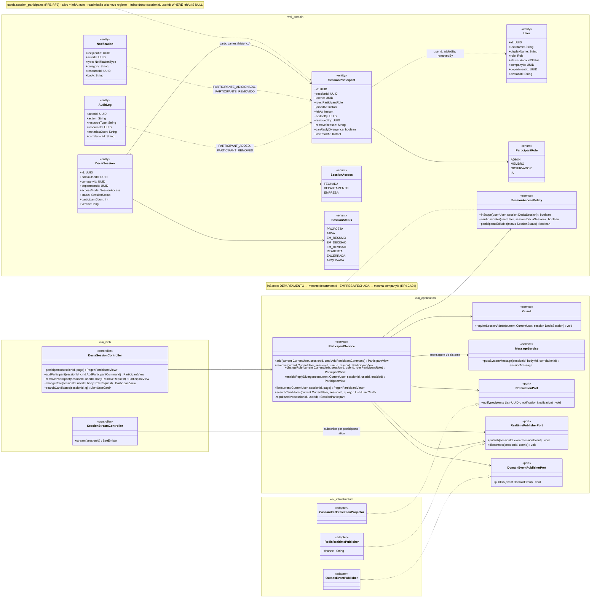
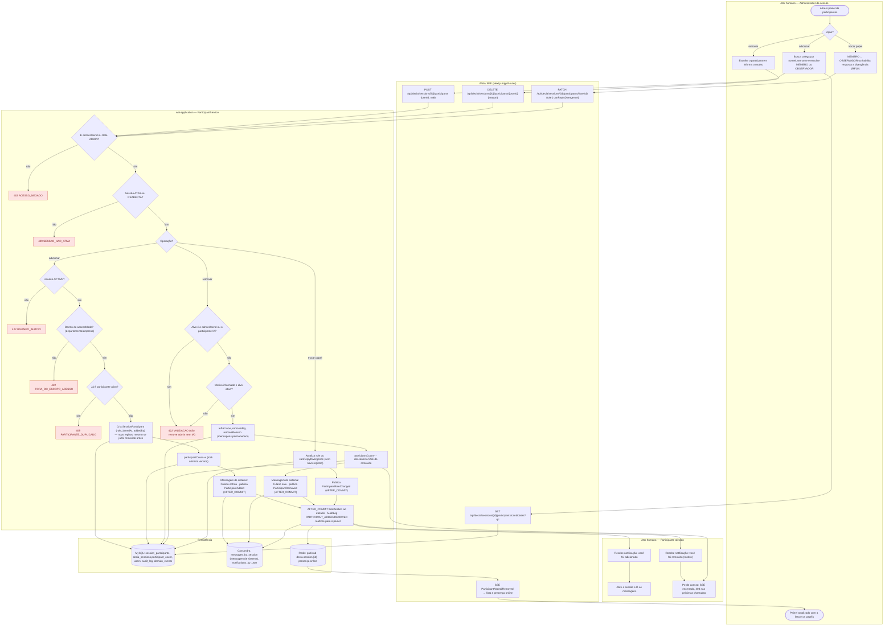
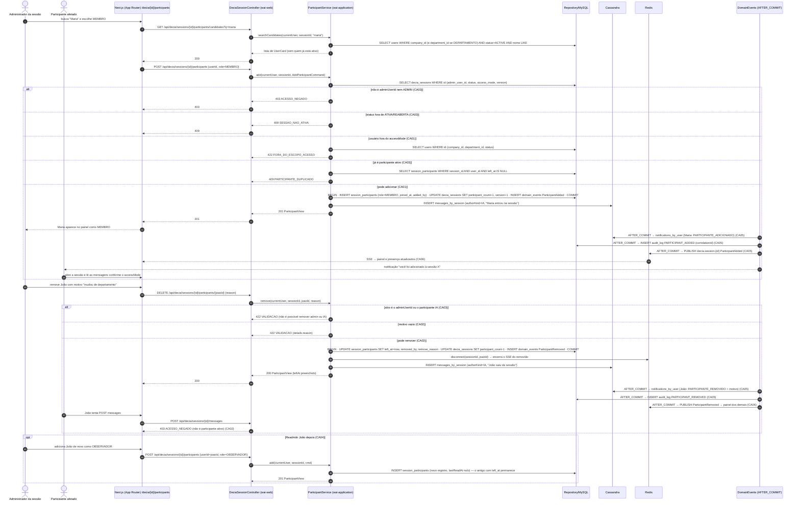
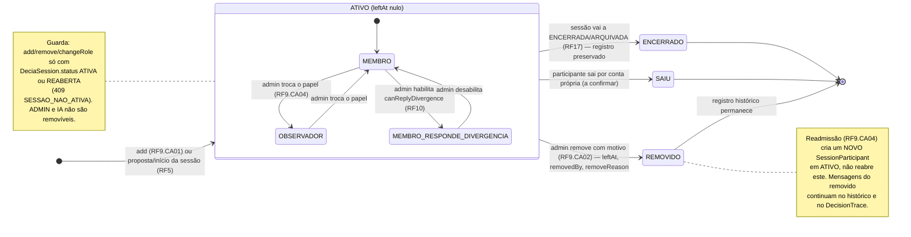
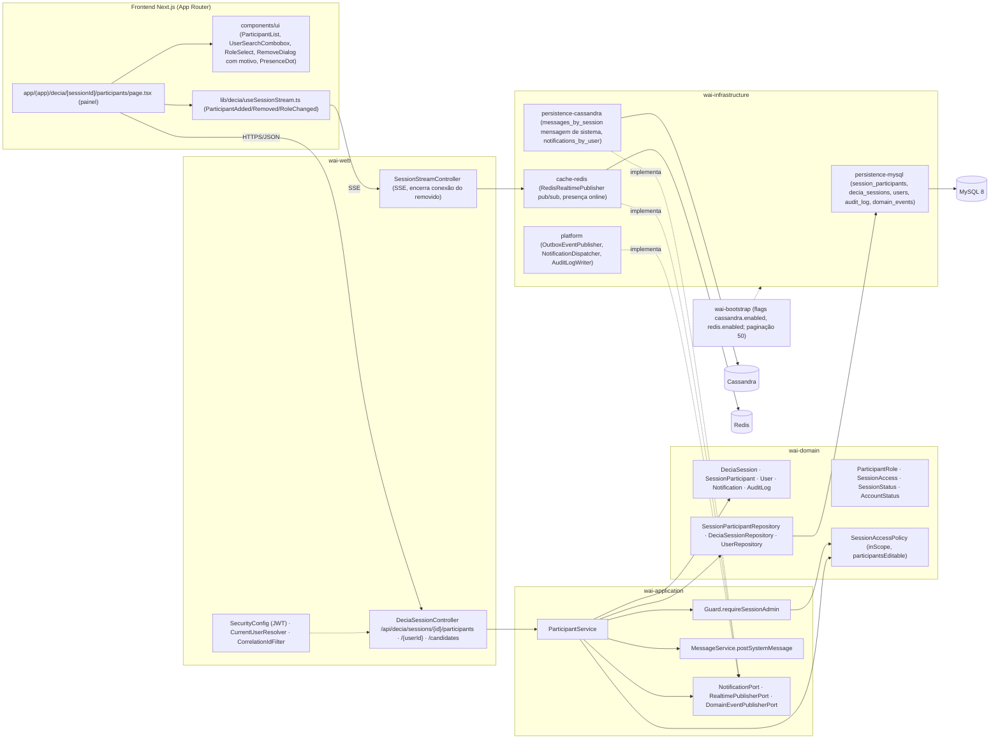

# RF9 — Adicionar ou remover usuários de uma sessão de conversa ativa.
**HU:** HU9 · **Sprint (board Work Station):** 2 · **Equivalente FAI:** RF10 Copilot (conversa individual no FAI — aqui a sessão é em grupo, com gestão de participantes pelo administrador) · **Aba/rota:** DECIA (`/decia/[sessionId]/participants` — painel de participantes com busca de colegas) — rota sugerida
**Critérios de aceite cobertos:** RF9.CA01 … RF9.CA06 (RF1–RF18 não têm CAs no board: derivados da HU9 + RF4/RF10 e marcados "CA a confirmar")

> **HU9** — COMO administrador da sessão de conversa POSSO adicionar ou remover usuários de uma sessão de conversa ativa PARA manter o grupo de participantes adequado ao tema e às regras de acesso.

## Critérios de aceite derivados da HU9 (todos "CA a confirmar")

| CA | Enunciado (Dado / Quando / Então) |
|---|---|
| **RF9.CA01** (CA a confirmar) | Dado o administrador da sessão (`adminUserId` ou `Role ADMIN`) numa sessão `ATIVA` (ou `REABERTA`), quando adiciona um usuário (busca por nome/username) com `role` MEMBRO ou OBSERVADOR, então é criado `SessionParticipant` (`joinedAt`, `addedBy`, `canReplyDivergence` padrão false) e `participantCount` é incrementado; o usuário deve respeitar o `accessMode` (RF4.CA04): DEPARTAMENTO → mesmo `departmentId`, EMPRESA/FECHADA → mesma `companyId`; fora do escopo → `422 FORA_DO_ESCOPO_ACESSO`. |
| **RF9.CA02** (CA a confirmar) | Dado o administrador, quando remove um participante informando `removeReason` (obrigatório), então `leftAt`, `removedBy` e `removeReason` são gravados (sem apagar o registro), `participantCount` decrementa, as mensagens do removido **permanecem** no histórico e ele perde o acesso imediatamente (canal SSE encerrado, `403` nas próximas chamadas) e deixa de receber notificações da sessão. |
| **RF9.CA03** (CA a confirmar) | Dado as regras, então: quem não é admin → `403 ACESSO_NEGADO`; sessão fora de `ATIVA`/`REABERTA` → `409 SESSAO_NAO_ATIVA`; usuário já participante ativo → `409 PARTICIPANTE_DUPLICADO`; tentar remover o próprio `adminUserId` ou o participante `IA` → `422 VALIDACAO`; usuário com `AccountStatus` diferente de `ACTIVE` → `422 USUARIO_INATIVO`. |
| **RF9.CA04** (CA a confirmar) | Dado um usuário removido, quando é adicionado de novo, então nasce um **novo** `SessionParticipant` (histórico de entradas e saídas preservado), `lastReadAt` reinicia e ele volta a ver as mensagens conforme o `accessMode`; a troca de papel MEMBRO ↔ OBSERVADOR (`PATCH …/participants/{userId}`) não cria novo registro. |
| **RF9.CA05** (CA a confirmar) | Dado a inclusão ou remoção, então `ParticipantAdded`/`ParticipantRemoved` (AFTER_COMMIT) notificam o afetado (`Notification` DECIA "você foi adicionado/removido" com motivo), publicam mensagem de sistema no chat ("Fulano entrou na sessão" / "saiu da sessão"), atualizam o painel em tempo real e gravam `AuditLog PARTICIPANT_ADDED / PARTICIPANT_REMOVED` com `correlationId`. |
| **RF9.CA06** (CA a confirmar) | Dado o painel de participantes, então ele lista `role`, `joinedAt`, presença online (SSE), `canReplyDivergence` (RF10) e ações do admin (remover, trocar papel, habilitar resposta a divergência); participantes comuns veem a lista sem ações; tudo i18n e paginado quando > 50. |

## 1. Diagrama de classes

## 2. Diagrama de atividades

Raias: Administrador da sessão · Participante afetado · Web/BFF · `wai-application` · Persistência (o RF9 não usa o AiEngine).

## 3. Diagrama de sequência

Caminho feliz de adicionar e remover, com os `alt` de erro do CA03 (403, 409, 422) e a readmissão (CA04) em `opt`. Sem ponto e vírgula nas mensagens.

## 4. Máquina de estados

Entidade central: `SessionParticipant`. Não há enum de status na TAXONOMIA; o ciclo é implícito por `joinedAt`/`leftAt` e `role`. A guarda da sessão (`SessionStatus` ATIVA/REABERTA) condiciona toda operação do RF9.

## 5. Diagrama de componentes

## 6. Rastreabilidade

| CA | Classe (§1) | Passo da atividade (§2) | Mensagem da sequência (§3) | Transição de estado (§4) | Componente (§5) |
|---|---|---|---|---|---|
| RF9.CA01 | `ParticipantService.add/searchCandidates`, `SessionParticipant.joinedAt/addedBy/role`, `SessionAccessPolicy.inScope`, `DeciaSession.participantCount/accessMode` | `A3`, `B1`, `B2`, `C4`–`C8` | 1–9, 18–22 (candidatos, `POST participants`, 201) | `[*] → ATIVO (MEMBRO)` | `FE2 UserSearchCombobox`, `W1`, `S1`, `D3`, `I1` |
| RF9.CA02 | `ParticipantService.remove`, `SessionParticipant.leftAt/removedBy/removeReason`, `RealtimePublisherPort.disconnect` | `A4`, `B3`, `C11`–`C13`, `H3`, `H4` | 30–41 (`DELETE participants`, disconnect, 403 na mensagem) | `ATIVO → REMOVIDO` | `W2` (encerra SSE), `I3`, `FE2 RemoveDialog` |
| RF9.CA03 | `Guard.requireSessionAdmin`, `SessionAccessPolicy.participantsEditable`, `User.status`, `ParticipantService.requireActive` | `C1` → `E403`, `C2` → `E409`, `C4` → `E422a`, `C6` → `E409b`, `C10` → `E422c` | 10–17 (403, 409, 422), 32–33 | guarda em `ATIVO` | `S2 Guard`, `W3` |
| RF9.CA04 | `ParticipantService.changeRole/enableReplyDivergence`, `SessionParticipant.canReplyDivergence/lastReadAt` | `A5`, `B4`, `C15`, `C16`, `C7` (novo registro) | 42–47 (`opt` readmissão) | `MEMBRO ↔ OBSERVADOR`, `→ MEMBRO_RESPONDE_DIVERGENCIA`, nota de readmissão | `W1 PATCH`, `FE2 RoleSelect` |
| RF9.CA05 | `DomainEventPublisherPort` (`ParticipantAdded/Removed`), `NotificationPort`, `Notification`, `AuditLog`, `MessageService.postSystemMessage` | `C9`, `C14`, `C17`, `H1`, `H3` | 20, 23–27, 36, 38–40 | — | `I4 OutboxEventPublisher/NotificationDispatcher/AuditLogWriter`, `I2` |
| RF9.CA06 | `ParticipantService.list`, `SessionParticipant.role/joinedAt/canReplyDivergence`, `RealtimePublisherPort` | `A1`, `B5`, `A20` | 26–27 (SSE → painel e presença) | — | `FE1`, `FE2 ParticipantList/PresenceDot`, `FE3`, `I3` (presença) |
