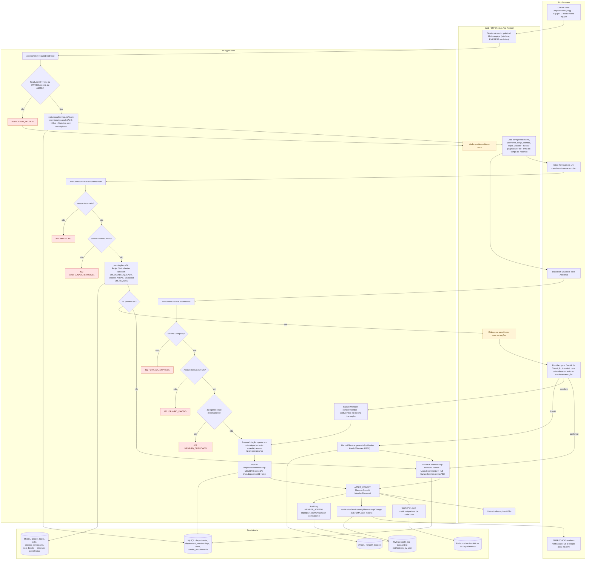
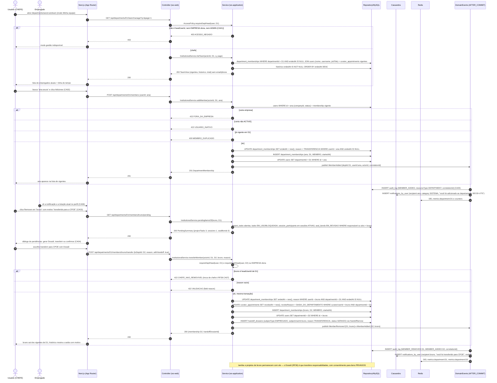
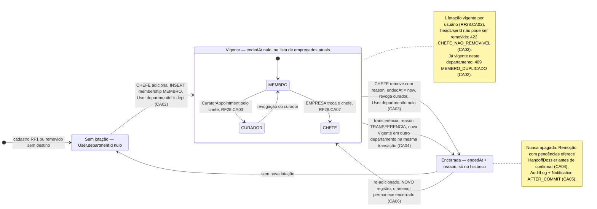
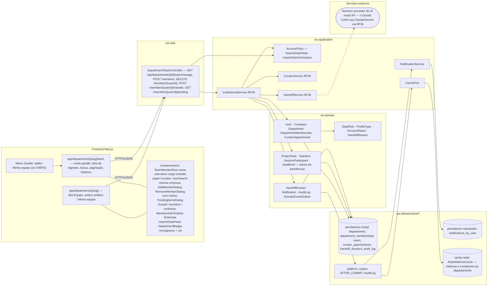

# RF9 — Permitir que um chefe de departamento possa adicionar ou remover um usuário da sua lista de empregados atuais
**HU:** HU9 · **Sprint (board Work Station):** lista *Requisitos Funcionais* (sem sprint atribuída) · **Equivalente FAI:** RF22 Perfil institucional (celebridade) — abas "do administrador" negadas no serviço (`guard.deny`) e não só escondidas; no FAI não há lotação de pessoas, a gestão de equipe é nova · **Aba/rota:** página do departamento `/departments/[slug]` → aba **Equipe**, modo **"Minha equipe" (gestão)** só para o chefe (`/departments/[slug]/team`); atalho **Minha equipe** no grupo Gestão do menu
**Critérios de aceite cobertos:** RF9.CA01 … RF9.CA06 — **todos "(CA a confirmar)"**: o corpo do card RF9 está vazio e o **escopo é novo** (antes RF9 = participantes da sessão DECIA, preservado em `_anterior/RF9`); os CAs foram derivados do título + HU9 e reaproveitam RF28.CA02 (lotação 1 por vez com histórico em `DepartmentMembership`), RF28.CA03 (auditoria do chefe), o guard `requireDeptHead` e a aba "Minha equipe" propostos em `docs/produto/ABAS_POR_PERFIL.md` §1.2 e §7.b

> **HU9** — COMO chefe de departamento de uma empresa POSSO adicionar ou remover um usuário de minha lista de empregados ativos PARA melhorar a minha gestão empresarial.

A **lista de empregados atuais** de um departamento é o conjunto de `DepartmentMembership` **vigentes** (`endedAt` nulo) daquele `Department`; `User.departmentId` espelha a lotação atual (1 por vez, RF28.CA02). O **CHEFE** (`Department.headUserId`, guard `requireDeptHead`, que também aceita a EMPRESA dona da `Company` e o ADMIN) **adiciona** (cria `DepartmentMembership` MEMBRO e encerra a lotação anterior em outro departamento — transferência), **remove** (fecha `endedAt` + `reason`, zera `User.departmentId`, revoga `CuratorAppointment` vigente) e **transfere** (remove + adiciona na mesma transação, com o chefe de destino ou a EMPRESA). O histórico nunca é apagado; remover avisa o empregado e, se ele tem pendências (tarefas EM_USO como responsável, sessões DECIA ativas, chancelas EM_REVISAO), oferece o **Dossiê de Transição** (RF36) antes de confirmar. A API da equipe só expõe nome, username, cargo e lotação — nunca `email`/`phone` (LGPD). Nenhuma IA neste RF.

## Critérios de aceite derivados do título + HU9 (todos "CA a confirmar")

| CA | Enunciado (Dado / Quando / Então) | Fonte reaproveitada |
|---|---|---|
| **RF9.CA01** (CA a confirmar) | Dado um CHEFE_DEPARTAMENTO com `Department.headUserId == eu` (ou EMPRESA dona da Company, ou ADMIN — `requireDeptHead`), quando abro a aba Equipe no modo **Minha equipe**, então vejo os `DepartmentMembership` vigentes (nome, username, `jobTitle`, `roleInDept`, `startedAt`, etiqueta Curador) com busca e paginação (> 50), mais o histórico de lotações encerradas; quem não é chefe não vê o modo gestão no menu e recebe `403 ACESSO_NEGADO` na API; a API nunca devolve `email`/`phone`. | RF28.CA02, RF28.CA08, ABAS §7.b |
| **RF9.CA02** (CA a confirmar) | Dado o modo gestão, quando **adiciono** um usuário (busca por nome/username na mesma `Company`, `AccountStatus` ACTIVE), então nasce um `DepartmentMembership` MEMBRO com `startedAt`, a lotação vigente anterior (em outro departamento) é encerrada com `endedAt` e `reason` TRANSFERENCIA e `User.departmentId` passa a ser o meu departamento; já membro vigente → `409 MEMBRO_DUPLICADO`; outra empresa → `422 FORA_DA_EMPRESA`; conta não ACTIVE → `422 USUARIO_INATIVO`. | RF28.CA02 (1 departamento por vez) |
| **RF9.CA03** (CA a confirmar) | Dado um membro vigente, quando **removo** informando `reason` (obrigatório, `422 VALIDACAO`), então o `DepartmentMembership` recebe `endedAt` e `reason` (sem apagar), `User.departmentId` fica nulo, o `CuratorAppointment` vigente dele é revogado (`revokeReason` = saída do departamento) e suas tarefas/projetos **permanecem** com o dono; remover o próprio chefe (`headUserId`) → `422 CHEFE_NAO_REMOVIVEL` (troca de chefe é RF28.CA07). | RF28.CA02, RF28.CA03, RF28.CA07 |
| **RF9.CA04** (CA a confirmar) | Dado que o removido tem pendências (responsável em `ProjectTask` aberta, `TaskItem` EM_USO/BLOQUEADA como responsável, `SessionParticipant` em sessão ATIVA, `SealBond` EM_REVISAO de que é alvo), quando confirmo a remoção, então o sistema lista as pendências e oferece **gerar Dossiê de Transição** (`HandoffDossier` reason TRANSFERENCIA/SAIDA, RF36) ou **transferir** para outro departamento (remover + adicionar na mesma transação); itens PRIVADOS do empregado nunca entram sem consentimento. | RF36.CA01, RF36.CA05 |
| **RF9.CA05** (CA a confirmar) | Dado a inclusão ou remoção, então `MemberAdded`/`MemberRemoved` (AFTER_COMMIT) gravam `AuditLog MEMBER_ADDED/MEMBER_REMOVED` com `correlationId`, notificam o empregado (`Notification` category SISTEMA: "você foi adicionado/removido do departamento X", com motivo), invalidam o cache Redis de métricas/contadores do departamento e atualizam a aba pública Equipe e a página da empresa (Pessoas). | RF28.CA03 (auditoria), RF28.CA04 (cache) |
| **RF9.CA06** (CA a confirmar) | Dado o histórico, então re-adicionar alguém cria um **novo** `DepartmentMembership` (o anterior permanece encerrado), a linha do tempo de lotações aparece no modo gestão e no perfil do empregado (empresa/departamento atual, RF16), e todas as mensagens são i18n (pt-BR/en/es). | RF28.CA02 (histórico), RF19.CA07 |

## 1. Diagrama de classes

```mermaid
classDiagram
direction LR

namespace ws_domain_identidade {
  class User {
    <<entity>>
    +id: UUID
    +username: String
    +fullName: String
    +displayName: String
    +jobTitle: String
    +profileType: ProfileType
    +role: Role
    +status: AccountStatus
    +companyId: UUID
    +departmentId: UUID lotação atual
    +avatarUrl: String
    .. +25 campos ..
  }
  class Company {
    <<entity>>
    +id: UUID
    +ownerUserId: UUID perfil EMPRESA
    +legalName: String
    +slug: String
  }
  class Department {
    <<entity>>
    +id: UUID
    +companyId: UUID
    +name: String
    +acronym: String
    +slug: String
    +color: String
    +monogram: String
    +headUserId: UUID CHEFE
    +active: boolean
  }
  class DepartmentMembership {
    <<entity>>
    +id: UUID
    +userId: UUID
    +departmentId: UUID
    +roleInDept: DeptRole
    +startedAt: Instant
    +endedAt: Instant nulo = vigente
    +reason: String
  }
  class CuratorAppointment {
    <<entity>>
    +id: UUID
    +departmentId: UUID
    +curatorUserId: UUID
    +revokedAt: Instant
    +revokeReason: String
    +scope: CuratorScope
  }
}

namespace ws_domain_pendencias {
  class ProjectTask {
    <<entity>>
    +id: UUID
    +projectId: UUID
    +responsibleId: UUID
    +percentComplete: int
  }
  class TaskItem {
    <<entity>>
    +id: UUID
    +ownerId: UUID
    +responsibleId: UUID
    +state: TaskState
    +visibility: Visibility
  }
  class SessionParticipant {
    <<entity>>
    +sessionId: UUID
    +userId: UUID
    +leftAt: Instant
  }
  class SealBond {
    <<entity>>
    +id: UUID
    +targetOwnerId: UUID
    +status: SealBondStatus
  }
  class HandoffDossier {
    <<entity>>
    +id: UUID
    +subjectType: String EMPREGADO
    +subjectUserId: UUID
    +requestedBy: UUID
    +reason: HandoffReason
    +status: HandoffStatus
    +consentForPrivateItems: boolean
  }
}

namespace ws_domain_plataforma {
  class Notification {
    <<entity>>
    +id: UUID
    +recipientId: UUID
    +actorId: UUID
    +type: NotificationType SISTEMA
    +category: String SISTEMA
    +title: String
    +body: String
    +payloadJson: JSON
  }
  class AuditLog {
    <<entity>>
    +id: UUID
    +actorId: UUID
    +action: String MEMBER_ADDED MEMBER_REMOVED MEMBER_TRANSFERRED
    +resourceType: String DEPARTMENT
    +resourceId: UUID
    +correlationId: String
    +metadataJson: JSON
  }
  class DomainEventOutbox {
    <<entity>>
    +aggregateType: String DEPARTMENT
    +eventType: String MemberAdded MemberRemoved
    +payloadJson: JSON
  }
}

namespace ws_domain_enums {
  class DeptRole {
    <<enum>>
    MEMBRO
    CHEFE
    CURADOR
  }
  class ProfileType {
    <<enum>>
    EMPREGADO
    EMPRESA
    CHEFE_DEPARTAMENTO
  }
  class AccountStatus {
    <<enum>>
    PENDING_EMAIL_VERIFICATION
    PENDING_VALIDATION
    ACTIVE
    SUSPENDED
    DELETION_SCHEDULED
  }
  class HandoffReason {
    <<enum>>
    SAIDA
    TRANSFERENCIA
    FIM_GESTAO
    TROCA_CHEFE
  }
}

namespace ws_application {
  class InstitutionalService {
    <<service>>
    +listTeam(actorId, deptId, query, page) TeamView vigentes + histórico
    +addMember(actorId, deptId, userId) DepartmentMembership
    +removeMember(actorId, deptId, userId, reason) DepartmentMembership
    +transferMember(actorId, fromDeptId, toDeptId, userId, reason) DepartmentMembership
    +pendingItemsOf(userId, deptId) PendingSummary
    +assignMembership(actorId, userId, deptId, reason) DepartmentMembership
  }
  class AccessPolicy {
    <<service>>
    +requireDeptHead(user, departmentId) void headUserId ou EMPRESA dona ou ADMIN
    +requireSameCompany(user, companyId) void
  }
  class CuratorService {
    <<service>>
    +revokeAllOf(userId, deptId, reason)
  }
  class HandoffService {
    <<service>>
    +generateForMember(deptId, userId, reason) HandoffDossier
  }
  class NotificationService {
    <<service>>
    +notifyMembershipChange(recipientId, actorId, dept, added, reason)
  }
  class CachePort {
    <<port>>
    +evict(key)
  }
}

namespace ws_web {
  class DepartmentTeamController {
    <<controller>>
    +GET_api_departments_id_team_manage(q, page)
    +POST_api_departments_id_members(userId)
    +DELETE_api_departments_id_members_userId(reason)
    +POST_api_departments_id_members_userId_transfer(toDeptId, reason)
    +GET_api_departments_id_members_userId_pending()
  }
}

namespace ws_infrastructure {
  class DepartmentMembershipJpaRepository {
    <<adapter>>
  }
  class AuditLogJpaRepository {
    <<adapter>>
  }
  class RedisMetricsCache {
    <<adapter>>
  }
  class CassandraNotificationAdapter {
    <<adapter>>
  }
}

Company "1" --> "*" Department
Company "1" --> "*" User : companyId
Department "1" --> "*" DepartmentMembership : lista de empregados = vigentes
User "1" --> "*" DepartmentMembership : histórico de lotações
User --> Department : departmentId atual
Department --> User : headUserId CHEFE
Department "1" --> "*" CuratorAppointment
CuratorAppointment --> User : curatorUserId
ProjectTask --> User : responsibleId pendência
TaskItem --> User : responsibleId pendência
SessionParticipant --> User : userId pendência
SealBond --> User : targetOwnerId pendência
HandoffDossier --> User : subjectUserId
Notification --> User : recipientId
DepartmentMembership --> DeptRole
User --> ProfileType
User --> AccountStatus
HandoffDossier --> HandoffReason

DepartmentTeamController ..> InstitutionalService
DepartmentTeamController ..> AccessPolicy : requireDeptHead 403
InstitutionalService ..> AccessPolicy
InstitutionalService ..> DepartmentMembership
InstitutionalService ..> CuratorService : revoga ao remover
InstitutionalService ..> HandoffService : pendências CA04
InstitutionalService ..> DomainEventOutbox : MemberAdded MemberRemoved
DomainEventOutbox ..> AuditLog : AFTER_COMMIT
DomainEventOutbox ..> NotificationService : AFTER_COMMIT
DomainEventOutbox ..> CachePort : evict métricas do departamento
DepartmentMembershipJpaRepository ..> DepartmentMembership : JPA
AuditLogJpaRepository ..> AuditLog : JPA
RedisMetricsCache ..|> CachePort
CassandraNotificationAdapter ..> Notification : notifications_by_user

note for DepartmentMembership "tabela department_memberships · lista de empregados atuais = endedAt IS NULL · 1 lotação vigente por usuário (RF28.CA02) · nunca apagada (CA06)"
note for AccessPolicy "requireDeptHead = Department.headUserId == user OR Company.ownerUserId == user OR Role ADMIN · senão 403 ACESSO_NEGADO (CA01)"
note for InstitutionalService "addMember: 409 MEMBRO_DUPLICADO, 422 FORA_DA_EMPRESA, 422 USUARIO_INATIVO (CA02) · removeMember: reason obrigatório, 422 CHEFE_NAO_REMOVIVEL (CA03) · API sem email/phone (LGPD)"
note for HandoffDossier "oferecido quando o removido tem pendências (CA04) · itens PRIVADOS só com consentForPrivateItems (RF36.CA05)"
```

## 2. Diagrama de atividades

## 3. Diagrama de sequência

## 4. Máquina de estados

Entidade central: **`DepartmentMembership`**, que não tem enum próprio — o estado deriva de `endedAt` (nulo = **vigente**, preenchido = **encerrada**) e de `roleInDept` (`DeptRole`). Um usuário tem no máximo uma lotação vigente (RF28.CA02); a "lista de empregados atuais" é o conjunto de lotações vigentes do departamento. Registros nunca são apagados (CA06).

## 5. Diagrama de componentes

## 6. Rastreabilidade

| CA | Elemento do diagrama (classe / passo / mensagem / transição / componente) |
|---|---|
| RF9.CA01 (a confirmar) | Classes `Department.headUserId`, `DepartmentMembership.endedAt` (nota "lista = endedAt IS NULL"), `AccessPolicy.requireDeptHead` (nota), `InstitutionalService.listTeam`, `DepartmentTeamController GET …/team/manage` · Atividades `U1 → W1 → A1 → A2 → A3 403 → W3` / `A2 (sim) → A4 → P1 → W2` · Sequência msgs 1–11 (`alt não é headUserId … → 403` / `else chefe` → TeamView sem email/phone) · Componentes `app/departments/[slug]/team`, `TeamMemberRow`, `RoleGate requireDeptHead`, `Menu Gestão: Minha equipe` |
| RF9.CA02 (a confirmar) | Classes `DepartmentMembership` (startedAt, roleInDept MEMBRO), `User.departmentId/companyId/status`, enums `DeptRole`, `AccountStatus`, `InstitutionalService.addMember`, `AccessPolicy.requireSameCompany` · Atividades `U2 → A5 → A6 → A7 422 FORA_DA_EMPRESA`, `A8 → A9 422 USUARIO_INATIVO`, `A10 → A11 409 MEMBRO_DUPLICADO`, `A12 → A13 → P1` · Sequência `POST /api/departments/D1/members` com os três `alt` de erro e `else ok` (encerra lotação anterior, INSERT membership, UPDATE users.departmentId) · Transição `SemLotacao → Vigente` e nota · Componentes `UserSearch mesma empresa`, `AddMemberDialog` |
| RF9.CA03 (a confirmar) | Classes `DepartmentMembership.endedAt/reason`, `CuratorAppointment.revokedAt/revokeReason`, `InstitutionalService.removeMember`, `CuratorService.revokeAllOf` · Atividades `U3 → A14 → A15 → A16 422 VALIDACAO`, `A17 → A18 422 CHEFE_NAO_REMOVIVEL`, `A23 → P1` · Sequência `alt bruno é headUserId → 422 CHEFE_NAO_REMOVIVEL`, `else reason vazio → 422 VALIDACAO`, `else ok` → UPDATE membership endedAt, UPDATE curator_appointments revokedAt, nota "tarefas e projetos permanecem com ele" · Transição `Vigente → Encerrada : CHEFE remove com reason` e nota · Componente `RemoveMemberDialog com motivo` |
| RF9.CA04 (a confirmar) | Classes `ProjectTask/TaskItem/SessionParticipant/SealBond` (pendências), `HandoffDossier` (reason TRANSFERENCIA/SAIDA, consentForPrivateItems), enum `HandoffReason`, `InstitutionalService.pendingItemsOf/transferMember`, `HandoffService.generateForMember` · Atividades `A19 → P2 → A20 → W4 → U4 → A21 → P3` / `A22 → A12` / `A23` · Sequência `GET …/members/bruno/pending` → PendingSummary → `POST …/transfer {withHandoff}` → INSERT handoff_dossiers na mesma transação · Transição `Vigente → Encerrada : transferência … nova Vigente na mesma transação` e nota · Componentes `PendingItemsDialog`, `HandoffService RF36`, `X1` |
| RF9.CA05 (a confirmar) | Classes `DomainEventOutbox` (MemberAdded/MemberRemoved), `AuditLog MEMBER_ADDED/MEMBER_REMOVED/MEMBER_TRANSFERRED`, `Notification` (category SISTEMA), `NotificationService.notifyMembershipChange`, `CachePort.evict`, `RedisMetricsCache`, `CassandraNotificationAdapter` · Atividades `A24 → A25 → P4`, `A24 → A26 → P4 → U5`, `A24 → A27 → P5`, `A24 → W5` · Sequência `DE->>DB INSERT audit_log`, `DE->>CS INSERT notifications_by_user`, `DE->>R DEL metrics:department` (duas vezes) · Nota do estado *Encerrada* · Componentes `platform: outbox AFTER_COMMIT`, `persistence-cassandra`, `cache-redis` |
| RF9.CA06 (a confirmar) | Classes `DepartmentMembership` (nota "nunca apagada"), `User "1" --> "*" DepartmentMembership : histórico` · Atividades `A4` (histórico) → `W2` (linha do tempo), `U5` · Sequência msg "histórico endedAt IS NOT NULL ORDER BY endedAt DESC", `E->>NX vê a lotação atual no perfil` · Transições `Encerrada → Vigente : re-adicionado, NOVO registro` e `Encerrada → SemLotacao` · Componentes `MembershipTimeline`, `TeamMemberRow` (i18n) |
