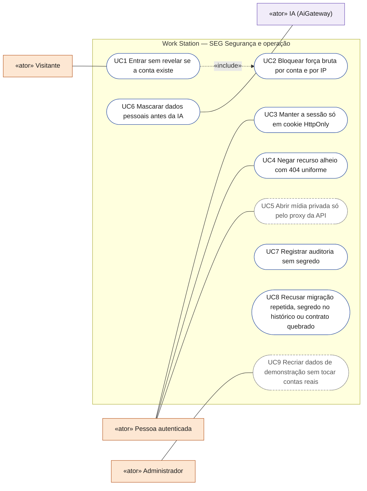
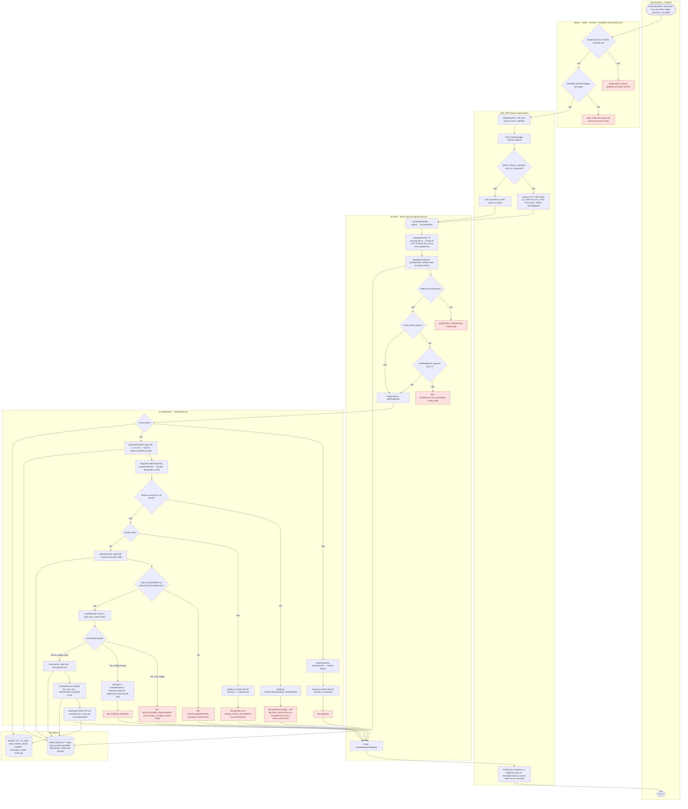
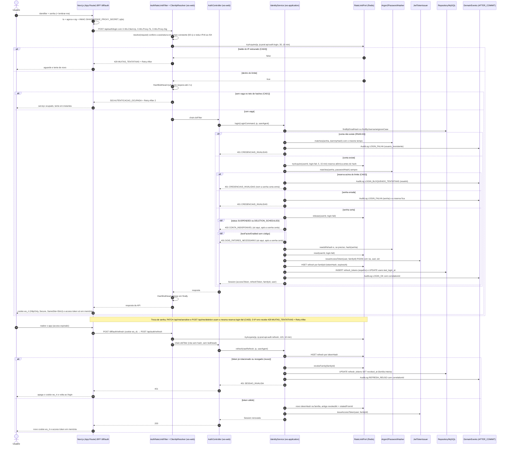
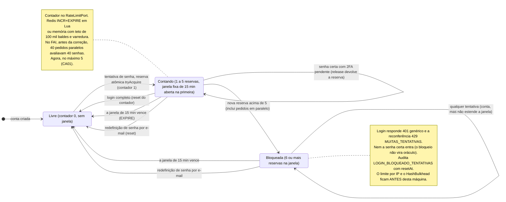
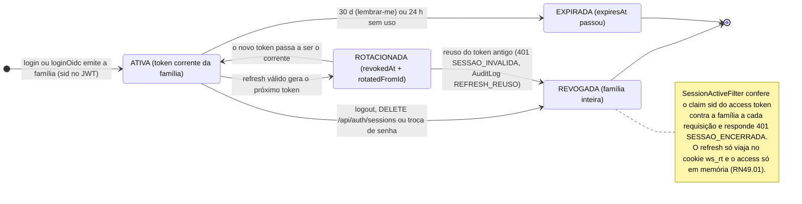
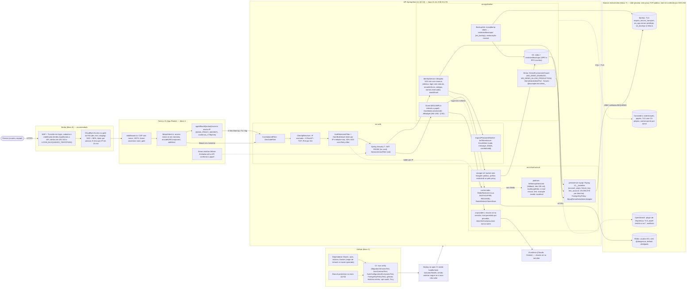
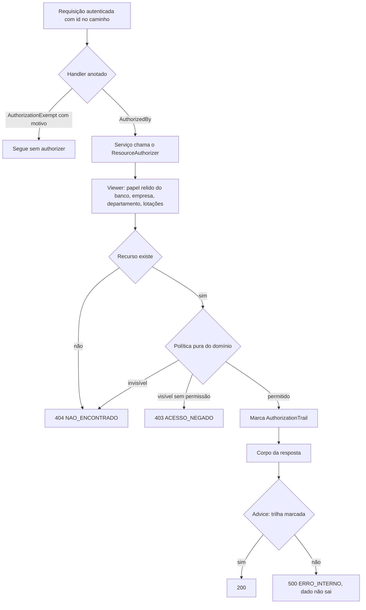
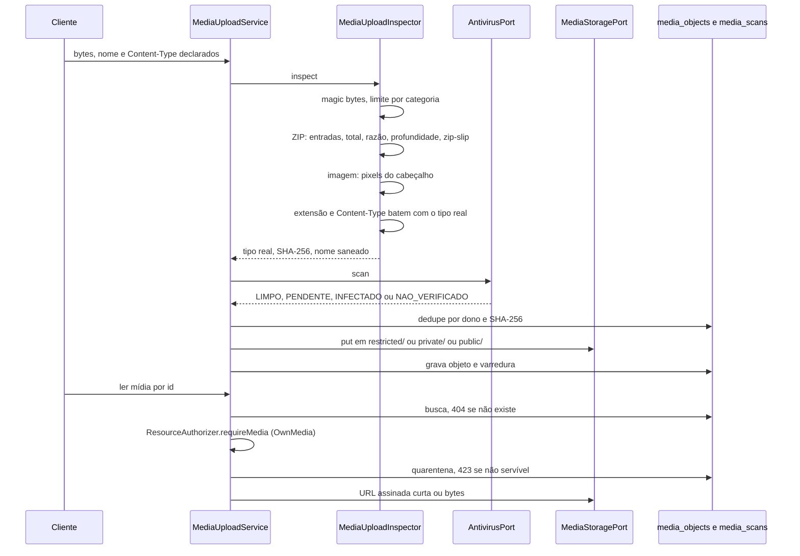
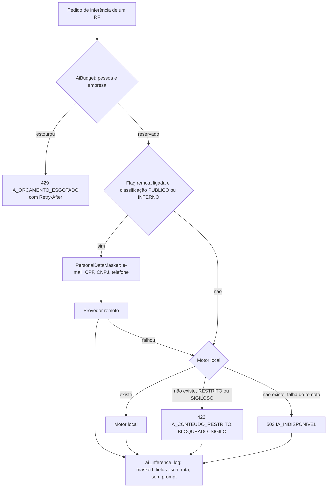

# SEG — Segurança, integridade e operação herdadas do FAI (RF49)
**HU:** transversal (RF1–RF3 e todo RF com `{id}`, mídia ou IA) · **Sprint (board Work Station):** desde o esqueleto (fase *a* da ARQUITETURA §6) · **Equivalente FAI:** RF49 "Proteger contas e a plataforma: sessão segura, limites contra força bruta, bancos endurecidos, dados demo isolados e entrega confiável" (`docs/novos-rf/RF49_Seguranca_Integridade_Operacao.md`, `docs/diagramas/RF49/*.puml`) · **Aba/rota:** `/bff/auth/*` → `/api/auth/*`, `/api/me/*`, `/api/admin/demo/*`, `/gate`
**Critérios de aceite cobertos:** FAI RF49.CA01 … CA10 e RN49.01 … RN49.12, adaptados ao Work Station e marcados "(CA a confirmar)" — **Q-48:** ainda não está decidido se isto vira um **RF** no board Work Station (ex.: RF47) ou um **RNF**; nenhum card foi criado. Decisões: **D-13** (Spring Boot 4.1.x, JVM 25 LTS) e **D-14** (controles herdados desde o esqueleto). Dúvidas abertas: Q-48 (RF ou RNF), Q-49 (TTL do access token: 10 ou 15 min), Q-50 (teto de gasto `AiBudget`), Q-51 (hospedagem → `infra/<provedor>/`), Q-52 (branch protection na `main`).

> Não é um RF do board: é a pasta pedida pela D-14 e pelo brief de segurança (blocos 0–8). Os cinco diagramas seguem a `CONVENCOES.md`; os nomes já são os do Work Station (`br.gov.pr.secid.workstation`, `ws-*`, `ws_rt`, `X-Ws-*`, `WS_*`). Dois bugs do FAI que só apareceram sob ataque real guiam o desenho: o **hash avaliado em corrida** (40 pedidos paralelos avaliavam 40 senhas) e o **pool do banco esgotado** (60 logins paralelos → 50 respostas 500).

## Regras e critérios herdados (todos "CA a confirmar")

| Id | Enunciado adaptado ao Work Station | Bloco do brief |
|---|---|---|
| **RN49.01** | Nenhum token de sessão no `localStorage`/`sessionStorage`; o refresh fica só no cookie `ws_rt` (HttpOnly, Secure, SameSite=Strict) e o access token só em memória. | 4 |
| **RN49.02** | O login responde igual (401 genérico, mesmo tempo) para conta inexistente (hash falso), senha errada e conta bloqueada — mesmo com a senha certa. `403 CONTA_INDISPONIVEL` e `401 DOIS_FATORES_NECESSARIO` só depois da senha certa e fora do bloqueio. | 3 |
| **RN49.03** | No máximo 5 tentativas de senha por conta em 15 min, reservadas de forma atômica (`tryAcquire` INCR) **antes** do hash; a reserva volta (`release`) só com senha certa. Vale para troca de senha, dados sensíveis, exclusão e todo *step-up* (`429 MUITAS_TENTATIVAS` + `Retry-After`). A redefinição por e-mail tira a conta do bloqueio. | 3 |
| **RN49.04** | O limite por IP usa o IP assinado pelo BFF (`X-Ws-Client-Ip`/`X-Ws-Proxy-Ts`/`X-Ws-Proxy-Sig`, HMAC-SHA256 com `EDGE_PROXY_SECRET`, 60 s) › `X-Real-IP` da borda › TCP; nunca `X-Forwarded-For`; IPv6 conta por /64. | 3 |
| **RN49.05** | Teto de hashes Argon2 simultâneos (`HashBulkhead`, permits = `max(1, min(max(2, núcleos), pool/2))`, espera 2 s); o excedente recebe `503 AUTENTICACAO_OCUPADA` + `Retry-After` sem derrubar o resto da API. | 3 |
| **RN49.06** | Mídia privada (`restricted/`: backups, anexos RESTRITO/SIGILOSO, áudio de reunião) só pelo proxy da API e só para o dono, quem a classificação libera ou ADMIN (`OwnMedia`). | 5 |
| **RN49.07** | Chaves de IA e segredos só no servidor (cabeçalho, host permitido do provedor); e-mail em log sempre mascarado (`maskEmail`); log nunca leva senha, token ou código. | 1, 5 |
| **RN49.08** | Bancos só na rede privada, TLS obrigatório, usuário da aplicação de menor privilégio (`ws_app`) e usuário de backup só leitura (`ws_backup`); Redis com ACL sem `@dangerous`. | 7 |
| **RN49.09** | Política de `ON DELETE` por domínio escrita em cada FK desde o `V1__baseline.sql`: dono → CASCADE; catálogo institucional → RESTRICT; SET NULL só quando o filho continua válido; trilhas append-only → RESTRICT. Nunca `SET FOREIGN_KEY_CHECKS=0`. Conferida por `ForeignKeyPolicyTest`. | 2 |
| **RN49.10** | Só contas `TEST_SEED`/`DEMO` (`account_origin`) podem ser apagadas pelo reset demo; conta `REAL` é anonimizada (LGPD), nunca apagada. | 2, 6 |
| **RN49.11** | Fixtures usam `@example.test` e o prefixo `demo_` (reservado no cadastro, junto com `e2e_`, `admin`, `root`, `suporte`, `secid`, `decia`, `workstation`); o envio de e-mail recusa `.test`, `.example`, `.invalid`, `.localhost`. | 6 |
| **RN49.12** | Versão de migration única (`MigrationVersionsTest`); major de framework é migração, não bump; só JVM LTS na imagem (D-13). | 0, 1 |
| **CA01** | 60 logins em paralelo: nenhum HTTP 500 e no máximo 5 senhas avaliadas por conta. | 3 |
| **CA02** | Conta bloqueada: até a senha certa recebe 401 genérico; passados 15 min, ou depois de redefinir a senha por e-mail, entra. | 3 |
| **CA03** | Sessão roubada: o 6º chute da senha atual na troca de senha recebe `429 MUITAS_TENTATIVAS`. | 3 |
| **CA04** | Mesmo IP: o 31º login em 10 min recebe 429 com `Retry-After`; trocar o fim do IPv6 (mesmo /64) não abre balde novo; `X-Forwarded-For` forjado não muda o balde. | 3 |
| **CA05** | Recarregar a página mantém a sessão pelo cookie `ws_rt`, sem nenhum token no `localStorage` (teste falha se aparecer). | 4 |
| **CA06** | Mídia de outra pessoa ou em `restricted/` não abre para quem não é dono nem ADMIN; todo endpoint com `{id}` tem teste BOLA e toda rota de papel tem teste BFLA (`Guard` relê o papel no banco). | 5 |
| **CA07** | Banco novo (V1 → última versão): a API sobe e o `ForeignKeyPolicyTest` mostra 0 divergências. | 2 |
| **CA08** | O CI fica vermelho com migration repetida, segredo no histórico (gitleaks `fetch-depth: 0`), quebra do contrato JSON ou exclusão de autoconfiguração inexistente. | 1 |
| **CA09** | Um deploy que não sobe não tira a versão anterior do ar (healthcheck `/actuator/health` com timeout cobrindo o Flyway). | 1, 7 |
| **CA10** | Seed demo idempotente (upsert por `fixture_key`); o reset exige `dryRun` → `planHash` → `confirm=<planHash>` e nunca apaga conta `REAL`; `DemoEnvironmentGuard` desligado por padrão e, em produção, exige `WS_DEMO_ALLOW_PRODUCTION=true`. | 6 |

## 0. Diagrama de casos de uso

Os casos de uso de segurança atravessam todos os RF: proteger a conta, negar acesso a recurso alheio, tratar mídia e IA com cuidado e garantir que a operação não perca dados. Atores do catálogo em [`ATORES_E_ATRIBUTOS.md`](../../arquitetura/ATORES_E_ATRIBUTOS.md).

| Caso de uso | Ator(es) | CAs | Situação |
|---|---|---|---|
| UC1 Entrar sem revelar se a conta existe | Visitante | RN49.02, CA02 | real: hash falso e mesma resposta (`IdentityService.login`) |
| UC2 Bloquear força bruta por conta e por IP | (sistema) | RN49.03, RN49.04, RN49.05, CA01, CA03, CA04 | real: `RateLimitPort`, `AuthRateLimitFilter`, `HashBulkhead` |
| UC3 Manter a sessão só em cookie HttpOnly | Pessoa autenticada | RN49.01, CA05 | real: `ws_rt` HttpOnly; access token só em memória |
| UC4 Negar recurso alheio com 404 uniforme | Pessoa autenticada | CA06 | real: `ResourceAuthorizer`, `AccessPolicy`, `AuthorizationEnforcementAdvice` |
| UC5 Abrir mídia privada só pelo proxy da API | Pessoa autenticada | RN49.06, CA06 | planejado: `MediaAccessPolicy` existe; `MediaUploadService` ainda não é bean |
| UC6 Mascarar dados pessoais antes da IA | IA | RN49.07 | real: `PersonalDataMasker` no `AiGateway`; nenhum motor registrado |
| UC7 Registrar auditoria sem segredo | (sistema) | RN49.07 | real: `AuditLogPort` com e-mail mascarado |
| UC8 Recusar migração repetida, segredo no histórico ou contrato quebrado | (sistema) | RN49.08, RN49.09, RN49.12, CA07, CA08, CA09 | real: CI (`MigrationVersionsTest`, gitleaks, contrato OpenAPI, `ForeignKeyPolicyTest`) |
| UC9 Recriar dados de demonstração sem tocar contas reais | Administrador | RN49.10, RN49.11, CA10 | planejado (seed demo) |

## 1. Diagrama de classes

Freios de autenticação (`ws-web/support` e `ws-web/security`), contador atômico (`RateLimitPort` e adaptadores), identidade e autorização (`ws-application`), origem da conta e política de FKs (`ws-domain`, `ws-infrastructure/persistence-mysql`) e dados demo. Entidades conforme `docs/arquitetura/TAXONOMIA.md` §1 e §12 (subconjunto de atributos).

```mermaid
classDiagram
  direction LR

  namespace ws_web_support {
    class AuthRateLimitFilter {
      <<adapter>>
      +RULES: List~Rule~
      -rateLimit: RateLimitPort
      -clientIp: ClientIpResolver
      -bulkhead: HashBulkhead
      +ruleFor(method, path) Optional~Rule~
      +bucketKey(ip) String
      #doFilterInternal(req, res, chain) void
      -reject(res, status, retryAfter, code) void
    }
    class Rule {
      <<record>>
      +method: String
      +path: String
      +limit: int
      +window: Duration
      +hashes: boolean
      +matches(method, path) boolean
      +bucket() String
    }
    class ClientIpResolver {
      <<adapter>>
      +SIGNED_IP: String
      +SIGNED_TS: String
      +SIGNED_SIG: String
      +MAX_SKEW_SECONDS: long
      +MIN_SECRET_LENGTH: int
      -edgeSecret: byte[]
      -header: String
      +resolve(request) String
      -signedIp(ip, ts, sig) String
      -literalIp(raw) String
      +socketAddress(request) String
    }
    class HashBulkhead {
      <<adapter>>
      -permits: Semaphore
      -waitMillis: long
      +defaultPermits(cores, dbPool) int
      +tryAcquire() boolean
      +release() void
    }
    class CorrelationIdFilter {
      <<adapter>>
      +doFilterInternal(req, res, chain) void
    }
  }

  namespace ws_web_security {
    class Argon2PasswordHasher {
      <<adapter>>
      +MEMORY_KIB: int
      +ITERATIONS: int
      +PARALLELISM: int
      +SALT_LENGTH: int
      +HASH_LENGTH: int
      +hash(raw) String
      +matches(raw, encoded) boolean
      +needsRehash(encoded) boolean
    }
    class JwtTokenIssuer {
      <<adapter>>
      -issuer: String
      -audience: String
      -ttl: Duration
      +issueAccessToken(user, familyId) String
      +accessTokenTtl() Duration
    }
    class SessionActiveFilter {
      <<adapter>>
      -identity: IdentityService
      +doFilterInternal(req, res, chain) void
    }
  }

  namespace ws_application {
    class RateLimitPort {
      <<port>>
      +tryAcquire(owner, bucket, limit, window) boolean
      +status(owner, bucket, limit, window) QuotaStatus
      +reset(owner, bucket) void
      +release(owner, bucket) void
    }
    class QuotaStatus {
      <<value>>
      +limit: int
      +used: long
      +resetAt: Instant
      +exhausted() boolean
    }
    class PasswordHasherPort {
      <<port>>
      +hash(raw) String
      +matches(raw, encoded) boolean
      +needsRehash(encoded) boolean
    }
    class TokenIssuerPort {
      <<port>>
      +issueAccessToken(user, familyId) String
      +accessTokenTtl() Duration
    }
    class IdentityService {
      <<service>>
      +LOGIN_FAIL: String
      -MAX_LOGIN_FAILURES: int
      -LOCK_WINDOW: Duration
      +MAX_CODE_ATTEMPTS: int
      +CODE_ATTEMPTS_PER_HOUR: int
      +RESERVED_USERNAMES: Set~String~
      -dummyHash: String
      +login(cmd LoginCommand, ip, userAgent) Session
      +refresh(rawRefresh, ip, userAgent) Session
      +changePassword(current, familyId, atual, nova, confirma) int
      +reauthenticate(userId, senha) void
      +confirmPasswordReset(token, nova, confirma) void
      +verifyEmail(current, code) UserCard
      +requireCodeAttemptQuota(userId, purpose) void
      +sessionActive(familyId) boolean
      +reservedUsername(normalized) boolean
      +maskEmail(mail) String
      -passwordMatchesWithLockout(user, senha, via) boolean
      -revokeFamily(familyId) void
    }
    class Guard {
      <<service>>
      +requireRole(user, role) void
      +requireOwner(user, ownerId, resource) void
      +requireParticipant(user, sessionId) void
      +requireIssuer(user, sealId) void
      +requireAdmin(user) void
      +deny(user, resource, message) ApiException
    }
    class OwnMedia {
      <<service>>
      +accepts(ownerId, url, classification) boolean
      +require(ownerId, url, field, classification) String
      +requireOrUnchanged(ownerId, url, field, classification, current) String
    }
    class AiBudget {
      <<service>>
      +check(userId, pending) Verdict
      +globalDaily() BigDecimal
      +userDaily() BigDecimal
    }
    class AdminBootstrap {
      <<service>>
      -email: String
      -password: String
      -promoteExisting: boolean
      +ensureAdmin() void
      -promote(user) void
    }
    class DemoEnvironmentGuard {
      <<service>>
      -enabled: boolean
      -allowProduction: boolean
      +requireEnabled() void
      +production() boolean
    }
    class DemoDataAdminPort {
      <<port>>
      +testAccountIds() List~UUID~
      +realAccountsAmong(ids) long
      +plan(ids) ResetCounts
      +lockAccounts(ids) void
      +deleteTestAccounts(ids) long
      +integrityProblems(fixtureKeys) List~String~
    }
  }

  namespace ws_infrastructure {
    class InMemoryRateLimit {
      <<adapter>>
      +DEFAULT_MAX_ENTRIES: int
      -windows: ConcurrentHashMap
      +tryAcquire(owner, bucket, limit, window) boolean
      +release(owner, bucket) void
      -sweep(now) void
    }
    class RedisRateLimit {
      <<adapter>>
      -acquireLua: RedisScript
      -releaseLua: RedisScript
      +tryAcquire(owner, bucket, limit, window) boolean
      +release(owner, bucket) void
    }
    class MysqlDemoDataAdminAdapter {
      <<adapter>>
      -edges() List~Edge~
      -deletedRows(edges) Map
    }
    class ForeignKeyPolicy {
      <<adapter>>
      +POLICY: List~Fk~
      +sameRule(atual, politica) boolean
      +divergences(informationSchema) List~String~
    }
    class Fk {
      <<record>>
      +table: String
      +column: String
      +refTable: String
      +refColumn: String
      +onDelete: String
    }
  }

  namespace ws_domain {
    class User {
      <<entity>>
      +id: UUID
      +username: String
      +emailHash: String
      +passwordHash: String
      +role: Role
      +status: AccountStatus
      +twoFactorEnabled: boolean
      +accountOrigin: AccountOrigin
      +fixtureKey: String
      +testAccount: boolean
      +isTestAccount() boolean
    }
    class AccountOrigin {
      <<enum>>
      REAL
      TEST_SEED
      DEMO
      SYSTEM
      +isTest() boolean
    }
    class AuditLog {
      <<entity>>
      +actorId: UUID
      +action: String
      +result: String
      +ip: String
      +correlationId: String
    }
  }

  AuthRateLimitFilter *-- Rule
  AuthRateLimitFilter --> ClientIpResolver : resolve(request)
  AuthRateLimitFilter --> HashBulkhead : rotas com hashes
  AuthRateLimitFilter --> RateLimitPort : balde por IP
  CorrelationIdFilter ..> ClientIpResolver : ip no MDC
  RateLimitPort ..> QuotaStatus
  RateLimitPort <|.. InMemoryRateLimit
  RateLimitPort <|.. RedisRateLimit
  PasswordHasherPort <|.. Argon2PasswordHasher
  TokenIssuerPort <|.. JwtTokenIssuer
  IdentityService --> RateLimitPort : balde login-fail por conta
  IdentityService --> PasswordHasherPort
  IdentityService --> TokenIssuerPort
  IdentityService ..> User
  IdentityService ..> AuditLog : LOGIN_OK LOGIN_FALHA LOGIN_BLOQUEADO_TENTATIVAS REFRESH_REUSO
  SessionActiveFilter --> IdentityService : sessionActive(sid)
  Guard ..> User : relê o papel no banco
  Guard ..> AuditLog : ACESSO_NEGADO
  AdminBootstrap --> PasswordHasherPort
  AdminBootstrap ..> User : cria ADMIN só se não existe
  DemoDataAdminPort <|.. MysqlDemoDataAdminAdapter
  MysqlDemoDataAdminAdapter ..> ForeignKeyPolicy : confere desvio
  ForeignKeyPolicy *-- Fk
  User --> AccountOrigin
  DemoEnvironmentGuard ..> DemoDataAdminPort : libera seed e reset

  note for AuthRateLimitFilter "OncePerRequestFilter antes do Spring Security. RULES: login 30/10 min, register 10/h, refresh 120/10 min, password-reset request 10/h e confirm 20/h, PUT password 20/h, PATCH me/sensitive 30/h, POST me/deletion 10/h, username availability 120 e suggestions 60/10 min, envios do cadastro 40/h. 429 MUITAS_TENTATIVAS e 503 AUTENTICACAO_OCUPADA, ambos com Retry-After."
  note for ClientIpResolver "Ordem: X-Ws-Client-Ip assinado (HMAC-SHA256 de ip|ts com EDGE_PROXY_SECRET, 60 s, tempo constante) › X-Real-IP › TCP. Nunca X-Forwarded-For. Segredo ausente ou com menos de 32 caracteres: WARN no boot."
  note for HashBulkhead "permits = max(1, min(max(2, núcleos), poolDoBanco/2)). Espera até 2 s e devolve a vaga em finally."
  note for RateLimitPort "Redis: INCR + EXPIRE num script Lua. RELEASE em Lua: GET e DECR só se maior que 0. Memória: teto de 100 mil baldes e varredura dos vencidos. release tem implementação padrão vazia."
  note for IdentityService "Login sem oráculo: conta inexistente avalia dummyHash e responde 401 genérico. tryAcquire antes do hash, matches sempre, release só com senha certa, reset após login completo. Reservados: admin, root, suporte, secid, decia, workstation e prefixos demo_ e e2e_. maskEmail: m***@dominio."
  note for Argon2PasswordHasher "Argon2id m=19456 KiB, t=2, p=1, salt 16, hash 32 (mínimo OWASP). Rehash no login quando os parâmetros mudam."
  note for JwtTokenIssuer "RS256 com iss, aud e claims user_id, sid, role, profile_type. TTL em aberto na Q-49 (10 ou 15 min). Chaves por scripts/keys/generate_jwt_keys.sh, fora do git e da imagem."
  note for AdminBootstrap "Senha de WS_ADMIN_PASSWORD (segredo, mínimo 12). Nunca promove conta existente sem WS_ADMIN_PROMOTE_EXISTING=true."
  note for ForeignKeyPolicy "Lista POLICY conferida pelo ForeignKeyPolicyTest (Testcontainers MySQL) contra INFORMATION_SCHEMA. Dono CASCADE, catálogo RESTRICT, SET NULL só com filho válido, trilhas append-only RESTRICT."
  note for AccountOrigin "users.account_origin desde o V1__baseline.sql, fixture_key UNIQUE e coluna gerada test_account. Contas de teste fora de rankings, HSE, DECIA Points e métricas do RF43."
```

## 2. Diagrama de atividades

Login (e reconferência de senha) atravessando as camadas de defesa. Raias: Pessoa · Borda · Web/BFF (Next.js) · `ws-web` (filtros) · `ws-application` (`IdentityService`) · Persistência. O RF não usa o AiEngine.

## 3. Diagrama de sequência

Login pelo BFF com IP assinado, limite por IP (429), teto de hashes (503), login sem oráculo (401) e caminho feliz (`ws_rt` + access em memória); em seguida o refresh com rotação e o reuso que revoga a família.

## 4. Máquina de estados

Esta pasta não tem entidade própria na `TAXONOMIA`. O primeiro bloco é o **balde `login-fail`** de uma conta no `RateLimitPort` (5 em 15 min), que o `IdentityService` consulta no login e em toda reconferência de senha. O segundo é a **família de `RefreshToken`** (RF2), aqui só para mostrar o reuso que revoga a família e alimenta `REFRESH_REUSO`.

## 5. Diagrama de componentes

Da borda aos bancos: WAF/Turnstile e Cloudflare Access (ou gate), BFF Next.js, filtros do `ws-web`, `ws-application`, `ws-infrastructure` e os bancos endurecidos como código. Hospedagem em aberto (Q-51): `infra/<provedor>/<banco>/start.sh`.

## 6. Rastreabilidade

Cada regra (RN49.01–12) e critério (CA01–CA10) do RF49 do FAI → elemento dos diagramas desta pasta → bloco do brief de segurança (0 plataforma · 1 esqueleto · 2 banco · 3 autenticação · 4 sessão no front · 5 autorização/mídia/IA · 6 dados demo · 7 bancos e backup · 8 Zero Trust camadas 2–4).

| Id (FAI RF49) | Classe (§1) | Passo da atividade (§2) | Mensagem da sequência (§3) | Transição de estado (§4) | Componente (§5) | Bloco |
|---|---|---|---|---|---|---|
| RN49.01 | `JwtTokenIssuer`, `SessionActiveFilter` | `C8` | 38 (cookie `ws_rt` + access em memória), 50–55 | nota de `REVOGADA` (bloco 2) | `BFF`, `APP`, `MW` | 4 |
| RN49.02 | `IdentityService.login/dummyHash`, `Argon2PasswordHasher.matches` | `F1`→`F2`→`E401a`, `F6`→`E401b`, `F8`→`E401c`, `F11`→`E403`, `F13`→`E2FA` | 15–18, 21–24, 26–27 (`403`/`401 2FA` só após a senha certa) | nota de `Bloqueada` | `S1` | 3 |
| RN49.03 | `RateLimitPort.tryAcquire/release/reset`, `IdentityService.passwordMatchesWithLockout/changePassword/reauthenticate/confirmPasswordReset`, `RedisRateLimit`, `InMemoryRateLimit` | `F4`, `F5`, `F10`, `F15`, `E401b` | 19–20, 25, 29, nota após 38 (reconferência 429) | bloco 1 inteiro (`Livre`→`Contando`→`Bloqueada`, redefinição → `Livre`) | `S1`, `I1`, `I5` | 3 |
| RN49.04 | `ClientIpResolver`, `AuthRateLimitFilter.bucketKey` | `C3`–`C5`, `D2` | 2–4 | — | `BFF`, `W2` | 3 |
| RN49.05 | `HashBulkhead`, `AuthRateLimitFilter`, `Rule.hashes` | `D5`–`D6`→`E503`, `D9` | 10–12, 36 | nota de `Bloqueada` ("ANTES desta máquina") | `W3` | 3 |
| RN49.06 | `MediaAccessPolicy` (OwnMedia), `ResourceAuthorizer.requireMedia`, `MediaUploadService.authorizeRead`, `MediaKeys` (`restricted/`) | §7.2 | §7.2 | — | `S2`, `I3`, `S3` | 5 |
| RN49.07 | `IdentityService.maskEmail`, `AiBudget`, `AiGateway`, `PersonalDataMasker`, `CorrelationIdFilter` | `F3`, `F17` (auditoria sem segredo) | 17, 33 | — | `S1`, `I4`, `W5`, `IA` | 1, 5 |
| RN49.08 | — | `P2` ("MySQL TLS, ws_app") | — | — | `DBS` (`MY`, `CAS`, `OS`, `RD`), aresta `JDBC sslMode=REQUIRED` | 7 |
| RN49.09 | `ForeignKeyPolicy`, `Fk` | — | — | — | `I2`, `CI` (`ForeignKeyPolicyTest`) | 2 |
| RN49.10 | `AccountOrigin`, `User.accountOrigin/testAccount`, `DemoDataAdminPort.realAccountsAmong/deleteTestAccounts` | — | — | — | `S4`, `I2` | 2, 6 |
| RN49.11 | `IdentityService.RESERVED_USERNAMES/reservedUsername`, `DemoEnvironmentGuard` | — | — | — | `S4`, `I5` (e-mail recusa domínios reservados) | 6 |
| RN49.12 | — | — | — | — | `CI` (`MigrationVersionsTest`), `DEP`, `API` (JVM 25 LTS, D-13) | 0, 1 |
| RF49.CA01 | `HashBulkhead`, `RateLimitPort.tryAcquire` antes do hash | `D6`→`E503`, `F4`→`F5` | 10–12, 19–20 | `Contando`→`Bloqueada` "inclui pedidos em paralelo" | `W3`, `I1` | 3 |
| RF49.CA02 | `IdentityService.login`, `RateLimitPort.status/reset` | `F6`→`F7`→`E401b`, `F15` | 19–22, 29 | `Bloqueada`→`Livre` (janela vence, redefinição por e-mail) | `S1` | 3 |
| RF49.CA03 | `IdentityService.passwordMatchesWithLockout/changePassword/reauthenticate`, `Rule` (PUT password, PATCH me/sensitive, POST me/deletion) | `A1`, `E401b` | nota após 38 | nota de `Bloqueada` (429 na reconferência) | `W3`, `S1` | 3 |
| RF49.CA04 | `AuthRateLimitFilter.RULES/bucketKey`, `ClientIpResolver` | `D2`–`D4`→`E429` | 3–9 | — | `W2`, `W3`, `BFF` | 3 |
| RF49.CA05 | `JwtTokenIssuer`, `SessionActiveFilter` | `C8` | 38, 39–55 (refresh pelo cookie) | bloco 2 (`ATIVA`→`ROTACIONADA`→`ATIVA`) | `BFF`, `APP` | 4 |
| RF49.CA06 | `ResourceAuthorizer`, `AccessPolicy`, `MediaAccessPolicy`, `AuthorizationEnforcementAdvice` (testes `PathVariableAuthorizationTest`, `AuthorizationMatrixWebTest`) | §7.1 | §7.2 | — | `S2`, `I3` | 5 |
| RF49.CA07 | `ForeignKeyPolicy.divergences` | — | — | — | `I2`, `CI` | 2 |
| RF49.CA08 | — | — | — | — | `CI`, `BP`, `DEPLOY` | 1 |
| RF49.CA09 | — | — | — | — | `DEPLOY` | 1, 7 |
| RF49.CA10 | `DemoEnvironmentGuard`, `DemoDataAdminPort.plan/lockAccounts/integrityProblems`, `MysqlDemoDataAdminAdapter` | — | — | — | `S4`, `I2` | 6 |
| (RF2) reuso de refresh | `IdentityService.refresh/revokeFamily`, `SessionActiveFilter` | — | 39–50 (`REFRESH_REUSO`, `401 SESSAO_INVALIDA`), 51–55 (rotação) | `ROTACIONADA`→`REVOGADA` | `W4`, `I1` | 3 |

### Ações que só o time pode fazer (fora do repo)

- Segredos a criar, só por nome: `EDGE_PROXY_SECRET` (mesmo valor no front e na API, nunca `NEXT_PUBLIC_`), `JWT_PRIVATE_KEY_PEM`/`JWT_PUBLIC_KEY_PEM` (`scripts/keys/generate_jwt_keys.sh`), `DATA_ENCRYPTION_KEY`, `WS_ADMIN_EMAIL`/`WS_ADMIN_PASSWORD`, `WS_ADMIN_PROMOTE_EXISTING`, `WS_DEMO_ENABLED`/`WS_DEMO_ALLOW_PRODUCTION`, `MYSQL_APP_PASSWORD`/`MYSQL_BACKUP_PASSWORD`, `REDIS_APP_PASSWORD`, `CASSANDRA_APP_PASSWORD`, `OPENSEARCH_APP_PASSWORD`, `CF_ACCESS_AUD`.
- Branch protection na `main` (Q-52), configuração do IdP institucional (OIDC com `email_verified`, MFA para ADMIN/EMPRESA/CHEFE/CURADOR) e do WAF/Turnstile (bloco 8).
- Respostas às Q-48 (RF ou RNF), Q-49 (TTL), Q-50 (tetos de IA) e Q-51 (hospedagem).

## 7. Bloco 5 — BOLA/BFLA, upload e gate de IA (D-65…D-69)

Controles em `ws-domain` (`domain.security`: políticas puras), `ws-application` (`security.ResourceAuthorizer`, `media.*`, `ai.*`),
`ws-web` (`AuthorizationEnforcementAdvice`, `@AuthorizedBy`/`@AuthorizationExempt`) e adaptadores (`JpaMembershipAdapter`,
`JpaAiInferenceLog`, `RedisAiBudgetCounter`, `LocalMediaStorage`). Tabela controle → teste em `docs/seguranca/SEGURANCA.md` §3.2.

### 7.1 Autorização de recurso (BOLA/BFLA)

Visibilidade: dono, colaborador e ADMIN sempre; PUBLICA = autenticado; EMPRESA = mesma empresa; DEPARTAMENTO = lotado;
PRIVADA = ninguém mais. RESTRITO nunca passa de DEPARTAMENTO; SIGILOSO = PRIVADA (Q-166). Decisão: papéis DACI do §8.

### 7.2 Upload e leitura de mídia

### 7.3 Gate de IA

