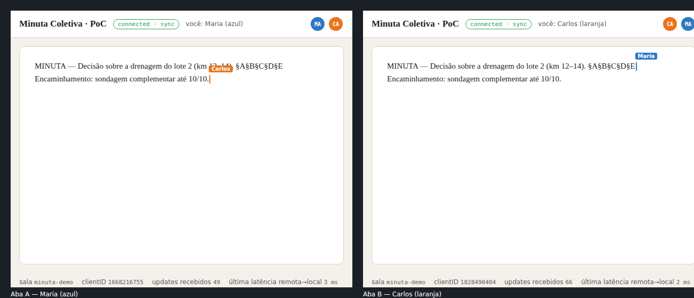

# PoC — coedição da "Minuta Coletiva" (Yjs + y-websocket + awareness)

Prova de conceito mínima da coedição em tempo real do DECIA (documento colaborativo da sessão, ver `docs/produto/DECIA_SESSAO_E_MESA.md` e o comparativo em `docs/produto/COEDICAO_TECNICA.md`). Sem bundler, sem framework: um servidor Node e uma página HTML.

| Arquivo | O que é |
|---|---|
| `server.mjs` | Servidor HTTP + WebSocket. Implementa o protocolo y-websocket (mensagens `sync` 0 e `awareness` 1) com `y-protocols` em ~80 linhas — o mesmo que `@y/websocket-server` faz — mantendo um `Y.Doc` por sala em memória. Serve `client.html` e os módulos ESM de `node_modules` em `/vendor/<pacote>` (resolvendo a condição `browser` do `exports`). `/status` mostra salas, conexões e updates. É o esqueleto do adapter da porta `CollabDocPort` (`ws-infrastructure/collab-yjs`). |
| `client.html` | Cliente: `Y.Doc` + `WebsocketProvider` + `awareness`. Um `contenteditable` ligado a `Y.Text('minuta')` por diff mínimo (prefixo/sufixo) — no produto entra um editor com binding pronto (TipTap/ProseMirror `y-prosemirror`). Presença: avatares e cursores coloridos com as 6 cores de nó (vermelho, amarelo, verde, azul, marrom, laranja). |
| `test.mjs` | Teste E2E com Playwright (Chromium): sobe o servidor, abre 2 páginas (Maria/azul e Carlos/laranja), digita em uma, espera a outra receber (< 1 s), repete no sentido inverso, confere convergência e grava a captura das 2 abas. |
| `teste-2-abas.png`, `teste.log` | Resultado da última execução (abaixo). |

## Como rodar

```bash
cd docs/lab/poc-coedicao
npm install                       # yjs, y-websocket, y-protocols, lib0, ws (+ playwright-core para o teste)
npm start                         # http://localhost:1234/?room=minuta-demo&user=Maria&cor=azul
# abra uma segunda aba: http://localhost:1234/?room=minuta-demo&user=Carlos&cor=laranja
```

Teste automatizado (precisa de um Chromium; o caminho padrão é o do ambiente desta sessão, troque com `CHROME=/caminho/chrome`):

```bash
CHROME=/opt/pw-browsers/chromium-1194/chrome-linux/chrome npm test
```

## Resultado do teste (2026-10-03, Node 22.22, yjs 13.6.33, y-websocket 3.1.0, Chromium 1194)

```
ambas conectadas; presença em A = 2
A→B: "MINUTA — Decisão sobre a drenagem do lote 2 (km 12–14)." chegou em 248 ms (inclui o tempo de digitação dos 56 caracteres)
A→B 1 token "§A": 15 ms
A→B 1 token "§B": 11 ms
A→B 1 token "§C": 13 ms
A→B 1 token "§D": 12 ms
A→B 1 token "§E": 17 ms
B→A: chegou em 284 ms
convergiu: true | texto final: "MINUTA — Decisão sobre a drenagem do lote 2 (km 12–14). §A§B§C§D§E Encaminhamento: sondagem complementar até 10/10."
servidor /status: {"minuta-demo":{"conns":2,"updates":115,"textLength":115,"awareness":2}}
RESULTADO: OK — todas as amostras < 1 s (máx 284 ms)
```

- **Latência por tecla (A→B, localhost): 11–17 ms**; o tempo de 248/284 ms das frases inteiras é dominado pela digitação simulada caractere a caractere (56 e 49 updates), não pelo transporte.
- Os dois lados convergiram para o mesmo texto após edições concorrentes (Carlos escreveu no fim enquanto o cursor de Maria estava no meio).
- Presença: cada aba vê 2 estados de awareness (avatar + cursor colorido do outro usuário).



## O que a PoC não cobre (fica para o adapter real)
Persistência (snapshot S3 + metadados MySQL + eventos Cassandra), autenticação do WebSocket (JWT do RF2), limite de editores por documento, RESTRITO/SIGILOSO (sala só no backend interno, sem provedor externo), reconexão com fila offline (`y-indexeddb`) e editor rico com modo revisão (sugestões) — ver `docs/produto/COEDICAO_TECNICA.md`.
