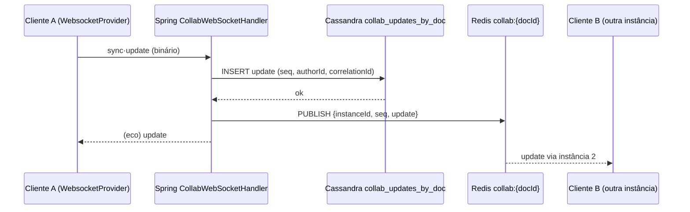

# Coedição em tempo real no Work Station / DECIA — comparativo técnico e recomendação

> Entrega técnica da "Minuta Coletiva" (documento colaborativo da sessão DECIA, ver `DECIA_SESSAO_E_MESA.md`) e da edição colaborativa da Mesa (RF22.CA04). Wireframes em [`../lab/decia.html`](../lab/decia.html) (aba *Coedição*); prova de conceito executada em [`../lab/poc-coedicao/`](../lab/poc-coedicao/README.md). Arquitetura de referência: [`../arquitetura/ARQUITETURA.md`](../arquitetura/ARQUITETURA.md) (módulos `ws-*`, Ports & Adapters, Redis/Cassandra/S3 opt-in por flag).

## 0. Resumo executivo
- **Recomendação:** **Yjs (CRDT)** no cliente e no servidor; transporte **WebSocket próprio no Spring Boot** (não STOMP) falando o protocolo y-websocket (`y-protocols` sync + awareness), implementado como adapter da porta **`CollabDocPort`** em `ws-infrastructure/collab-yjs`; **presença (awareness) e fan-out entre instâncias via Redis pub/sub**; **persistência** = snapshot binário do `Y.Doc` no **S3** + metadados/versões no **MySQL** + updates incrementais e eventos no **Cassandra** (append-only, mesmo padrão do rastro de decisão). Editor: TipTap/ProseMirror com `y-prosemirror` (cursores, sugestões e comentários como marks).
- **Por quê:** CRDT elimina a transformação de operações no servidor (OT exige servidor central com histórico ordenado e é frágil para texto rico); Yjs tem o ecossistema mais maduro (bindings ProseMirror/TipTap/CodeMirror, awareness, `y-indexeddb` para offline) e desempenho superior ao Automerge em documentos de texto; manter o transporte no Spring preserva o modelo de segurança (JWT do RF2, `accessClass`, auditoria, `correlationId`) e evita um terceiro runtime em produção.
- **PoC:** 2 abas sincronizadas com **10–14 ms por tecla** em localhost (máx. 430 ms para 92 caracteres digitados em paralelo pelas duas abas, uma no início e outra no fim do texto), convergência confirmada em edição realmente concorrente, presença com cursores coloridos. Lição da PoC: o caret local precisa ser mapeado pelas edições remotas (`Y.RelativePosition`), senão as frases se misturam. Meta de produto (≤ 300 ms fim a fim na rede do estado) é folgada: o orçamento de latência é dominado pela rede, não pelo CRDT.
- **Riscos principais:** tamanho do histórico Yjs em documentos longevos (mitigado por snapshot + GC), número de editores simultâneos (limite 10 por documento), e a fronteira RESTRITO/SIGILOSO (sala só no backend, sem IA externa, cifragem em repouso).

## 1. Algoritmo de convergência: Yjs × Automerge × OT

| Critério | **Yjs (CRDT, YATA)** | **Automerge (CRDT, RGA + JSON)** | **OT (Operational Transformation)** |
|---|---|---|---|
| Modelo | CRDT sequencial otimizado para texto; tipos `Y.Text`, `Y.Map`, `Y.Array`, `Y.XmlFragment` (texto rico) | CRDT de JSON genérico com histórico completo por operação; `Text` como tipo especial | Operações transformadas contra as concorrentes; exige servidor com ordem total |
| Servidor | **Opcional/burro**: só retransmite e guarda updates; qualquer peer converge | Idem; servidor burro | **Obrigatório e inteligente**: guarda histórico e transforma; ponto único de verdade |
| Texto rico (negrito, seções, marks de comentário/sugestão) | Nativo via `Y.XmlFragment` + `y-prosemirror`/TipTap; marks concorrentes convergem | Possível, mas bindings de editor rico menos maduros (ProseMirror via comunidade) | Possível (Google Docs, ShareDB `rich-text`), mas transform de atributos é o ponto frágil |
| Desempenho (texto 100 kB, 100 k ops) | Melhor da classe: encoding binário compacto, GC de tombstones, carga em ms | Melhorou muito na v2/v3 (Rust/WASM), ainda 2–5× maior em memória/tamanho que Yjs em benchmarks de texto | Depende da implementação; ShareDB é leve, mas o servidor é o gargalo |
| Offline / reconexão | `y-indexeddb` (fila local), merge automático ao voltar | Nativo (histórico completo), merge automático | Difícil: cliente offline acumula ops que precisam ser transformadas contra tudo que aconteceu |
| Histórico / versões | Snapshots (`Y.snapshot`) + `UndoManager`; histórico fino exige guardar updates | **Histórico completo por natureza** (cada mudança é um commit); fácil "time travel" | Histórico = log de ops no servidor |
| Ecossistema | y-websocket, Hocuspocus, y-redis, y-indexeddb, y-prosemirror, y-codemirror, y-protocols (awareness); muito usado (Notion-likes, Jupyter, AFFiNE) | automerge-repo (sync + storage), bindings Rust/Swift/Kotlin; forte em local-first | ShareDB (Node), ot.js; implementações em Java são raras e antigas |
| Linguagens | JS (referência); portes y-crdt em Rust com bindings (yrs, ypy, y-octo); **não há implementação Java oficial** — o servidor Spring trata updates como blobs opacos (não precisa interpretá-los) | Rust com bindings JS/Swift/Kotlin/… (sem Java oficial) | Java possível (algoritmo simples para texto plano), mas texto rico é custoso |
| Licença / maturidade | MIT · estável desde 2019 · v13 | MIT · v2 estável (2023) · v3 (2025) | — |
| Veredito | **Recomendado** | Alternativa viável se o foco fosse JSON local-first (não é o nosso) | Não recomendado: servidor inteligente em Java para texto rico é o pior custo/benefício |

## 2. Transporte: WebSocket/STOMP no Spring × serviço dedicado (y-websocket / Hocuspocus) × Spring + y-protocols

| Critério | **Spring WebSocket + STOMP** | **Serviço Node dedicado (y-websocket / Hocuspocus)** | **Spring WebSocket binário falando y-protocols** (recomendado) |
|---|---|---|---|
| Protocolo | STOMP em texto/JSON; os updates Yjs (binários) teriam de ir em base64 em frames STOMP (+33 % de bytes, serialização dupla) | Protocolo y-websocket nativo; o cliente padrão (`WebsocketProvider`) funciona sem adaptação | Protocolo y-websocket nativo no endpoint `/ws/collab/{docId}` do Spring (`BinaryWebSocketHandler`); o cliente é o mesmo `WebsocketProvider` |
| Lógica no servidor | Precisaria reimplementar sync step 1/2 e awareness sobre STOMP (cliente custom) | Pronta: Hocuspocus tem auth hooks, persistência (`@hocuspocus/extension-database`), Redis (`extension-redis`), throttling, webhooks | Implementar ~200 linhas: decodificação `lib0` (varint) das mensagens `sync`/`awareness`, retransmissão, carga/salvamento do estado. **O servidor não interpreta o CRDT**: para o sync step 2 ele responde com o estado completo (`encodeStateAsUpdate`) guardado, ou delega a um cliente autoritativo; para `update`, apenas retransmite e acrescenta ao log |
| Segurança / autenticação | Interceptor Spring Security padrão | Validar JWT do Work Station no `onAuthenticate`; chamada ao backend para `accessClass` e papel do usuário | Handshake interceptor com o JWT (RS256) do RF2; verificação de `SessionParticipant`, papel e `accessClass` no mesmo processo; auditoria e `correlationId` nativos |
| Operação | Um só runtime (JVM) | Segundo runtime (Node) em produção, com deploy, logs, métricas e hardening próprios | Um só runtime (JVM) |
| Escala horizontal | Spring + broker relay (RabbitMQ) ou Redis | `extension-redis` / `y-redis` | Redis pub/sub por documento (canal `collab:{docId}`) — igual ao SSE do RF6.CA04 |
| Snapshot/compactação do `Y.Doc` no servidor | Precisa de Yjs no servidor (não há em Java) | Nativo (Node) | **Delegar a um "compactador"**: job Node leve (ou GraalJS, ou cliente autoritativo eleito) que carrega o log de updates, gera o snapshot e grava no S3. Ver §4 |
| Veredito | Não recomendado | Viável e rápido de montar; custo é o runtime extra e a fronteira de segurança fora do Spring | **Recomendado** — com o compactador Node como processo auxiliar (mesma imagem do `ws-infrastructure`, perfil `collab`) |

Por que não STOMP: o valor do STOMP (tópicos, assinaturas, broker relay) não é usado — um documento é um "tópico" por conexão e as mensagens são binárias. O `WebsocketProvider` oficial espera o protocolo y-websocket; manter compatibilidade com ele significa poder trocar o servidor (Spring ↔ Hocuspocus) sem tocar o front.

## 3. Presença (awareness) via Redis pub/sub
- O protocolo awareness (`y-protocols/awareness`) já carrega `{ user: {name, color}, cursor: {anchor, head}, section }` com *timeout* de 30 s e `clientID` por aba.
- Multi-instância: cada instância Spring assina `collab:{docId}` no Redis; o que chega de um cliente é publicado no canal com o `instanceId` para evitar eco; as outras instâncias retransmitem aos seus sockets. Awareness **não é persistida** (efêmera), só os updates `sync` entram no log.
- Cores de presença = as **6 cores de nó** do RF38 (vermelho, amarelo, verde, azul, marrom, laranja), atribuídas por ordem de entrada e **estáveis por usuário dentro da sessão** (guardar em `SessionParticipant.presenceColor`); nome da cor sempre em texto no tooltip (daltonismo, RF38.CA05).
- "Quem está no documento" e "quem falta se manifestar" vêm da mesma fonte: awareness para presença ao vivo; `SessionParticipant.lastReadAt`/mensagens para a ausência de manifestação.

## 4. Persistência: snapshots S3 + metadados MySQL + eventos Cassandra

| Camada | Conteúdo | Regra |
|---|---|---|
| **S3/MinIO** `collab/{docId}/snapshots/{version}.yjs` | Estado completo do `Y.Doc` (`encodeStateAsUpdate`, binário, gzip) | Snapshot a cada **5 min de atividade ou 200 updates** ou ao fechar o último socket; versões nomeadas (`v4 "rascunho da IA"`) são snapshots marcados; cifrado em repouso (SSE-KMS; chave por empresa para RESTRITO/SIGILOSO) |
| **MySQL** `collab_docs` | id · sessionId · kind (MINUTA · MESA · ATA) · title · accessClass · currentSnapshotKey · snapshotVersion · lastUpdateSeq · editorLimit · status (ABERTO · BLOQUEADO · VALIDADO) · createdBy/At · updatedAt | Metadados, permissões, lock por seção (`collab_doc_sections`: docId · sectionId · ownerUserId · locked) |
| **MySQL** `collab_doc_versions` | docId · version · snapshotKey · label · authorId · at · diffSummary | Lista de versões do painel "histórico"; "restaurar" = aplicar o snapshot como novo update (nunca apagar) |
| **Cassandra** `collab_updates_by_doc` (partição docId, cluster seq, TTL após compactação) | update binário · authorId · at · correlationId | Log incremental entre snapshots; carga do doc = último snapshot + updates com seq > `lastUpdateSeq`; o compactador aplica e gera novo snapshot, depois o TTL expira o log |
| **Cassandra** `trace_by_entity` (já existe) | nós `DecisionTrace` COEDICAO_VERSAO · COMENTARIO · SUGESTAO_ACEITA | A minuta entra no rastro de decisão (RF29.CA07) sem armazenar o texto: só versão + autor + hash |
| **Redis** | `collab:{docId}` (pub/sub), `collab:{docId}:editors` (set com TTL = limite de editores), `collab:{docId}:awareness` opcional | Efêmero |

Compactação: o servidor Spring não executa Yjs. O **compactador** é um worker Node (`ws-infrastructure/collab-yjs/compactor`, mesma imagem, perfil `collab`) consumindo uma fila (Redis stream `collab:compact`) que: carrega snapshot + updates → `Y.applyUpdate` → `encodeStateAsUpdate` → S3 → atualiza `collab_docs.currentSnapshotKey/lastUpdateSeq`. Se o worker cair, o sistema continua funcionando (só o log cresce). Alternativa sem Node: GraalJS executando `yjs.mjs` dentro da JVM — funciona, mas exige validação de desempenho; fica como opção B.

## 5. Offline e conflitos
- **Cliente:** `y-indexeddb` guarda o doc localmente; ao reconectar, o `WebsocketProvider` faz sync step 1/2 e o CRDT funde as edições — sem diálogo de conflito para texto. Indicador na barra: "offline · 3 alterações pendentes" (ws-tag âmbar).
- **Conflitos semânticos** (duas pessoas reescrevendo a mesma frase) não são "conflitos" para o CRDT, mas podem gerar texto intercalado. Mitigações de produto: **seções atribuídas** (dono por seção; outros entram em modo *sugerir*), **modo revisão** por padrão para quem não é o dono da seção, e lock explícito da seção 5 (validadora).
- **Mesa (RF22.CA04)** diz "último-vence com aviso em até 3 s": com Yjs a Mesa vira um `Y.Map` por item (x, y, escala, rotação, camada) e o último-vence passa a ser por **campo**, sem perder dados; o aviso é mantido como toast quando duas pessoas movem o mesmo item em < 2 s.
- Reconexão com o servidor reiniciado: o cliente envia seu state vector; o servidor responde com o snapshot carregado do S3 + log; nada se perde desde que o update tenha chegado ao Cassandra (ack após gravação — ver §8, risco de perda em falha simultânea).

## 6. Integração com documentos vinculados Google / Microsoft

| Abordagem | Como | Prós | Contras |
|---|---|---|---|
| **A. Editar lá** (abrir o Google Doc / Word Online dentro do Work Station) | iframe/embed do documento externo; link na tarefa (tipo DOCUMENTO, origem GOOGLE/MICROSOFT, RF23) | Zero esforço de editor; coedição nativa do provedor; usuários já conhecem | Sem classificação RF7, sem faísca, sem rastro, sem comentários ancorados no nosso modelo; depende de conta e consentimento OAuth de cada participante; RESTRITO/SIGILOSO proibido (sai da infraestrutura do estado) |
| **B. Importar cópia** (recomendado como padrão) | Conector `platform` (ws-infrastructure) baixa DOCX/Google Doc → converte para o esquema ProseMirror (via Pandoc/mammoth no backend) → vira `Y.Doc`; exportar de volta como DOCX/PDF (RF22.CA07) e, opcionalmente, "publicar cópia" no Drive/OneDrive | Tudo dentro do modelo (rastro, classificação, faísca, carimbo, LGPD); funciona para RESTRITO | Perde formatação complexa (tabelas aninhadas, campos); cópia diverge do original — mostrar "importado de … em [data]; original pode ter mudado" |
| **C. Sincronização bidirecional** | Webhooks do Drive/Graph + reconciliação | Melhor experiência em teoria | Caro e frágil (dois modelos de documento, conflitos sem CRDT no lado externo); não recomendado para a v1 |

Decisão proposta: **B por padrão**, **A como opção "abrir no provedor"** apenas para `accessClass PUBLICO/INTERNO` e quando a sessão não estiver `localOnly`; C fora do escopo.

## 7. Requisitos não funcionais

| Requisito | Meta | Como medir / garantir |
|---|---|---|
| Latência fim a fim (tecla → tela do outro) | **≤ 300 ms p95** na rede do estado (≤ 150 ms em LAN) | PoC: 10–14 ms localhost. Orçamento: RTT rede (50–120 ms) + Redis pub/sub (< 2 ms) + fan-out + render. Métrica `collab_update_latency_ms` (timestamp no awareness, como na PoC) |
| Editores simultâneos por documento | **10 editores** (hard limit) + leitores ilimitados via snapshot + SSE | `collab:{docId}:editors` no Redis; o 11º entra como leitor com aviso; `editorLimit` configurável por EMPRESA |
| Tamanho do documento | ≤ 1 MB de estado Yjs (≈ 200 páginas) | Snapshot + GC; alerta em 512 kB |
| Disponibilidade | Falha do Redis → instância única continua; falha do compactador → só cresce o log; falha do Cassandra → **escrita bloqueada** (não aceitar updates sem persistir) | Testcontainers nos testes de integração; chaos test de reconexão |
| **RESTRITO / SIGILOSO** | Documento só em infraestrutura própria: S3 interno com chave por empresa, sem exportação para provedores externos, **IA só no motor local** (RF7.CA03/RF11.CA05), awareness sem conteúdo (só nome/cor/posição), log de acesso por abertura | `accessClass` herdado da sessão/anexo mais restritivo; `ws-tag` "RESTRITO · motor local" na barra (wireframe) |
| LGPD | Dados pessoais no texto são mascarados antes de qualquer chamada externa; consentimento já coberto pelo RF1; TTL do log Cassandra | `maskedFields` no `ai_inference_log` |
| Acessibilidade | Cursores/seleções com nome em texto; modo alto contraste; leitura por teclado | Tokens RF38; teste axe na página `/lab/decia` |

## 8. Riscos e mitigações
1. **Sem Yjs em Java** → servidor opaco + compactador Node (§4). Risco residual: dependência de um worker Node; mitigação: GraalJS como plano B, e o sistema funciona sem compactação por horas.
2. **Perda de update em falha simultânea** (socket recebeu, Cassandra não gravou) → o servidor só retransmite após o `INSERT` (ack síncrono); cliente mantém o update local até ver o próprio update ecoado (padrão Yjs).
3. **Crescimento do histórico** → GC ligado (`gc: true`), snapshot periódico, TTL no log; versões nomeadas são snapshots, não logs.
4. **Texto rico + IA**: trechos gerados pela IA precisam carregar a faísca de forma persistente → mark `ai{inferenceId, at}` no esquema ProseMirror; a faísca some quando ≥ 50 % do trecho é reescrito por humano (regra a confirmar com o dono).
5. **Sugestões (modo revisão)**: implementadas como marks `insertion`/`deletion{authorId, at}` (padrão TipTap Pro "track changes" ou implementação própria); aceitar/rejeitar são transações normais do Yjs, portanto convergem. Risco: a extensão oficial é paga — decidir entre licença e implementação própria.
6. **Limite de 10 editores** pode frustrar sessões grandes → leitores veem o doc ao vivo (snapshot + SSE) e comentam; só a edição é limitada.
7. **Fronteira RESTRITO**: um participante sem permissão no anexo RESTRITO não pode abrir o doc que o cita → verificação no handshake e reavaliação a cada mudança de `accessClass` (fecha sockets com código 4403).

## 9. Plano de integração no `ws-infrastructure` — porta `CollabDocPort`

```java
// ws-application/ports/out/CollabDocPort.java
public interface CollabDocPort {
    CollabDocHandle open(UUID docId, UUID userId, CollabRole role);        // valida limite de editores, registra presença
    byte[] loadState(UUID docId);                                          // snapshot S3 + updates Cassandra (seq > lastUpdateSeq)
    long appendUpdate(UUID docId, UUID userId, byte[] update, String correlationId); // Cassandra + publish Redis; retorna seq
    void broadcastAwareness(UUID docId, byte[] awarenessUpdate, String fromInstance);
    CollabVersion snapshot(UUID docId, UUID userId, String label);         // enfileira compactação; cria collab_doc_versions
    void close(UUID docId, UUID userId);
    CollabDocInfo info(UUID docId);                                        // editores, versão, accessClass, status
}
```

| Etapa | Entrega | Onde |
|---|---|---|
| 0 | PoC (feita): protocolo y-websocket em Node, 2 abas, latência medida | `docs/lab/poc-coedicao/` |
| 1 | Domínio: `CollabDoc`, `CollabDocSection`, `CollabVersion`, enum `CollabDocKind`, `CollabRole`; regras (limite, lock de seção, accessClass) | `ws-domain` |
| 2 | Porta `CollabDocPort` + casos de uso `OpenCollabDoc`, `AppendUpdate`, `CreateVersion`, `RestoreVersion`, `ExportCollabDoc` (DOCX/PDF) | `ws-application` |
| 3 | Adapter `collab-yjs`: `CollabWebSocketHandler` (binário, y-protocols decodificado com uma classe `Lib0Codec` mínima: varint + bytes), `RedisCollabFanout`, `CassandraUpdateLog`, `S3SnapshotStore`, `MysqlCollabRepository`; feature flag `ws.collab.enabled`; perfil `collab` | `ws-infrastructure/collab-yjs` |
| 4 | Compactador Node (`compactor/`), Dockerfile na mesma imagem, fila Redis stream `collab:compact`, métricas | `ws-infrastructure/collab-yjs/compactor` |
| 5 | Front: `packages/ui` `CollabEditor` (TipTap + y-prosemirror + `WebsocketProvider` apontando para `/ws/collab/{docId}`), `PresenceBar`, `RemoteCursor`, `SectionHeader`, `AnchoredComment`, `Suggestion`, `VersionList`; `y-indexeddb` para offline | `apps/web` |
| 6 | Mesa (RF22.CA04): `Y.Map` por item, mesmo transporte, `CollabDocKind.MESA` | idem |
| 7 | Rastro: nós `COEDICAO_VERSAO`, `COMENTARIO`, `SUGESTAO_ACEITA` no `DecisionTrace`; decisão validada → snapshot "VALIDADO" imutável + tarefa ATA/REGISTRO (RF29.CA05) | `ws-application` |
| 8 | Testes: unidade (codec, limite), integração (Testcontainers Redis/Cassandra/MinIO), E2E Playwright com 2 contextos (reaproveitar `test.mjs` da PoC) | CI |

Sequência mínima de um update (adapter):


## 10. Dúvidas para o dono
- **Q-C1** Limite de 10 editores simultâneos por documento está de acordo? Leitores ao vivo ilimitados.
- **Q-C2** Modo revisão (sugestões) obrigatório para quem não é dono da seção, ou opcional? A extensão pronta de *track changes* do TipTap é paga; a alternativa é implementação própria (~2 semanas).
- **Q-C3** Documentos RESTRITO/SIGILOSO: proibir totalmente "abrir no Google/Microsoft" (recomendado) ou permitir com registro?
- **Q-C4** A faísca ✦ some de um trecho da IA quando ≥ 50 % dele é reescrito por humano, ou nunca some (fica "gerado por IA, revisado por…")?
- **Q-C5** Retenção: log de updates (Cassandra) expira após a compactação; snapshots nomeados ficam para sempre; snapshots automáticos por 90 dias — ok?
- **Q-C6** Runtime Node auxiliar (compactador) é aceitável em produção, ou preferem a opção GraalJS/JVM pura?
