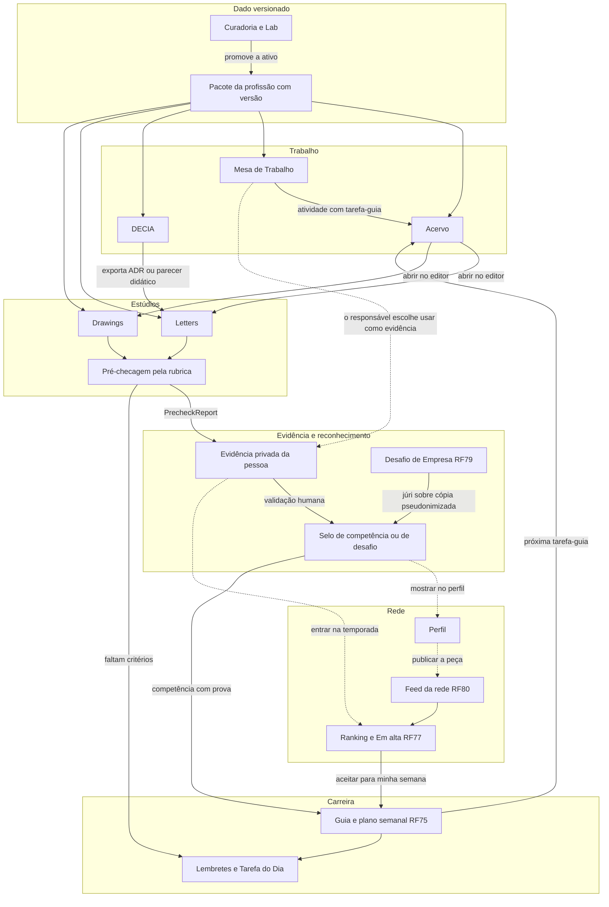

# Integração por profissão de interesse — o que muda em cada aba e como os módulos conversam

Consolidação de 10/11/2026 das cinco pesquisas de produto feitas em 09–10/11/2026, só com leitura do repositório, uma por grupo de
abas: **A** trabalho (Mesa, Acervo, Espelho, Simulador, Autopilot, Planos, Metas, Handoffs) · **B** decisão e IA (DECIA, Insights,
Agentes, Memória, Curadoria, Modelos, Lab) · **C** carreira e social (Perfil, aba da profissão, Desafios, Selos, Pontos, Feed,
Destaques, Busca, Mensagens) · **D** estúdios (Letters, Drawings, Balcão, Anexos, Emissor) · **E** conta, fontes e privacidade
(cadastro, Conta, Conectores, Privacidade, Notificações, Empresas, curadoria dos pacotes). Pedido do dono do produto: "Pense como
integrar novos requisitos funcionais por profissão de interesse escolhida. Rode agentes para entender como estes módulos se
integrariam às demais abas." Os achados sobre o código foram conferidos de novo em 10/11/2026.

**Termos.** *Profissão preferida* = `User.preferredOccupation`, um dos 79 ramos de `contracts/career/academic-fields.json` (D-148,
RF81). *Pacote* = `contracts/career/occupation-packs/<ramo>.json` (80 arquivos: 79 ramos + `generico`; tipos em
`lib/career/occupationPack.ts`). *Lente* = o ramo gravado no item. **Numeração (D-149):** RF76 Treino e Simulados · RF77 Ranking da
temporada, níveis e Em alta · RF78 Memória da Profissão · RF79 Desafios de Empresa, com o selo bronze/prata/ouro da D-151 · RF80 Feed
da rede · RF81 cadastro com profissão. Requisitos novos usam o código provisório `RFP-<grupo>-n`; a numeração definitiva é do dono do
produto (pergunta 3).

## 1. Resumo executivo

- **A profissão é uma lente do item, não um rótulo da pessoa.** Tarefa, projeto, decisão, peça, documento e desafio gravam o ramo
  (`fieldCode`) e a versão do pacote; a profissão preferida só pré-marca o seletor, só para o dono (D-147). Os cinco grupos chegaram
  a esse desenho por conta própria, e o Acervo já o usa com o campo de estudo.
- **Nenhum pacote está pronto para produção.** Os 79 pacotes de ramo estão em `pesquisa` (só o `generico` está `revisado`; nenhum
  `ativo`), `packForField` ignora o status e o Acervo já exibe "(pesquisa)" na tela. A curadoria com revisor da área é o caminho
  crítico de todo o RF75–RF81.
- **A Mesa de Trabalho só conhece TI.** Portões e indicadores de `lib/projects/{lifecycle,metrics}.ts` vêm de Gestão e Governança de
  TI (COBIT, ITIL, ISO/IEC 38500, SISP). Já feito em 10/11, parte do RFP-A-1/A-4: a "área do projeto" (TI × outras) tira ISO/IEC
  38500, Run/Grow/Transform, SLA/OLA/UC e a transição ITIL dos projetos de outras áreas. Falta o principal: o portão da Análise ainda
  exige a marca ISO 38500, a área usa as 9 `WorkArea` e não há ciclo de vida, artefatos nem portões da profissão (seção `work`, §5).
- **Os estúdios quase não existem.** `/letters` é esqueleto e `/drawings` só abre o editor 3D, que guarda o rascunho no navegador e
  serve aos 7 pacotes com modo `3d`; já diagrama e infográfico aparecem em 79 dos 80 pacotes, L4 em 76 e L7 em 66. Painel Guia
  (RF75.CA06), modo prova (RF76), entrega de desafio (RF79), evidência e "criar a partir do modelo" (RF81) dependem deles.
- **Uma só régua de checagem.** Os 862 critérios objetivos dos pacotes (828 automáticos) têm o `check` em texto livre. Proposta:
  `strategy` + `params` em cada critério e uma biblioteca pura `lib/career/checks/*` que dá o mesmo resultado no Acervo, nos
  editores, no Feedback da Mesa, no envio de desafio e na política de selo (D-12).
- **Autonomia padrão em conflito.** Os 80 pacotes declaram `defaultAutonomy: SUGESTOES`; a D-136 fixa o padrão pessoal em
  `SOB_SOLICITACAO`. Recomendação: o pacote só restringe, e vale sempre o modo mais restritivo (pergunta 4).
- **A IA ainda não conhece a profissão.** O backend não lê pacote; `composeAiContext` só roda em testes; `ai.services` está no teto
  do esquema (12 serviços em 63 pacotes); o `PersonalDataMasker` não reconhece número CNJ, prontuário, inscrição em conselho nem
  nome de aluno. Proposta: um `AiContextAssembler` antes do `AiGateway`, que bloqueia, em vez de mascarar, o que o pacote proíbe.
- **Privacidade em três listas que não batem.** O `sensitiveData` do catálogo e o do pacote divergem em 65 dos 79 ramos, e
  `ai.dataScope.never` é uma terceira lista. Proposta: guardas estruturadas (`system.privacy.guards`) por contexto — importar,
  publicar, IA externa, desafio —, das quais as outras listas derivam.
- **Nomes duplicados.** `Evidence` já é a foto ou anexo do RF41.CA06 e virou também a evidência de competência (RF75, RF81.CA09); a
  origem da tarefa da profissão tem três nomes (`GUIA_DE_CARREIRA`, `DESAFIO`, `PROFISSAO`) num `TaskOrigin` que é de origem
  institucional; o contrato "minha profissão" tem três rotas propostas (§7).
- **Barreira de privacidade antes de selo e ranking.** Treino, Pontuação de Evidências da Temporada (PET), nível, desafios e
  mentoria nunca chegam a empresa, chefe, busca ou feed sem um ato da pessoa; agregados para empresa só com k ≥ 10 e depois do
  encerramento. Isso entra no desenho do RF79 E1: corrigir depois, com dados já expostos, é tarde.
- **Já resolvido depois das pesquisas.** A checagem do Acervo confere só a rubrica da tarefa-guia de origem
  (`extensions.guidedTask`, commit 377acc4); o ramo lembrado no navegador passou a ser por conta, o que fecha o vazamento entre
  contas apontado pelo grupo C; a Mesa ganhou a área do projeto. Os conectores de fontes externas ocuparam as migrações V60 e V61
  que o RF75 e o RF81 planejavam; os planos foram renumerados para V62–V68, com a faixa reservada no `PLANO_EXECUCAO` §6 (§7).
- **Sequência (§6).** Onda 1: esquema, curadoria com Lab e barreira de privacidade. Onda 2: a lente nas telas que já existem
  (cadastro, Acervo, Mesa, DECIA), com o assembler de IA e as guardas. Onda 3: estúdios, painel Guia e evidência. Onda 4: desafios,
  carteira de selos e feed.

## 2. Princípios transversais

Valem para todo requisito por profissão. O primeiro é a convergência mais forte: os cinco grupos chegaram a ele por caminhos
diferentes — A (área do projeto ≠ profissão preferida), B (a lente da decisão), C (profissão do item ≠ profissão preferida), D (o
pacote da peça, declarado pela autora) e E (domínio do departamento como dado institucional).

1. **A lente é do item, não da pessoa (D-147, D-148).** Cada item grava `fieldCode` (ramo do catálogo) e `packCode@version`. Ordem
   de resolução: lente do item → profissão preferida, só para o dono e só em telas pessoais (criadores, guia, editor sem tarefa) →
   `generico`. A sugestão vem marcada "a partir da sua profissão — só você vê" e só vira atributo de item compartilhado com
   confirmação. A profissão preferida nunca é coluna, filtro, ordenação, meta, equipe, dossiê, campo de DTO de terceiro nem registro
   que o ADMIN lê (a trilha da IA grava `lens=PESSOAL`, sem o código). Trocar de profissão não muda itens já criados (RF81.CA08).
2. **O pacote só restringe.** Autonomia, rota da IA, dados e ferramentas efetivos são o mais restritivo entre gateway (D-69),
   pacote, consentimento, preferência da pessoa (D-136) e política da sessão (RF51). Nada no pacote libera IA externa para conteúdo
   RESTRITO ou SIGILOSO, e nenhum pacote tem AGENTE como padrão.
3. **Determinístico primeiro (D-12).** Portões, indicadores, prazos, restrições de cenário, conformidade, pré-checagem, PET, Em alta,
   metal, vizinhança, agregados e os números dos lembretes são funções puras e versionadas. A IA redige a partir de um bloco de fatos
   numerados, e a saída que cita número fora dele é recusada (`IA_SAIDA_SEM_LASTRO`). O pacote traz texto, critérios, portões e
   vocabulário, nunca pesos que ordenem pessoas ou alternativas.
4. **Curadoria antes de ativar.** Escada proposta (pergunta 1): `pesquisa` — Lab e, no máximo, conteúdo informativo marcado "em
   revisão por especialistas"; `revisado` — modelos, rubricas, Treino, Em alta e Desafios, mas critérios regulatórios, prazos e
   checklists só com revisor da área inscrito no conselho; `ativo` — IA por profissão, ranking, Memória, selo exportável, facetas do
   feed e lembretes. Item, decisão, desafio e selo guardam a versão de origem; status, versão e códigos L/D/X não aparecem fora do Lab
   (RF75.CA18).
5. **Profissões reguladas: registrar o declarado e quem atestou, sem consultar o conselho.** São 44 dos 79 ramos com registro
   obrigatório (13 no CREA). O sistema confere formato, número, anexo, papel e data, avisa "verificado só o que foi declarado;
   confira no conselho" e abre a consulta pública oficial em nova aba, sem raspar portais. A IA não redige ato regulado em projeto
   REAL; a peça dessas áreas leva a marca fixa "exercício didático — não assinável"; selo não usa título profissional reservado;
   desafio não exige registro (Lei 9.029/1995).
6. **LGPD e dados sensíveis por profissão.** Saúde (art. 11), crianças e adolescentes (art. 14 e ECA), sigilo profissional (OAB,
   CFM, COFEN, CFP), segredo de justiça (CPC art. 189), convicção religiosa (Teologia, art. 5º, II), segredos e PI (software, NDA).
   Os detectores da lente bloqueiam antes de IA externa, publicação, Balcão, desafio e cópia de conector; eventos e logs levam só ids
   e contagens; a anonimização é local, com antes e depois para aceite; exportação e eliminação (D-145) cobrem profissão, registro,
   evidências, ranking, desafios e mentoria; o mapa de dados ganha a categoria `CARREIRA_E_PROFISSAO` (RF3.CA13).
7. **Justiça.** Mede-se a entrega, não a pessoa: ninguém é ordenado por profissão, selo, metal ou nível; agregados com k ≥ 5 para
   equipe e k ≥ 10 para empresa; régua "supera = k de n" visível; vaga por profissão em Em alta e Destaques; trabalho de prática vale
   tanto quanto projeto real, porque quem está Em transição não tem projeto real; "exige computador" sinalizado.
8. **Acessibilidade.** Status em texto e ícone, nunca só em cor (WCAG 1.4.1); etapas, portões, atestos e painel Guia operáveis por
   teclado, com `aria-live="polite"`; glossário dos termos do pacote (`vocabulary.terms[].meaning`); combobox com
   `aria-activedescendant` (RF81.CA10); "✦" com texto alternativo; nada de contagem regressiva; pt-BR, en e es, com aviso quando
   faltar tradução.

## 3. Mapa aba × profissão

Exemplos contrastam Eng. de Software, Direito, Eng. Civil, Medicina/Enfermagem, Design e Pedagogia.

| Grupo | Aba (rota) | Hoje | O que muda com a profissão | Campos do pacote | Requisito candidato |
|---|---|---|---|---|---|
| A | Mesa e projetos (`/desk`, `/projects/*`) | front completo com dados DEMO; portões e indicadores de TI; área TI × outras (10/11) | ciclo de vida da área sobre as 7 fases canônicas; portões profissionais (ART antes da obra, peça protocolada no prazo, CEP antes da coleta); RACI com papel habilitado; modo PRÁTICA × REAL; modelos de projeto | `work.lifecycles`, `artifacts`, `gateCriteria`, `roles`, `templates`, `governance` | RFP-A-1, A-2, A-3, A-5 |
| A | Feedback da Mesa (janela segmentada) | 31 indicadores de TI; ISO 38500 e ITIL só em TI desde 10/11 | indicadores que não se aplicam saem da conta; grupo "Prática profissional"; "x de n critérios objetivos" da rubrica | `work.metrics`, `rubric.objective` | RFP-A-4 |
| A | Acervo (`/tasks`, `/tasks/new`, `/tasks/[id]`) | lente do campo de estudo (79 ramos), modelos do pacote, rubrica só da tarefa-guia de origem, ramo lembrado por conta | lente padrão = profissão preferida, só para o dono; aviso ao compartilhar a área; RESTRITO por padrão em saúde e infância; prazos (CPC no Direito, precedências nas demais) | `guidedTasks`, `rubric.objective`, `system.privacy`, `work.deadlineRules` | RFP-A-7, A-8 |
| A | Espelho (`/projects/[id]/mirror`) | esqueleto; domínio pronto | checklists da área como terceira fonte (empresa, departamento, pacote); ato regulado só com atesto (`AGUARDA_ATESTO`) | `work.checklists`, `regulated-acts.json` | RFP-A-9 |
| A | Simulador e Autopilot | esqueletos; motores PERT, Monte Carlo e EVM no front | cenários e restrições legais da área (aditivo acima de 25 %, 200 dias letivos); projeto montado pelos modelos da área, sem inferir a área da pessoa | `work.scenarios`, `work.templates`, `vocabulary` | RFP-A-10, A-11 |
| A | Planos, Metas e Handoffs | esqueletos | eixos e indicadores da área; metas de processo, nunca por profissão de pessoas; dossiê com atos regulados e sigilo só por referência | `work.plans`, `work.metrics.add`, `system.privacy` | RFP-A-12, A-13, A-14 |
| B | DECIA (`/decia/*`) | motor completo no front (DEMO), 6 modelos fixos, botões de IA "não conectado" | campo Lente; modelos da profissão com critérios sem pesos, portões (`PORTAO_ABERTO`) e nota de contexto: fundação (Eng. Civil), estratégia em caso fictício (Direito), arquitetura (Software) | `decisions.models` | RFP-B-2, B-3 |
| B | Motor de IA (`AiGateway`, `lib/ai/autonomy.ts`) | sem pacote; `composeAiContext` só em testes | assembler: lente, serviço, autonomia, escopo de dados com bloqueio, rota, bloco de fatos, trilha | `ai.*`, `system.privacy.guards` | RFP-B-1 |
| B | Insights (`/insights`) | esqueleto; domínio pronto | entregas típicas ausentes; evidência esperada na lente; equipe conta itens, nunca pessoas (k ≥ 5); ranking institucional igual | `vocabulary.deliverables`, `competencies.core`, `decisions.evidenceExpectations` | RFP-B-4 |
| B | Agentes e Memória (`/agents`, `/memory`) | esqueletos; RF48 só para contratação pública | testes da área (SINAPI e BDI, prazos, licenças, BNCC); sinônimos por lente ("ART", "laudo", "SOAP") e decisões parecidas | `agents`, `memory.synonyms` | RFP-B-5, B-6 |
| B | Curadoria e Lab (`/curation`, `/lab`) | esqueleto; nenhuma página de pacotes | fila de pacotes por área com dois curadores; bancada com validador, prévia do prompt e da rota, sandbox do scanner e "profissão de visualização" | `review` | RFP-E-9, B-7, B-9 |
| B, D | Balcão de modelos (`/models`, `/store`) | esqueletos; entidades da V19 | prateleira "Da sua profissão"; modelos de decisão e de peça com pacote e tarefa de origem; portões de publicação da área | `rubric.objective`, `system.studio` | RFP-B-8, D-8 |
| C | Perfil (`/profile`, `/u/[username]`) | sem Carreira nem Profissão; `preferredOccupation` ainda não existe no código | sub-abas privadas Carreira e Profissão; carteira única de credenciais; aba condicional em `/u`; aviso do conselho no selo | `label.roleNouns`, `social.credentialDisclaimer`, `social.reservedTitles` | RFP-C-3 |
| C | Minha profissão (`/profile?tab=profissao`; RF76–RF78) | só especificação | título neutro, que a pessoa pode trocar; seções liberadas pelo status; Treino pela prova de referência (OAB, ENADE); Em alta por tarefas-guia, sem L1, L2 e L9; temporada por coorte | `social.ranking`, `guidedTasks`, `learning` | RFP-C-2, C-12 |
| C | Desafios, selos, pontos e benefícios (RF79, `/challenges`, `/seals`, `/points`, `/benefits`) | especificação e esqueletos | rubrica do pacote com checagens críticas não removíveis; "supera = k de n"; vínculo de desafio invisível ao emissor; pontos de desafio fora de agregados; benefícios de lista permitida | `social.challengeLevels`, `rubric` | RFP-C-4, C-5 |
| C | Mural e Feed da rede (RF80, `/mural?tab=rede`) | DEMO; sem a aba `rede`; servidor valida só o formato de `studyField` | faceta Profissão pelos 79 ramos; seguir profissão; Em alta com até 3 itens da mesma profissão a cada 20; checagens críticas ao publicar | `social.itemFacets`, `competencies.tracks` | RFP-C-6 |
| C | Destaques e Reconhecimentos (RF35) | esqueletos | reações normalizadas dentro de cada profissão e vaga por profissão; reconhecimento de temporada emitido pelo sistema, privado | `rubric.objective` | RFP-C-7, C-8 |
| C | Buscar, Encontrar e Mensagens (`/search`, `/find`, `/messages`) | Pessoas e Mensagens só dentro da empresa; `/find` esqueleto | sinônimos e extratores da área (CNJ, NBR, BNCC, CID-10); pessoas nunca filtradas por profissão; mentoria entre empresas após aceite; pessoas semelhantes com opt-in | `vocabulary.terms`, `social.find`, `social.mentoring`, `system.insights.peersBy` | RFP-C-9, C-10, C-11 |
| D | Letters (`/letters`) | esqueleto | modelo e seções por tarefa: parecer e peça processual (Direito), ADR (Software), plano de aula com BNCC (Pedagogia), caso anonimizado em Vancouver (Medicina); marca "não assinável"; scanner | `system.studio`, `system.lettersTemplates` | RFP-D-1, D-2, D-3, D-6 |
| D | Drawings (`/drawings`) | só o 3D, com rascunho no navegador | entrada pelo modo do pacote; kits de notação (C4, BPMN com prazo); prancha com folha, escala, carimbo e cotas (planta 1:50, NBR 6492); 3D com unidades reais | `system.drawingsModes`, `system.studio`, `system.computerOnly` | RFP-D-4, D-5, D-11 |
| D | Peça, Anexos e Emissor (`/attachments`, `/issuer/dashboard`) | `lib/pieces/*` em memória; esqueletos | a mesma revisão serve à Mesa, ao selo e ao desafio; EXIF, geolocalização, rosto e licença pela regra da área; chancela pela rubrica com agregados k ≥ 10 | `system.studio.media`, `rubric.objective` | RFP-D-7, D-9, D-10 |
| E | Cadastro e primeiro acesso (`/register`, `/welcome`) | sem profissão; autocompletar pronto e testado | pergunta opcional (RF81); passo com quatro cartões: modelos, fontes, cuidados com dados, ritmo dos lembretes | `guidedTasks.priority`, `system.sources`, `system.privacy.guards`, `system.nudges` | RF81, RFP-E-1 |
| E | Conta (`/settings?tab=conta`) | sem cartão de profissão | troca com prévia do que muda; registro no conselho opcional, cifrado e só declarado | catálogo: `council.lookupUrl`, `council.numberPattern` | RFP-E-2 |
| E | Conectores (`/settings?tab=conectores`) | em implementação, por ecossistema (Google, Microsoft, Apple) | "Fontes da sua profissão" (GitHub, IFC/DWG, Figma, ORCID); "não conectamos por segurança" (prontuário, ERP); referências públicas (DataJud, DOI e PubMed, diários oficiais) | `system.sources` | RFP-E-3, E-4, E-5 |
| E | Privacidade e Notificações (`/settings?tab=privacidade`, `notificacoes`) | Privacidade é esqueleto; Notificações = horário e 7 interruptores | "Cuidados da sua profissão" com guardas por contexto; lembretes com gatilho e números do sistema, horário, teto e pausa; push e e-mail com texto genérico | `system.privacy.guards`, `system.nudges` | RFP-E-6, E-7 |
| E | Empresas e Departamentos (`/companies/*`, `/departments/*`) | sem setor nem domínio | domínio profissional do departamento (até 3 pacotes) com guardas e modelos oficiais; aba pública de desafios patrocinados | nenhum (dado da instituição) | RFP-E-8 |

## 4. Fluxos entre módulos

### 4.1 Ciclo de ponta a ponta

O pacote ativo é a fonte de verdade; setas tracejadas só acontecem por um ato da própria pessoa. As guardas de privacidade
(RFP-E-6) ficam em toda travessia de privado para público: publicar, enviar a desafio, ofertar no Balcão, usar IA externa e importar.

Exemplo (Eng. Civil): `/projects/new?modelo=campo.engenharia-civil.reforma` → atividade D1 na etapa de projeto executivo → tarefa
no Acervo com a procedência do pacote → Drawings com o painel Guia → revisão congelada e pré-checada → revisão por outra pessoa →
evidência privada → selo validado → perfil, se a pessoa quiser → feed, só se ela publicar a peça → o plano sugere a D6. O desafio
de empresa pode reutilizar um modelo de projeto PRÁTICA como enunciado.

### 4.2 Eventos e contratos

Transporte: outbox `domain_events` (convenção da D-57: enum em português, `messageType` em inglês). Cada evento leva uma classe de
privacidade — PUBLICO, AGREGADO, PARTICIPANTES ou PRIVADO_DONO — e cada consumidor declara as classes que lê; um teste de
arquitetura falha se feed, busca, pessoas semelhantes, Destaques ou painéis de empresa e emissor assinarem algo além de PUBLICO e
AGREGADO (RFP-C-1).

| Evento | Quem produz | Quem consome | Dados mínimos | Regra de privacidade |
|---|---|---|---|---|
| `PackStatusChanged` | Curadoria (B, E) | carga dos pacotes → Acervo, Mesa (oferece migrar o projeto), Balcão, assembler da IA, desafios, ranking, facetas, painel Guia, fontes, guardas, lembretes | código, de, para, versão | PUBLICO: dado de catálogo, sem pessoa |
| `OccupationChanged` | Conta e cadastro (E) | Acervo e Mesa (modelos), IA, aba Minha profissão, Conectores (ordem), Privacidade (guardas), Notificações (cancela lembretes do pacote antigo) | pessoa, de, para, pacote e versão | PRIVADO_DONO; `AuditLog` só com o nome do campo; nunca feed, empresa, chefe, busca ou ranking |
| `DepartmentDomainChanged` | Empresas (E) | modelos oficiais da Mesa e do Acervo, guardas e acesso padrão, desafios e vitrine, Insights da equipe | departamento, até 3 pacotes | dado institucional; nunca derivado das pessoas da equipe |
| `ExternalItemImported` | Conectores (E) | Acervo (cria a tarefa), editores (abrem o artefato), pré-checagem | tarefa, provedor, `sourceKind`, modo copiado ou vinculado, pacote | guardas de importação antes de copiar; pacote sensível → RESTRITO e PRIVADA |
| `ProjectDomainSet` | Mesa (A) | Espelho, Simulador, Autopilot; feed só se o projeto for publicado com a área | projeto, pacote e versão, ciclo de vida, modo | atributo do trabalho, visível a quem vê o projeto; nunca a profissão preferida |
| `GuidedTaskAccepted` e `GuidedActivityCompleted` | plano, Acervo e Mesa (A) | Guia de Carreira; "usar como evidência", só para o responsável; contagem anônima do Em alta | tarefa, pacote e versão, tarefa-guia | PRIVADO_DONO; aceite de desafio nunca conta no Em alta |
| `PrecheckProgressed` | estúdios (D) | lembretes, Tarefa do Dia, plano | peça, tarefa-guia, atendidos e total, ids faltantes | PRIVADO_DONO; só ids e contagens, nunca texto |
| `PieceRevisionFrozen` com `PrecheckReport` | estúdios (D) | Acervo (concluída), Mesa (em revisão), evidência, envio do desafio, política de selo | revisão, SHA-256, versões da rubrica e das estratégias, resultado por critério | PRIVADO_DONO; júri e validador recebem cópia pseudonimizada |
| `GuardTriggered` | scanner no Acervo, editores, Anexos, conectores e assembler | `AiGateway` (bloqueio), publicação, Balcão, desafio | guarda, contexto, tipos encontrados, contagem | nunca o trecho; nenhum painel conta acionamentos por pessoa |
| `EvidenceValidated` | Guia (RF75) e júri (RF79) | credencial, plano, PET (com opt-in), Em alta (contagem anônima) | evidência, papel do validador, `countsForPet`, `ignoredReason` | PRIVADO_DONO |
| `CredentialIssued` | RF75, RF79 | carteira, nível do RF77, pontos (só de desafio) | tipo, competência ESCO ou CBO, pacote e versão, metal | PRIVADO_DONO; o selo nasce "só eu" |
| `CredentialVisibilityChanged` | Perfil (C) | aba condicional em `/u`, chip no card do feed, pessoas semelhantes | credencial, visibilidade, `showTier` | PUBLICO, inclusive ao esconder (some em até 5 s) |
| `ItemPublished` e `ItemUnpublished` | Acervo, Mesa, estúdios, Feed | feed, busca, vitrine da profissão, Em alta, Destaques | item, versão, visibilidade, classificação, `fieldCode` declarado | PUBLICO; guardas de publicação antes; a profissão é a do item |
| `ChallengeOutcomePublished` | Desafios (RF79) | credencial, pontos idempotentes, lacre com `authorConsent`, agregado da empresa | submissão, situação, metal | PRIVADO_DONO e AGREGADO (k ≥ 10, após o fim); `DESAFIO_CONCLUIDO` fora de agregados de pontos |
| `GateEvaluated` e `GateDecided` | Mesa e DECIA (A, B) | plano (eixo), Mural da equipe sem pessoas, Metas | projeto, fase, critérios, resultado | visibilidade do projeto; sem nota de pessoa |
| `RegulatedActAttested` | Mesa (A) | Espelho (item atendido), Handoff | ato, número (só a equipe vê), anexo RESTRITO, quem atestou, papel, data | RESTRITO; o sistema não afirma validade no conselho |
| `DecisionFinalized` e `ReviewCompleted` | DECIA (B) | Mesa (`syncFromDecia`), Memória (lição com lente), Balcão (estrutura como modelo) | `templateKey`, `fieldCode`, versão do pacote, qualidade do processo | visibilidade da decisão; vira evidência ou entrega de desafio só por ato da pessoa; nunca ranking |
| `ModelOffered` e `ModelRemixed` | Balcão (D) | Em alta, DECIA Points (RF42), perfil, Acervo (o remix vira tarefa) | oferta, pacote, tarefa-guia, licença | contadores sem quem remixou; recorte abaixo de 10 = "amostra insuficiente" |
| `CareerPlanAdjusted` | Guia (RF75) | Tarefa do Dia e plano; desafios e mentores sugeridos | competências com prova, lacunas | PRIVADO_DONO |
| `SeasonClosed` | Ranking (RF77) | reconhecimento de temporada privado; saúde do ranking | temporada, coorte | PARTICIPANTES e AGREGADO |
| `MentorshipAccepted` | Mensagens (C) | conversa do tipo MENTORIA | tema | privado entre as duas pessoas; nenhuma empresa é avisada |
| `ConsentChanged` | Privacidade (E) | sugestões e recomendações pendentes, invalidadas no servidor (RF75.CA17) | finalidade, estado | PRIVADO_DONO |

**Contratos e componentes compartilhados.** Um só contrato da profissão da própria pessoa, `GET /api/me/occupation` (código, rótulo,
visibilidade, pacote com versão e estado, seções liberadas), do qual derivam o perfil de estúdio (`GET /api/me/studio-profile?task=`)
e a aba Minha profissão; `GET /api/me/privacy/guards?context=` com o componente `PrivacyGuard`; `lib/career/checks/*` (com espelho
em Java) e os componentes `GuidePanel` e `PrecheckList`; o `AiContextAssembler` como função pura compartilhada entre front e back,
como já é `lib/ai/autonomy.ts`; `lib/projects/profession.ts` (ciclo, portões e métricas da área);
`openDecisionFromModel(lente, modelo, contexto)` no DECIA; um `TrendingService` único com dois perfis de peso (RF77 por profissão,
RF80 global); e os componentes `ProfessionTag`, `WhyThis`, `FixedNotice`, `AggregateStat`, `VisibilityControl`, `SealCard`,
`OccupationCombobox` e `CriteriaMatrix`.

## 5. Extensões do esquema do pacote

- **Esquema fechado.** `contracts/career/occupation-pack.schema.json` usa `additionalProperties: false` na raiz e em `system`, `ai`,
  `rubric`, `system.privacy`, nos critérios objetivos e no rótulo: todo campo novo entra junto no esquema e em
  `lib/career/occupationPack.ts` (o `lib/career/career.test.ts` compara as listas).
- **Compatibilidade.** Tudo opcional no `schemaVersion` 1, para os 80 pacotes continuarem válidos; a obrigatoriedade por status
  (em `revisado` ou `ativo`) vira checagem cruzada em `validarPacote`, porque `scripts/career/validar-pacotes.mjs` implementa um
  subconjunto de JSON Schema sem `if`/`then` e hoje não tem regra nenhuma por status.
- **Catálogos novos, revisados uma vez para todos os pacotes:** `contracts/career/regulated-acts.json` (ART, RRT, procuração,
  responsável técnico, parecer do CEP, autorização de imagem; a ART não se repete em 13 pacotes), `contracts/career/scanner-fixtures.json`
  (textos que devem e que não devem disparar), `contracts/studio/{presentation,sheets,kits}/` e
  `contracts/connectors/{providers,reference-sources}.json`. Os detectores (CPF e CNPJ com dígito verificador, CNJ, CNS, prontuário,
  inscrição em conselho de terceiros, endereço de obra, nome de aluno, segredos) formam uma lista fechada implementada no código.

| Campo | O que guarda | Requisitos que usam | Impacto no `npm run career:validate` |
|---|---|---|---|
| `work` (`lifecycles`, `artifacts`, `gateCriteria`, `roles`, `deadlineRules`, `checklists`, `metrics`, `scenarios`, `plans`, `templates`, `governance`) | ciclo de vida da área sobre as 7 fases canônicas, artefatos com id, critérios de portão por estratégia fechada, papéis e conselhos, prazos, checklists, indicadores, cenários, modelos de plano e de projeto | RFP-A-1 a A-14; RF81.CA06 | `phase` ∈ `ProjectPhase`; ids de etapa, artefato, critério e checklist existem; um ciclo `default`; modelo sem tarefa excluída; `regulatedAct` no catálogo; critério bloqueante com norma; prazos, critérios regulatórios e checklists só em `revisado` ou `ativo`; teste de regressão: o pacote de TI reproduz os 25 critérios atuais da Mesa |
| `decisions` (`models`, `evidenceExpectations`) | pergunta, alternativas, critérios sem peso, portões com fonte, premissas, riscos, gatilhos, nota de contexto, `realCaseAllowed`, classificação mínima | RFP-B-2, B-3, B-4, B-8 | ao menos 2 alternativas e 3 critérios; nenhum peso numérico; fonte do portão em `ai.citeSources` ou `scope.regulation`; `realCaseAllowed = false` só com mínimo RESTRITO; os 6 modelos gerais viram dado do `generico` |
| `agents` e `memory` (`synonyms`, `ambiguous`) | testes da área por fase, com estratégia e referência; sinônimos e siglas por lente | RFP-B-5, B-6 | cada teste aponta estratégia existente; sinônimo sem colisão na mesma lente; publicar, seguir, enviar mensagem e se candidatar ficam numa lista de bloqueio de ferramentas |
| `ai.services` (listas `serviceId` e `capability`) | serviços `COMPOR_PROJETO`, `FEEDBACK_PROJETO`, `CONFORMIDADE_PROJETO`, `SIMULAR_CENARIO`, `DOSSIE`, `DECIA_ESTRUTURA`, `DECIA_DESAFIO`, `DECIA_RECOMENDACAO`, `MEMORIA_RESPOSTA`, `INSIGHT_REDACAO`, `AGENTE_TESTES`; capacidades `CONFORMIDADE`, `SIMULAR_CENARIO`, `DOSSIE`, `DECISAO_ESTRUTURADA`, `PRECHECK_DESAFIO`, `RANKING_PROFISSAO`, `EXPLICAR_EM_ALTA` | RFP-B-1 e todos os que usam IA | o teto de 12 já está cheio em 63 pacotes: subir para 20 ou mover os serviços para o bloco de cada módulo (pergunta 4); `externalAllowedFor` continua contido em `services` |
| `system.defaultAutonomy` e `system.studio.aiCeiling` | hoje um padrão (`SUGESTOES` nos 80); passa a teto, geral e por tipo de peça | RFP-B-1, D-6, E-7 | recusa padrão acima de `SOB_SOLICITACAO` e AGENTE como padrão (D-136); teto só com valores de `AutonomyMode` |
| `system.studio` (`taskMap`, `signable`, `defaultLicense`, `media`) e `system.computerOnly` | tarefa → modelo, variante e perfil de apresentação (Letters) ou modo, folha e kit (Drawings); peças não assináveis e a marca; licença padrão; regras de mídia; tarefas que pedem computador, no lugar do texto de `deviceNotes` | RFP-D-1 a D-11, E-1 | tarefa de `guidedTasks.priority` sem modelo ou modo habilitado falha (hoje 23); valores fora das listas fechadas falham; `computerOnly` contém D3 e D8 |
| `rubric.objective[]` com `strategy`, `params`, `kind` e `blocks` | estratégia determinística do critério (cerca de 22, como `SECOES`, `CITACOES_MIN`, `SEM_IDENTIFICADORES`, `COTAS_FECHAM`, `CONTRASTE`) e em que momento ele bloqueia: concluir, enviar, publicar ou ofertar | RFP-D-2, A-4, C-4, C-6, D-8 | estratégia da lista fechada com `params` válidos; critério automático sem estratégia é aviso em `revisado` e erro em `ativo`; substitui `social.privacyCriticalChecks` (C) e `studio.publish.gates` (D) |
| `system.lettersTemplates` (lista) | entram `peca-processual`, `contrato`, `orcamento`, `plano-de-cuidados`, `sequencia-didatica`, `revisao-de-literatura` e `documentacao-tecnica` | RFP-D-3 | teto de 12 para 16, já cheio em 23 pacotes |
| `label.roleNouns` e `social` (`credentialDisclaimer`, `reservedTitles`, `sensitiveProfession`, `challengeLevels`, `itemFacets`, `ranking.minCohort`, `mentoring`, `find.entityKinds`, `disabledServices`) | títulos escolhíveis da aba, aviso do conselho no selo, títulos reservados, profissão que revela dado sensível, descritor de cada dificuldade, facetas, coorte mínima, mentoria, extratores do Encontrar, serviços desligados com motivo | RFP-C-2 a C-12 | `reservedTitles` e `credentialDisclaimer` obrigatórios com `council.registrationRequired`; cada dificuldade tem tarefa-guia do nível (20 pacotes não têm nível 3); `peersBy` exige `PESSOAS_SEMELHANTES` ou motivo em `disabledServices`; ao menos 5 tarefas sem computador |
| `system.sources` (`recommended`, `reference`, `files`, `never`) | fontes da área com o modo (conta, token, referência pública, arquivo, link) e o que nunca conectar, com motivo | RFP-E-1, E-3, E-4, E-5 | provedor e `sourceKind` existem no catálogo de conectores; `never` tem motivo e base legal |
| `system.privacy.guards[]` | guarda com rótulo nas 3 línguas, base legal, contextos (importar, publicar, IA externa, desafio), ação (bloquear, confirmar, avisar) e detectores | RFP-E-6, B-1, D-6, D-9, C-6 | `sensitiveData` do catálogo = rótulos das guardas; `ai.dataScope.never` cobre as guardas de IA; detectores da lista fechada; aposenta as três listas atuais |
| `system.nudges` (`tone`, `templates[]` com `trigger`, `maxPerWeek` e texto) | lembretes com gatilho fechado e variáveis calculadas pelo sistema, no lugar de `examples` | RFP-E-7 | texto sem número escrito à mão (257 dos 312 exemplos atuais têm); pt-BR, en e es obrigatórios em `ativo` |
| `review` (`reviewers[]`, `nextReviewDue`, `changelog`) | quem revisou o quê, com papel, credencial declarada, conflitos e data; quando vence | RFP-E-9, B-7, RF78 | `revisado` exige especialista (com registro declarado se a profissão é regulada) e revisão LGPD se houver guarda sensível; `ativo` falha com `naoConferido` em rubrica, tarefas, IA, guardas ou fontes, fonte acessada há mais de 12 meses, texto sem en ou es, ou revisão vencida |
| catálogo de ramos: `council.lookupUrl`, `council.numberPattern`, `editors` | consulta pública oficial e formato do número do registro; uma só fonte dos editores | RFP-E-2, D-1 | formato do número validado; `editors` do catálogo igual ao do pacote (hoje 4 divergências) |

## 6. Requisitos candidatos priorizados

Onda 1 cria o dado e a governança, sem tela de produto nova; onda 2 leva a lente às telas que já existem; onda 3 constrói os
estúdios e a evidência; onda 4 abre desafios, selos e rede. Dentro de cada onda, as linhas estão na ordem sugerida.

| Id | Título | Grupo | Valor | Esforço | Depende de | Onda |
|---|---|---|---|---|---|---|
| RFP-D-1 (CA6) e §5 | Esquema e validador do pacote (seções da §5, listas fechadas, regras por status) e 6 pacotes-piloto: Eng. de Software (extraído da Mesa atual), Direito, Eng. Civil, Medicina/Enfermagem, Design, Pedagogia | D, todos | alto | médio | — | 1 |
| RFP-E-9 + B-7 + B-9 | Curadoria e ciclo de vida dos pacotes (`pesquisa` → `revisado` → `ativo`, dois curadores, revisão anual, suspensão), com bancada no Lab: validador, prévia do prompt e da rota, sandbox do scanner | E, B | alto | médio | RFP-D-1; curadores (RF28) | 1 |
| RFP-C-1 + C-5 | Barreira de projeção dos dados de carreira (classe de privacidade no outbox, DTOs e busca de pessoas com campos fechados, agregados k ≥ 10 após o fim) e desafio sem identificar participantes | C | alto | baixo a médio | outbox `domain_events`; desenho do RF79 E1 | 1 |
| RFP-E-1 | Passo da profissão no primeiro acesso (`/welcome`: modelos, fontes, cuidados, ritmo), junto com o RF81 E1 (`preferredOccupation` gravado e privado) | E | alto | baixo | RF81 E1, RF75 E2, RFP-E-9 | 2 |
| RFP-A-7 | Acervo com a lente da profissão: a preferida pré-selecionada só para o dono, aviso ao compartilhar a área, RESTRITO em área sensível (o CA3 já foi feito no commit 377acc4) | A | alto | baixo | RF81 E1 | 2 |
| RFP-A-1 + A-4 | Área profissional e modo PRÁTICA × REAL do projeto; Feedback e portões só com o que vale para a área, com o grupo "Prática profissional" (parcial já feito: área TI × outras) | A | alto | médio | RFP-D-1 (`work`), RF81 E1 | 2 |
| RFP-B-2 | Modelos de decisão da profissão no DECIA (6 pilotos, critérios sem pesos, portões na Prontidão, nota de contexto), sem IA | B | alto | baixo a médio | RFP-D-1 (`decisions`); API de decisões (RF29) para persistir | 2 |
| RFP-B-1 | Composição governada do pacote na IA: lente, serviço, autonomia mais restritiva, bloqueio do que o pacote proíbe, rota, bloco de fatos, trilha sem profissão preferida | B | alto | médio | RFP-E-9; motor do RF43 (o simulado basta); extratores do RF47 | 2 |
| RFP-E-6 | Cuidados da profissão e guardas de dados por contexto (importar, publicar, IA externa, desafio) | E | alto | médio | RFP-E-9, RFP-B-1 | 2 |
| RFP-C-2 | Aba Minha profissão: contexto, título escolhido pela pessoa e liberação das seções pelo status do pacote | C | alto | baixo | RF81 E1, RFP-E-9 | 2 |
| RFP-D-2 (e telas do D-1) | Painel Guia com pré-checagem determinística e biblioteca única `lib/career/checks/*`, para a qual migra o `assessTask` | D | alto | médio | RFP-D-1, RF69, RF75 E5 | 3 |
| RFP-D-3 + D-6 | Letters mínimo com perfis de apresentação da área e guardrails de profissão regulada (teto de autonomia, scanner, marca "não assinável") | D | alto | alto | RFP-D-2, RFP-B-1, RF52 | 3 |
| RFP-D-7 + A-6 | A peça como evidência única (`PieceEvidence`) e a tarefa-guia como atividade da Mesa, com "usar como evidência" só para o responsável | D, A | alto | médio | RFP-D-2, RF71, RF75 E5 | 3 |
| RFP-A-5 + A-2 | Modelos de projeto por profissão e quadro no ciclo de vida da área | A | alto | médio | RFP-A-1, RFP-D-1 (`work`) | 3 |
| RFP-C-4 + C-3 | Desafio montado a partir do pacote ("supera = k de n", checagens críticas, títulos reservados) e carteira de credenciais com `SealCard` | C | alto | médio | RFP-C-1, RFP-E-6, RFP-D-7, RF79 E1–E2, pilotos em `revisado` | 4 |
| RFP-C-6 | Profissão do item no feed da rede (faceta pelos 79 ramos, seguir profissão, Em alta intercalado, checagens críticas ao publicar) | C | alto | médio | RFP-C-1, RFP-E-6, RF80 E1 | 4 |

**Demais requisitos, em ordem sugerida:**

- **Antecipáveis, baixo esforço:** RFP-E-3 fontes da profissão na aba Conectores (quando os conectores fecharem), RFP-E-2 registro
  no conselho declarado, RFP-C-9 busca com o vocabulário da área, RFP-D-11 3D pela profissão (o editor existe; alcança 7 pacotes).
- **Logo depois da onda 3:** RFP-D-5 diagramas e infográficos (D7 em 74 pacotes e D4 em 70; o motor 2D não existe), RFP-D-4
  prancha técnica, RFP-D-8 Balcão, RFP-D-9 Anexos, RFP-D-10 Emissor, RFP-B-8 modelos de decisão no Balcão.
- **Com a API de projetos (RF22):** RFP-A-3 portões com critérios profissionais e RFP-A-9 Espelho com checklists da área, de valor
  alto nas áreas reguladas.
- **Com o motor de IA e as bases externas:** RFP-B-3 desafio e recomendação na língua da área, RFP-B-4 Insights com lente, RFP-E-5
  referências públicas, RFP-E-7 lembretes, RFP-A-8 prazos profissionais (após revisão por advogado inscrito), RFP-A-11 Autopilot.
- **Quando os RFs-base saírem do esqueleto:** RFP-A-10 (RF31), A-12 (RF24), A-13 (RF35), A-14 (RF36), B-5 (RF47, RF48), B-6 (RF33),
  C-7 e C-8 (RF35, RF77 E3), C-10 e C-11 (RF50, RF46), C-12 (RF77 E1), E-4 (conectores técnicos, provedor a provedor), E-8 (RF79 E1).

## 7. Inconsistências a resolver

| # | Inconsistência | Onde | Proposta |
|---|---|---|---|
| 1 | Numeração RF77 × RF80 | o brief da pesquisa trocou RF77 e RF80 e chamou os selos de RF80; também apontou `docs/produto/ABAS_POR_PROFISSAO.md`, que está em `docs/auditoria/2026-11-02/` | vale a D-149: RF77 Ranking, níveis e Em alta; RF80 Feed da rede; selo bronze/prata/ouro no RF79 (D-151), exibido em "Meu nível e selos" do RF77. Corrigido aqui. |
| 2 | Migrações V60–V66 | RF75 planeja V60 (Em transição e colunas da profissão), V61 (`career_profiles`), V62 (consentimento), V63 (`occupation_packs`) e V64 (`CompetencyEvidence`); o RF81 repete V60 e V63; o RF78 usa V63, V65 (`pack_reviews`) e V66 (`showcase_entries`). Os conectores já criaram `V60__acervo_tipos_e_fontes_externas.sql` e `V61__rf20_conectores_fontes_externas.sql` | **Feito:** RF75 E1–E5 em V62–V66 (V62 Em transição e colunas da profissão, V63 `career_profiles`, V64 consentimento, V65 `occupation_packs`, V66 `CompetencyEvidence`); RF81 em V62 e V65; RF78 em V65, V67 (`pack_reviews`) e V68 (`showcase_entries`). A faixa V62–V68 está reservada no `PLANO_EXECUCAO` §6 (D-138). O `out-of-order` não resolveria número repetido, que o `MigrationVersionsTest` recusa |
| 3 | Autonomia padrão | `system.defaultAutonomy = SUGESTOES` nos 80 pacotes × D-136 (padrão pessoal `SOB_SOLICITACAO`); B propõe o mais restritivo, E propõe que a pessoa sempre vença, D propõe teto por tipo de peça | o pacote vira teto e nunca eleva; corrigir os 80 pacotes; o validador recusa padrão acima de `SOB_SOLICITACAO` (pergunta 4) |
| 4 | `Evidence` com dois sentidos | `ws-domain/.../acervo/Evidence.java` é a foto ou anexo do RF41.CA06; o RF75 e o RF81.CA09 chamam de `Evidence` a evidência de competência, com `artifactVersion` inteiro | `CompetencyEvidence` em tabela própria, que referencia uma `PieceEvidence` (revisão, hash, `PrecheckReport`); `Evidence` fica só para mídia |
| 5 | Origem da tarefa da profissão com três nomes | `GUIA_DE_CARREIRA` (RF75), `TaskOrigin.DESAFIO` (RF79), `TaskOrigin.PROFISSAO` (RF81.CA05); `TaskOrigin` é origem institucional (INTERNA, ORGAO_EXTERNO, FORNECEDOR, CIDADAO); o grupo A propôs `SourceKind.PACOTE`, que acaba de ganhar um valor por aplicativo na V60 | campo de procedência próprio (`provenance`: pacote e versão, tarefa-guia, desafio, semente), porque uma tarefa pode vir de um conector e ser tarefa-guia ao mesmo tempo; `SourceKind` segue dizendo como a tarefa entrou; `extensions.guidedTask` (377acc4) é a ponte até lá |
| 6 | Quatro vocabulários de área | `WorkArea` (9 áreas, sem saúde nem educação: Medicina e Enfermagem viram PESQUISA, Pedagogia vira PLANEJAMENTO); `extensions.studyField` (79 ramos, servidor valida só o formato); a área do projeto da Mesa (valores de `WorkArea`, padrão SOFTWARE); `fieldCode`, `domainPackCode` e `packCode` nas propostas | um só: `fieldCode` = código do ramo, validado no catálogo pelo servidor, com a versão do pacote; `WorkArea` derivada só para agrupar; a área do projeto passa a guardar o ramo |
| 7 | Contrato "minha profissão" com três rotas | `GET /api/me/profession` (C), `GET /api/me/occupation` (E), `GET /api/me/studio-profile` (D) e `preferredOccupation` em `/api/me` (A) | um contrato só do dono, `GET /api/me/occupation`, do qual o perfil de estúdio deriva (§4.2) |
| 8 | Lab e status do pacote | `/lab/profissoes` (B) × `/lab/pacotes/<code>` (E); o README de `contracts/career` diz que pacotes fora de `ativo` ficam no laboratório, mas o Acervo usa pacote em `pesquisa` e mostra "(pesquisa)" (contra RF75.CA18); `packForField` ignora status | uma rota no Lab; `packFor(code, minStatus)` no lugar de `packForField` nas telas de produto; texto "em revisão por especialistas" (pergunta 1) |
| 9 | Dado sensível em três listas e detectores em quatro lugares | `sensitiveData` do catálogo × do pacote (65 de 79 divergem) × `ai.dataScope.never`; detectores propostos em `decisions.sensitiveDetectors`, `social.find.maskKinds`, `studio.media.ocrPatterns` e `privacy.guards[].detectors` | `system.privacy.guards` como fonte única e uma lista fechada de detectores no código |
| 10 | Critérios que bloqueiam em dois lugares | `social.privacyCriticalChecks` (C) e `system.studio.publish.gates` e `humanReview` (D) | `rubric.objective[].blocks` (concluir, enviar, publicar, ofertar), num lugar só |
| 11 | Duas fontes para `editors` | catálogo e pacote divergem em Educação Física, Jornalismo, Nutrição e Relações Públicas | o pacote como fonte (pergunta 8) |
| 12 | Guardrail "sem ranking" × RF77 | os pacotes proíbem score, ranking e popularidade; o RF77 cria o ranking da profissão | reescrever: "a IA não cria, não comenta nem incentiva posição; só explica a pontuação a pedido" |
| 13 | Colisões de nome | "Iniciante" é nível do RF77 e dificuldade do desafio; metal (`BadgeTier`) × `SealTier` (TAREFA, PROJETO, PLANO); "destaque" com 4 sentidos (RF35, RF77, RF78, RF79); "selo" com 4 (chancela RF39, competência RF75, desafio RF79, medalha RF35); modelo `revisao` (L10) × revisão de evidência; `/seals` é das chancelas do emissor | glossário do grupo C e novos nomes para os níveis do RF77 (pergunta 10, completa a Q-247) |
| 14 | Texto do pacote que fere regras | 257 dos 312 exemplos de lembrete têm números escritos à mão (D-12) e só existem em pt-BR (RF81.CA10 pede pt, en e es); `deviceNotes` em texto livre em 46 pacotes × `COMPUTER_ONLY_TASKS = D3, D8`; 23 tarefas de prioridade sem modelo ou modo habilitado | modelos de lembrete com variáveis do sistema; `system.computerOnly`; regras novas do validador (§5) |
| 15 | Escopos de curador | `CuratorAppointment` é por departamento (FILA_REVISAO, PREMIACAO, AMBOS); as propostas criam DESAFIOS (RF79), PACOTE_PROFISSAO (B), PACOTES (E) e filas de profissão (C) | um papel de plataforma com escopo por pacote e outro para desafios (pergunta 2) |
| 16 | Portão da Análise ainda de TI | com a área do projeto (10/11), ISO/IEC 38500, Run/Grow/Transform, SLA/OLA/UC e a transição ITIL saem fora de TI, mas `CONFORMIDADE_AVALIADA` ainda lê a marca ISO 38500 em qualquer área, e projeto sem área conta como TI | o critério passa a ler o Espelho (RFP-A-9, CA4); projeto sem área usa o genérico (pergunta 6) |

## 8. Perguntas ao dono do produto

Deduplicadas das 57 perguntas das cinco pesquisas (A 10, B 11, C 12, D 11, E 13) e registradas em `docs/DECISOES.md` como Q-253
a Q-267, na mesma ordem.

**Liberação, curadoria e numeração**

1. **(Q-253) Liberação pelo status do pacote.** Pacote em `pesquisa` pode aparecer fora do Lab, como lente e modelos do Acervo e da
   Mesa com "em revisão por especialistas", ou volta ao Lab até `revisado`? Treino, Em alta e Desafios abrem com `revisado`
   (rubrica revisada pelo curador) ou só com `ativo`? `ativo` exige textos em pt-BR, en e es? Recomendação: a escada do princípio 4.
2. **(Q-254) Curadores dos pacotes** (completa a Q-250). Quem nomeia e de onde vêm (equipe interna, especialistas convidados,
   conselhos, universidades)? Nas profissões reguladas, exigir registro ativo declarado? Nome público, contrapartida e termo de
   responsabilidade? Recomendação: papel de plataforma nomeado pelo ADMIN; `ativo` com duas pessoas, uma da área e uma de IA e
   privacidade; ninguém aprova o que editou.
3. **(Q-255) Numeração.** Os requisitos `RFP-*` viram CAs dos RFs existentes (RF22, RF29, RF33, RF40, RF41, RF52, RF58, RF71…) ou
   RFs novos a partir do RF82? (A renumeração das migrações já foi aplicada nos planos: V62–V68, reservadas no `PLANO_EXECUCAO`;
   se preferir outra faixa, basta trocar a reserva.)

**IA e profissões reguladas**

4. **(Q-256) Autonomia e IA externa.** O pacote só restringe (vale o mais restritivo entre pessoa, pacote e sessão) ou a escolha da
   pessoa sempre vence? Corrigir os 80 pacotes para respeitar a D-136? Alguma profissão pode liberar os serviços de decisão para
   provedor externo com conteúdo PUBLICO? Subir o teto de `ai.services` para 20 ou criar blocos de IA por módulo? Recomendação: só
   restringe; decisão sempre local até a curadoria liberar serviço a serviço.
5. **(Q-257) Atos regulados, prazos e registros.** Em projeto REAL, a IA pode rascunhar peça, laudo ou memorial para o profissional
   habilitado revisar e assinar? A peça é sempre "exercício didático — não assinável", mesmo para quem tem registro, ou existe um
   "documento profissional"? O Work Station calcula prazos processuais (dias úteis e feriados por tribunal), assumindo o risco, ou
   só registra a data informada? Para ART, RRT e registro no conselho bastam número, anexo e atesto declarados, com link para a
   consulta oficial? Os textos fixos passam por revisão jurídica, conselho a conselho, antes de ativar?

**Trabalho e decisão**

6. **(Q-258) Mesa por profissão.** Criar o modo PRÁTICA × REAL? Projeto REAL da empresa gera evidência de carreira (só por cópia
   anonimizada e ato privado do responsável) ou só projetos de prática? Validação por colega da mesma empresa vale para o selo (no
   ranking não conta)? Projeto sem área continua TI por padrão? Uma área principal e até 2 secundárias por frente bastam? Metas por
   área do projeto são permitidas (por profissão de pessoas, nunca)?
7. **(Q-259) DECIA e Agentes por profissão.** Modelos de decisão trazem só critérios, sem pesos sugeridos (recomendado)? Manter os 9
   `DecisionKind` com a lente num campo próprio? Decisões pessoais de carreira ficam só no Guia, nunca em `decisions`? Generalizar
   os agentes do RF48 para todas as profissões? Sinais agregados de decisões entre empresas (k ≥ 5) podem melhorar o pacote, com
   opt-in de cada empresa?

**Estúdios**

8. **(Q-260) Letters e Drawings.** O pacote passa a ser a fonte única de `editors`? Entram os 7 modelos novos no Letters (teto de 16)?
   Normas entram como checklists autorais com número e ano (sem licenciar a coleção ABNT), e quem revisa os perfis de
   apresentação? Diagrama e infográfico vêm antes da prancha técnica e do 3D, e `/drawings` deixa de abrir no 3D para todos?
9. **(Q-261) Evidência e Balcão.** Que categorias de autoria valem como evidência para selo (proposta: nunca `AI_FULL`; e
   `AI_DIRECTED`)? A chancela pela rubrica pode ser automática ou passa sempre por revisão humana? A peça entra no Balcão como alvo
   próprio (PIECE, TEMPLATE) e o modelo da profissão custa 0 DP por padrão?

**Carreira, desafios e rede**

10. **(Q-262) Aba e perfil.** Título neutro por padrão ("Minha profissão · Direito"), com opção de a pessoa escolher "Sou um bom/uma
    boa …", sem inferir gênero? No perfil de terceiros, só "Desafios concluídos" ou uma aba "Selos" com os selos de competência?
    Aprovar o glossário e renomear os níveis do RF77 que colidem com a dificuldade "iniciante" (completa a Q-247)?
11. **(Q-263) Temporada e justiça** (completa a D-152). Calendário trimestral único de 12 + 1 semanas (`AAAA-Tn`), contagem pela data
    de envio e teto de 6 evidências em qualquer janela de 2 semanas? Currículo, carta e plano 30-60-90 (L1, L2, L9) fora da PET, do
    Em alta, do selo público e dos desafios? Em alta da Rede e Destaques com no máximo 3 itens da mesma profissão a cada 20?
12. **(Q-264) Desafios, benefícios e mentoria.** Empregado da empresa promotora pode participar (sem sinal individual à empresa;
    jurado com vínculo hierárquico se declara impedido)? Benefícios de desafio só da lista permitida, com resgate anônimo e
    consentimento a cada resgate para menção e vitrine? O mentor pode validar selo do mentorado (com segundo validador, fora da
    PET)? Validar evidência rende DECIA Points (proposta: não)?
13. **(Q-265) Descoberta e contato.** Abrir exceção a "mensagens só na mesma empresa" para mentorias aceitas? Quem não tem empresa
    pode buscar perfis visíveis a autenticados? Composição de equipe por competência, agregada com k ≥ 5 e nunca por profissão
    preferida, é aceitável? A área do projeto publicado vira faceta do feed (RF80) e da vitrine da profissão (RF78)?

**Dados, conta e fontes**

14. **(Q-266) Dados sensíveis.** Profissão que revela dado sensível (Teologia) exige consentimento específico para ser exibida e
    usada em pessoas semelhantes? Modelos de conduta em saúde valem para caso fictício ou anonimizado e decisões institucionais, com
    relatório de impacto (LGPD art. 38) antes de ativar? Narrativas de caso em saúde e educação passam por revisão humana antes de
    ficarem públicas? Detecção de rosto no aparelho (sem reconhecimento) nos anexos é aceitável, ou basta a declaração da pessoa?
15. **(Q-267) Cadastro, conta, lembretes e fontes.** A profissão é perguntada só à pessoa física (EMPREGADO, EM_TRANSICAO) ou também
    a EMPRESA e CHEFE? Conta aceita profissões secundárias (o `CareerProfile` prevê até 4)? Lembretes por e-mail e push só por
    opt-in e com texto genérico? Em que ordem entram os conectores técnicos (GitHub, IFC/DWG, Figma, ORCID e Zotero, Moodle, Jira,
    Autodesk) e quem paga custos e limites? Moodle e Classroom só em instâncias aprovadas pelo ADMIN? No Direito, só metadados
    públicos (DataJud) ou também intimações do DJEN como tarefas RESTRITAS?
